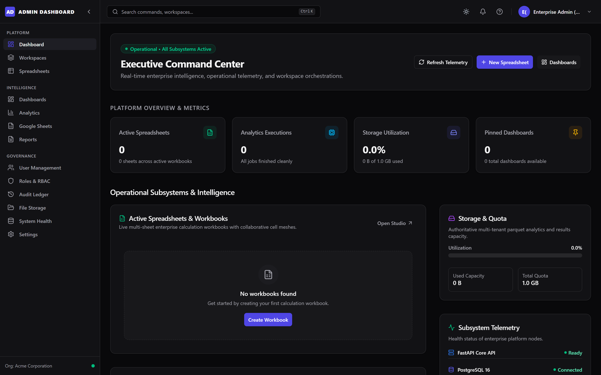
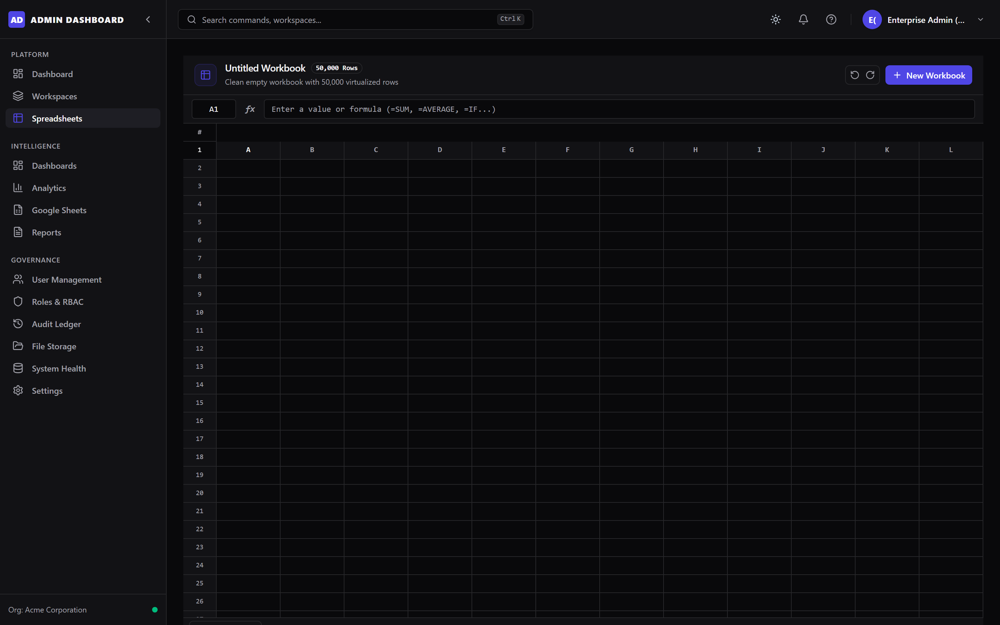
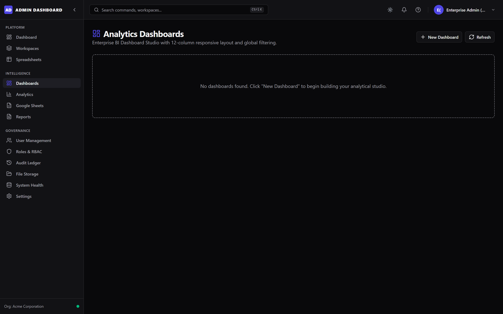
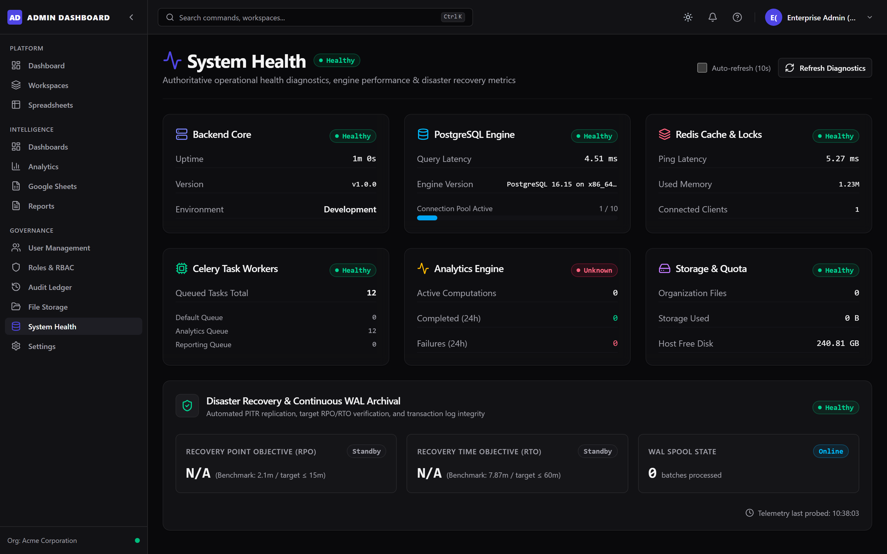
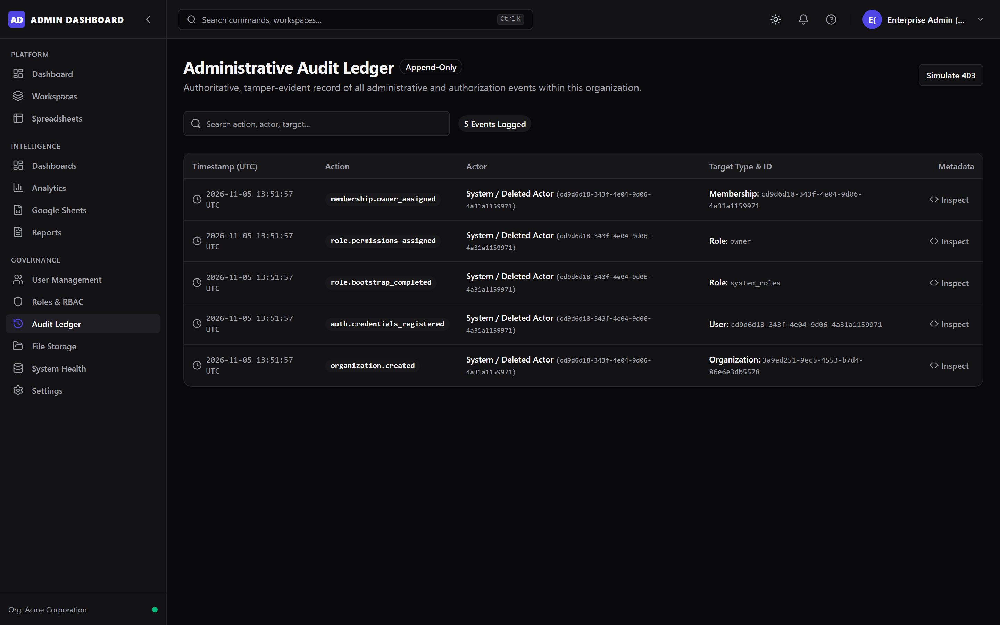
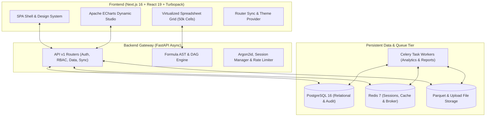

# Admin Dashboard
### Enterprise Data Intelligence, Calculation Engine & Governance Platform

[](#)
[](#)
[](#)
[](#)
[](#)
[](#)
[](#)
[](#project-genesis--ai-disclosure)

An enterprise-grade administrative platform designed for high-density tabular calculation, distributed analytics, organizational governance, interactive data visualization, and continuous disaster recovery.

---

## Project Genesis & AI Disclosure

> [!IMPORTANT]
> **Built by AI with Human-in-the-Loop Architectural Direction and Intervention**
>
> This entire codebase — spanning full-stack frontend engineering, asynchronous backend APIs, database schemas, cryptographic security layers, formula calculation engines, and automated test suites — was conceived, implemented, debugged, and refined through pair programming between an **autonomous AI coding agent** and **human engineering leadership**.
> 
> The human partner provided architectural boundaries, requirements specifications, visual design reviews, and quality gates, while the AI generated, tested, and iteratively hardened the underlying implementation.

---

## Visual Showcase & Screenshots

### Executive Command Center
*Real-time operational telemetry across all subsystems, pinned dashboards, active workbooks, and quick orchestrations.*


### High-Performance Spreadsheets Subsystem
*50,000+ cell virtualized grid with custom formula parser, dependency graphs, cell formatting, and sheet tabs.*


### Interactive Dashboard Studio & Apache ECharts
*Dynamic multi-widget analytics studio supporting bar, line, scatter, KPI, and pivot visualizations with filter synchronization.*


### Subsystem Health Diagnostics & Continuous Disaster Recovery
*Operational health diagnostics, Continuous WAL Archival, and Point-In-Time Recovery (PITR) RPO/RTO verification.*


### Governance, Compliance & Tamper-Evident Audit Ledger
*Immutable chronological audit records with actor attribution, target resources, and structured JSON metadata inspection.*


---

## Key Capabilities & Modules

### 1. Executive Command Center
- Real-time operational telemetry across all platform subsystems (Database latency, Redis throughput, Celery task queues, disk utilization).
- Pinned dashboard quick-access, live health indicators, and global keyboard command palette (`Ctrl+K` / `Cmd+K`).

### 2. High-Performance Spreadsheets Subsystem
- Virtualized data grid capable of rendering **50,000+ rows and 26+ columns** at 60 FPS using `@tanstack/react-virtual`.
- Custom-built formula parsing engine featuring Lexer/AST evaluation, DAG-based cell dependency tracking, topological sorting, and circular reference detection (`#CYCLE!`).
- Cell version history, undo/redo stacks, and bidirectional Google Sheets synchronization.

### 3. Distributed Analytics Computation Engine
- High-throughput dataset transformations powered by Polars, Apache Arrow, and Parquet storage.
- Multi-tenant sandboxing with CPU thread pinning, memory execution quotas, and snapshot isolation.
- Asynchronous Celery worker queues with real-time status reporting.

### 4. Interactive Dashboard Studio & Visualizations
- Multi-widget dashboard grid engine with draggable, resizable cards.
- Full Apache ECharts integration (bar charts, line graphs, scatter plots, KPI metrics, pivot tables).
- Global dashboard filter state propagation and dynamic query aggregation.

### 5. Multi-Tenant Governance & Security
- Strict multi-tenant data isolation with composite foreign keys and tenant-scoped transaction isolation.
- Role-Based Access Control (RBAC) with fine-grained permission matrices (Owner, Admin, Member, Viewer, Auditor).
- Tamper-evident, immutable audit ledger tracking security actions, authentication events, and data mutations.
- Argon2id password hashing, TOTP Multi-Factor Authentication (AES-256-GCM encrypted secrets), and sliding-window session management.

### 6. Continuous Backup & Automated Disaster Recovery
- Continuous physical streaming WAL archival with PostgreSQL 16 replication.
- Point-in-Time Recovery (PITR) monitoring with real-time RPO (Recovery Point Objective) and RTO (Recovery Time Objective) telemetry.
- Isolated verification sandbox drills validating recovery integrity without production downtime.

---

## Architectural Overview



---

## Tech Stack

| Layer | Technology |
| :--- | :--- |
| **Frontend Framework** | [Next.js 16](https://nextjs.org/) (App Router, Turbopack) |
| **UI Library & State** | [React 19](https://react.dev/), [React Router DOM v7](https://reactrouter.com/), [Tailwind CSS v4](https://tailwindcss.com/) |
| **Visualizations** | [Apache ECharts 6](https://echarts.apache.org/), [Lucide React](https://lucide.dev/) |
| **Component Primitives** | [Radix UI](https://www.radix-ui.com/), [class-variance-authority](https://cva.style/) |
| **Backend Framework** | [FastAPI](https://fastapi.tiangolo.com/) (Asynchronous Python 3.12+) |
| **Database & ORM** | [PostgreSQL 16](https://www.postgresql.org/), [SQLAlchemy 2.0 (Async)](https://www.sqlalchemy.org/), [Alembic](https://alembic.sqlalchemy.org/) |
| **Caching & Message Broker** | [Redis 7](https://redis.io/) (AOF persistence, memory quotas) |
| **Task Queue** | [Celery 5](https://docs.celeryq.dev/) (Distributed execution, isolated worker pools) |
| **Data Engine** | [Polars](https://pola.rs/), [PyArrow](https://arrow.apache.org/docs/python/) (Vectorized Parquet computation) |
| **Testing** | [Vitest](https://vitest.dev/), [Testing Library](https://testing-library.com/), [Playwright](https://playwright.dev/), [Pytest](https://pytest.org/) |

---

## Getting Started

### Prerequisites
- **Docker & Docker Compose** (v20+)
- **Node.js** (v20 or v22 LTS) & **npm**
- **Python** (v3.12 or v3.14) & `venv`

---

### Step 1: Clone & Configure Environment

```bash
git clone https://github.com/your-username/admin-dashboard.git
cd admin-dashboard

# Copy environment configuration template
cp .env.example .env
cp .env.example frontend/.env.local
```

---

### Step 2: Start Infrastructure (PostgreSQL & Redis)

```bash
docker compose up -d postgres redis
```
Verify healthy status:
```bash
docker compose ps
```

---

### Step 3: Initialize and Run Backend

```bash
cd backend

# Create virtual environment
python -m venv .venv

# Activate virtual environment
# Windows (PowerShell)
.\.venv\Scripts\activate
# Linux/macOS
source .venv/bin/activate

# Install dependencies
pip install -r requirements.txt

# Run database schema migrations
alembic upgrade head

# Start FastAPI development server
uvicorn app.main:app --host 127.0.0.1 --port 8000 --reload
```
- Interactive API Documentation: **http://127.0.0.1:8000/docs**
- Health Probe: **http://127.0.0.1:8000/health**

---

### Step 4: Initialize and Run Frontend

In a separate terminal:

```bash
cd frontend

# Install dependencies
npm install

# Option A: Fast Development Server (Turbopack)
npm run dev

# Option B: Optimized Production Build
npm run build
npm run start
```
- Web Application: **http://localhost:3000**

---

## Default Demo Credentials

For quick evaluation in local development:
- **Email:** `admin@vibe.enterprise`
- **Password:** `Password1234!`
- **Role:** Organization Owner / System Administrator

---

## Testing & Quality Assurance

Both frontend and backend include comprehensive test suites designed for zero regressions:

### Frontend Tests (Vitest & ESLint)
```bash
cd frontend

# Run unit and integration component tests (18 suites, 145 tests)
npm run test

# Run ESLint validation (0 errors, 0 warnings enforced)
npm run lint

# Run End-to-End browser tests (requires running backend & frontend)
npx playwright test
```

### Backend Tests (Pytest)
```bash
cd backend
source .venv/bin/activate  # or .\.venv\Scripts\activate on Windows

# Run unit tests (135 tests)
pytest tests/unit

# Run full integration test suite
pytest tests/integration
```

---

## Project Structure

```text
admin-dashboard/
├── .github/
│   └── workflows/ci.yml           # Automated CI testing & quality checks
├── backend/
│   ├── alembic/                   # Database versioning and migrations
│   ├── app/
│   │   ├── analytics/             # Sandboxed Polars/Arrow computation
│   │   ├── api/v1/routers/        # Modular FastAPI endpoint controllers
│   │   ├── core/                  # Security, Argon2id, config, exceptions
│   │   ├── db/                    # SQLAlchemy engine & async session factory
│   │   ├── formula/               # Custom AST formula parser & DAG engine
│   │   ├── models/                # Database models & relationships
│   │   ├── repositories/          # Data access abstraction layer
│   │   ├── services/              # Business logic & domain coordinators
│   │   └── tasks/                 # Celery asynchronous task definitions
│   ├── tests/                     # Unit & integration test suites
│   ├── Dockerfile                 # Backend container definition
│   └── requirements.txt           # Python package specifications
├── frontend/
│   ├── src/
│   │   ├── app/                   # Next.js App Router (21 unified pages)
│   │   ├── components/            # UI design system, ECharts, Grid, Shell
│   │   └── lib/                   # API clients, spreadsheet types, utilities
│   ├── public/                    # Static brand assets
│   ├── vitest.config.ts           # Vitest unit testing configuration
│   └── package.json               # Frontend dependencies & scripts
├── docker-compose.yml             # Local multi-service orchestration
├── .env.example                   # Environment variable template
└── README.md                      # Platform documentation
```

---

## Security & Production Readiness

- **Environment Isolation**: Production secrets, session encryption keys, and private credentials are excluded via `.gitignore`.
- **Content Security Policy**: Hardened headers (`Strict-Transport-Security`, `X-Content-Type-Options`, `X-Frame-Options: DENY`, `Referrer-Policy: strict-origin-when-cross-origin`).
- **Session Protection**: HTTP-only, SameSite strict/lax cookies with automatic activity refresh and absolute TTL expiration.
- **Audit Trails**: Tamper-evident structured records with IP capture, user-agent auditing, and actor IDs.

---

## License

This project is licensed under the MIT License - see the LICENSE file for details.
