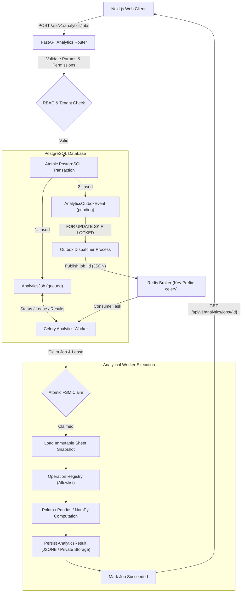

# ADR 002: Analytics Execution Architecture, Celery/Redis Integration & Transactional Outbox

**Status:** Accepted  
**Date:** November 1, 2026  
**Context:** Phase 7 — Analytics Engine, Python Data Processing & Background Job Infrastructure  
**Authors:** VIBE Core Engineering Team  

---

## 1. Context and Problem Statement

The VIBE platform requires a scalable, secure, and resource-controlled analytical calculation subsystem that allows organization members to perform Python-powered analysis (descriptive statistics, dataset profiling, grouped aggregations, correlation matrices, safe filtering, and data quality profiling) against spreadsheet datasets up to 50,000 rows.

A key architectural challenge is executing analytical jobs without blocking the synchronous FastAPI web server, ensuring transactional guarantees on job scheduling, avoiding loss of scheduled jobs during process crashes or Redis restarts, enforcing strict tenant isolation, and bounding memory usage on the 16 GB development machine (with ~7.6 GB Docker memory limits).

---

## 2. Decision Factors & Evaluated Alternatives

### 2.1 Execution Model: Synchronous API vs Background Workers
- **Option A (Synchronous in FastAPI request-response loop):**
  - *Pros:* Simple request-response lifecycle; no queue or worker processes.
  - *Cons:* Analytical processing on 50,000 rows takes hundreds of milliseconds to several seconds of CPU time, blocking asynchronous event loops or consuming Uvicorn worker threads. Subject to HTTP client timeouts, proxy timeouts, and connection drops. Uncontrolled CPU/memory consumption could starve HTTP traffic.
- **Option B (Asynchronous Background Execution via Task Queue):**
  - *Pros:* Decouples client HTTP request from compute; client receives HTTP 202 Accepted immediately with job ID; workers execute under isolated OS/container process boundaries; allows cancellation, progress reporting, retries, and bounded queue concurrency.
  - *Decision:* **Option B (Asynchronous Background Execution)** is selected.

### 2.2 Broker & Task Processing: Celery + Redis vs Alternatives
- **Option A (Native FastAPI `BackgroundTasks`):**
  - *Pros:* Zero external dependencies.
  - *Cons:* Tasks execute within the same process and event loop thread pool as FastAPI; unmanaged memory leaks crash the web server; tasks are lost on server restart; no distributed workers or queue management.
- **Option B (PostgreSQL-only SKIP LOCKED Polling Queue):**
  - *Pros:* Uses existing database; zero Redis broker dependency.
  - *Cons:* High database connection consumption and polling load for high job throughput; lacks built-in task acknowledgment, worker loss redelivery, and prefetch flow control.
- **Option C (Celery with Redis Broker):**
  - *Pros:* Standard Python distributed task queue; mature worker process management, task timeouts, JSON serialization, prefetch multiplier control, and worker recycling (`max_tasks_per_child`). Uses the existing Redis 7 container with AOF persistence already running in the stack.
  - *Cons:* Requires Redis broker separation and operational monitoring.
  - *Decision:* **Option C (Celery with Redis Broker)** is selected. To maintain security and avoid key collision, Celery tasks use dedicated Redis key prefixes (`celery:` or Redis DB 0 / namespace) isolated from Redis session tokens and rate limits.

### 2.3 Source of Truth: PostgreSQL Job Tracking vs Redis Result Backend
- **Option A (Celery Redis Result Backend):**
  - *Pros:* Default Celery pattern.
  - *Cons:* Redis memory is volatile and finite; analytical results can expire or get evicted under memory pressure (`noeviction` raises errors); complex tenant querying and access control inside Redis keys; lacks relational joins with organizations, sheets, and users.
- **Option B (PostgreSQL Authoritative Job & Result State):**
  - *Pros:* ACID durability; strict organization scoping and composite foreign key enforcement; transactional state transitions using conditional updates (`WHERE status = 'running'`); persistent queryability for UI job lists; immutable result records. Celery result backend is disabled (`task_ignore_result = True`).
  - *Decision:* **Option B (PostgreSQL Authoritative Job & Result State)** is selected. Redis is treated strictly as a transient message broker.

### 2.4 Scheduling Reliability: Transactional Outbox vs Direct Task Publishing
- **Option A (Direct Publishing in API Endpoint):**
  - *Risk (Dual-Write Anti-Pattern):* If the API commits the job record to PostgreSQL and crashes before calling `celery.send_task()`, an orphaned job is stuck in `queued` forever. If the API publishes to Redis first and the database commit fails, the worker executes a ghost job with no database record.
- **Option B (Transactional Outbox Pattern):**
  - *Design:* When an analytics job is requested, both the `AnalyticsJob` and an `AnalyticsOutboxEvent` are committed in the **exact same PostgreSQL transaction** via `transaction(session)`. A lightweight, independent Outbox Dispatcher polls `analytics_outbox_events` using `SELECT ... FOR UPDATE SKIP LOCKED`, dispatches the task containing only `{job_id}` to Redis, and marks the event `published_at = NOW()`.
  - *Decision:* **Option B (Transactional Outbox)** is selected. Guarantees zero dropped jobs even during Redis downtime or process termination.

### 2.5 Worker Process Isolation & Safety
- **Operation Allowlist Registry:** The worker never executes arbitrary client-provided Python code, lambdas, or SQL. All analytical execution is restricted to predefined registered operations (`profile_dataset`, `describe_columns`, `group_by_aggregate`, `filter_dataset`, `correlation_matrix`, `data_quality_profile`).
- **Resource Constraints:** Celery worker runs with concurrency=1 initially, memory recycling (`max_memory_per_child = 1000000` kB / 1 GB), task time limits (soft: 60s, hard: 90s), and JSON-only serialization (pickle completely forbidden).

---

## 3. Architecture Specification

---

## 4. Operational Diagnostics & Failure Recovery

1. **Broker Outage:** If Redis goes down, the API continues accepting and committing jobs into PostgreSQL outbox. When Redis recovers, the Dispatcher resumes publication without job loss.
2. **Worker Crash & Lease Expiration:** Each active job holds a worker lease (`lease_expires_at`). If a worker dies mid-execution, a periodic recovery sweep detects expired leases on `running` jobs and reschedules them up to `max_attempts = 3`.
3. **Idempotent Retries:** Every job is bound to a unique `(organization_id, idempotency_key)` index. If a duplicate task is received by a worker, the worker verifies job status and skips execution if already terminal or claimed.

---

## 5. Architectural Decision Acceptance
- **Accepted:** Celery 5.6 with Redis broker, PostgreSQL-authoritative job state, Transactional Outbox with SKIP LOCKED, allowlist Operation Registry, and Polars/NumPy/Pandas execution engine.

