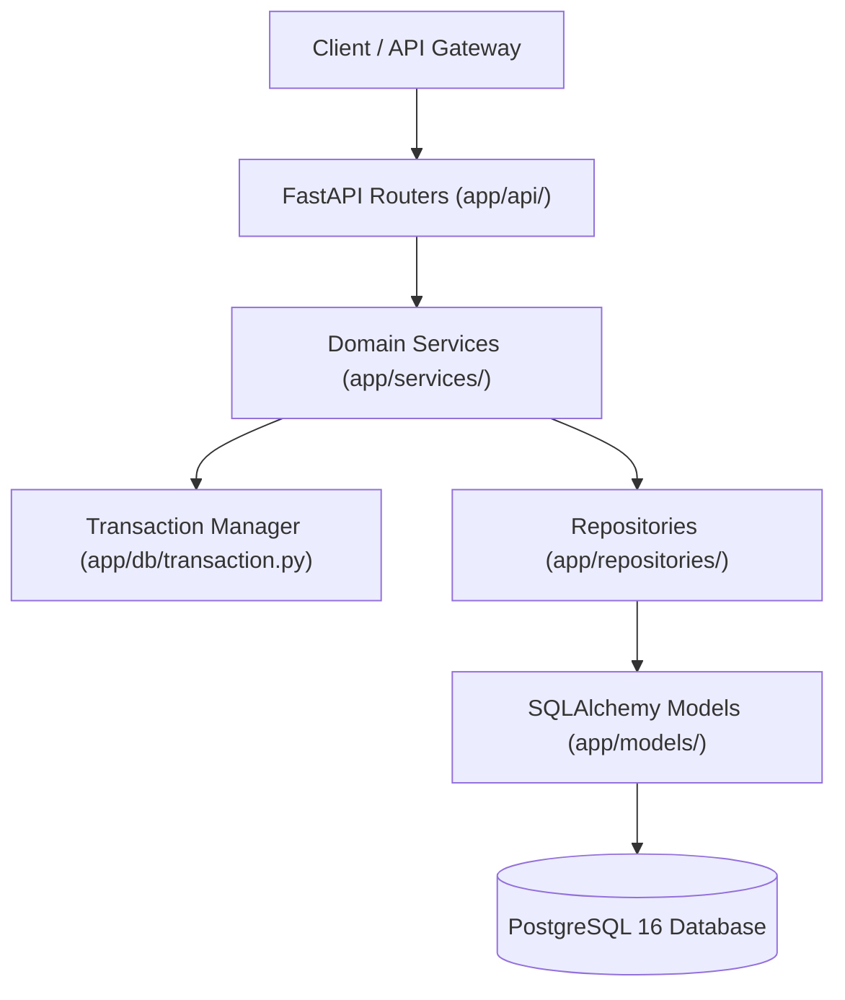
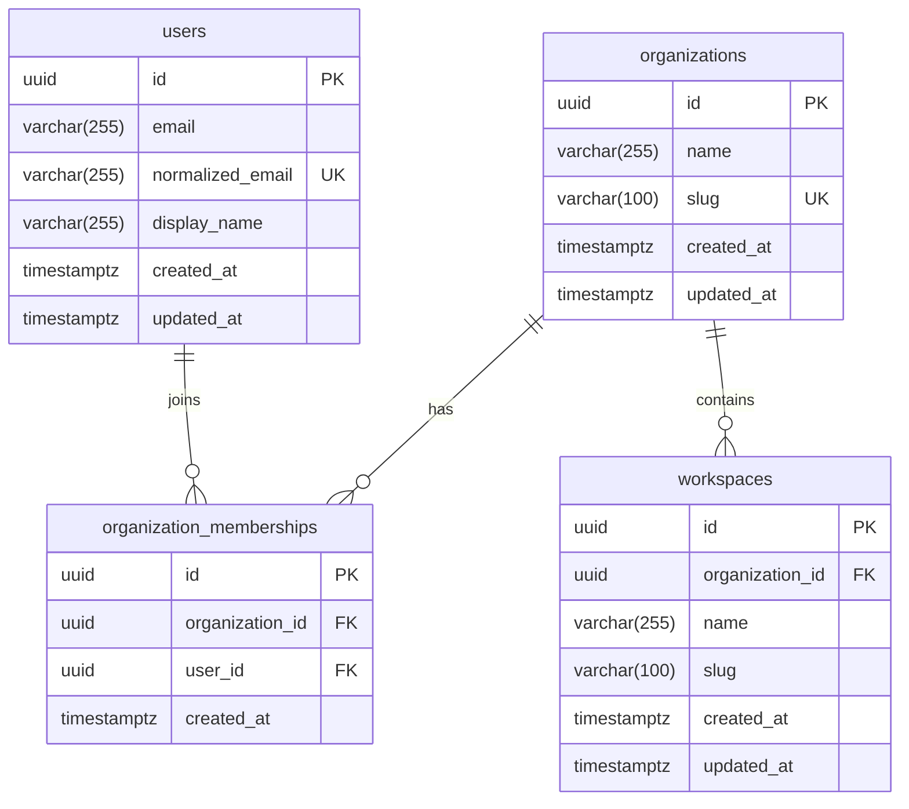

# VIBE Platform — Backend Architecture & Multi-Tenant Data Foundation

## 1. Architectural Principles & Boundaries

The VIBE backend is structured around a strict layered architecture built with FastAPI, SQLAlchemy 2.x (Asyncio), PostgreSQL 16, and Pydantic v2.



### Module Responsibilities

| Layer | Directory | Responsibilities | Forbidden Patterns |
| :--- | :--- | :--- | :--- |
| **API** | `app/api/` | HTTP transport, status codes, route parameters, response formatting | Business logic, direct DB queries, transaction control |
| **Services** | `app/services/` | Business workflows, multi-step orchestration, transaction boundaries | Direct SQL strings, HTTP request parsing, formatting responses |
| **Repositories** | `app/repositories/` | Async query execution, filtering, pagination, ORM mapping | Transaction commits (`commit()`), rollbacks, business rules |
| **Models** | `app/models/` | Declarative table definitions, UUID primary keys, foreign keys, cascades | Business validations, query methods |
| **Schemas** | `app/schemas/` | Pydantic validation, serialization, email normalization | Database engine dependencies |
| **DB & Core** | `app/db/`, `app/core/` | Engine pool, declarative base, transaction context manager, exceptions | Domain entity specifics |

---

## 2. Entity Relationship Diagram (ERD)

The four foundational entities provide a secure, strict multi-tenant boundary:



### Constraints & Indexes
- **Organizations:**
  - `pk_organizations` on `id`
  - `ix_organizations_slug` (UNIQUE) on `slug`
- **Users:**
  - `pk_users` on `id`
  - `ix_users_normalized_email` (UNIQUE) on `normalized_email`
- **Organization Memberships:**
  - `pk_organization_memberships` on `id`
  - `fk_organization_memberships_organization_id_organizations` (`ON DELETE CASCADE`)
  - `fk_organization_memberships_user_id_users` (`ON DELETE CASCADE`)
  - `uq_organization_memberships_org_user` (UNIQUE) on `(organization_id, user_id)`
  - Indexes on `organization_id` and `user_id`
- **Workspaces:**
  - `pk_workspaces` on `id`
  - `fk_workspaces_organization_id_organizations` (`ON DELETE CASCADE`)
  - `uq_workspaces_org_slug` (UNIQUE) on `(organization_id, slug)`
  - Index on `organization_id` and `slug`

---

## 3. Transaction Ownership, Savepoints & Concurrency Handling

Repositories **never** independently commit transactions. The service layer owns the unit of work via `app.db.transaction.transaction(session)`:

```python
async with transaction(self.session):
    # 1. Create Organization
    await self.org_repo.create(org)
    
    # 2. Get or create Owner User
    await self.user_repo.create(user)
    
    # 3. Create Membership
    await self.membership_repo.create(membership)
    
    # 4. Create Default Workspace
    await self.workspace_repo.create(workspace)
```

### Explicit Unit of Work Transaction Boundary Policy
In SQLAlchemy 2.0, ordinary read queries (such as `session.execute(select(...))`) automatically trigger **autobegin**, causing `session.in_transaction()` to return `True` even when no business transaction has been explicitly initiated. Relying solely on `session.in_transaction()` to switch to `session.begin_nested()` causes read-before-write methods to open savepoints instead of root transactions, leaving mutations uncommitted when the session closes.

To guarantee deterministic transaction boundaries, `app.db.transaction.transaction` uses session-scoped depth tracking (`session.info["_explicit_tx_depth"]`):

1. **Root Transaction Owner (`depth == 0` & no caller transaction):**
   - If no explicit Unit of Work is active, this block claims ownership of the root transaction.
   - If the session was idle (`not session.in_transaction()`), it begins and manages the transaction via `session.begin()`.
   - If a transaction was already autobegun by prior SELECT queries (where calling `session.begin()` would raise `InvalidRequestError`), it commits the autobegun transaction upon clean block exit, or rolls it back on exception or task cancellation (`except BaseException:`).
   - Guarantees all writes are committed to the database upon exit.

2. **Caller-Owned or Nested Transaction / Savepoint:**
   - If an outer explicit transaction boundary is already active—either via an enclosing helper block (`depth > 0`), an active external nested transaction (`session.in_nested_transaction()`), or an explicit caller-owned root transaction (`root_tx.origin == BEGIN` where `root_tx = session.sync_session.get_transaction()`)—this block creates a nested PostgreSQL `SAVEPOINT` via `session.begin_nested()`.
   - All detection relies exclusively on documented SQLAlchemy public methods (`session.in_transaction()`, `session.in_nested_transaction()`, `session.sync_session.get_transaction()`) with zero private attribute access.
   - Clean exit releases the savepoint without committing the caller's outer transaction.
   - Unhandled exceptions or task cancellation roll back strictly to the savepoint and re-raise, preserving the surrounding caller's Unit of Work and leaving the outer transaction active for the caller to manage.
   - Never calls `session.commit()` or `session.rollback()` indiscriminately from nested handlers.
   - Never swallows exceptions or `asyncio.CancelledError`.

### Service Behavior Under Different Session States
| Service Context | Session State When Service is Invoked | Transaction Helper Behavior | On Clean Exit | On Unhandled Error or Cancellation |
| :--- | :--- | :--- | :--- | :--- |
| **Fresh Session** | Idle (`in_transaction == False`, `depth == 0`) | Begins root transaction via `session.begin()` | Commits root transaction | Rolls back root transaction; depth reset |
| **Prior Read Query** | Autobegun (`in_transaction == True`, `in_nested == False`, `origin == AUTOBEGIN`, `depth == 0`) | Takes ownership of autobegun transaction | Commits root transaction via `await session.commit()` | Rolls back root transaction via `await session.rollback()`; depth reset; re-raises |
| **Caller `session.begin()`** | Explicitly Started (`in_transaction == True`, `origin == BEGIN`, `depth == 0`) | Protects caller transaction; creates savepoint via `session.begin_nested()` | Releases savepoint; outer caller tx remains active & uncommitted | Rolls back to savepoint; outer caller tx remains active; re-raises |
| **Caller `session.begin_nested()`** | Caller Nested Active (`in_nested_transaction == True`) | Protects caller savepoint; creates savepoint via `session.begin_nested()` | Releases savepoint; outer caller savepoint remains active & uncommitted | Rolls back to savepoint; outer caller savepoint remains active; re-raises |
| **Outer `transaction()` Helper** | Explicitly Managed (`depth > 0`) | Creates savepoint via `session.begin_nested()` | Releases savepoint; outer tx remains open | Rolls back to savepoint; outer tx remains valid; re-raises |

### Concurrency and Unique Constraint Collision Handling
In high-concurrency environments, check-then-insert patterns (such as `get_or_create_user`) can encounter race conditions where two workers concurrently observe that an entity does not exist, and both attempt insertion.
- The `UserService.get_or_create_user` method wraps user creation in a savepoint transaction.
- When a race occurs, PostgreSQL enforces the unique constraint (`ix_users_normalized_email`) and raises `IntegrityError`.
- The method catches `IntegrityError`, the savepoint cleanly rolls back the failed insert without corrupting the surrounding transaction, and the service re-queries the database to return the newly committed record from the winning transaction:

```python
try:
    async with transaction(self.session):
        await self.repo.create(user)
    return UserRead.model_validate(user), True
except IntegrityError:
    # Concurrent insert collision handled via savepoint rollback
    existing = await self.repo.get_by_normalized_email(normalized)
    if existing:
        return UserRead.model_validate(existing), False
    raise
```

---

## 4. Multi-Tenant Data Isolation & Safe Public Error Policy

Organization boundaries are the primary authorization perimeter:

### 1. Mandatory Organization Scope in Queries
All workspace and child-entity queries require an explicit `organization_id` filter:
```python
# Strictly scoped to tenant:
stmt = select(Workspace).where(
    Workspace.id == workspace_id,
    Workspace.organization_id == organization_id
)
```

### 2. Information-Leakage Defense (404 vs 403 Policy)
- **Enumeration Attack Prevention:** If a client requests a resource ID that belongs to another tenant, returning HTTP 403 would confirm the resource exists, enabling attackers to probe and enumerate valid entity UUIDs across tenants.
- **Unified Public Response (HTTP 404):** The API returns a consistent HTTP 404 `ENTITY_NOT_FOUND` ("Resource not found.") whether an ID does not exist or belongs to another organization.
- **Internal Security Audit Logging:** When cross-tenant access is attempted, the service layer logs an internal structured security warning (`logger.warning("Security Alert: Cross-tenant access attempt: ...")`) capturing the attempted ID, requesting organization, and owning organization for SIEM audit trails without leaking details to external clients.

### 3. Database Cascades as Defense-in-Depth
All foreign keys specify `ondelete="CASCADE"`. Deleting an organization cleanly removes all associated workspaces and memberships in a single database operation.

---

## 5. Migration Workflow (Alembic)

Alembic migrations use synchronous `psycopg` connections configured in `backend/alembic/env.py`.

### Migration Commands
```bash
# Apply pending migrations to database
cd backend && alembic upgrade head

# Check current revision status
cd backend && alembic current

# View revision history tree
cd backend && alembic history

# Generate a new incremental revision
cd backend && alembic revision --autogenerate -m "describe_changes"
```

### Safety Rules
- Existing migration revisions (`f50478da1aca`, `5b9cdc88b118`) are permanent and immutable.
- Never downgrade the live development database merely for verification; use a disposable database (`vibe_migration_test`) for upgrade/downgrade lifecycle testing.

---

## 6. Authentication Integration (Phase 4 Implemented)

In Phase 4, the authentication layer was integrated on top of `User` and `OrganizationMembership`:
1. **Credentials & Sessions:** User authentication records (`UserCredentials` with Argon2id password hashes) link 1:1 to `users.id`. Authoritative server-side sessions (`AuthenticationSession`) persist token digests and session state in PostgreSQL.
2. **Strict Tenant Context Resolution:**
   - **CRITICAL SECURITY REQUIREMENT:** The active tenant context (`organization_id`) is **NEVER** accepted from untrusted client inputs.
   - FastAPI dependencies (`get_current_user`, `get_current_session`, and `get_current_tenant`) extract and validate the session cookie, verify active membership in `OrganizationMembership`, and inject verified tenant context into domain services.
   - If membership is removed in PostgreSQL, access is immediately blocked with HTTP 403 Forbidden.
3. **MFA & Account Security:** RFC 6238 TOTP with AES-256-GCM secret encryption, time-step replay prevention, single-use recovery codes, and sliding-window Redis rate limiting with HMAC-keyed privacy digests.
4. **Complete Documentation:** See [`docs/security/authentication-security.md`](file:///D:/vibe/docs/security/authentication-security.md) for full details.

---

## 7. Role-Based Access Control & Organization Administration (Phase 5 Implemented)

In Phase 5, the authorization and organization administration layer was established:
1. **Authorization Data Model:** `OrganizationRole`, `Permission`, `RolePermission`, `MembershipRole`, `OrganizationInvitation`, and `AdministrativeAuditEvent`.
2. **Authoritative Evaluation:** Single SQL join across 5 tables evaluates active effective permissions without N+1 queries or stale Redis cache sync risks.
3. **Delegation & Anti-Escalation:** Admins cannot create roles with permissions they lack, cannot assign roles exceeding their permissions, cannot assign the Owner role, and cannot modify system roles.
4. **Last-Owner Protection:** Row-level locks (`SELECT ... FOR UPDATE`) serialize concurrent demotions/removals and prevent removing or demoting the last Owner of an organization.
5. **Complete Documentation:** See [`docs/security/rbac-authorization.md`](file:///D:/vibe/docs/security/rbac-authorization.md) for full details.

---

## 8. Extending With New Domains

To add a new domain (e.g. `Spreadsheet` in Phase 6 or `Report` in Phase 9):
1. **Model:** Add `app/models/<domain>.py` inheriting from `Base`. Always include `organization_id: Mapped[UUID] = mapped_column(ForeignKey("organizations.id", ondelete="CASCADE"), nullable=False, index=True)`.
2. **Schema:** Add `app/schemas/<domain>.py` with separate Create, Update, and Read schemas.
3. **Repository:** Add `app/repositories/<domain>.py` with queries strictly filtered by `organization_id`.
4. **Service:** Add `app/services/<domain>.py` implementing business validation and transaction boundaries.
5. **Migration:** Run `alembic revision --autogenerate -m "create_<domain>_table"` and verify upgrade/downgrade paths.

---

## 9. Spreadsheet Subsystem Architecture (Phase 6)

The spreadsheet subsystem (`app/models/spreadsheet.py`, `app/formula/`, `app/services/spreadsheet.py`) implements a hybrid tabular storage architecture (ADR 001):
- **Workbooks & Sheets**: Tenant-isolated multi-workbook hierarchy with composite foreign keys `(id, organization_id)`.
- **Hybrid Storage Engine**: Dense row JSONB storage (`sheet_rows`) for 1.12ms viewport queries, paired with relational dependency graph table (`sheet_cell_dependencies`) for 1.68ms formula precedent lookups.
- **Formula Engine**: Pure Python tokenizer, AST parser, and evaluator supporting arithmetic, comparison, aggregation (`SUM`, `AVERAGE`, `COUNT`, `MIN`, `MAX`), conditionals (`IF`), and typed formula errors (`#DIV/0!`, `#REF!`, `#VALUE!`, `#NAME?`, `#CYCLE!`, `#NUM!`).
- **Recalculation & Cycles**: Topological dependency sorting with cycle detection (`#CYCLE!`).
- **Optimistic Locking**: Integer row versions rejecting stale concurrent updates with HTTP 409 Conflict.
- **Audit Revision History**: Bounded revision ledger supporting reversible undo/redo with automatic dependent recalculation.

---

## 10. Analytics Subsystem & Background Worker Architecture (Phase 7)

Phase 7 introduces scalable, resource-controlled analytical computation against tabular datasets:
- **Python Data Processing**: Apache Arrow-backed Polars 2.1, Pandas 3.1, and NumPy 2.5 routines executed strictly via an allowlisted `OperationRegistry`.
- **Transactional Outbox Pattern**: Analytical jobs are scheduled transactionally alongside an outbox event in PostgreSQL (`analytics_outbox_events`). An asynchronous `OutboxDispatcher` daemon pulls events with `SELECT ... FOR UPDATE SKIP LOCKED` and publishes jobs to the Redis broker.
- **Celery 5.6 & Redis 7**: Durable background job execution with cooperative cancellation checkpoints, atomic worker claims (`UPDATE ... SET status='running', lease_expires_at=...`), and automatic lease recovery sweeps for stale workers.
- **Immutable Parquet Snapshots**: Version-bound Apache Parquet snapshot artifacts (`uploads/analytics/snapshots/`) with SHA-256 integrity validation isolate analytical workloads from concurrent spreadsheet cell modifications.
- **Spreadsheet Publishing**: Tabular results can be published directly into new sheets in existing workbooks via atomic batch mutations.
- **Complete Documentation**: See [`docs/architecture/analytics-engine.md`](file:///D:/vibe/docs/architecture/analytics-engine.md) for full details.


