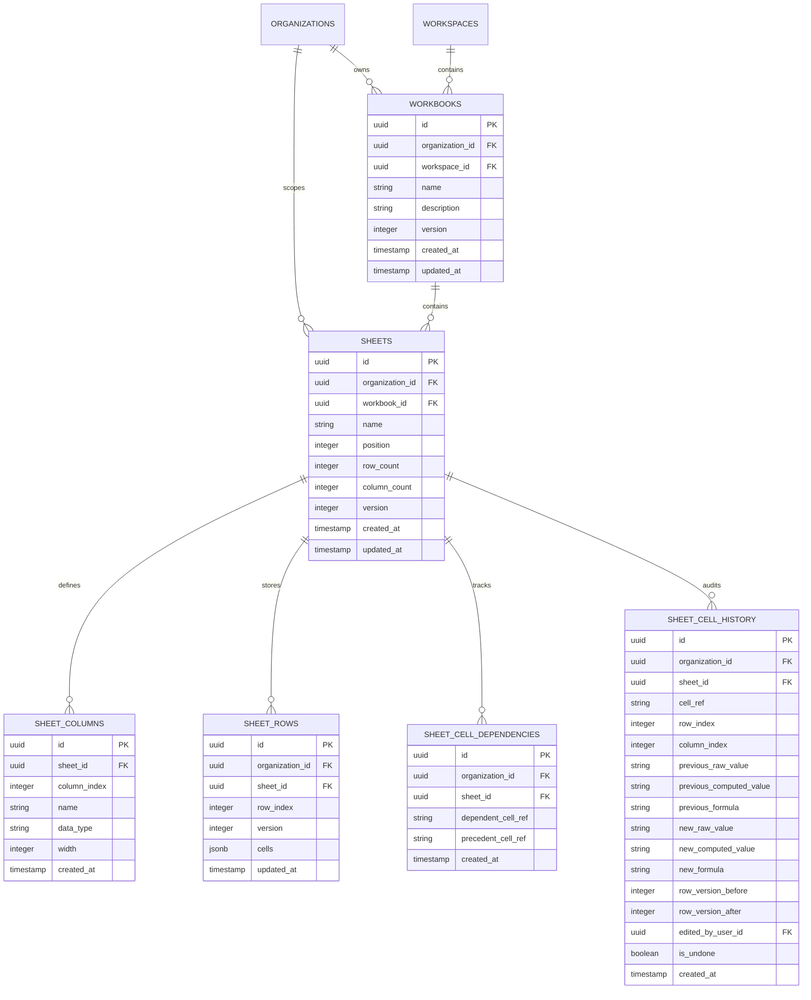
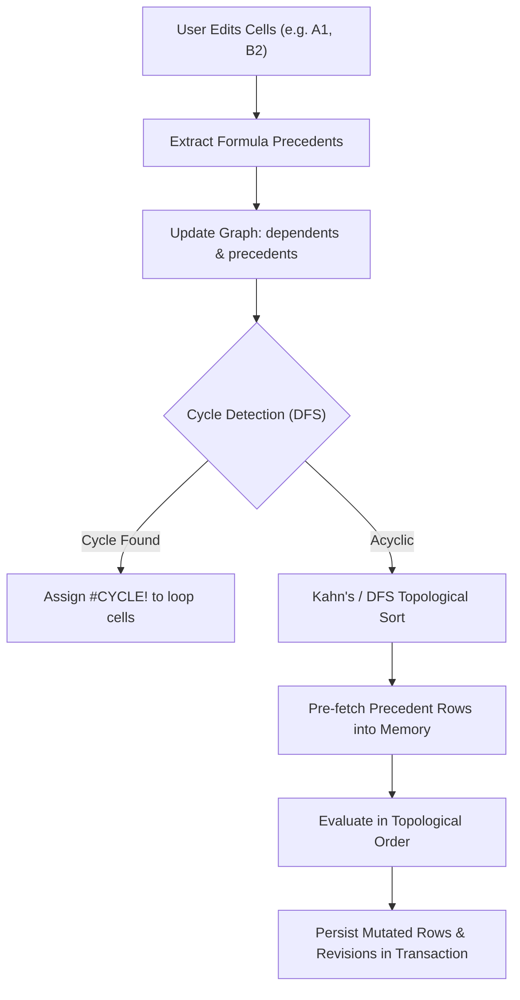

# Spreadsheet Engine & Virtualized Grid Architecture

This document specifies the technical architecture, mathematical grammar, dependency resolution, database schema, concurrency controls, and virtualized rendering pipeline of the VIBE Spreadsheet Subsystem (Phase 6).

---

## 1. Subsystem Overview

The VIBE Spreadsheet Subsystem is an enterprise-grade calculation and tabular data engine providing:
1. **Tenant-Isolated Multi-Workbook Architecture**: Workbooks, sheets, columns, and rows strictly scoped to organizations with database-enforced composite foreign keys.
2. **Hybrid Storage Engine**: Dense row JSONB storage for rapid viewport range windowing paired with relational formula dependency records for fast directed graph traversals (ADR 001).
3. **Deterministic Formula Engine**: Pure Python tokenizer, recursive descent AST parser, and evaluator supporting arithmetic, comparison, aggregation (`SUM`, `AVERAGE`, `COUNT`, `MIN`, `MAX`), conditionals (`IF`), and typed formula errors (`#DIV/0!`, `#REF!`, `#VALUE!`, `#NAME?`, `#CYCLE!`, `#NUM!`).
4. **Topological Dependency Graph**: Directed acyclic graph tracking cell dependencies, DFS cycle detection, and topological ordering for cascading downstream recalculation.
5. **Optimistic Concurrency Control**: Row-level versioning enforcing atomic multi-user editing with HTTP 409 Conflict rejection on stale updates.
6. **Bounded Undo / Redo**: Reversible audit revision history restoring prior cell states and recalculating dependents.
7. **Virtualized Frontend Grid**: 50,000-row 60fps rendering using `@tanstack/react-virtual` with formula bar synchronization and keyboard navigation.

---

## 2. Entity-Relationship Model



### Database-Level Tenant Isolation
Cross-tenant references are prevented at the database schema level via composite foreign keys:
- `workbooks` references `workspaces(id, organization_id)`.
- `sheets` references `workbooks(id, organization_id)`.
- `sheet_rows` references `sheets(id, organization_id)`.
- `sheet_cell_dependencies` references `sheets(id, organization_id)`.
- `sheet_cell_history` references `sheets(id, organization_id)`.

Attempts to associate a workbook or sheet with a foreign organization fail immediately with `ForeignKeyViolation`.

---

## 3. Storage Architecture Decision (ADR 001)

As documented in `docs/architecture/adr/001-spreadsheet-storage-architecture.md`, storage architecture was empirically selected through PostgreSQL benchmarks on 50,000 rows × 20 columns (~255,000 cells):

| Storage Approach | 50K Row Disk Footprint | 100-Row Viewport Query | Formula Dependency Lookup | Decision |
|---|---|---|---|---|
| **Approach 1: Row JSONB Only** | 27.77 MB | 1.27 ms | 73.76 ms (Slow table scan) | Rejected (Slow recalc) |
| **Approach 2: Normalized Cells** | 49.35 MB (+77.7%) | 1.24 ms | 3.99 ms | Rejected (Large footprint) |
| **Approach 3: Hybrid (JSONB + Relational Deps)** | **29.48 MB (+6.1%)** | **1.12 ms** | **1.68 ms (43.9x faster)** | **ACCEPTED** |

The hybrid approach stores dense cell values (`v`), computed results (`c`), formulas (`f`), types (`t`), and errors (`err`) inside `sheet_rows.cells` (JSONB) while indexing dependency links in `sheet_cell_dependencies` with composite B-tree indices on `(sheet_id, dependent_cell_ref)` and `(sheet_id, precedent_cell_ref)`.

---

## 4. Deterministic Formula Engine

The formula calculation engine (`backend/app/formula/`) is implemented as an isolated, deterministic Python package without external runtime dependencies.

### 4.1 Grammar & Operators

```ebnf
Formula        ::= "=" Expression
Expression     ::= ComparisonExpr
ComparisonExpr ::= AdditiveExpr ( ("=" | "<>" | "<" | "<=" | ">" | ">=") AdditiveExpr )*
AdditiveExpr   ::= MultiplicativeExpr ( ("+" | "-") MultiplicativeExpr )*
Multiplicative ::= PowerExpr ( ("*" | "/") PowerExpr )*
PowerExpr      ::= UnaryExpr ( "^" PowerExpr )*    (* Right-associative *)
UnaryExpr      ::= ("+" | "-")? PrimaryExpr
PrimaryExpr    ::= Number | String | Boolean | CellRef | RangeRef | FunctionCall | "(" Expression ")"
FunctionCall   ::= IDENTIFIER "(" ( Expression ( "," Expression )* )? ")"
CellRef        ::= [A-Za-z]+ [1-9][0-9]*
RangeRef       ::= CellRef ":" CellRef
```

### 4.2 AST Node Structure
- `LiteralNode(value, type)`: Numbers (`float | int`), strings (`str`), booleans (`bool`).
- `CellRefNode(ref, coord)`: Coordinate-resolved cell pointer (e.g., `A1` -> `{row: 0, col: 0}`).
- `RangeRefNode(range_str, cell_range)`: Bounded rectangular range of cells (e.g., `A1:B10`).
- `UnaryOpNode(op, operand)`: Unary prefix operations (`+`, `-`).
- `BinaryOpNode(op, left, right)`: Infix operators (`+`, `-`, `*`, `/`, `^`, `=`, `<>`, `<`, `<=`, `>`, `>=`).
- `FunctionCallNode(func_name, args)`: Evaluated built-in functions (`SUM`, `AVERAGE`, `COUNT`, `MIN`, `MAX`, `IF`).

### 4.3 Safety Limits
- `MAX_FORMULA_LENGTH = 1,000` characters.
- `MAX_AST_NODES = 250` nodes.
- `MAX_PARSE_DEPTH = 30` nested levels.
- `MAX_RANGE_CELLS = 10,000` cells per range reference.

### 4.4 Function Semantics & Short-Circuit Lazy Evaluation
- **Mathematical**: `SUM(range)`, `AVERAGE(range)`, `MIN(range)`, `MAX(range)`, `COUNT(range)`.
- **Conditional Short-Circuit (`IF`)**:
  `IF(condition, true_branch, false_branch)` implements strict **lazy (short-circuit) evaluation**:
  1. The `condition` expression is evaluated first.
  2. If the condition is truthy (non-zero number or `TRUE`), **only** the `true_branch` is evaluated; the `false_branch` is completely skipped.
  3. If the condition is falsy (zero or `FALSE`), **only** the `false_branch` is evaluated; the `true_branch` is completely skipped.
  4. Example: `=IF(1=1, 42, 1/0)` evaluates to `42.0` without evaluating `1/0` (preventing `#DIV/0!`). Conversely, `=IF(1=2, 1/0, 99)` evaluates to `99.0`.

### 4.5 Typed Formula Errors
- `#DIV/0!`: Division by zero or modulo zero.
- `#REF!`: Invalid cell coordinate or out-of-bounds row/column index.
- `#VALUE!`: Incompatible types (e.g. arithmetic on non-numeric text).
- `#NAME?`: Unrecognized function name or invalid token identifier.
- `#CYCLE!`: Circular dependency detected in the calculation graph (persisted to cell and propagated downstream).
- `#NUM!`: Numeric overflow, invalid exponentiation, or math domain errors.

---

## 5. Dependency Graph & Recalculation



### Circular Dependency Detection
Circular references are detected using depth-first search (DFS) with path tracking. If a path returns to an already-active node in the current recursion stack (e.g., `A1 -> B1 -> C1 -> A1`), a cycle is recorded, evaluation terminates safely, and `#CYCLE!` is assigned to the affected cell without infinite loops or recursion depth errors.

---

## 6. Granular Optimistic Concurrency Control

Multi-user editing protects against lost updates using fine-grained **per-cell revisions**:
1. **Per-Cell Revision Metadata**:
   - Each cell inside `sheet_rows.cells` (JSONB) tracks an integer revision: `ver: int`.
   - Initial cell state is version 1; each mutation increments the target cell's version by 1.
2. **Client Concurrency Payloads**:
   - When retrieving cell data via `/range` or `/rows`, the client receives each cell's current `version`.
   - In `POST /api/v1/spreadsheets/sheets/{id}/cells/batch`, the client submits `expected_cell_version` for modified cells.
3. **Serialization & Safe Concurrent Merging**:
   - Mutating transactions lock the parent `Sheet` record via `SELECT ... FOR UPDATE` within an atomic transaction.
   - **Case A (Same Cell Conflict)**: If Transaction 2 submits an edit on `A1` expecting version 2, but Transaction 1 already committed version 3, Transaction 2 is rejected with HTTP 409:
     ```json
     {
       "detail": "Concurrent edit conflict on A1: expected cell version 2, but found 3"
     }
     ```
   - **Case B (Different Cells in Same Row)**: If Session 1 edits `A1` and Session 2 concurrently edits `B1`, both transactions succeed because each inspects only its own target cell version. The JSONB maps are safely merged without either edit overwriting the other.
   - **Case C (Different Rows)**: Edits on separate rows succeed concurrently.
   - **Case D (Overlapping Batch Rollback)**: If an overlapping batch edit contains a stale version on any cell, the entire batch is rejected with HTTP 409, and PostgreSQL transaction rollback ensures none of the batch's edits persist.

---

## 7. Bounded Undo / Redo & Audit History

Cell mutations are tracked in `sheet_cell_history` with atomic batch grouping:
1. **Multi-Cell Batch Grouping**:
   - All cell updates executed within a single mutation request share a single unique `batch_id` (UUID).
   - Undo/redo operations operate atomically on all records sharing the latest `batch_id`.
2. **Revision Conflict Policy**:
   - Before undoing a batch, the system verifies whether any cell in the batch was subsequently modified by a newer active edit (`has_newer_active_edit`).
   - If a cell has been modified by a later edit, undo is rejected with `ConflictError` (HTTP 409), preventing silent overwrites of subsequent edits.
3. **Redo Invalidation**:
   - Submitting any new cell mutation immediately purges all pending redo history (`is_undone = true`) for that sheet.
4. **Bounded Retention & Pruning**:
   - Retention is bounded to `MAX_HISTORY_BATCHES = 100` distinct batches per sheet.
   - Older batches are automatically pruned upon new edits to prevent unbounded disk growth.
5. **Cross-Tenant Isolation**:
   - All history queries, undo, and redo mutations are strictly scoped by `organization_id` with composite foreign key enforcement.

---

## 8. Safety & Resource Caps

To prevent denial of service and ensure predictable latency:
- `MAX_VIEWPORT_ROWS = 200`: Maximum rows requested in `/range`.
- `MAX_VIEWPORT_COLS = 50`: Maximum columns requested in `/range`.
- `MAX_BATCH_CELLS = 500`: Maximum cells updated in a single `/cells/batch` request.
- `MAX_RECALCULATION_NODES = 1000`: Maximum downstream dependent cells allowed in a single recalculation cascade.
- `MAX_HISTORY_BATCHES = 100`: Maximum undo/redo batches retained per sheet.

---

## 9. Versioned REST API Specification

| Endpoint | Method | Permission | Description |
|---|---|---|---|
| `/api/v1/spreadsheets/workbooks` | `POST` | `spreadsheets.create` | Create a workbook with default initial sheet |
| `/api/v1/spreadsheets/workbooks` | `GET` | `spreadsheets.read` | List all workbooks in organization |
| `/api/v1/spreadsheets/workbooks/{id}` | `GET` | `spreadsheets.read` | Get workbook metadata and sheet list |
| `/api/v1/spreadsheets/workbooks/{id}` | `PATCH` | `spreadsheets.update` | Update workbook name or description |
| `/api/v1/spreadsheets/workbooks/{id}` | `DELETE` | `spreadsheets.delete` | Cascade delete workbook and all sheets |
| `/api/v1/spreadsheets/workbooks/{id}/sheets` | `POST` | `spreadsheets.create` | Add sheet to existing workbook |
| `/api/v1/spreadsheets/workbooks/{id}/sheets` | `GET` | `spreadsheets.read` | List sheets for a workbook |
| `/api/v1/spreadsheets/sheets/{id}` | `GET` | `spreadsheets.read` | Get sheet metadata |
| `/api/v1/spreadsheets/sheets/{id}` | `PATCH` | `spreadsheets.update` | Rename or reorder sheet |
| `/api/v1/spreadsheets/sheets/{id}/range` | `GET` | `spreadsheets.read` | Fetch bounded window of cells (`start_row`, `end_row`, `start_col`, `end_col`) |
| `/api/v1/spreadsheets/sheets/{id}/rows` | `GET` | `spreadsheets.read` | Paginated row retrieval |
| `/api/v1/spreadsheets/sheets/{id}/cells/batch` | `POST` | `spreadsheets.update` | Batch update cells, evaluate formulas, recalculate dependents |
| `/api/v1/spreadsheets/sheets/{id}/undo` | `POST` | `spreadsheets.update` | Undo most recent cell edit and recalculate |
| `/api/v1/spreadsheets/sheets/{id}/redo` | `POST` | `spreadsheets.update` | Redo most recently undone cell edit |
| `/api/v1/spreadsheets/sheets/{id}/history` | `GET` | `spreadsheets.read` | Audit log of cell revisions |

---

## 10. Virtualized Grid Frontend Architecture

The user interface (`frontend/src/components/spreadsheet/`) provides:
- **`VirtualGrid`**: Uses `@tanstack/react-virtual` to virtualize 50,000 rows. At any given moment, only the ~35 visible rows are mounted in the DOM, keeping memory minimal and scrolling locked at 60fps.
- **Sticky Headers**: Sticky column headers (`A`–`Z`) and sticky row headers (`1`–`50,000`) maintain alignment during rapid scrolling.
- **`FormulaBar`**: Bi-directionally synchronized with active cell selection, displaying cell reference (`B4`), formula/raw value (`=SUM(B2:B3)`), and computed result preview (`21500`).
- **Keyboard Navigation**:
  - `Arrow Keys`: Move active selection.
  - `Enter` / `Shift+Enter`: Commit edit and move down / up.
  - `Tab` / `Shift+Tab`: Commit edit and move right / left.
  - `Escape`: Cancel editing.
  - `F2` / Double Click: Enter inline edit mode.
  - `Printable Characters`: Direct typing immediately initiates inline editing.
- **Clipboard**: `Ctrl+C` copies cell value or formula; `Ctrl+V` pastes tab-delimited text across grid coordinates and dispatches batch server updates.
- **Undo / Redo**: `Ctrl+Z` and `Ctrl+Y` / `Ctrl+Shift+Z` trigger server-side undo/redo and live recalculation.
- **Design Tokens**: Standard light and dark mode theming built on Phase 2 design system CSS variables (`--background`, `--surface`, `--surface-raised`, `--border`, `--foreground`, `--primary`, `--ring`).

---

## 11. Analytics Engine Integration (Phase 7)

In Phase 7, the spreadsheet subsystem is integrated with the VIBE Analytics Engine:
1. **Input Snapshotting:** When an analytical job is queued, a point-in-time snapshot of the source sheet is captured into an immutable Apache Parquet file (`uploads/analytics/snapshots/`). The snapshot captures the exact state of cells and computed values, ensuring analytical computations are isolated from concurrent cell updates.
2. **Publishing Tabular Results:** Analytical outputs (e.g. grouped aggregations, descriptive statistics, filtered subsets) can be written directly back into the spreadsheet workbook using `POST /api/v1/analytics/results/{result_id}/publish-to-sheet`. The service creates a new sheet, writes formatted column headers, and dispatches batch cell updates through `update_cells_batch()`.


