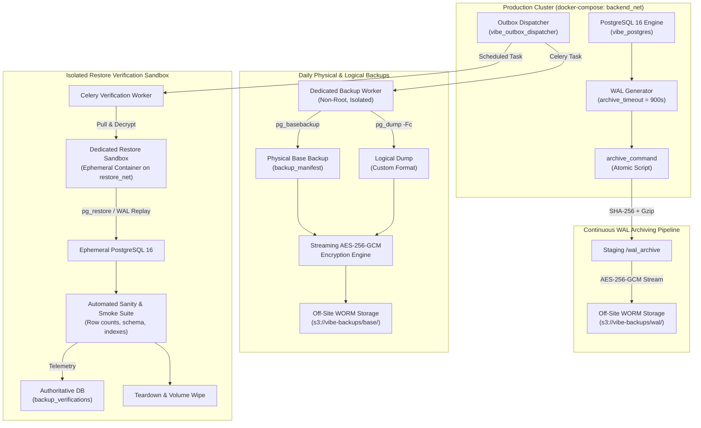
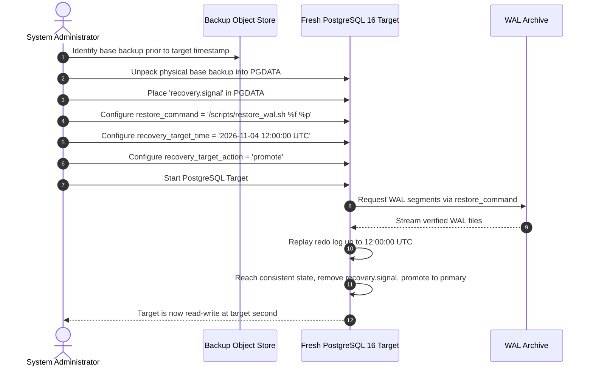
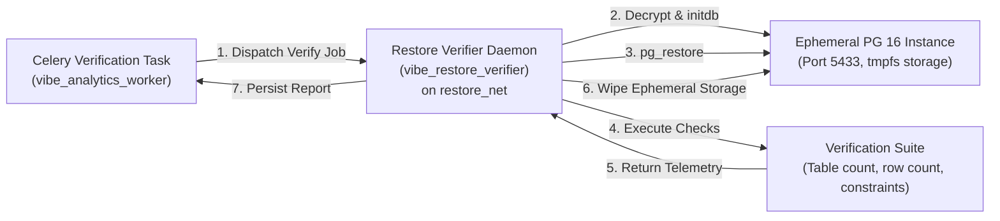
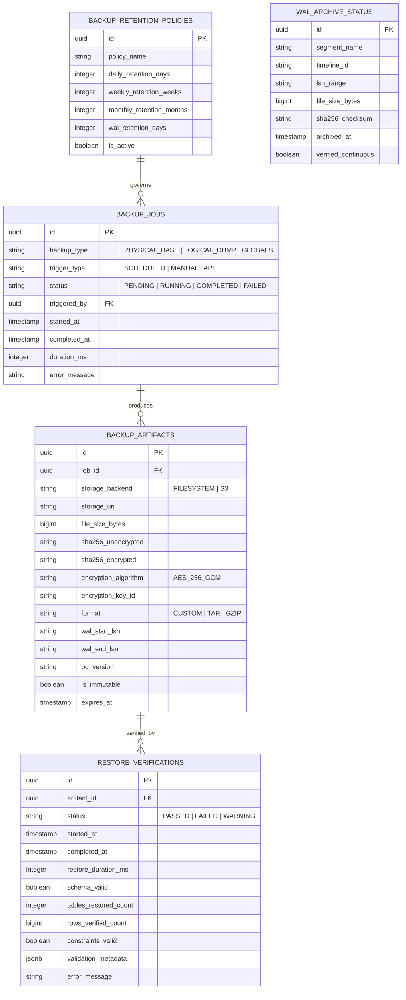
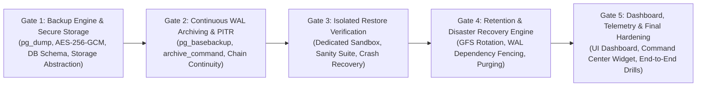

# VIBE — PHASE 10 ARCHITECTURE DISCOVERY & SECURITY ASSESSMENT
## Automated Backup & Disaster Recovery Verification

**Workspace:** `D:\vibe`  
**Project:** VIBE — Enterprise Admin & Data Intelligence Platform  
**Governing Roadmap:** [`docs/IMPLEMENTATION_PLAN.md`](file:///D:/vibe/docs/IMPLEMENTATION_PLAN.md) — Version 2.0.0  
**Phase:** Phase 10 — Automated Backup & Disaster Recovery Verification  
**Previous Phase:** Phase 9 — Business Intelligence, Visualizations & Reporting (Completed & Fully Accepted)  
**Current Alembic Head:** `370908748232 (head)` (Parent: `370908748231`)  
**Python Sandbox Policy:** `PYTHON_SANDBOX_ENABLED=false` (Strictly Preserved)  
**Database Engine:** PostgreSQL 16.8 (Alpine)  
**Assessment Date:** November 4, 2026  
**Execution Mode:** STRICTLY READ-ONLY  
**Document Status:** Complete Discovery & Security Assessment — Awaiting User Approval  

---

## 1. Executive Summary

Phase 10 transitions VIBE from active application feature development (Phases 1 through 9) into **enterprise data resilience, business continuity, and disaster recovery verification**. While Phase 9 established an Executive Command Center, collaborative calculation workbooks, interactive dashboards, and immutable PDF reporting artifacts, the underlying enterprise relational database—containing 42 relational tables and ~3.88 GB of active multi-tenant state—currently operates **without an active automated backup pipeline, continuous WAL archiving, or automated restore verification**.

This architecture discovery and security assessment establishes the technical foundation, threat models, storage abstractions, cryptographic boundaries, and implementation plan for Phase 10. The core principle governing this design is:

> **A backup is not valid because an exit code was zero. A backup is only valid when it has been cryptographically verified and proven restorable in an isolated sandbox without human intervention.**

### Key Discovery Findings:
1. **WAL Volume Mounted but Archiving Disabled:** `docker-compose.yml` mounts `./backups/wal_archive:/wal_archive`, but live inspection of PostgreSQL 16 confirms `archive_mode = off`, `archive_command = (disabled)`, and `archive_timeout = 0`.
2. **PostgreSQL Utilities Missing from Worker:** The Celery worker container (`vibe_analytics_worker`) does not have `postgresql-client` (`pg_dump`, `pg_restore`, `pg_basebackup`) installed, and operates with `user: 10001:10001`, `cap_drop: ALL`, and `read_only: true`.
3. **Docker Socket Isolation Requirement:** The Celery worker does not and must not have `/var/run/docker.sock` mounted. Exposing the Docker socket to an application Celery worker represents an unacceptable container escape vulnerability (host root-equivalent). Restore verification must be executed in an isolated, dedicated container sandbox without Docker daemon exposure.
4. **Logical Dumps vs. PITR Reality:** A logical backup (`pg_dump`) cannot replay Write-Ahead Logs (WAL) for Point-in-Time Recovery (PITR). Physical base backups (`pg_basebackup`) are required for continuous WAL-based timeline recovery. The architecture must implement a dual-tier strategy: daily physical base backups + continuous WAL streaming for PITR, accompanied by encrypted logical dumps for portable, granular cross-version recovery.
5. **Database Footprint & Resource Impact:** The live database currently measures **3,877 MB (~3.88 GB)**, dominated by `sheet_rows` (2,363 MB) and `report_sections` (1,149 MB). Full restore verification will require at least 8 GB of ephemeral storage and strict CPU/memory throttling to avoid destabilizing active services.

---

## 2. Governing Implementation Plan Reference

The governing implementation plan is [`docs/IMPLEMENTATION_PLAN.md`](file:///D:/vibe/docs/IMPLEMENTATION_PLAN.md) (Version 2.0.0, Section "Phase 10: Automated Backup & Disaster Recovery Verification", lines 111–114):

```markdown
### Phase 10: Automated Backup & Disaster Recovery Verification
- Steps: Automated daily logical backup; continuous WAL archiving; Celery restore verification sandbox; backup status dashboard.
```

Additionally, [`docs/BACKUP_AND_RECOVERY.md`](file:///D:/vibe/docs/BACKUP_AND_RECOVERY.md) provides the original architectural intent established during Phase 0:
- Empirical targets: Local Dev (RPO 24h, RTO 5m) | Production (RPO ≤ 15m, RTO ≤ 45m).
- Continuous WAL archiving with `archive_timeout = 900` (15 minutes).
- AES-256-GCM encryption with separate offline master key.
- SHA-256 checksum verification before restoration.
- Automated restoration testing sandbox running table and row-count sanity checks.

This assessment adheres strictly to the roadmap, expanding these high-level requirements into a production-grade, hardened architecture without premature implementation.

---

## 3. Phase 9 Baseline Verification

Prior to conducting architectural discovery, the workspace was audited in strictly read-only mode to verify the existing baseline:

| Dimension | Target Baseline | Live Repository State | Status |
|---|---|---|---|
| **Git Branch** | `main` | `main` (clean working tree with untracked workspace files) | **VERIFIED** |
| **Alembic Head** | `370908748232` | `370908748232 (head)` (confirmed via `alembic current`) | **VERIFIED** |
| **Python Sandbox** | `PYTHON_SANDBOX_ENABLED=false` | Verified `false` in `config.py:237` and all test suites | **VERIFIED** |
| **PostgreSQL Engine** | PostgreSQL 16 (Alpine) | `PostgreSQL 16.8 on x86_64-pc-linux-musl` | **VERIFIED** |
| **Database Size** | Active multi-tenant cluster | `3,877 MB` (42 tables, 3 extensions) | **VERIFIED** |
| **Docker Compose** | 5 Services running | `vibe_postgres`, `vibe_redis`, `vibe_analytics_worker`, `vibe_outbox_dispatcher`, `vibe_report_renderer` | **VERIFIED** |
| **Frontend Tests** | 12 test files | 12/12 passed (129/129 tests passed) | **VERIFIED** |
| **Backend Tests** | Full regression suite | 553 passed, 2 skipped, 0 failed in 622s | **VERIFIED** |

---

## 4. Repository Architecture Inventory

### 4.1 Directory Structure & Role in Phase 10

- [`backend/app/core/`](file:///D:/vibe/backend/app/core/): Application settings (`config.py`), security primitives (`security.py`), and exceptions. Must host backup configurations, encryption key paths, and timeout parameters.
- [`backend/app/db/`](file:///D:/vibe/backend/app/db/): Base model (`base.py`), async session maker (`session.py`), and transaction decorators (`transaction.py`).
- [`backend/app/models/`](file:///D:/vibe/backend/app/models/): 42 existing database entities. Zero backup models currently exist.
- [`backend/app/repositories/`](file:///D:/vibe/backend/app/repositories/): Asynchronous repositories. Need repositories for backup jobs, artifacts, and verification runs.
- [`backend/app/services/`](file:///D:/vibe/backend/app/services/): Business logic services. Need `BackupService`, `RestoreVerificationService`, `WALArchiveService`, and `BackupRetentionService`.
- [`backend/app/tasks/`](file:///D:/vibe/backend/app/tasks/): Celery application (`celery_app.py`) and transactional outbox dispatcher (`dispatcher.py`). Need dedicated backup and restore verification tasks.
- [`backend/alembic/`](file:///D:/vibe/backend/alembic/): 14 migration files culminating at `370908748232`. Phase 10 will require new migrations for backup tracking tables.
- [`frontend/src/app/`](file:///D:/vibe/frontend/src/app/): Next.js 16 app router. Contains `/` (Executive Command Center), `/dashboards`, `/spreadsheets`, `/analytics`, `/audit`, `/roles`, `/users`. Need `/backup` (Backup Status Dashboard) and Command Center telemetry integration.

---

## 5. Existing Backup and Storage Infrastructure Assessment

A source-level grep across the entire repository revealed the following findings for Phase 10 keywords:

| Search Term / Component | Location | Current State | Reusability / Assessment |
|---|---|---|---|
| `pg_dump` | Container `vibe_postgres:/usr/local/bin/pg_dump` | **VERIFIED EXISTING** (in Postgres container only). Missing from Celery worker. | **Cannot run in worker as currently built.** Worker requires client binaries or delegated container. |
| `pg_restore` | Container `vibe_postgres:/usr/local/bin/pg_restore` | **VERIFIED EXISTING** (in Postgres container only). Missing from Celery worker. | Must be executed in isolated sandbox environment. |
| `pg_basebackup` | Container `vibe_postgres:/usr/local/bin/pg_basebackup` | **VERIFIED EXISTING** (in Postgres container). | Required for physical base backups and continuous WAL PITR. |
| `pg_verifybackup` | Container `vibe_postgres:/usr/local/bin/pg_verifybackup` | **VERIFIED EXISTING** (in Postgres container). | Built-in PostgreSQL 16 manifest verification utility. Can verify base backups prior to restore. |
| `wal_level` | PostgreSQL live engine | **VERIFIED EXISTING**: `replica` | Default setting is already suitable for physical replication and archiving. |
| `archive_mode` | PostgreSQL live engine | **DISABLED**: `off` | Must be reconfigured to `on`. Requires PostgreSQL restart. |
| `archive_command` | PostgreSQL live engine | **DISABLED**: `(disabled)` | Must be configured to execute a secure atomic archive script. |
| `archive_timeout` | PostgreSQL live engine | **DISABLED**: `0` | Must be set to `900` (15m) or `300` (5m) to force periodic WAL rotation. |
| `wal_archive` volume | `docker-compose.yml:15`, `backups/wal_archive/` | **PARTIALLY IMPLEMENTED**: Volume mounted, but contains only placeholder `README.md`. | Ready to receive archived WAL files once archiving is enabled. |
| `ReportStorageService` | `backend/app/services/report_storage.py` | **VERIFIED EXISTING** (for reports). | **Not suitable for DB backups.** It is tenant-scoped, unencrypted, and strictly local filesystem. |
| `AnalyticsStorageService` | `backend/app/analytics/storage.py` | **VERIFIED EXISTING** (for parquet). | **Not suitable for DB backups.** Local filesystem only, tenant-scoped. |
| Backup Database Models | `backend/app/models/` | **MISSING**: No backup tables exist. | Must be designed and introduced in Phase 10 Gate 1. |
| Celery Backup Tasks | `backend/app/tasks/` | **MISSING**: No backup tasks registered. | Must be implemented in Phase 10 Gate 1 & Gate 3. |

---

## 6. Reusable Component Matrix

| Component | File Path | Existing Capability | Reuse Strategy in Phase 10 | Adaptation Needed |
|---|---|---|---|---|
| **Transactional Outbox Dispatcher** | [`backend/app/tasks/dispatcher.py`](file:///D:/vibe/backend/app/tasks/dispatcher.py) | `FOR UPDATE SKIP LOCKED` polling, lease fencing, worker crash watchdog | **Direct Reuse**: Dispatch backup jobs and restore verification tasks with durable at-least-once delivery | Add `BackupOutboxEvent` polling loop and lease recovery |
| **Audit Ledger** | [`backend/app/models/audit.py`](file:///D:/vibe/backend/app/models/audit.py) | Append-only immutable administrative audit event logging | **Direct Reuse**: Log all backup initiations, checksum failures, restore runs, and retention deletions | Add audit actions: `BACKUP_CREATED`, `BACKUP_VERIFIED`, `RESTORE_FAILED`, etc. |
| **Descriptor Security Helpers** | [`backend/app/services/report_storage.py`](file:///D:/vibe/backend/app/services/report_storage.py) | `O_DIRECTORY | O_CLOEXEC | O_NOFOLLOW` descriptor checks and `st_dev` device boundary validation | **Pattern Reuse**: Prevent path traversal, symlink hijacking, and mount boundary escapes during backup staging | Port descriptor verification logic to `BackupStorageService` |
| **RBAC Framework** | [`backend/app/models/role.py`](file:///D:/vibe/backend/app/models/role.py) | Dynamic role-permission mapping with system super-admin enforcement | **Direct Reuse**: Protect backup and restore APIs | Register new `backup` and `disaster_recovery` permissions |
| **Executive Command Center** | [`frontend/src/app/page.tsx`](file:///D:/vibe/frontend/src/app/page.tsx) | Responsive cockpit with concurrent `Promise.allSettled` queries, error boundaries, and telemetry cards | **Direct Reuse**: Display real-time backup readiness and WAL health | Add Backup Status Metric Card and Subsystem Telemetry row |

---

## 7. Architecture Gaps

1. **No Client Binaries in Worker Image:** The `vibe-analytics-worker` Docker image cannot execute `pg_dump` or `pg_restore`.
2. **PostgreSQL Configuration Immutable in Container Image:** PostgreSQL runs as `postgres:16-alpine` without custom `postgresql.conf` or command-line parameter overrides in `docker-compose.yml`. Archiving cannot start until `archive_mode=on` is configured.
3. **No Storage Abstraction for Object Storage:** Current storage implementations only support local POSIX directories. Storing backups on the same disk as PostgreSQL leaves the platform completely vulnerable to host disk loss and ransomware.
4. **No Cryptographic Envelope Encryption:** No mechanism currently exists to generate ephemeral DEKs, encrypt multi-gigabyte streams via AES-256-GCM, or manage offline KEKs.
5. **No Isolated Execution Sandbox for Restore Testing:** There is currently no isolated network or dedicated sandbox container to safely run `pg_restore` and execute validation queries without endangering production.
6. **No Backup Tracking Data Models or APIs:** The application has no concept of backup jobs, manifests, checksums, or retention schedules.

---

## 8. Recommended Backup Architecture

We recommend a **Dual-Tier Resilience Architecture** combining continuous physical protection (for near-zero RPO disaster recovery) with encrypted logical snapshots (for corruption isolation and portable recovery).



---

## 9. PostgreSQL Logical Backup Design

### 9.1 Execution Strategy & Parameters
Logical backups must be generated using `pg_dump` with the custom archive format (`-Fc`), executed in a non-blocking transaction:
```bash
pg_dump \
  --host=postgres \
  --port=5432 \
  --username=vibe_backup_user \
  --dbname=vibe_enterprise \
  --format=custom \
  --compress=zstd:6 \
  --no-owner \
  --no-privileges \
  --clean \
  --if-exists \
  --quote-all-identifiers \
  --file=/staging/backup_logical.dump
```

### 9.2 Key Technical Decisions:
1. **Zstandard Compression (`zstd:6`):** Superior compression speed and decompression ratio compared to traditional gzip, minimizing backup duration on a 3.8 GB database.
2. **`--no-owner` & `--no-privileges`:** Prevents restoration failures caused by differing user IDs or environment-specific role names. Role definitions and cluster-level globals must be captured separately using `pg_dumpall --globals-only`.
3. **Atomic Manifest Publication:** The backup file must be accompanied by an immutable manifest (`manifest.json`) containing:
   - SHA-256 checksum of raw unencrypted dump.
   - SHA-256 checksum of encrypted artifact.
   - Database OID and exact PostgreSQL version (`16.8`).
   - Catalog table count and total row count estimate.
   - Encryption IV, auth tag, and KEK ID.

---

## 10. Physical Base Backup and WAL Design

### 10.1 Physical Base Backup Pipeline
Physical base backups are taken via `pg_basebackup` over PostgreSQL's streaming replication protocol:
```bash
pg_basebackup \
  --host=postgres \
  --port=5432 \
  --username=vibe_replicator \
  --format=tar \
  --target=wal_stream \
  --checkpoint=fast \
  --manifest-checksums=SHA256 \
  --progress
```
PostgreSQL automatically generates `backup_manifest`, which allows verifying the integrity of every data block using `pg_verifybackup` before storing or restoring.

### 10.2 Continuous WAL Archiving Configuration
PostgreSQL must be configured with:
```ini
wal_level = replica
archive_mode = on
archive_command = '/scripts/archive_wal.sh %p %f'
archive_timeout = 900
```
The script [`scripts/archive_wal.sh`](file:///D:/vibe/scripts/archive_wal.sh) must guarantee **atomic, idempotent write semantics**:
1. Check that destination does not already exist with different content.
2. Copy WAL segment (`%p`) to a staging directory on `/wal_archive`.
3. Compute SHA-256 checksum.
4. Compress with `gzip` or `zstd`.
5. Atomically move staged file to final archive directory via descriptor-safe rename.
6. Return exit code `0` only when `fsync` succeeds. Any error returns non-zero, forcing PostgreSQL to retain the segment and retry.

---

## 11. Point-in-Time Recovery (PITR)

### 11.1 Recovery Workflow Runbook (Conceptual)
To recover to a specific historical second (e.g., `2026-11-04 12:00:00 UTC`):



### 11.2 Risks & Mitigations:
- **Timeline Divergence:** When a database is promoted, it increments its timeline ID (e.g. from 1 to 2). Recovery configuration must explicitly set `recovery_target_timeline = 'latest'` to traverse timeline switches cleanly.
- **Missing Intermediate WAL Segments:** If a single 16MB WAL segment in the sequence is missing or corrupt, replay halts at that point. Mitigation: Automated daily WAL chain continuity validation verifying sequential LSN coverage.

---

## 12. Backup Storage Architecture

### 12.1 Storage Options Comparison

| Characteristic | Local Filesystem | Dedicated Docker Volume | S3-Compatible Object Store (MinIO / S3) |
|---|---|---|---|
| **Disaster Isolation** | **None** (fails with host disk) | **None** (fails with host disk) | **High** (survives total host destruction) |
| **Ransomware Resistance** | **Poor** (host root can wipe) | **Poor** (host root can wipe) | **Excellent** (WORM Object Lock in Compliance mode) |
| **Credential Separation** | Low (same OS user/permissions) | Low (Docker daemon access) | **High** (separate scoped IAM credentials) |
| **Scalability** | Limited by host partition | Limited by host partition | **Virtually Unlimited** |
| **Implementation Cost** | $0 | $0 | Low ($0.015 - $0.023 / GB / month) |

### 12.2 Recommended Multi-Tier Architecture:
- **Tier 1 (Staging / Short-Term Cache):** Local dedicated Docker volume (`vibe_backup_staging`) mounted with `noexec, nosuid` for high-speed local dump generation and initial WAL staging.
- **Tier 2 (Authoritative Long-Term Archive):** S3-compatible object storage with **Object Lock (Compliance Mode)** enabled. Backups are pushed over TLS 1.3 with separate dedicated S3 credentials. Once written, objects cannot be deleted or overwritten by anyone—even root or compromised application credentials—until the retention period expires.

---

## 13. Backup Encryption and Key Management

### 13.1 Cryptographic Specification
All database backups must be encrypted at rest using **Envelope Encryption** with authenticated symmetric ciphers:
- **Cipher:** `AES-256-GCM` (Galois/Counter Mode).
- **Authentication:** 128-bit GCM authentication tag verifying ciphertext authenticity before decryption.
- **Data Encryption Key (DEK):** Cryptographically secure random 256-bit key generated uniquely for each backup file via `secrets.token_bytes(32)`.
- **Key Encryption Key (KEK):** Master key stored outside the database in an environment secret (`VIBE_BACKUP_MASTER_KEY`).
- **Encrypted Envelope Header:**
  ```
  +-------------------------------------------------------------+
  | Magic Header: "VIBE_ENC_V1" (11 bytes)                     |
  | KEK Fingerprint: SHA-256(KEK)[:8] (8 bytes)                |
  | IV / Nonce: 96-bit random nonce (12 bytes)                 |
  | Encrypted DEK: AES-KeyWrap(KEK, DEK) (40 bytes)             |
  | Auth Tag: GCM 128-bit authentication tag (16 bytes)        |
  | Payload: AES-256-GCM encrypted backup stream               |
  +-------------------------------------------------------------+
  ```

### 13.2 Disaster Recovery Key Protection:
- **Never store the KEK inside PostgreSQL.** If PostgreSQL is lost, the key is lost.
- **Never store the KEK in the backup storage bucket.**
- In production, KEK is injected via secret managers (AWS Secrets Manager, HashiCorp Vault) or derived from an offline passphrase using Argon2id with an emergency recovery key paper backup (runbook escrow).

---

## 14. Celery-Based Isolated Restore Verification

The restore verification engine is the core technical differentiator of Phase 10. It converts passive backups into verified recovery assurances.

### 14.1 Sandbox Isolation Architecture
To prevent exposing `/var/run/docker.sock` to the application Celery worker, we propose:
**Dedicated Restore Verifier Container (`vibe_restore_verifier`):**
- Operates on a dedicated, isolated internal Docker network (`restore_net`).
- **Has NO network route to `vibe_postgres` or production databases.**
- Runs a standalone PostgreSQL 16 server inside its own container on a private loopback socket.
- Receives the encrypted backup artifact from the verification task over an isolated internal endpoint, decrypts it in memory/tmpfs, initializes an ephemeral cluster, restores the database, executes automated smoke tests, and tears down the cluster.



### 14.2 Verification Verification Suite (Smoke Tests)
The restore verification worker executes 10 automated assertions:
1. **Schema Integrity:** Verify Alembic migration head matches production revision (`370908748232`).
2. **Catalog Table Count:** Verify all 42 expected relations are present.
3. **Critical Extensions:** Verify `uuid-ossp`, `pgcrypto`, and `plpgsql` are installed and functional.
4. **Row Count Consistency:** Verify row counts on critical tables (`users`, `organizations`, `workspaces`, `sheet_rows`, `report_runs`) are within expected delta margins of the manifest.
5. **Foreign Key Integrity:** Execute `ANALYZE` and verify zero broken foreign keys.
6. **Unique Constraints & Indexes:** Verify critical indexes are marked valid in `pg_index`.
7. **Synthetic Query Smoke Test:** Run representative read queries across multi-sheet models.
8. **Immutability Trigger Verification:** Verify `audit_events` immutability trigger prevents updates.
9. **Execution Duration:** Measure exact restoration duration to benchmark operational RTO.
10. **Clean Teardown:** Confirm temporary database files and decrypted buffers are securely wiped (`shred` / `unlink`).

---

## 15. Database Schema Proposal

To track the backup lifecycle, WAL archiving health, and restore verification evidence, the following database models are proposed for Phase 10 Gate 1 (0 schema migrations are introduced during this read-only discovery):

### 15.1 Proposed Entities



---

## 16. API Specification (Design Only)

All Phase 10 endpoints will be grouped under `/api/v1/backups` and require high-privilege administrative permissions:

| Method | Endpoint | Required Permission | Description |
|---|---|---|---|
| `GET` | `/api/v1/backups` | `backup:read` | List backup jobs, statuses, and artifact metadata with pagination. |
| `GET` | `/api/v1/backups/{id}` | `backup:read` | Get detailed backup job telemetry, manifest, and verification results. |
| `POST` | `/api/v1/backups` | `backup:create` | Trigger an immediate on-demand backup (logical dump or physical base). |
| `GET` | `/api/v1/backups/wal/status` | `backup:read` | Real-time continuous WAL archiving status, lag in seconds, and backlog. |
| `GET` | `/api/v1/backups/verifications` | `backup:read` | History of Celery isolated restore verification runs and sanity reports. |
| `POST` | `/api/v1/backups/{id}/verify` | `backup:verify` | Trigger an immediate isolated restore verification run for a specific artifact. |
| `GET` | `/api/v1/backups/storage` | `backup:read` | Backup storage utilization, off-site replication status, and quota usage. |
| `GET` | `/api/v1/backups/policies` | `backup:manage` | Get current GFS retention and rotation policy rules. |
| `PUT` | `/api/v1/backups/policies` | `backup:manage` | Update backup retention policies (super-admin only). |

---

## 17. Executive Command Center Integration

Phase 9 Gate 4 established the Executive Command Center at `/`. In Phase 10 Gate 5, disaster recovery readiness will be seamlessly surfaced into the existing UI design system without redesigning the cockpit:

1. **Subsystem Health Card Update:** Add a dedicated "Disaster Recovery" node under Subsystem Telemetry with active status indicators (`Continuous Archiving Active &bull; Verified Restorable`).
2. **Executive Metric Card (Optional 5th Card or Dynamic Switch):** "Disaster Recovery Readiness" displaying the timestamp of the last verified restorable backup (e.g. `100% Verified &bull; RPO 14m`).
3. **Advisory / Warning Banner:** If the last backup is >24 hours old or the latest restore verification failed, display an prominent amber/rose warning banner with a direct deep-link to the Backup Status Dashboard.
4. **Dedicated Dashboard Route:** Introduce `/system/backup` accessible via the sidebar under "Governance -> System Health", displaying the full backup history, WAL lag chart, and restore test ledger.

---

## 18. Security Threat Model

| # | Threat Scenario | Severity | Existing Protection | Missing Protection | Recommended Mitigation | Required Automated Test |
|---|---|---|---|---|---|---|
| 1 | **Unauthorized Backup Access** (Exfiltrating tenant PII/secrets) | **CRITICAL** | None (no backup API exists) | Encryption at rest, authorization checks | AES-256-GCM envelope encryption; strict RBAC (`backup:read`) | Unit test: Unauthenticated/unprivileged access returns 401/403 |
| 2 | **Docker Socket Compromise** (Worker container escape to host root) | **CRITICAL** | Worker drops ALL caps, non-root user | Socket isolation | **Never mount `/var/run/docker.sock`** in Celery worker; use isolated verifier container | Configuration audit test: Worker container has no docker socket |
| 3 | **Backup Tampering / Bitrot** (Restoring corrupted or altered dump) | **HIGH** | None | Cryptographic integrity checks | SHA-256 checksums on unencrypted and encrypted payloads + manifest | Test: Tampered byte in archive fails checksum validation |
| 4 | **Ransomware Backup Deletion** (Attacker deletes both DB and backups) | **CRITICAL** | None (local disk only) | Off-site immutable storage | S3 Object Lock (Compliance mode / WORM) with separate credentials | Architecture test: S3 Object Lock retention verified |
| 5 | **Restore Command Injection** (Arbitrary command execution via filename) | **CRITICAL** | Subprocess sanitizer in renderer | Shell sanitization in restore worker | Never use `shell=True`; use direct argument lists `['pg_restore', ...]` | Security test: Path traversal & shell injection characters rejected |
| 6 | **Broken WAL Recovery Chain** (Missing intermediate WAL segment) | **HIGH** | None | Sequential LSN continuity check | Daily automated WAL sequence audit; alert on missing sequence numbers | Integration test: Simulate missing WAL segment and verify alert |
| 7 | **Production Overwrite Accident** (Restoring into live database) | **CRITICAL** | None | Environment isolation | Restore verifier has **zero network routes** to production PostgreSQL | Network test: Ephemeral restore instance cannot reach prod DB |

---

## 19. Testing Strategy

### 19.1 Testing Pyramid for Phase 10
1. **Unit Tests (`backend/tests/unit/`):**
   - Cryptographic envelope encryption and decryption (`AES-256-GCM`).
   - Checksum generation, comparison, and tampering detection.
   - GFS retention calculation algorithms (protecting active WAL chains).
   - Filename sanitization, parameter escaping, and path traversal rejection.
2. **Integration Tests (`backend/tests/integration/`):**
   - End-to-end `pg_dump` execution and custom archive validation.
   - Streaming physical base backup via `pg_basebackup`.
   - WAL archiving script execution, checksum calculation, and atomic move.
   - S3-compatible storage adapter upload and download verification.
   - Celery outbox task dispatch and worker execution.
3. **Isolated Restore Sandbox Tests:**
   - Ephemeral PostgreSQL cluster startup, restore execution, and smoke testing.
   - Verification failure detection on simulated schema drift or corrupt data.
   - Clean ephemeral teardown and temporary file shredding.
4. **Reliability & Crash Recovery Tests:**
   - Worker kill during backup generation (lease expiration and retry).
   - Interrupted network upload to backup storage.
   - WAL archiving failure handling and backlog catch-up.

---

## 20. Performance and Resource Budget

- **Database Footprint:** Currently ~3.88 GB.
- **Estimated Backup Size (with zstd compression):** ~450 MB – 650 MB.
- **Backup Execution Duration:** Estimated 45s – 90s (on SSD with multi-core zstd).
- **CPU & Memory Budget for Backup Worker:**
  - Memory limit: 1024 MB.
  - CPU allocation: Max 1 core (preventing CPU starvation on primary database).
- **Resource Budget for Restore Verification:**
  - Ephemeral PostgreSQL RAM limit: 1024 MB.
  - Temporary disk space: 8 GB (accommodates 4 GB decompressed cluster + staging files).
  - Verification execution timeout: 600s (10 minutes).
  - Concurrency: 1 verification task at a time (strictly sequential).

---

## 21. RPO, RTO and Disaster Recovery Policy

We define three standardized operational disaster recovery profiles:

| Parameter | Profile 1: Standard (Local/Dev) | Profile 2: High Availability (Default Production) | Profile 3: Critical Data Protection (Enterprise Tier) |
|---|---|---|---|
| **Base Backup Frequency** | Daily (Logical) | Daily (Physical Base + Logical Dump) | Daily Base + 12h Logical Snapshots |
| **WAL Archiving Interval** | 60 minutes | **15 minutes (`archive_timeout = 900`)** | **5 minutes (`archive_timeout = 300`)** |
| **Target RPO (Max Data Loss)** | ≤ 24 hours | **≤ 15 minutes** | **≤ 5 minutes** |
| **Target RTO (Max Recovery Time)**| ≤ 2 hours | **≤ 45 minutes** | **≤ 15 minutes** |
| **Restore Verification Frequency**| Weekly | **Daily Automated Sandbox Run** | Continuous after every base backup |
| **Storage Target** | Local Volume / NAS | Encrypted S3 with Object Lock | Multi-Region Encrypted S3 (WORM) |
| **Retention Policy** | 7 Daily | 14 Daily, 8 Weekly, 12 Monthly | 30 Daily, 52 Weekly, 84 Monthly |

*Note:* All RPO and RTO figures represent proposed architectural targets. They will not be reported as achieved until empirically measured using real restore tests in Gate 5.

---

## 22. Retention and Rotation Strategy

### 22.1 Grandfather-Father-Son (GFS) Rotation Policy
- **Daily Backups:** Retain for 14 days.
- **Weekly Backups:** Retain for 8 weeks (taken Sundays at 00:00 UTC).
- **Monthly Backups:** Retain for 12 months (taken 1st of month at 00:00 UTC).

### 22.2 WAL Chain Dependency Protection Rule
**A WAL segment must NEVER be deleted if it is required by any retained base backup.**
```
Oldest Retained Base Backup (LSN: 0/16000000) ------------> Present
                     ▲
                     │
      WAL Retention Boundary: All WAL segments after LSN 0/16000000 MUST BE KEPT.
      Only WAL segments strictly prior to LSN 0/16000000 may be purged.
```
The retention service must query `backup_artifacts` to identify the minimum active `wal_start_lsn` before issuing any deletion commands to the WAL archive.

---

## 23. Infrastructure and Cost Analysis

- **Storage Requirements:**
  - 14 daily base backups (~7 GB compressed).
  - 8 weekly + 12 monthly base backups (~10 GB compressed).
  - 14 days of continuous WAL (~5–10 GB depending on transaction volume).
  - Total storage budget: ~25–35 GB.
- **Estimated Cloud Storage Costs (AWS S3 Standard / Wasabi / Cloudflare R2):**
  - AWS S3 Standard (35 GB @ $0.023/GB): **~$0.80 / month**.
  - Cloudflare R2 / Wasabi (35 GB @ $0.015/GB with zero egress): **~$0.52 / month**.
  - Local MinIO S3-compatible container (for on-premise/dev): **$0.00 / month**.
- **Container Infrastructure:**
  - Add `vibe_restore_verifier` container running lightweight PostgreSQL 16 on `restore_net`.

---

## 24. Phase 10 Implementation Gate Breakdown

We propose a structured, 5-gate sequential implementation plan. Each gate represents an independent test and acceptance boundary:



### Gate 1 — Backup Foundation, Metadata Architecture & Secure Storage
- **Objective:** Implement database models, storage abstractions (Filesystem + S3), AES-256-GCM envelope encryption, and the logical backup execution engine.
- **Deliverables:**
  - Alembic migration creating `backup_jobs`, `backup_artifacts`, `backup_retention_policies`.
  - `BackupStorageBackend` interface with `LocalFilesystemStorage` and `S3StorageBackend`.
  - `BackupEncryptionService` with AES-256-GCM and key derivation.
  - `PostgresLogicalBackupService` executing `pg_dump -Fc` with zstd compression and manifest generation.
  - Unit and integration tests for backup creation, checksums, and encryption.
- **Acceptance Criteria:** Logical backup executes cleanly, produces encrypted artifact and valid manifest, and passes SHA-256 verification.

### Gate 2 — Continuous WAL Archiving & Physical Base Backup Pipeline
- **Objective:** Configure continuous WAL archiving on PostgreSQL 16, implement streaming physical base backups, and establish the PITR recovery pipeline.
- **Deliverables:**
  - Updated `docker-compose.yml` with `archive_mode=on`, `archive_timeout=900`, and `archive_command`.
  - Idempotent, descriptor-safe [`scripts/archive_wal.sh`](file:///D:/vibe/scripts/archive_wal.sh).
  - `PostgresPhysicalBackupService` executing `pg_basebackup` with manifest checksums.
  - WAL continuity validator detecting missing segments in recovery chains.
  - PITR restoration runbook and automated verification scripts.
- **Acceptance Criteria:** PostgreSQL archives WAL segments continuously to staging; physical base backups are verified via `pg_verifybackup`.

### Gate 3 — Celery-Driven Isolated Restore Verification Sandbox
- **Objective:** Implement the isolated restore verification sandbox to prove backups are restorable without risking production data or exposing Docker sockets.
- **Deliverables:**
  - Dedicated `vibe_restore_verifier` container on isolated `restore_net`.
  - Celery verification task `verify_backup_restoration` dispatched via transactional outbox.
  - 10-point automated restore sanity test suite (schema, table counts, row counts, constraints).
  - Reliable crash cleanup and ephemeral disk wiping.
- **Acceptance Criteria:** Backup is restored into ephemeral PostgreSQL sandbox, smoke tests pass 100%, duration is recorded, and sandbox is wiped clean.

### Gate 4 — Backup Retention, Rotation & Disaster Recovery Policies
- **Objective:** Implement the automated lifecycle management engine for backup rotation and WAL chain dependency preservation.
- **Deliverables:**
  - `BackupRetentionService` implementing GFS rotation policies.
  - WAL chain dependency resolver ensuring no required WAL files are deleted prematurely.
  - Scheduled retention sweep task with transactional outbox logging.
  - Audit logging of all pruning events to `administrative_audit_events`.
- **Acceptance Criteria:** Expired backups are safely purged without breaking active recovery chains; deletion of needed WAL files is strictly prevented.

### Gate 5 — Executive Backup Monitoring, Dashboard & Final Hardening
- **Objective:** Build the frontend Backup Status Dashboard, integrate real-time disaster recovery telemetry into the Executive Command Center, and perform final security audits.
- **Deliverables:**
  - Dedicated Backup Status Dashboard (`/system/backup`).
  - Executive Command Center telemetry widget displaying backup freshness and WAL status.
  - Full API endpoints (`/api/v1/backups/*`) with RBAC enforcement (`backup:read`, `backup:create`, `backup:verify`).
  - Adversarial security test suite (tampering, path traversal, injection).
  - Final acceptance report and Phase 10 sign-off.
- **Acceptance Criteria:** Full Vitest and Pytest regression suites pass 100%; manual restore verification drill succeeds; Command Center reflects live backup telemetry.

---

## 25. Migration Strategy

- **Zero Downtime Database Schema:** Phase 10 tables (`backup_jobs`, `backup_artifacts`, `restore_verifications`, `wal_archive_status`, `backup_retention_policies`) are entirely additive. They introduce zero locks or modifications to existing Phase 1–9 business tables.
- **PostgreSQL Archiving Activation:** Changing `archive_mode` requires a controlled PostgreSQL service restart (`docker compose restart postgres`). This will be scheduled in Gate 2 during a planned maintenance window.
- **Alembic Progression:** Migration `370908748233` will build directly upon `370908748232 (head)`.

---

## 26. Rollback Strategy

1. **Schema Rollback:** If Phase 10 migration fails or requires reversal, Alembic can downgrade cleanly back to `370908748232` without affecting application tables.
2. **PostgreSQL Configuration Rollback:** Reverting `archive_mode = off` and removing `archive_command` returns PostgreSQL to its exact baseline state.
3. **Storage Rollback:** Staged and archived backup files are isolated in separate directories (`/wal_archive`, `/backups`) and do not touch application upload paths (`/app/uploads/analytics`, `/app/uploads/reports`).

---

## 27. Risks and Mitigations

| Risk | Impact | Mitigation Strategy |
|---|---|---|
| **Primary Disk Space Exhaustion by WAL Backlog** | Database halts if disk fills | Monitor `/wal_archive` capacity; alert at 80% utilization; implement automatic throttle. |
| **Worker CPU Starvation during Backup Compression** | Slows down live analytics | Run `pg_dump` and zstd with nice priority and limit worker concurrency to 1 thread. |
| **Encryption Key Loss during Disaster** | Backups permanently unrecoverable | Document offline paper key escrow in Disaster Recovery Runbook; test key recovery drills. |
| **Docker Socket Escape Vulnerability** | Host root compromise | Eliminate Docker socket from worker; use dedicated verifier container on internal network. |
| **Silent Bitrot in Backup Archives** | Failed restoration during emergency | Weekly automated sandbox restore verification + daily SHA-256 checksum audits. |

---

## 28. Unresolved Architectural Decisions (For User Approval)

The following design decisions require explicit user alignment before beginning Gate 1:

1. **Storage Target for Development vs. Production:**
   - *Option A:* Local Docker volume / directory mount for both development and production. (Simple, zero external dependencies, but vulnerable to host loss).
   - *Option B (Recommended):* Local filesystem for development testing + S3-compatible object store (MinIO or AWS S3 with Object Lock) for production.
2. **Restore Sandbox Architecture:**
   - *Option A (Recommended):* Dedicated `vibe_restore_verifier` container on isolated `restore_net` running standalone ephemeral PostgreSQL. (Secure, zero Docker socket exposure).
   - *Option B:* Ephemeral in-process PostgreSQL cluster initialized directly inside the worker container via `initdb` on a loopback socket. (Requires bundling PostgreSQL binaries into worker image).
3. **Continuous WAL Archiving Interval (`archive_timeout`):**
   - *Option A:* 900 seconds (15 minutes — High Availability profile, lower I/O).
   - *Option B:* 300 seconds (5 minutes — Critical Data Protection profile, higher disk/WAL rotation).

---

## 29. Explicit User Approval Checklist

Please review and approve the following items before implementation begins:

- [ ] **Approval 1:** Accept the 5-Gate Breakdown for Phase 10 (Gate 1: Backup Foundation & Secure Storage -> Gate 2: Continuous WAL Archiving -> Gate 3: Isolated Restore Verification -> Gate 4: Retention Policies -> Gate 5: Dashboard & Final Hardening).
- [ ] **Approval 2:** Authorize adding the dedicated `vibe_restore_verifier` container service in `docker-compose.yml` to prevent Docker socket exposure in the application worker.
- [ ] **Approval 3:** Approve the Dual-Tier Strategy (Daily Physical Base Backup + Continuous WAL Archiving for PITR, alongside Daily Encrypted Logical Dumps for portable recovery).
- [ ] **Approval 4:** Confirm the default WAL archiving timeout (`archive_timeout = 900` / 15-minute RPO).
- [ ] **Approval 5:** Confirm that `PYTHON_SANDBOX_ENABLED=false` remains strictly enforced throughout Phase 10.
- [ ] **Approval 6:** Authorize proceeding to **Phase 10 Gate 1 — Backup Foundation & Secure Storage**.
