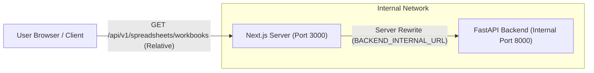

# Phase 11 Gate 3 Stage 3.1.1 — API Reverse Proxy Architecture Audit
**Document:** `docs/phase-11/GATE_3_STAGE_3_1_1_API_PROXY_AUDIT.md`  
**Phase:** 11 — Security Hardening & Performance Optimization  
**Gate:** 3 — Frontend Security, Performance & Accessibility  
**Stage:** 3.1.1 — Independent Verification and Targeted Corrections  
**Governing Roadmap:** `docs/IMPLEMENTATION_PLAN.md` v2.0.0  

---

## 1. Architectural Purpose & Mechanism

The Next.js API Reverse Proxy enables relative API requests from the browser (`/api/v1/*`) to be routed to the FastAPI backend service over internal network boundaries without exposing backend internal ports to the public internet or violating Content Security Policy.

### 1.1 Next.js `rewrites()` Configuration
Implemented in `frontend/next.config.ts`:

```typescript
async rewrites() {
  const isProd = process.env.NODE_ENV === "production";
  const backendUrl = process.env.BACKEND_INTERNAL_URL;

  if (isProd && !backendUrl) {
    console.warn(
      "[SECURITY WARNING] BACKEND_INTERNAL_URL is not set in production. " +
      "API proxy rewrites to backend (/api/v1/:path*) are disabled to prevent accidental loopback routing."
    );
    return [];
  }

  const targetUrl = backendUrl || "http://127.0.0.1:8000";

  // Validate protocol to prevent arbitrary scheme injection
  try {
    const parsed = new URL(targetUrl);
    if (parsed.protocol !== "http:" && parsed.protocol !== "https:") {
      throw new Error(`Invalid protocol ${parsed.protocol}`);
    }
  } catch (err) {
    console.error(`[SECURITY ERROR] Invalid BACKEND_INTERNAL_URL: ${targetUrl}`, err);
    return [];
  }

  return [
    {
      source: "/api/v1/:path*",
      destination: `${targetUrl}/api/v1/:path*`,
    },
  ];
}
```

---

## 2. Security Hardening vs Stage 3.1

### 2.1 Prevention of Insecure Loopback Fallback in Production
- **Prior Flaw (Stage 3.1):** `const backendUrl = process.env.BACKEND_INTERNAL_URL || "http://127.0.0.1:8000"`. In containerized deployments (Docker/Kubernetes), falling back silently to `127.0.0.1:8000` inside the frontend container causes connectivity failures or connects to rogue services bound to the container's loopback interface.
- **Stage 3.1.1 Enforcement:** In production (`NODE_ENV === 'production'`), if `BACKEND_INTERNAL_URL` is omitted, the proxy emits a critical security warning and returns empty rewrites (`[]`), ensuring fail-safe closure rather than unintended loopback traffic.

### 2.2 Scheme & URL Validation
- Input is parsed with standard `new URL()`.
- Only `http:` and `https:` schemes are permitted. Malformed strings or non-HTTP protocols (e.g. `file:`, `ftp:`, `javascript:`) are rejected at build/startup time.

### 2.3 Browser-to-Backend Topology


By keeping all client requests relative to the origin (`origin/api/v1/...`), the client application requires zero CORS negotiation and CSP `connect-src` remains strictly locked to `'self'`.

