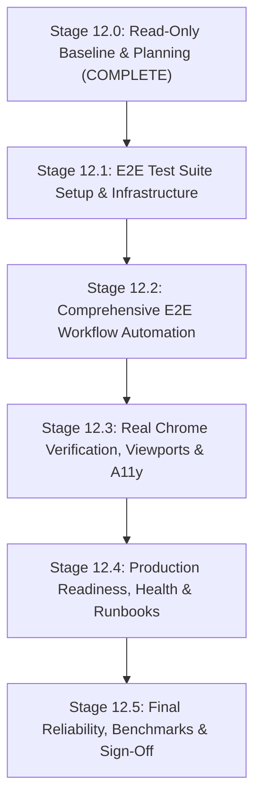

# Phase 12 — Implementation Plan: Production Readiness, E2E Testing & Deployment Verification
**Document:** `docs/phase-12/PHASE_12_IMPLEMENTATION_PLAN.md`  
**Phase:** 12 — Production Readiness, End-to-End Testing & Deployment Verification  
**Governing Roadmap:** `docs/IMPLEMENTATION_PLAN.md` v2.0.0  
**Alembic Revision Head:** `370908748232` (STRICTLY PRESERVED)  
**Python Sandbox Policy:** `PYTHON_SANDBOX_ENABLED=false` (STRICTLY PRESERVED)  
**AWS Integration Policy:** `AWS_LIVE_OBJECT_LOCK_VERIFICATION = DEFERRED`  

---

## 1. Objective & Governing Boundaries

The objective of Phase 12 is to validate production readiness, execute end-to-end multi-tier user workflows in real browser environments, benchmark performance under realistic workloads, and author definitive deployment and rollback runbooks.

### Mandatory Invariants:
- **Alembic Revision Head:** Must remain `370908748232`. 0 database migrations, 0 schema mutations, 0 PostgreSQL role changes.
- **Python Sandbox:** `PYTHON_SANDBOX_ENABLED=false` must remain strictly enforced.
- **AWS Integration:** `AWS_LIVE_OBJECT_LOCK_VERIFICATION = DEFERRED` must remain strictly maintained.
- **Working Tree Integrity:** All existing files, tests, and configurations must be preserved. Zero destructive git operations.

---

## 2. Proposed Sequential Stages

---

### Stage 12.1 — E2E Test Suite Setup & Infrastructure
**Goal:** Establish the browser automation and end-to-end testing harness without disrupting existing Vitest unit tests.
- **Tasks:**
  1. Determine E2E test runner strategy:
     - *Option A (Recommended):* Install `@playwright/test` in `frontend` devDependencies, configured with `playwright.config.ts` targeting `http://localhost:3000` with headless Chromium.
     - *Option B:* Utilize Python Playwright in `backend/tests/e2e` driving the frontend server.
  2. Implement global test fixtures for automatic authentication, session cookie injection, and tenant context isolation.
  3. Validate test runner setup with a basic smoke test (`auth.setup.ts` and `home.spec.ts`).
- **Acceptance Criteria:**
  - E2E runner executes cleanly without conflicts with Vitest.
  - Zero modification to application production code.

---

### Stage 12.2 — Comprehensive E2E Workflow Automation
**Goal:** Implement automated end-to-end tests for all 6 core enterprise workflows.
- **Workflows Covered:**
  1. **Authentication & Multi-Tenant Context:** Login, cookie verification (`HttpOnly`, `SameSite=lax`), tenant switcher dropdown, permission checks, logout.
  2. **Spreadsheet Subsystem:** 50k-row virtual grid loading, cell navigation (`ArrowDown`, `Enter`), formula editing (`=SUM(A1:A5)`), batch updates, Google Sheets sync trigger.
  3. **Dashboard Studio:** Widget drag/resize, view/edit mode toggle, filter bar filtering, lazy chunk loading of Apache ECharts.
  4. **Analytics Subsystem:** Job submission modal, progress polling, result inspection, storage usage display.
  5. **Report Generation:** PDF report creation, section reordering, renderer dispatch, token-based PDF download.
  6. **Disaster Recovery UI:** Backup posture card, SLA metrics, manifest hash display.
- **Acceptance Criteria:**
  - All automated E2E tests pass reliably with zero flakiness.
  - Assertions verify actual DOM mutations and API responses.

---

### Stage 12.3 — Real Chrome Verification, Viewports & Accessibility
**Goal:** Verify user experience in live Google Chrome using Chrome DevTools MCP.
- **Tasks:**
  1. **Responsive Viewport Testing:**
     - Mobile: 390x844 (Mobile drawer navigation, single-column KPI cards)
     - Tablet: 768x1024 (Collapsible sidebar, two-column dashboards)
     - Desktop: 1366x768 and 1920x1080 (Full command center view)
  2. **Keyboard Navigation & Focus Trapping:** Command palette (`Ctrl+K`), modal dialogs (`Escape`, `Tab` trapping), table keyboard navigation.
  3. **Theme & Color Contrast:** Light mode and Dark mode visual audit with zero contrast regressions.
  4. **Direct Route Navigation & Refresh:** Ensure direct URLs (`/spreadsheets`, `/dashboards`, `/roles`) load cleanly without hydration mismatch or redirect loops.
  5. **Console & CSP Monitoring:** Confirm 0 CSP violation reports or unexpected JavaScript errors during full navigation.
- **Acceptance Criteria:**
  - Screenshots captured for each viewport and modal state.
  - 100/100 Lighthouse Accessibility maintained in both themes.

---

### Stage 12.4 — Production Readiness, Health & Runbooks
**Goal:** Verify operational configuration, health endpoints, container isolation, and produce production documentation.
- **Tasks:**
  1. **Startup & Configuration Safety:**
     - Verify FastAPI startup rejects development placeholder passwords in production mode.
     - Verify Next.js reverse proxy fails safe when `BACKEND_INTERNAL_URL` is omitted in production.
  2. **Container Security & Health Checks:**
     - Validate non-root execution (`10001:10001`), `read_only` filesystems, and tmpfs boundaries.
     - Verify healthcheck endpoints: PostgreSQL (`pg_isready`), Redis (`redis-cli ping`), Backend (`/api/v1/health`), Renderer (`/health`).
  3. **Deployment Runbook:**
     - Document exact deployment procedure, environment variable matrix, secret rotation, and container orchestration steps.
  4. **Rollback Runbook:**
     - Document step-by-step rollback procedures for frontend, backend, and worker services.
- **Acceptance Criteria:**
  - Production readiness checklist 100% verified.
  - Runbooks are complete, actionable, and verified.

---

### Stage 12.5 — Final Reliability, Benchmarks & Phase 12 Sign-Off
**Goal:** Execute full regression verification, compile performance benchmarks, and deliver final engineering acceptance report.
- **Tasks:**
  1. Execute full backend test suite (`pytest tests/unit` and key integration suites).
  2. Execute full frontend test suite (`npm run test` and E2E suites).
  3. Run TypeScript typecheck (`tsc --noEmit`) and ESLint.
  4. Measure performance: virtual grid scroll frame rate, API proxy latency, database query performance.
  5. Compile `PHASE_12_FINAL_ACCEPTANCE.md`.
- **Acceptance Criteria:**
  - 100% test pass rate across all suites.
  - Zero unresolved P0/P1 defects.
  - Explicit sign-off recommendation.

---

## 3. Risk Identification & Mitigation Matrix

| Identified Risk | Severity | Mitigation Strategy |
|---|---|---|
| **E2E Browser Flakiness** | Medium | Use explicit locators, web-first assertions (`toBeVisible`), and avoid arbitrary hard sleeps. |
| **Port Conflicts During Live Testing** | Low | Next.js server bound to 3000, FastAPI backend on 8000; manage background daemon tasks explicitly. |
| **Accidental Package Lock Mutation** | Medium | Do not modify dependencies until Stage 12.1 is approved; inspect lockfile diffs. |
| **AWS Dependency Confusion** | Low | Maintain strict deferral notice (`AWS_LIVE_OBJECT_LOCK_VERIFICATION = DEFERRED`) in all runbooks. |

---

## 4. Phase 12 Acceptance Criteria

Phase 12 will be accepted when:
1. All planned stages (12.1 through 12.5) are completed with documented evidence.
2. End-to-end automated coverage spans all 6 primary workflows.
3. Real Google Chrome testing confirms responsive layouts, keyboard navigation, and zero CSP violations.
4. Deployment and Rollback runbooks are fully documented.
5. All mandatory preservation invariants remain intact (`370908748232`, `PYTHON_SANDBOX_ENABLED=false`).
6. Final acceptance decision is **ACCEPT**.

