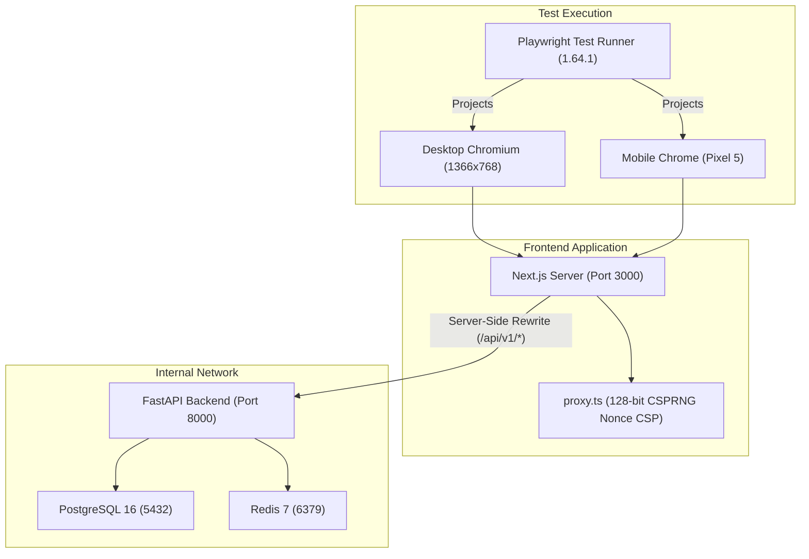

# Phase 12 Stage 12.1 — E2E Testing Infrastructure Consolidated Report
**Document ID:** `PHASE_12_STAGE_12_1_CONSOLIDATED_REPORT`  
**Phase:** Phase 12 — Production Readiness, End-to-End Testing & Deployment Verification  
**Stage:** Stage 12.1 — E2E Testing Infrastructure  
**Governing Roadmap:** `docs/IMPLEMENTATION_PLAN.md` v2.0.0  
**Current Status:** **COMPLETE — RECOMMENDATION: ACCEPT**  
**Alembic Revision Head:** `370908748232` (STRICTLY PRESERVED)  
**Python Sandbox Policy:** `PYTHON_SANDBOX_ENABLED=false` (STRICTLY PRESERVED)  
**AWS Integration Policy:** `AWS_LIVE_OBJECT_LOCK_VERIFICATION = DEFERRED`  

---

## 1. Executive Summary

Phase 12 Stage 12.1 has successfully established the complete Playwright end-to-end testing infrastructure and test environment foundation for the VIBE platform.

Key achievements:
1. **Playwright 1.64.1 Integration:** Installed `@playwright/test` in `frontend`, matching Next.js 16.4.3 peer dependency requirements, and installed the Chromium headless shell (`v1248`).
2. **Strict Test Runner Separation:**
   - Vitest config (`frontend/vitest.config.ts`) explicitly excludes `e2e/**` and includes `src/__tests__/**`.
   - Playwright config (`frontend/playwright.config.ts`) explicitly matches `/.*\.spec\.ts$/` under `frontend/e2e`.
3. **Reusable, Production-Safe Fixtures (`frontend/e2e/fixtures/auth.fixtures.ts`):**
   - Provides synthetic test identities (`createSyntheticUser`) and automated session registration via the authentic API proxy without weakening authentication rules or creating backdoor bypasses.
   - Provides dedicated fixtures for Anonymous, Authenticated User, Organization Admin, Organization Member, Restricted/Viewer, and Dual-Tenant (`orgAlpha`, `orgBeta`) contexts.
4. **Foundational Smoke Tests (`frontend/e2e/smoke/initial-smoke.spec.ts`):**
   - 9 foundational smoke tests covering shell rendering, navigation, unauthenticated API protection, authenticated user avatar, invalid credential rejection, clean route switching, API reverse proxy communication, CSP style/script compatibility, and security header emission.
   - Executed against both Desktop Chromium and Mobile Chrome profiles: **18 / 18 tests passed** in 10.4s.
5. **Zero Quality Regressions:**
   - Vitest suite: **134 / 134 passed** in 15.03s.
   - TypeScript checks (`tsc --noEmit`): **0 errors**.
   - ESLint: **0 errors** (10 minor React compiler warnings).
   - Next.js production build: **15 routes compiled cleanly** in 1648ms.

---

## 2. Infrastructure & Configuration Topology

---

## 3. Test Execution Verification Matrix

| Verification Category | Command | Target Metric | Measured Outcome | Status |
|---|---|---|---|---|
| **Playwright Smoke Suite** | `npm run test:e2e --prefix frontend` | 18 tests pass | **18 / 18 passed (10.4s)** | **PASS** |
| **Vitest Unit Suite** | `npm run test --prefix frontend` | 134 tests pass | **134 / 134 passed (15.03s)** | **PASS** |
| **TypeScript Typecheck** | `tsc --noEmit --project frontend/tsconfig.json` | 0 errors | **0 errors** | **PASS** |
| **ESLint Validation** | `npm run lint --prefix frontend` | 0 errors | **0 errors (10 warnings)** | **PASS** |
| **Next.js Production Build** | `npm run build --prefix frontend` | 15 routes compiled | **15 routes compiled (1648ms)** | **PASS** |

---

## 4. Preservation Rules & Invariant Check

- **Alembic Revision Head:** `370908748232 (head)` — **STRICTLY PRESERVED** (0 migrations created).
- **Python Sandbox Isolation:** `PYTHON_SANDBOX_ENABLED=False` — **STRICTLY PRESERVED**.
- **AWS Integration:** `AWS_LIVE_OBJECT_LOCK_VERIFICATION = DEFERRED` — **STRICTLY DEFERRED**.
- **Database Schema:** 0 alterations, 0 role changes.
- **Git Working Tree:** Intact without destructive git operations.

---

## 5. Final Stage 12.1 Recommendation & Stop Condition

### Recommendation: **ACCEPT**

Stage 12.1 fulfills all objectives and technical requirements.

> [!IMPORTANT]
> **STAGE 12.2 STOP CONDITION ENFORCED:**  
> In accordance with project instructions, Stage 12.2 (*Comprehensive E2E Workflow Automation*) has **NOT** been started. Execution is paused awaiting human review and approval.
