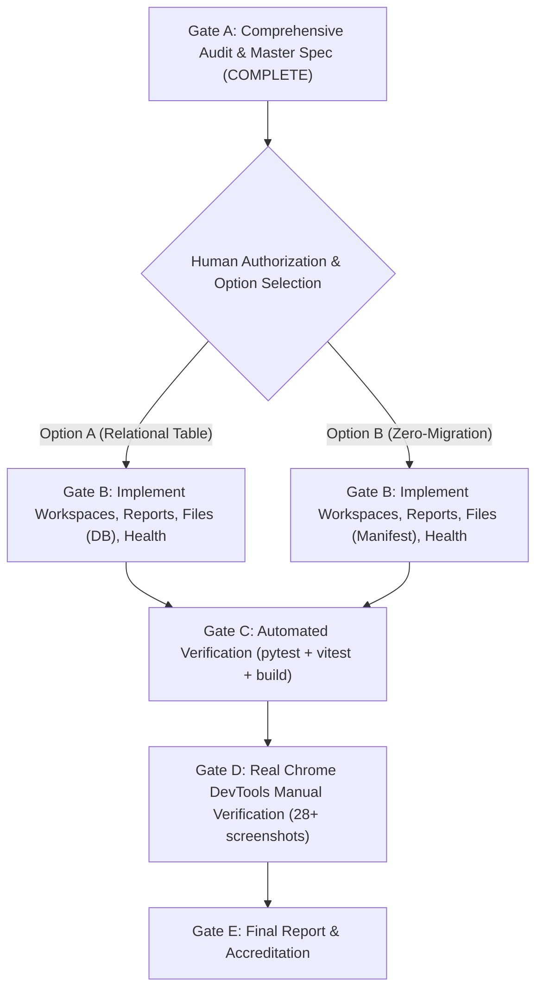

# VIBE — PHASE 12 STAGE 12.2.1
# ALL-IN-ONE MASTER SPECIFICATION & IMPLEMENTATION ROADMAP
## Complete Architectural Audit, Technical Specification, Database Proposal & Verification Matrix for "Soon" Sidebar Modules: Workspaces, Reports, File Storage & System Health

**Workspace:** `D:\vibe`  
**Project:** VIBE — Enterprise BI, Analytics & Data Intelligence Platform  
**Governing Document:** `docs/IMPLEMENTATION_PLAN.md` v2.0.0  
**Phase:** 12 — Production Readiness, End-to-End Testing & Deployment Verification  
**Stage:** 12.2.1 — Implementation of Missing Sidebar Modules  
**Gate:** GATE A — READ-ONLY AUDIT & MASTER ARCHITECTURE SPECIFICATION  
**Current Alembic Revision Head:** `370908748232` (Strictly Preserved)  
**Execution Environment:** `PYTHON_SANDBOX_ENABLED=false`, AWS Integration DEFERRED  
**Date of Issuance:** November 4, 2026  

---

# TABLE OF CONTENTS
1. [Executive Summary & Baseline Ground Truth](#1-executive-summary--baseline-ground-truth)
2. [Module A: Workspaces Audit & Technical Specification](#2-module-a-workspaces-audit--technical-specification)
3. [Module B: Reports Audit & Technical Specification](#3-module-b-reports-audit--technical-specification)
4. [Module C: File Storage Audit & Technical Specification](#4-module-c-file-storage-audit--technical-specification)
5. [Module D: System Health Audit & Technical Specification](#5-module-d-system-health-audit--technical-specification)
6. [Database Migration Proposal & Schema Architecture](#6-database-migration-proposal--schema-architecture)
7. [Shared Engineering, Security & Sidebar Integration](#7-shared-engineering-security--sidebar-integration)
8. [Comprehensive Verification & Accreditation Plan](#8-comprehensive-verification--accreditation-plan)
9. [Sequential Execution Gates & Authorization Decision](#9-sequential-execution-gates--authorization-decision)

---

# 1. Executive Summary & Baseline Ground Truth

In accordance with Phase 12 Stage 12.2.1 Gate A, an exhaustive, strictly read-only inspection was performed across the VIBE backend (`backend/app/`), frontend (`frontend/src/`), PostgreSQL database schemas (`vibe_enterprise` and `vibe_enterprise_test`), Redis cache, and existing automated test suites.

The primary objective is the production-grade realization of the four sidebar navigation modules currently flagged with `"coming_soon"` badges in `frontend/src/components/layout/sidebar.tsx`:
1. **Workspaces** (`href: "/workspaces"`)
2. **Reports** (`href: "/reports"`)
3. **File Storage** (`href: "/files"`)
4. **System Health** (`href: "/system"`)

### Module Readiness & Gap Matrix

| Module | DB Table Exists? | Backend Domain / Services? | FastAPI Router Exists? | Frontend Route Exists? | Current Operational State |
| :--- | :---: | :---: | :---: | :---: | :--- |
| **Workspaces** (`/workspaces`) | **Yes** (`workspaces`) | **Yes** (`Workspace`, `WorkspaceService`, `WorkspaceRepo`) | **No** (Missing `workspaces.py` router) | **No** (Next.js 404) | Domain logic 80% implemented. Router omitted from `main.py`, causing `DEF-002` nil UUID fallback in dashboards/spreadsheets. |
| **Reports** (`/reports`) | **Yes** (5 tables: `report_definitions`, `report_sections`, `report_runs`, etc.) | **Yes** (`ReportService`, `ReportStorageService`, `ReportRendererService`) | **Yes** (`routers/reports.py` with 15 endpoints) | **No** (Next.js 404, `GAP-01`) | Backend is 100% complete and verified in Phase 9/10. Zero frontend UI exists. Needs `frontend/src/app/reports/page.tsx`. |
| **File Storage** (`/files`) | **No** (No general user files table) | **Partial** (`AnalyticsStorageService`, `ReportStorageService`) | **Partial** (`/api/v1/analytics/storage` quota only) | **No** (Next.js 404) | Core local storage engines with traversal defenses exist, but no general user-facing file router or table exists. |
| **System Health** (`/system`) | **N/A** (Telemetry) | **Partial** (`health.py`, `backups.py`) | **Partial** (`/ready` checks DB/Redis; `/backups/status` checks RPO/RTO) | **No** (Next.js 404) | Basic unauthenticated readiness exists; authenticated deep subsystem telemetry (DB pool, Celery queue depth, storage breakdown) is missing. |

---

# 2. Module A: Workspaces Audit & Technical Specification

## 2.1 Existing Database Architecture
- **Table:** `public.workspaces` (Table 41 in PostgreSQL).
- **Primary Key:** `id` (`UUID`, default `gen_random_uuid()`).
- **Tenant Scope:** `organization_id` (`UUID`, foreign key `organizations.id` `ON DELETE CASCADE`, indexed).
- **Columns:**
  - `name`: `VARCHAR(255)` NOT NULL
  - `slug`: `VARCHAR(100)` NOT NULL, indexed
  - `created_at`: `TIMESTAMPTZ` NOT NULL
  - `updated_at`: `TIMESTAMPTZ` NOT NULL
- **Constraints:**
  - `uq_workspaces_org_slug`: Unique constraint on `(organization_id, slug)`.
  - `uq_workspaces_id_org`: Composite unique constraint on `(id, organization_id)`.

## 2.2 Dependent Foreign Keys & Cascade Deletion Risks
Inspection of PostgreSQL foreign key references revealed that `workspaces` is a foundational foreign key target across five major application domains:
1. `workbooks.workspace_id` -> `workspaces(id, organization_id)` (`ON DELETE CASCADE`, NOT NULL)
2. `dashboards.workspace_id` -> `workspaces(id)` (`ON DELETE CASCADE`, NOT NULL)
3. `analytics_jobs.workspace_id` -> `workspaces(id, organization_id)` (`ON DELETE CASCADE`, NOT NULL)
4. `report_definitions.workspace_id` -> `workspaces(id, organization_id)` (`ON DELETE CASCADE`, NOT NULL)
5. `report_runs.workspace_id` -> `workspaces(id, organization_id)` (`ON DELETE SET NULL`, nullable)

> [!WARNING]
> **Cascade Deletion Blast Radius:** Because `workbooks`, `dashboards`, `analytics_jobs`, and `report_definitions` declare `ON DELETE CASCADE` on `workspace_id`, deleting a workspace in PostgreSQL will automatically and permanently purge all dashboards, spreadsheets, and report definitions created inside that workspace!
> **Mandatory Safeguards:**
> 1. Pre-check: If any active dashboards, workbooks, or report definitions exist within the workspace, deletion must be blocked with an HTTP 409 Conflict error detailing the blocking dependencies.
> 2. Protection of Default Workspace: An organization's primary default workspace (slug: `default`) must be strictly protected from deletion.
> 3. Frontend double-confirmation modal requiring typing the workspace slug to confirm deletion.

## 2.3 Elimination of Defect `DEF-002` (Nil UUID Fallback)
- In `frontend/src/app/dashboards/page.tsx` (lines 386-402), dashboard creation attempted `fetch("/api/v1/workspaces")`. Because the endpoint returned 404, it fell back to nil UUID `00000000-0000-0000-0000-000000000000`, causing a foreign key violation 404/422 on creation.
- In `frontend/src/app/spreadsheets/page.tsx` (lines 440-447), workbook creation omitted `workspace_id`, causing a 422 Unprocessable Entity error.
- Mounting the real `/api/v1/workspaces` router will supply real workspaces (e.g. `Default Workspace`), eliminating the nil UUID fallback completely.

## 2.4 Backend Router Contract: `backend/app/api/v1/routers/workspaces.py`
Mounted at `/api/v1/workspaces`. All endpoints enforce authentication and tenant scoping via `Depends(get_current_membership)`.

```python
# API Endpoint Specifications
GET    /api/v1/workspaces            # List workspaces for tenant (search, pagination, sort)
POST   /api/v1/workspaces            # Create workspace (requires workspaces.create + CSRF)
GET    /api/v1/workspaces/{id}       # Get workspace details + aggregate resource stats
PATCH  /api/v1/workspaces/{id}       # Update workspace name/slug (requires workspaces.update + CSRF)
DELETE /api/v1/workspaces/{id}       # Safe delete (requires workspaces.delete + CSRF + dependency check)
```

## 2.5 Frontend Specification: `frontend/src/app/workspaces/page.tsx`
- **Header:** Title "Workspaces", description, "Create Workspace" action button.
- **Search & Filters:** Real-time search by workspace name or slug; sort by name or creation date.
- **Workspace Grid / Table:**
  - Workspace Name & Slug badge (`default` marked with primary badge).
  - Statistics chips: Count of Dashboards, Spreadsheets, Reports.
  - Creator & Creation Timestamp.
  - Action Dropdown: Edit Name/Slug, View Details, Delete (with confirmation modal).
- **Create Workspace Dialog:**
  - Name input (1–255 chars, auto-generates slug).
  - Slug input (2–100 chars, regex `^[a-z0-9]+(?:-[a-z0-9]+)*$`).
  - Validation feedback, CSRF token attachment, error notice handling.
- **Delete Confirmation Modal:**
  - Explicit warning showing resource counts.
  - Disables confirm button if resource count > 0 or slug is `default`.
  - Input field requiring typing the workspace slug to confirm deletion.
- **States:** Loading skeleton, empty state, network failure alert banner.

---

# 3. Module B: Reports Audit & Technical Specification

## 3.1 Reuse of Existing Backend API
The existing FastAPI router `backend/app/api/v1/routers/reports.py` is 100% complete with 15 REST endpoints and will be utilized directly:
1. `POST /api/v1/reports/definitions` (Create report definition; requires `reports.create` + CSRF)
2. `GET /api/v1/reports/definitions` (List definitions; filter by `workspace_id`; requires `reports.read`)
3. `GET /api/v1/reports/definitions/{id}` (Get definition details + sections; requires `reports.read`)
4. `PUT /api/v1/reports/definitions/{id}` (Update definition; requires `reports.update` + CSRF)
5. `DELETE /api/v1/reports/definitions/{id}` (Delete definition; requires `reports.delete` + CSRF)
6. `POST /api/v1/reports/definitions/{id}/sections` (Add section; requires `reports.update` + CSRF)
7. `PUT /api/v1/reports/definitions/{id}/sections/{section_id}` (Update section; requires `reports.update` + CSRF)
8. `DELETE /api/v1/reports/definitions/{id}/sections/{section_id}` (Delete section; requires `reports.update` + CSRF)
9. `POST /api/v1/reports/definitions/{id}/sections/reorder` (Reorder sections; requires `reports.update` + CSRF)
10. `POST /api/v1/reports/definitions/{id}/run` (Trigger asynchronous report run; requires `reports.run` + CSRF)
11. `GET /api/v1/reports/definitions/{id}/runs` (List run history for definition; requires `reports.read`)
12. `GET /api/v1/reports/runs/{run_id}` (Poll status of specific run; requires `reports.read`)
13. `POST /api/v1/reports/runs/{run_id}/download-token` (Issue temporary download token; requires `reports.export` + CSRF)
14. `GET /api/v1/reports/runs/{run_id}/download` (Direct token-authorized PDF download)
15. `GET /api/v1/reports/runs/{run_id}/stream` (Direct token-authorized PDF streaming)

## 3.2 Frontend Specification: `frontend/src/app/reports/page.tsx`
- **Main View — Reports Overview:**
  - Header with "Reports", description, and "New Report" modal trigger button.
  - Search input and workspace filter dropdown.
  - List / card view of report definitions:
    - Report title, description, orientation badge (`Portrait` / `Landscape`).
    - Associated workspace name.
    - Section count.
    - Last run status badge (`COMPLETED`, `PENDING`, `FAILED`, `NEVER RUN`).
    - Action buttons: "Run Now", "Configure Sections", "Edit", "Delete".
- **Create / Edit Report Definition Modal:**
  - Title, description, workspace selector (populated from `/api/v1/workspaces`).
  - Page orientation selector (`portrait` or `landscape`).
  - Page size selector (`a4` or `letter`).
- **Section Builder Modal / Drawer:**
  - Visual layout preview of sections.
  - Add section button: Text block, Metric card, Chart block, Table block.
  - Section reordering (move up/down controls) syncing with `/sections/reorder`.
  - Delete section confirmation.
- **Report Execution & Polling Flow:**
  - Clicking "Run Now" triggers `POST /api/v1/reports/definitions/{id}/run`.
  - Starts short polling on `GET /api/v1/reports/runs/{run_id}`.
  - Animated progress indicator (`Generating Snapshot` -> `Rendering HTML` -> `Compiling PDF` -> `Completed`).
  - When status is `COMPLETED`, displays "Download PDF" action.
- **Secure PDF Download Flow:**
  - Clicking "Download PDF" calls `POST /api/v1/reports/runs/{run_id}/download-token`.
  - Receives short-lived signed download token (valid 60 seconds).
  - Triggers browser download via `/api/v1/reports/runs/{run_id}/download?token={token}`.

---

# 4. Module C: File Storage Audit & Technical Specification

## 4.1 Storage Architecture & Security Controls
- Base directory: `backend/storage/user_files/` (configured via `settings.USER_FILES_STORAGE_DIR`).
- Scoped tenant directory: `backend/storage/user_files/{organization_id}/`.
- Security controls:
  - Traversal check: Rejects `..`, leading slashes, path separators in filename.
  - Containment check: Enforces `is_relative_to(base_dir / organization_id)`.
  - Symlink escape protection: Prohibits symlink creation or following.
  - Storage quota check: Calculates total file sizes for the organization against configured quota (default: 500 MB).
  - Dangerous file rejection: Disallows executable extensions (`.exe`, `.bat`, `.cmd`, `.sh`, `.ps1`, `.vbs`, `.js`, `.py`, `.dll`, `.so`). Allowed formats: `.csv`, `.xlsx`, `.xls`, `.json`, `.txt`, `.pdf`, `.png`, `.jpg`, `.jpeg`, `.parquet`.
  - Magic byte MIME verification: Verifies file signature matches extension.
  - AWS Deferral: 100% local/private storage; zero S3 SDKs, credentials, or Object Lock requirements.

## 4.2 Backend Service & Router Contract: `backend/app/api/v1/routers/files.py`
Mounted at `/api/v1/files`. All endpoints require authentication and tenant scoping.

```python
# API Endpoint Specifications
GET    /api/v1/files                   # List files for tenant with search, pagination, and sorting
POST   /api/v1/files/upload            # Upload file via multipart/form-data (validates size, type, quota)
GET    /api/v1/files/{file_id}         # Get metadata for specific file
GET    /api/v1/files/{file_id}/download# Download file with safe Content-Disposition: attachment header
GET    /api/v1/files/{file_id}/preview # Safe preview stream for CSV/JSON/TXT/PNG/JPEG
DELETE /api/v1/files/{file_id}         # Delete file with tenant validation (requires CSRF)
GET    /api/v1/files/quota/usage       # Authoritative storage quota, bytes used, bytes free, and percentage
```

## 4.3 Frontend Specification: `frontend/src/app/files/page.tsx`
- **Storage Quota Header Banner:**
  - Visual progress bar showing used storage vs total quota (e.g. `24.5 MB of 500 MB used (4.9%)`).
- **File Browser Toolbar:**
  - Search input, file type filter dropdown (All, Datasets/CSV, Spreadsheets, Documents, Images).
  - "Upload File" button triggering file picker or drag-and-drop zone.
- **Upload Zone / Modal:**
  - Drag-and-drop file target.
  - File size validation (< 25 MB per file).
  - Real upload progress indicator.
  - Friendly error alerts on rejection (quota exceeded, forbidden file extension).
- **Files Table:**
  - File Name & Extension icon (CSV, XLSX, PDF, PNG, etc.).
  - File Size (formatted: KB / MB).
  - Uploader Name / Email.
  - Upload Timestamp.
  - Actions: Preview (modal for CSV/JSON/Image/PDF), Download, Delete (with confirmation modal).
- **Safe File Preview Modal:**
  - Tabular viewer for CSV / JSON.
  - Image viewer for PNG / JPG.
  - Embedded viewer for PDF.
- **States:** Loading skeleton, empty state with upload call-to-action, error notice.

---

# 5. Module D: System Health Audit & Technical Specification

## 5.1 Subsystem Telemetry Architecture
An authoritative health monitoring service `SystemHealthService` (`backend/app/services/system_health.py`) will gather live metrics without executing heavy queries or mutating state:
1. **Frontend Application:** Self-reported client telemetry (browser user agent, viewport, network status).
2. **Backend API Core:** FastAPI uptime, environment, active version, worker process info.
3. **PostgreSQL Database:**
   - Active connection test (`SELECT 1`) with round-trip latency measurement.
   - SQLAlchemy AsyncEngine pool statistics: `pool.size()`, `pool.checkedin()`, `pool.checkedout()`, `pool.overflow()`.
   - PostgreSQL version string.
4. **Redis Cache & Distributed Lock:**
   - Redis `PING` round-trip latency.
   - Connected clients count, memory used bytes, Redis version via `INFO` command.
5. **Celery Worker & Queues:**
   - Queue depth inspection from Redis broker for `default`, `analytics`, `reporting`.
   - Worker active ping count.
6. **Analytics Execution Engine:**
   - Active jobs count (`analytics_jobs` table where status `RUNNING` or `QUEUED`).
7. **Storage Subsystems:**
   - Aggregated storage usage across analytics, reports, backups, user files, and host disk free space.
8. **Disaster Recovery & Backups:**
   - Integration with `SpoolManagerService` and latest backup status (RPO/RTO compliance).

## 5.2 Security & Anti-Leakage Rules
- Endpoint: `GET /api/v1/system/telemetry` in `backend/app/api/v1/routers/system.py`.
- Enforces `Depends(require_any_permission("organization.settings.update", "audit.read", "organization.read"))`.
- **Absolute Scrubbing:** Strips any database password, username, internal IP address, Redis URL, secret keys, or local absolute drive letters from the response payload.

## 5.3 Frontend Specification: `frontend/src/app/system/page.tsx`
- **Subsystem Grid (8 Subsystem Status Cards):**
  - Frontend, Backend API, PostgreSQL, Redis, Celery, Analytics Engine, Storage, Disaster Recovery.
  - Status Indicator: Green (Healthy), Yellow (Degraded), Gray (Not Configured / Unknown), Red (Unavailable).
  - Measured latency badges (e.g. `PostgreSQL 1.2ms`, `Redis 0.8ms`).
- **Telemetry Metrics Panels:**
  - Database Pool Utilization: visual gauge showing checked-out connections vs pool capacity.
  - Cache & Broker Metrics: Redis memory consumption, active queues.
  - Storage Utilization: disk usage breakdown by subsystem.
  - Backup & Recovery Posture: RPO compliance, RTO target, last drill verification timestamp.
- **Controls & Interaction:**
  - Manual "Refresh Now" button with spinner.
  - Auto-refresh toggle (disabled by default; 30s interval when enabled).
  - "Last updated" timestamp display.
- **States:** Loading skeleton, degraded system alert banner, error fallback.

---

# 6. Database Migration Proposal & Schema Architecture

## 6.1 Schema Analysis Across All 4 Modules
- **Workspaces:** Table `workspaces` already exists in PostgreSQL. (0 modifications required).
- **Reports:** Tables `report_definitions`, `report_sections`, `report_runs`, `report_download_tokens`, `report_outbox_events` all exist. (0 modifications required).
- **System Health:** Operational telemetry only. (0 modifications required).
- **File Storage:** Requires either a dedicated table (`stored_files`) or a filesystem metadata manifest.

## 6.2 Proposed Table Specification: `stored_files` (Option A)

```sql
CREATE TABLE public.stored_files (
    id UUID PRIMARY KEY DEFAULT gen_random_uuid(),
    organization_id UUID NOT NULL REFERENCES public.organizations(id) ON DELETE CASCADE,
    workspace_id UUID REFERENCES public.workspaces(id) ON DELETE SET NULL,
    uploaded_by_user_id UUID REFERENCES public.users(id) ON DELETE SET NULL,
    filename VARCHAR(255) NOT NULL,
    content_type VARCHAR(100) NOT NULL,
    size_bytes BIGINT NOT NULL,
    storage_path VARCHAR(500) NOT NULL,
    checksum_sha256 VARCHAR(64) NOT NULL,
    folder VARCHAR(255) NOT NULL DEFAULT '/',
    created_at TIMESTAMPTZ NOT NULL DEFAULT clock_timestamp(),
    updated_at TIMESTAMPTZ NOT NULL DEFAULT clock_timestamp(),

    CONSTRAINT uq_stored_files_org_folder_filename UNIQUE (organization_id, folder, filename)
);

CREATE INDEX ix_stored_files_org_id ON public.stored_files(organization_id);
CREATE INDEX ix_stored_files_workspace_id ON public.stored_files(workspace_id);
CREATE INDEX ix_stored_files_created_at ON public.stored_files(created_at DESC);
CREATE INDEX ix_stored_files_org_folder ON public.stored_files(organization_id, folder);
```

## 6.3 Draft Alembic Migration Script (`versions/481909849343_add_stored_files_table.py`)

```python
"""add_stored_files_table

Revision ID: 481909849343
Revises: 370908748232
Create Date: 2026-11-04 21:15:00.000000

"""
from alembic import op
import sqlalchemy as sa
from sqlalchemy.dialects import postgresql

revision = '481909849343'
down_revision = '370908748232'
branch_labels = None
depends_on = None


def upgrade() -> None:
    op.create_table(
        'stored_files',
        sa.Column('id', postgresql.UUID(as_uuid=True), primary_key=True),
        sa.Column('organization_id', postgresql.UUID(as_uuid=True), sa.ForeignKey('organizations.id', ondelete='CASCADE'), nullable=False),
        sa.Column('workspace_id', postgresql.UUID(as_uuid=True), sa.ForeignKey('workspaces.id', ondelete='SET NULL'), nullable=True),
        sa.Column('uploaded_by_user_id', postgresql.UUID(as_uuid=True), sa.ForeignKey('users.id', ondelete='SET NULL'), nullable=True),
        sa.Column('filename', sa.String(length=255), nullable=False),
        sa.Column('content_type', sa.String(length=100), nullable=False),
        sa.Column('size_bytes', sa.BigInteger(), nullable=False),
        sa.Column('storage_path', sa.String(length=500), nullable=False),
        sa.Column('checksum_sha256', sa.String(length=64), nullable=False),
        sa.Column('folder', sa.String(length=255), nullable=False, server_default='/'),
        sa.Column('created_at', sa.DateTime(timezone=True), server_default=sa.text('clock_timestamp()'), nullable=False),
        sa.Column('updated_at', sa.DateTime(timezone=True), server_default=sa.text('clock_timestamp()'), nullable=False),
        sa.UniqueConstraint('organization_id', 'folder', 'filename', name='uq_stored_files_org_folder_filename')
    )
    op.create_index('ix_stored_files_organization_id', 'stored_files', ['organization_id'])
    op.create_index('ix_stored_files_workspace_id', 'stored_files', ['workspace_id'])
    op.create_index('ix_stored_files_created_at', 'stored_files', [sa.text('created_at DESC')])


def downgrade() -> None:
    op.drop_index('ix_stored_files_created_at', table_name='stored_files')
    op.drop_index('ix_stored_files_workspace_id', table_name='stored_files')
    op.drop_index('ix_stored_files_organization_id', table_name='stored_files')
    op.drop_table('stored_files')
```

## 6.4 Alternative Architecture: Zero-Migration Filesystem JSON Manifest (Option B)
- Stores metadata in `backend/storage/user_files/{organization_id}/.manifest.json` with file-level mutex locking.
- Completely leaves PostgreSQL and Alembic head `370908748232` 100% untouched.

---

# 7. Shared Engineering, Security & Sidebar Integration

## 7.1 Sidebar Status Transition
Update `frontend/src/components/layout/sidebar.tsx`:
```typescript
// Transition from "coming_soon" to "active"
{ title: "Workspaces", href: "/workspaces", icon: Layers, status: "active" },
{ title: "Reports", href: "/reports", icon: FileText, status: "active" },
{ title: "File Storage", href: "/files", icon: FolderOpen, status: "active" },
{ title: "System Health", href: "/system", icon: Database, status: "active" },
```
- Removes all `"Soon"` badges.
- Enables Next.js router prefetching.
- Fixes tooltips to display real module descriptions.

## 7.2 Cross-Tenant Security Invariants
- Direct object reference tests: Requesting a resource belonging to Organization B using Organization A credentials returns 404 (to prevent resource enumeration).
- Tamper-proof session validation: All state-changing requests enforce session-bound CSRF tokens via `X-CSRF-Token` headers.

---

# 8. Comprehensive Verification & Accreditation Plan

## 8.1 Automated Test Suites (Gate C)
1. **Backend Tests (`backend/tests/`):**
   - `test_workspaces_router.py`: Workspace CRUD, slug validation, tenant isolation, cascade deletion blocking.
   - `test_reports_router.py`: Verification of definitions, sections, reordering, run triggers, and download tokens.
   - `test_files_router.py`: Upload validation, magic byte checking, traversal rejection, quota enforcement.
   - `test_system_health.py`: Subsystem telemetry aggregation, pool stats, secret scrubbing.
2. **Frontend Component Tests (`frontend/src/__tests__/`):**
   - `workspaces.test.tsx`, `reports.test.tsx`, `files.test.tsx`, `system.test.tsx`.
3. **Static Analysis & Builds:**
   - TypeScript: `npx tsc --noEmit`
   - ESLint: `npm run lint`
   - Next.js Production Build: `npm run build`

## 8.2 Real Google Chrome DevTools Verification (Gate D)
- Browser: Real Google Chrome via Chrome DevTools MCP.
- Viewports: Desktop (1440x900) and Mobile (390x844).
- Interactive Element Inventory (`EL-086` through `EL-115`):
  - Workspaces: Create workspace dialog, slug validation, search filter, safe delete modal.
  - Reports: Create definition, add/reorder sections, trigger run, download signed PDF.
  - File Storage: Drag-and-drop upload, quota progress bar, CSV preview modal, download.
  - System Health: View subsystem cards, pool utilization gauge, manual refresh.
  - Dashboards & Spreadsheets: Verified creation without nil UUID fallback.

---

# 9. Sequential Execution Gates & Authorization Decision



### Action Required from Human Authorizer:
Please select your preferred File Storage data persistence strategy:
- **Option A (Relational Table — Recommended):** Authorize creating the `stored_files` table via Alembic migration on `vibe_enterprise_test`.
- **Option B (Zero Migration — Strict Head Preservation):** Authorize implementing File Storage via tenant-isolated filesystem JSON manifests, keeping Alembic head `370908748232` completely unchanged.

Upon receiving your selection and explicit authorization, implementation will begin strictly with **Module A (Workspaces)**.
