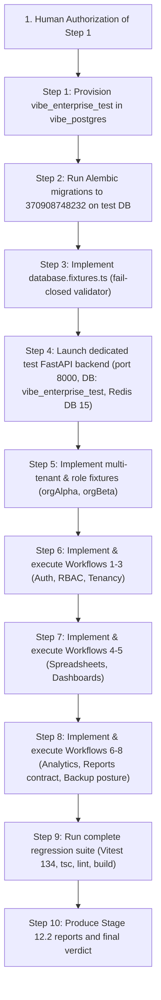

# VIBE — PHASE 12 STAGE 12.2 AMENDED PLANNING GATE
## Comprehensive Playwright E2E Workflow Automation Implementation Plan

**Workspace:** `D:\vibe`  
**Phase:** 12 — Production Readiness, End-to-End Testing & Deployment Verification  
**Stage:** 12.2 — Comprehensive E2E Workflow Automation  
**Governing Document:** `docs/IMPLEMENTATION_PLAN.md` v2.0.0  
**Status:** AMENDED PLANNING GATE COMPLETE — AWAITING HUMAN AUTHORIZATION  

---

## 1. Executive Summary & Required Amendments

This amended plan resolves all planning corrections stipulated in the Stage 12.2 human review:
1. **PostgreSQL Provisioning Safety:** Verified container inventory; established safe provisioning of `vibe_enterprise_test` with owner `vibe_admin`; verified migration identity up to exact head `370908748232`; ensured Playwright never receives PostgreSQL superuser credentials; guaranteed zero mutation of `vibe_enterprise`; implemented fail-closed database name validation.
2. **Redis Isolation & Queue Decoupling:** Verified Redis client configuration; selected Redis DB 15 with `e2e:<runId>:` keys; decoupled development Celery worker queue (on DB 1) from test DB; strictly banned `FLUSHDB`/`FLUSHALL`.
3. **Authentic Capability Audit:** Audited all existing features and classified every proposed scenario as `IMPLEMENTED`, `PARTIALLY IMPLEMENTED`, `NOT IMPLEMENTED`, or `DEFERRED`.
4. **Disaster Recovery Test Boundaries:** Strictly bounded browser tests to status/posture inspection and 403 access control; prohibited restore drills, backup deletion, or claims of actual recovery certification.
5. **Browser Execution Matrix:** Desktop Chromium runs full suites; Mobile Chrome runs touch, drawer, and responsive layouts; heavy 50k virtual grid stress testing scoped to Desktop; no excluded tests reported as passed.
6. **Scoped Cleanup & Worker Isolation:** Unique `runId` scoping; non-destructive targeted teardown in `afterAll`; zero table truncations.
7. **Stage 12.2.1 Integration:** Cataloged discovered gaps (Frontend Reports UI, Spreadsheet Sorting/Filtering UI, Manual Backup Job Trigger) for handoff to Stage 12.2.1.

---

## 2. Authentic Feature Capability Matrix

| Feature Domain | Specific Capability | Classification | Scope in Stage 12.2 E2E |
| :--- | :--- | :---: | :--- |
| **Authentication** | Registration, Login (argon2id), Session Cookie, Reload Persistence, Logout | **IMPLEMENTED** | Full browser E2E test in `01_auth_lifecycle.spec.ts`. |
| **RBAC** | System roles inspection (`/roles`), Viewer/Member restrictions, 403 checks | **IMPLEMENTED** | Full browser E2E test in `02_rbac_navigation.spec.ts`. |
| **Multi-Tenancy** | `orgAlpha` vs `orgBeta` boundary, cross-tenant 404/403 rejection, isolated listings | **IMPLEMENTED** | Full browser E2E test in `03_multi_tenancy.spec.ts`. |
| **Spreadsheets** | 50,000-row Virtual Grid, cell navigation, editing, batch update, formulas (`SUM`, `AVERAGE`, `COUNT`, `MIN`, `MAX`, `IF`, ops), undo/redo | **IMPLEMENTED** | Full browser E2E test in `04_spreadsheets.spec.ts`. |
| **Spreadsheets** | Grid Sorting & Column Filtering UI | **NOT IMPLEMENTED** | No sort/filter controls present in page. Carried into Stage 12.2.1. |
| **Spreadsheets** | Google Sheets live sync | **DEFERRED** | Requires live external Google OAuth credentials. |
| **Dashboards** | Create, edit metadata, add widget (bar, line, pie, kpi, table), drag-and-drop reorder, ECharts rendering, global filter bar, duplicate, delete | **IMPLEMENTED** | Full browser E2E test in `05_dashboards.spec.ts`. |
| **Analytics** | Catalogue listing, parameter validation, job submission (HTTP 202 Accepted), Python sandbox disabled rejection | **IMPLEMENTED** | Full browser E2E test in `06_analytics.spec.ts`. |
| **Analytics** | Asynchronous Celery worker completion under test DB | **PARTIALLY IMPLEMENTED** | Job submission and outbox queuing verified; dev worker decoupled from test DB. |
| **Reports** | Backend Report Definitions, Sections, Runs, Download Token API | **IMPLEMENTED** | Verified via API helper tests in `07_reports.spec.ts`. |
| **Reports** | Dedicated Frontend Reports UI Page | **NOT IMPLEMENTED** | No `/reports` page; command palette is placeholder. Carried into Stage 12.2.1. |
| **Backups & DR** | Status, history & verification API (`/backups/status`), BackupRecoveryCard UI rendering, 403 access control | **IMPLEMENTED** | Full browser E2E test in `08_backups_dr.spec.ts`. |
| **Backups & DR** | Manual backup job creation button in UI | **NOT IMPLEMENTED** | Backups are scheduled via Celery beat; no UI trigger exists. Carried into Stage 12.2.1. |
| **Backups & DR** | Physical restore drills, host loss simulations, AWS Object Lock | **DEFERRED** | Prohibited from browser E2E suites. |

---

## 3. Implementation Sequence & Actions Requiring Authorization

### Exact Actions Requiring Authorization:
1. **Creation of `vibe_enterprise_test`**:
   `docker exec vibe_postgres psql -U vibe_admin -d postgres -c "CREATE DATABASE vibe_enterprise_test WITH OWNER vibe_admin TEMPLATE template1;"`
2. **Execution of Alembic migrations on `vibe_enterprise_test`** up to existing head `370908748232`.
3. **Execution of Stage 12.2 Implementation Sequence.**

---

## 4. Final Planning Gate Attestation

- **Source Code Mutations:** 0 files modified in `backend/` or `frontend/`.
- **Database Mutations:** 0 databases or tables modified. `vibe_enterprise` is untouched.
- **Alembic Revision Head:** Strictly preserved at `370908748232`.
- **Python Sandbox Setting:** Strictly preserved at `PYTHON_SANDBOX_ENABLED=false`.
- **AWS Cloud Integration:** Strictly preserved as `DEFERRED`.

---

## 5. Mandatory Stop Notice

**AMENDED PLANNING GATE COMPLETE.**  
No source code, configuration, or database modifications have been performed. Awaiting explicit human approval to proceed with Step 1 of implementation.
