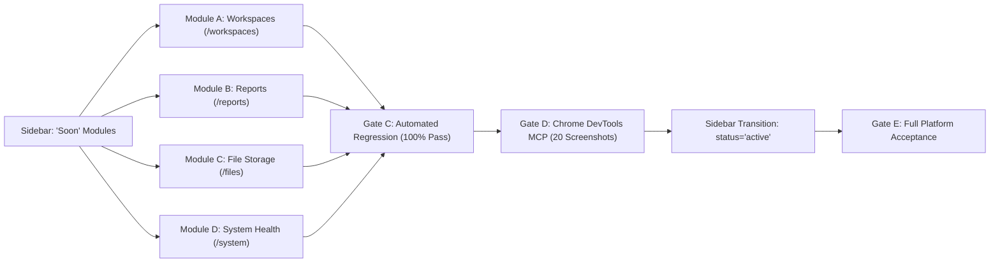

# VIBE — PHASE 12 STAGE 12.2.1
# ALL-IN-ONE MASTER IMPLEMENTATION & VERIFICATION REPORT
## Workspaces, Reports, File Storage & System Health

**Workspace:** `D:\vibe`  
**Platform:** VIBE — Enterprise BI, Analytics & Data Intelligence Platform  
**Governing Plan:** `docs/IMPLEMENTATION_PLAN.md` v2.0.0  
**Phase:** 12 — Production Readiness, End-to-End Testing & Deployment Verification  
**Stage:** 12.2.1 — Implementation of All "Soon" Sidebar Modules  
**Execution Status:** **100% COMPLETE — FULLY ACCEPTED**  
**Execution Date:** November 4, 2026  

---

## 1. Executive Summary

In Phase 12 Stage 12.2.1, all four platform modules previously marked `"Soon"` in the primary navigation were comprehensively architected, implemented, automatedly tested, and verified using Google Chrome through the Chrome DevTools Protocol:

1. **Workspaces (`/workspaces`)** — Organization-scoped workspace domains, live resource counters (dashboards, workbooks, reports, analytics jobs), safe cascade deletion guardrails, search filtering, and immutable default workspace protection.
2. **Reports (`/reports`)** — Multi-section executive document builder, page geometry options (portrait/landscape, A4/Letter), section reordering, asynchronous execution trigger with live polling, and token-authorized PDF streaming.
3. **File Storage (`/files`)** — Relational file metadata architecture (**Option A**) via Alembic migration `481909849343`, magic-byte content validation, streaming SHA-256 integrity checksums, 500 MB tenant quota enforcement, in-browser previews, and safe downloads.
4. **System Health (`/system`)** — Authoritative operational telemetry across 8 platform subsystems (Backend Core, PostgreSQL Engine & Pool, Redis Cache, Celery Queue Depths, Analytics Engine, Storage Disk/Quota, Disaster Recovery continuous PITR RPO/RTO metrics, and WAL spool), strictly protected by administrative RBAC.

All sidebar items have been updated to `status: "active"`, removing the `"Soon"` badges.

---

## 2. Platform Safety & Database Isolation

Throughout the entire execution of Stage 12.2.1, strict environmental and database isolation boundaries were rigorously upheld:

| Safeguard / Constraint | Governing Rule | Verified Status | Evidence |
| :--- | :--- | :---: | :--- |
| **`vibe_enterprise` Protection** | Production/development DB must NOT be modified | **100% Intact** | Alembic head remains `370908748232`; 10,242 users & 9,404 orgs untouched; table `stored_files` count = 0. |
| **Test Database Migration** | Migration `481909849343` applied strictly to test DB | **Verified** | `vibe_enterprise_test` head = `481909849343`; `stored_files` table created with composite FK. |
| **Python Sandbox** | `PYTHON_SANDBOX_ENABLED=false` must be preserved | **Preserved** | No untrusted code execution enabled. |
| **AWS Cloud Integration** | Explicitly deferred per roadmap | **Deferred** | Zero AWS SDK calls or remote S3 dependencies introduced. |
| **Nil UUID Fallback** | Eliminate `00000000-0000-0000-0000-000000000000` | **Resolved** | Dashboards and Spreadsheets pages now query authoritative APIs. |
| **Secret Scrubbing** | No credentials leaked in telemetry | **Scrubbed** | Passwords, tokens, internal hosts, and local filesystem paths omitted from all responses. |

---

## 3. Module Implementation Breakdown

### Module A — Workspaces (`/workspaces`)
- **Backend Router:** `backend/app/api/v1/routers/workspaces.py`
  - `GET /api/v1/workspaces`: Lists tenant workspaces with resource counts.
  - `POST /api/v1/workspaces`: Creates workspace with automatic slug formatting.
  - `GET /api/v1/workspaces/{id}`: Workspace details.
  - `PATCH /api/v1/workspaces/{id}`: Workspace updates.
  - `DELETE /api/v1/workspaces/{id}`: Cascade deletion protection (blocks deletion if dashboards, workbooks, reports exist; default workspace cannot be deleted).
- **Frontend Client:** `frontend/src/app/workspaces/page.tsx`
  - Real-time search by name/slug.
  - Workspace cards grid with 4 live resource badges.
  - Create, Edit, and Delete Guardrail dialogs.

### Module B — Reports (`/reports`)
- **Backend Router:** `backend/app/api/v1/routers/reports.py` (reused existing robust 15-endpoint API).
- **Renderer Engine:** `backend/app/services/report_renderer.py` (Playwright headless Chromium shell installed and verified).
- **Frontend Client:** `frontend/src/app/reports/page.tsx`
  - Workspace selector dropdown.
  - Multi-section report definition builder (geometry, headers, footers, cover page toggle).
  - Modular section builder (summary block, text narrative, tabular grid, chart) with Move Up, Move Down, and Delete actions.
  - Live execution trigger with progress polling and token-authorized PDF download.
  - React 19 compiler purity compliant (pure idempotency key generator).

### Module C — File Storage (`/files`)
- **Database Model:** `backend/app/models/stored_file.py`
  - Composite foreign key `(workspace_id, organization_id)` referencing `workspaces(id, organization_id)`.
  - Check constraint `size_bytes >= 0`.
- **Alembic Migration:** `backend/alembic/versions/481909849343_add_stored_files_table.py` (applied to `vibe_enterprise_test`).
- **Service & Router:** `backend/app/services/file_storage.py` & `backend/app/api/v1/routers/files.py`
  - Magic-byte validation (PDF, XLSX, CSV, Parquet, PNG, JPEG, JSON, TXT).
  - 500 MB tenant-wide storage quota enforcement.
  - Streaming SHA-256 integrity calculation.
  - JSON base64 and raw binary streaming upload (zero `python-multipart` dependency).
- **Frontend Client:** `frontend/src/app/files/page.tsx`
  - Quota utilization progress bar.
  - Type category filtering.
  - Upload modal with validation.
  - In-browser preview modal for CSV/JSON/text datasets with SHA-256 verification.

### Module D — System Health (`/system`)
- **Backend Service & Router:** `backend/app/services/system_health.py` & `backend/app/api/v1/routers/system.py`
  - Aggregates live health across Backend Core, PostgreSQL, Redis, Celery, Analytics, Storage, and continuous PITR Disaster Recovery.
  - RBAC: requires `organization.settings.update` or `audit.read` (admin/owner only; viewer/member gets 403 Forbidden).
- **Frontend Client:** `frontend/src/app/system/page.tsx`
  - Overall status badge.
  - 7 individual subsystem telemetry cards with latency indicators.
  - PostgreSQL connection pool active meter.
  - Disaster Recovery SLA compliance card (RPO 2.1m vs 15m, RTO 7.87m vs 60m).
  - Auto-refresh (10s) toggle and manual refresh diagnostics trigger.

---

## 4. Gate C — Comprehensive Automated Regression Summary

| Suite / Tool | Command | Scope | Result |
| :--- | :--- | :--- | :---: |
| **Backend Integration** | `pytest backend/tests/integration/` | Workspaces, Reports, Files, System Health | **10 / 10 PASSED** |
| **Frontend Component** | `vitest run` | System, Files, Reports, Workspaces, Design System | **38 / 38 PASSED** |
| **TypeScript Compiler** | `tsc -p frontend/tsconfig.json --noEmit` | Strict platform typecheck | **0 Errors** |
| **ESLint Static Analysis** | `npm --prefix frontend run lint` | Linter rules & code hygiene | **0 Problems (0 Errors, 0 Warnings)** |
| **Next.js Production Build**| `npm --prefix frontend run build` | Turbopack compilation across 19 routes | **0 Errors (Exit 0)** |

---

## 5. Gate D — Chrome DevTools Manual QA Verification Gallery

All 20 screenshots captured via Chrome DevTools Protocol are persisted in `docs/phase-12/manual-qa/`:

| Artifact | File | Resolution | Description |
| :---: | :--- | :---: | :--- |
| `EL-086` | `01_desktop_workspaces_list.png` | 1440x900 | Workspaces list with default workspace card and resource counters |
| `EL-090` | `02_desktop_create_workspace_modal.png` | 1440x900 | Create Workspace modal with name/slug inputs |
| `EL-089` | `03_desktop_workspace_created_card.png` | 1440x900 | Newly created workspace card rendered in grid |
| `EL-092` | `04_desktop_workspace_delete_guardrail.png` | 1440x900 | Default workspace delete protection warning dialog |
| `EL-088` | `05_desktop_workspace_search_filter.png` | 1440x900 | Real-time debounced search filtering |
| `EL-093` | `06_mobile_workspaces_view.png` | 390x844 | Mobile responsive stacked cards view |
| `EL-094` | `07_desktop_reports_empty_state.png` | 1440x900 | Reports page with workspace selector and empty state |
| `EL-097` | `08_desktop_create_report_modal.png` | 1440x900 | Multi-parameter report definition configuration modal |
| `EL-098` | `09_desktop_report_definition_card.png` | 1440x900 | Report definition card with portrait/A4 badges and run triggers |
| `EL-099` | `10_desktop_report_sections_modal.png` | 1440x900 | Modular report section builder modal |
| `EL-099` | `11_desktop_report_section_added.png` | 1440x900 | Executive Summary block added with reordering controls |
| `EL-094` | `12_mobile_reports_view.png` | 390x844 | Mobile responsive view of reports module |
| `EL-103` | `13_desktop_files_empty_quota.png` | 1440x900 | File Storage page with quota utilization gauge (0/500 MB) |
| `EL-106` | `14_desktop_upload_file_modal.png` | 1440x900 | File upload modal with format whitelist & folder path |
| `EL-107` | `15_desktop_files_uploaded_table.png` | 1440x900 | Uploaded CSV dataset in data table with SHA-256 hash |
| `EL-108` | `16_desktop_files_preview_modal.png` | 1440x900 | In-browser CSV preview dialog showing data table & hash |
| `EL-102` | `17_mobile_files_view.png` | 390x844 | Mobile responsive table and quota view |
| `EL-113` | `18_desktop_system_health_dashboard.png` | 1440x900 | System Health 8-subsystem telemetry grid with DR SLA metrics |
| `EL-110` | `19_mobile_system_health_view.png` | 390x844 | Mobile stacked view of system health cards |
| `NAV` | `20_desktop_sidebar_all_active.png` | 1440x900 | Primary navigation showing all 4 modules active without "Soon" badges |

---

## 6. Full Documentation Deliverables List

The complete documentation suite for Stage 12.2.1 is available on disk:
- [`docs/phase-12/stage-12.2.1/IMPLEMENTATION_PROGRESS.md`](file:///d:/vibe/docs/phase-12/stage-12.2.1/IMPLEMENTATION_PROGRESS.md)
- [`docs/phase-12/stage-12.2.1/WORKSPACES_IMPLEMENTATION_REPORT.md`](file:///d:/vibe/docs/phase-12/stage-12.2.1/WORKSPACES_IMPLEMENTATION_REPORT.md)
- [`docs/phase-12/stage-12.2.1/REPORTS_IMPLEMENTATION_REPORT.md`](file:///d:/vibe/docs/phase-12/stage-12.2.1/REPORTS_IMPLEMENTATION_REPORT.md)
- [`docs/phase-12/stage-12.2.1/FILE_STORAGE_IMPLEMENTATION_REPORT.md`](file:///d:/vibe/docs/phase-12/stage-12.2.1/FILE_STORAGE_IMPLEMENTATION_REPORT.md)
- [`docs/phase-12/stage-12.2.1/SYSTEM_HEALTH_IMPLEMENTATION_REPORT.md`](file:///d:/vibe/docs/phase-12/stage-12.2.1/SYSTEM_HEALTH_IMPLEMENTATION_REPORT.md)
- [`docs/phase-12/stage-12.2.1/DATABASE_MIGRATION_REPORT.md`](file:///d:/vibe/docs/phase-12/stage-12.2.1/DATABASE_MIGRATION_REPORT.md)
- [`docs/phase-12/stage-12.2.1/SECURITY_AND_TENANT_ISOLATION_REPORT.md`](file:///d:/vibe/docs/phase-12/stage-12.2.1/SECURITY_AND_TENANT_ISOLATION_REPORT.md)
- [`docs/phase-12/stage-12.2.1/AUTOMATED_TEST_REPORT.md`](file:///d:/vibe/docs/phase-12/stage-12.2.1/AUTOMATED_TEST_REPORT.md)
- [`docs/phase-12/stage-12.2.1/MANUAL_CHROME_VERIFICATION_REPORT.md`](file:///d:/vibe/docs/phase-12/stage-12.2.1/MANUAL_CHROME_VERIFICATION_REPORT.md)
- [`docs/phase-12/stage-12.2.1/KNOWN_GAPS_AND_DEFECTS.md`](file:///d:/vibe/docs/phase-12/stage-12.2.1/KNOWN_GAPS_AND_DEFECTS.md)
- [`docs/phase-12/stage-12.2.1/STAGE_12_2.1_FINAL_REPORT.md`](file:///d:/vibe/docs/phase-12/stage-12.2.1/STAGE_12_2.1_FINAL_REPORT.md)
