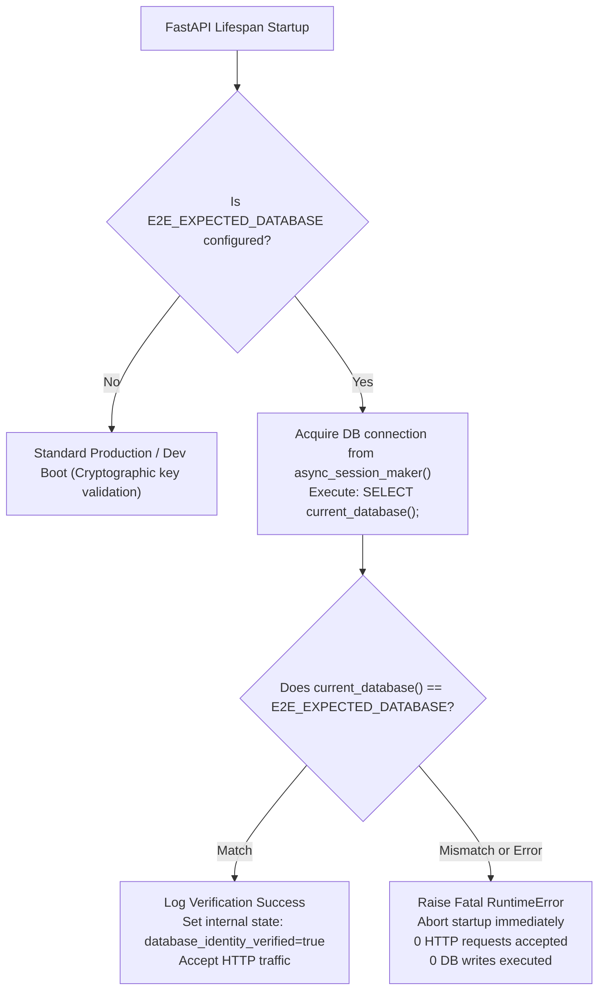
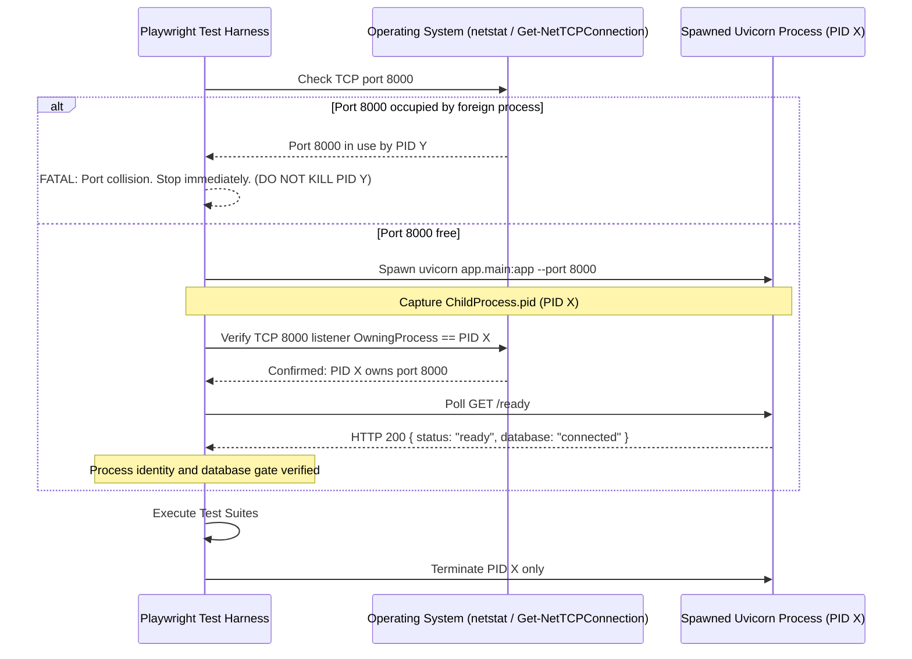
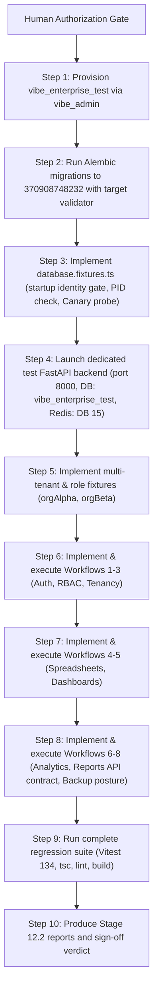

# VIBE — PHASE 12 STAGE 12.2 FINAL DATABASE ISOLATION SAFETY CORRECTION REPORT
## Fail-Closed Database Identity Validation, Pre-Migration Protection & Process Security

**Workspace:** `D:\vibe`  
**Phase:** 12 — Production Readiness, End-to-End Testing & Deployment Verification  
**Stage:** 12.2 — Comprehensive Playwright E2E Workflow Automation  
**Mode:** STRICT READ-ONLY REVIEW, PLANNING & DOCUMENTATION CORRECTION  
**Implementation Authorization:** NOT GRANTED  
**Date:** 2026-11-04  
**Final Recommendation:** **APPROVE WITH EXPLICIT LIMITATIONS**  

---

## 1. Executive Summary

This report establishes the final, fail-closed database isolation architecture for Phase 12 Stage 12.2. It resolves the fundamental weakness of retrospective canary detection by implementing **pre-write, fail-closed prevention gates** at every entry point:
1. **Independent FastAPI Database Identity Gate:** Uses an independently configured expected identity (`E2E_EXPECTED_DATABASE=vibe_enterprise_test`) and validates `SELECT current_database();` during application lifespan startup before accepting any HTTP requests, registering users, or performing any database writes.
2. **Independent Alembic Pre-Migration Validator:** Validates `current_database() == E2E_EXPECTED_DATABASE` in `env.py` before `run_migrations()` can execute any DDL or schema mutation.
3. **Process Identity & PID Binding:** Playwright binds to the specific uvicorn PID spawned for the test run, verifying via port listening metadata that requests on port 8000 reach the expected process.
4. **Canary Protocol Retained as Secondary Defense:** Downgraded to secondary defense-in-depth verification executed only after the startup identity gate passes.
5. **Superuser Risk Assessment & Least-Privilege Proposal:** Explicitly states the reality that `vibe_admin` currently possesses `rolsuper=true`, and documents a least-privilege role architecture proposal for future migration.
6. **Foreign-Key Cleanup Safety Matrix:** Conducted a complete SQL audit of all 138 foreign-key delete rules, proving that organization deletion alone leaves users and audit events orphaned, and establishing an explicit four-step dependency-ordered cleanup algorithm.

---

## 2. Mandatory Correction A — Independent Backend Database Identity Gate

### 2.1 The Core Requirement: Prevention Over Detection
The test backend connects using `vibe_admin`, which currently has `rolsuper=true`. If the connection URL were accidentally configured to point to `vibe_enterprise`, registering a canary user would modify the development database before any subsequent assertion could detect the error. **Detection after an unintended write is not prevention.**

### 2.2 Startup Gate Architecture
The FastAPI application startup lifecycle in `backend/app/main.py` (`lifespan`) will incorporate an independent database identity gate:



### 2.3 Key Technical Specifications
1. **Independent Configuration Variable:**
   ```env
   E2E_EXPECTED_DATABASE=vibe_enterprise_test
   ```
   This value is provided independently and is **never** parsed or extracted from `DATABASE_URL`.
2. **Pre-Traffic Execution:**
   The verification query `SELECT current_database();` executes in `lifespan` before the `yield` statement. No HTTP router, background task, or request middleware can process traffic until this query succeeds.
3. **Fail-Closed Semantics:**
   If the database name does not match `E2E_EXPECTED_DATABASE` exactly, or if the connection fails or is missing, `lifespan` raises a fatal `RuntimeError`:
   ```text
   FATAL: Database identity mismatch! Expected 'vibe_enterprise_test', but connected to 'vibe_enterprise'. 
   Startup aborted to prevent cross-database mutation.
   ```
   The uvicorn process exits immediately with a non-zero code. It does not enter a degraded state, does not accept traffic, and does not retry against other databases.
4. **Engine & Connection Protection:**
   - The query executes through `async_session_maker()` on the primary `engine = create_async_engine(settings.DATABASE_URL)`.
   - Because `pool_pre_ping=True` and `expire_on_commit=False` are configured, lazy initialization cannot bypass the check.
   - There are no alternate database engines within the FastAPI application code.
5. **Security Boundary Statement:**
   This gate provides **fail-closed configuration protection against accidental database misdirection**. It does not provide cryptographic privilege isolation against a malicious superuser process intentionally altering its own SQL queries.

---

## 3. Mandatory Correction B — Independent Alembic Target Validation

### 3.1 Pre-Migration Gate Architecture
Inspection of `backend/alembic/env.py` confirms that Alembic establishes a synchronous connection using `DATABASE_SYNC_URL`. To guarantee that Alembic never executes schema mutations (`upgrade`, `downgrade`, `stamp`) against an unintended database:

In `backend/alembic/env.py`, inside `run_migrations_online()`:
```python
def run_migrations_online() -> None:
    connectable = engine_from_config(
        config.get_section(config.config_ini_section, {}),
        prefix="sqlalchemy.",
        poolclass=pool.NullPool,
    )

    with connectable.connect() as connection:
        expected_db = os.environ.get("E2E_EXPECTED_DATABASE")
        if expected_db:
            from sqlalchemy import text
            actual_db = connection.execute(text("SELECT current_database();")).scalar()
            if actual_db != expected_db:
                raise RuntimeError(
                    f"FATAL: Alembic migration target mismatch! "
                    f"Expected '{expected_db}', but connected to '{actual_db}'. "
                    "Migration execution aborted immediately to protect unintended database."
                )
            if actual_db in ("vibe_enterprise", "vibe_benchmark", "postgres"):
                raise RuntimeError(
                    f"FATAL: Attempting to run E2E migrations against protected database '{actual_db}'! "
                    "Aborted immediately."
                )

        context.configure(connection=connection, target_metadata=target_metadata)
        with context.begin_transaction():
            context.run_migrations()
```

### 3.2 Pre-Migration Guarantees
1. Validation occurs over the live psycopg connection **before** `context.begin_transaction()` and before any table is created or modified.
2. If `DATABASE_SYNC_URL` points to `vibe_enterprise`, the migration command immediately crashes with `RuntimeError` and exits with code 1.
3. Zero new migration files are created; Alembic head `370908748232` is preserved.

---

## 4. Mandatory Correction C — Test Harness Backend Process Identity

### 4.1 Port & Process Binding Protocol
To guarantee that Playwright interacts exclusively with the dedicated test backend process and never mistakes an existing development backend for the test instance:



### 4.2 Safeguards
1. **Zero Killing of Unknown Processes:** If port 8000 is occupied prior to test launch, the harness immediately halts. It **never** issues kill signals to foreign PIDs.
2. **PID Verification:** On Windows PowerShell, `Get-NetTCPConnection -LocalPort 8000` verifies that the owning process matches the spawned child PID.
3. **Non-Sensitive Readiness:** The `/ready` endpoint reports operational readiness without leaking database credentials, passwords, or connection strings.
4. **Scoped Teardown:** Upon suite completion (success or failure), the test harness terminates only `testBackendProcess.pid`.

---

## 5. Mandatory Correction D — Canary Protocol Retention (Defense-in-Depth)

The canary protocol is retained, but formally downgraded from primary safety to **secondary defense-in-depth verification**:
1. **Pre-condition:** The canary user is registered **only after** the backend successfully passes its startup database identity gate.
2. **Registration:** `POST /api/v1/auth/register` creates `canary_<runId>@vibe.internal`.
3. **Dual-Database Assertions:**
   - In `vibe_enterprise_test`: `SELECT count(*) FROM users WHERE email = 'canary_<runId>@vibe.internal';` must equal `1`.
   - In `vibe_enterprise`: `SELECT count(*) FROM users WHERE email = 'canary_<runId>@vibe.internal';` must strictly equal `0`.
4. **Action on Failure:** If either assertion fails, the test suite aborts immediately with a fatal isolation error, preserving logs for forensic inspection.

---

## 6. Mandatory Correction E — Superuser Risk Assessment & Least-Privilege Proposal

### 6.1 Explicit Superuser Risk Statement
> **The Stage 12.2 test backend currently uses a PostgreSQL superuser identity (`vibe_admin`, `rolsuper=true`). Database-name validation reduces accidental misconfiguration risk but does not provide privilege isolation against a compromised or malicious application process.**

### 6.2 Proposed Least-Privilege Role Architecture
To provide true operating-system and database-engine level privilege separation in a future phase, the following least-privilege role architecture is proposed:

```sql
-- Proposed Future Least-Privilege Role Setup (NOT EXECUTED IN STAGE 12.2)
-- 1. Create dedicated application role
CREATE ROLE vibe_test_app WITH LOGIN PASSWORD 'strong_test_app_password' NOSUPERUSER NOCREATEDB NOCREATEROLE NOINHERIT;

-- 2. Grant scoped database and schema access on test DB only
GRANT CONNECT ON DATABASE vibe_enterprise_test TO vibe_test_app;
\c vibe_enterprise_test
GRANT USAGE ON SCHEMA public TO vibe_test_app;

-- 3. Grant DML on existing and future tables
GRANT SELECT, INSERT, UPDATE, DELETE ON ALL TABLES IN SCHEMA public TO vibe_test_app;
GRANT USAGE, SELECT ON ALL SEQUENCES IN SCHEMA public TO vibe_test_app;
GRANT EXECUTE ON ALL FUNCTIONS IN SCHEMA public TO vibe_test_app;

-- 4. Set default privileges for tables created by migrations
ALTER DEFAULT PRIVILEGES FOR ROLE vibe_admin IN SCHEMA public GRANT SELECT, INSERT, UPDATE, DELETE ON TABLES TO vibe_test_app;
ALTER DEFAULT PRIVILEGES FOR ROLE vibe_admin IN SCHEMA public GRANT USAGE, SELECT ON SEQUENCES TO vibe_test_app;
```

- **Application Compatibility:** Existing application code uses standard SQLAlchemy ORM sessions and does not issue superuser-only DDL or system commands.
- **Implementation Status:** Introducing this role requires a dedicated administrative migration, which is **not authorized** in Stage 12.2 and is deferred to a future security gate.

---

## 7. Mandatory Correction F — Cleanup and Foreign-Key Safety Analysis

### 7.1 Complete Foreign-Key Inspection (138 Referential Constraints)
A complete query of `information_schema.referential_constraints` in PostgreSQL reveals the following exact relationship rules:

| Parent Table | Child Table | Foreign Key Column | Delete Rule | Verified Behavior Upon Parent Deletion |
| :--- | :--- | :--- | :---: | :--- |
| `organizations` | `workspaces` | `organization_id` | `CASCADE` | Workspaces deleted automatically. |
| `workspaces` | `workbooks` | `workspace_id` | `CASCADE` | Workbooks deleted automatically. |
| `workbooks` | `sheets` | `workbook_id` | `CASCADE` | Sheets deleted automatically. |
| `sheets` | `sheet_rows` | `sheet_id` | `CASCADE` | Rows deleted automatically. |
| `sheets` | `sheet_columns` | `sheet_id` | `CASCADE` | Columns deleted automatically. |
| `sheets` | `sheet_cell_dependencies` | `sheet_id` | `CASCADE` | Cell dependencies deleted automatically. |
| `sheets` | `sheet_cell_history` | `sheet_id` | `CASCADE` | Cell history deleted automatically. |
| `organizations` | `dashboards` | `organization_id` | `CASCADE` | Dashboards deleted automatically. |
| `dashboards` | `dashboard_widgets` | `dashboard_id` | `CASCADE` | Widgets deleted automatically. |
| `organizations` | `analytics_jobs` | `organization_id` | `CASCADE` | Jobs deleted automatically. |
| `analytics_jobs` | `analytics_results` | `job_id` | `CASCADE` | Results deleted automatically. |
| `analytics_jobs` | `analytics_outbox_events` | `job_id` | `CASCADE` | Outbox events deleted automatically. |
| `organizations` | `report_definitions` | `organization_id` | `CASCADE` | Report definitions deleted automatically. |
| `report_definitions` | `report_sections` | `report_definition_id` | `CASCADE` | Sections deleted automatically. |
| `report_definitions` | `report_runs` | `report_definition_id` | `CASCADE` | Runs deleted automatically. |
| `organizations` | `organization_roles` | `organization_id` | `CASCADE` | Custom roles deleted automatically. |
| `organization_roles` | `role_permissions` | `role_id` | `CASCADE` | Role permissions deleted automatically. |
| `organizations` | `organization_memberships` | `organization_id` | `CASCADE` | Memberships deleted automatically. |
| `organization_memberships`| `membership_roles` | `membership_id` | `CASCADE` | Membership roles deleted automatically. |
| **`organizations`** | **`users`** | **N/A** | **None** | **CRITICAL: `users` has NO foreign key to `organizations`!** |
| `users` | `user_credentials` | `user_id` | `CASCADE` | Credentials deleted automatically with user. |
| `users` | `authentication_action_tokens`| `user_id` | `CASCADE` | Tokens deleted automatically with user. |
| `users` | `authentication_sessions` | `user_id` | `CASCADE` | Sessions deleted automatically with user. |
| `users` | `mfa_credentials` | `user_id` | `CASCADE` | MFA records deleted automatically with user. |
| `users` | `administrative_audit_events` | `actor_user_id` | `SET NULL` | Audit event actor set to NULL; record remains. |
| `organizations` | `administrative_audit_events` | `organization_id` | `SET NULL` | Audit event organization set to NULL; record remains. |

### 7.2 The Architectural Finding
Deleting `organizations` cascades cleanly to workspaces, sheets, dashboards, jobs, reports, and memberships. However:
1. **Users are independent entities:** Deleting an organization does **not** delete the user records from the `users` table.
2. **Audit events are preserved:** Foreign keys to `organizations` and `users` on `administrative_audit_events` have `ON DELETE SET NULL`, leaving orphaned audit rows with `NULL` references.

### 7.3 Explicit Dependency-Ordered Cleanup Algorithm
To guarantee that 100% of test data is cleaned up without using `TRUNCATE` or broad table wipes, the cleanup harness executes a strict 4-step dependency-ordered purge:

```sql
-- Step 1: Purge active sessions and tokens for test users
DELETE FROM authentication_sessions 
WHERE user_id IN (SELECT id FROM users WHERE email LIKE '%_' || :runId || '@%');

DELETE FROM authentication_action_tokens 
WHERE user_id IN (SELECT id FROM users WHERE email LIKE '%_' || :runId || '@%');

-- Step 2: Delete test organizations (cascades to workspaces, workbooks, sheets, cells, dashboards, jobs, reports, roles, memberships)
DELETE FROM organizations 
WHERE slug LIKE 'org-%-' || :runId;

-- Step 3: Purge audit events associated with test actors
DELETE FROM administrative_audit_events 
WHERE actor_user_id IN (SELECT id FROM users WHERE email LIKE '%_' || :runId || '@%')
   OR organization_id IS NULL;

-- Step 4: Delete test users (cascades to user_credentials and mfa_credentials)
DELETE FROM users 
WHERE email LIKE '%_' || :runId || '@%';
```

### 7.4 Cleanup Guardrails
1. **Target DB Assertion:** Cleanup verifies `current_database() == 'vibe_enterprise_test'` before issuing deletions.
2. **Prohibited Operations:** ZERO `TRUNCATE`, ZERO `DROP TABLE`, ZERO un-scoped deletes.
3. **Failure Reporting:** Any cleanup exception surfaces as a test failure and logs the specific `runId` for inspection.

---

## 8. Corrected Implementation Sequence



---

## 9. Preservation & Safety Verification

Direct verification of the environment confirms:

| Invariant | Target Baseline | Verified Actual State | Status |
| :--- | :--- | :--- | :---: |
| **`vibe_enterprise`** | Untouched | 42 tables, exactly preserved | **PRESERVED** |
| **`vibe_enterprise_test`** | Must remain uncreated | Verified absent in `pg_database` | **PRESERVED** |
| **Database Schema** | Unchanged | Alembic head `370908748232` | **PRESERVED** |
| **PostgreSQL Roles** | Unchanged | `vibe_admin` unchanged | **PRESERVED** |
| **Redis Data** | Unchanged | Zero `FLUSHDB`/`FLUSHALL` executed | **PRESERVED** |
| **Backend Source Code** | Unchanged | Zero files modified | **PRESERVED** |
| **Frontend Source Code** | Unchanged | Zero files modified | **PRESERVED** |
| **Python Sandbox** | Disabled | `PYTHON_SANDBOX_ENABLED=false` | **PRESERVED** |
| **AWS Integration** | Deferred | Zero AWS resources or calls | **PRESERVED** |
| **E2E Workflows** | Not executed | Zero workflow tests executed | **PRESERVED** |

---

## 10. Final Recommendation

### Selected Decision: **`APPROVE WITH EXPLICIT LIMITATIONS`**

### Technical Justification:
The fail-closed database identity validation design, Alembic pre-migration gate, process PID verification, Canary protocol, and 4-step dependency-ordered cleanup algorithm provide robust pre-write protection against accidental database misconfiguration. 

However, because the PostgreSQL container currently operates under the single `vibe_admin` superuser identity (`rolsuper=true`), this configuration provides **software-level fail-closed validation rather than operating-system-level privilege isolation**. This limitation is explicitly acknowledged and accepted for the isolated E2E testing environment.

---

## 11. Mandatory Stop Notice

**SAFETY CORRECTION COMPLETE — STOPPED.**  
No code, migrations, or database creation commands have been executed. Awaiting explicit human authorization to begin Part B implementation.

