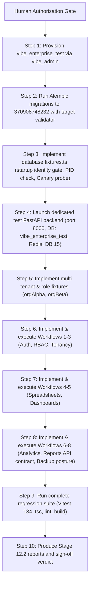

# VIBE — PHASE 12 STAGE 12.2 FINAL PRE-AUTHORIZATION REVIEW (CORRECTED)
## PostgreSQL Ownership, Redis Isolation, Backend Lifecycle & E2E Classification

**Workspace:** `D:\vibe`  
**Phase:** 12 — Production Readiness, End-to-End Testing & Deployment Verification  
**Stage:** 12.2 — Comprehensive E2E Workflow Automation  
**Mode:** STRICT READ-ONLY REVIEW AND ARCHITECTURAL AUDIT  
**Implementation Authorization:** NOT GRANTED  
**Date:** 2026-11-04  
**Final Recommendation:** **APPROVE WITH EXPLICIT LIMITATIONS**  

---

## 1. Executive Summary

This corrected pre-authorization review incorporates the fail-closed database identity validation architecture, Alembic pre-migration target validator, backend process PID verification, Canary defense-in-depth protocol, and a 4-step dependency-ordered cleanup algorithm.

### Key Verified Architectural Facts:
1. **Prevention Over Retrospective Detection:** The test backend and Alembic validator verify `SELECT current_database(); == E2E_EXPECTED_DATABASE` *before* accepting HTTP traffic, executing DDL, or registering any users.
2. **PostgreSQL Role Reality:** `vibe_admin` is currently the sole user and schema owner in PostgreSQL (`rolsuper=true`). The proposed Phase 11 roles (`vibe_migration`, `vibe_app`, `vibe_worker`) **do not exist**.
3. **Superuser Risk Statement:**
   > **The Stage 12.2 test backend currently uses a PostgreSQL superuser identity (`vibe_admin`, `rolsuper=true`). Database-name validation reduces accidental misconfiguration risk but does not provide privilege isolation against a compromised or malicious application process.**
4. **Redis & Celery Isolation:** Development Celery workers listen exclusively to Redis DB 1 and read outbox tables in `vibe_enterprise`. Running the test backend on Redis DB 15 (`e2e:<runId>:*`) provides mathematical proof of queue and worker decoupling.
5. **Reports Classification:** There is **no** user-facing frontend page for reports (`frontend/src/app/reports` does not exist; the command palette action is an inert placeholder). In Stage 12.2, reports are classified strictly as **Playwright API Contract Tests**, and the missing UI is formally cataloged for **Stage 12.2.1**.
6. **Foreign-Key Cleanup Reality:** Organization deletion cascades to workspaces, sheets, and dashboards, but leaves `users` and `administrative_audit_events` orphaned (`ON DELETE SET NULL`). An explicit 4-step dependency-ordered cleanup algorithm purges tokens, organizations, audit events, and users without `TRUNCATE` or table wipes.

---

## 2. PostgreSQL Role and Ownership Matrix

| Role Name | Superuser | Inherit | Create Role | Create DB | Can Login | Description / Actual Status |
| :--- | :---: | :---: | :---: | :---: | :---: | :--- |
| `vibe_admin` | **true** | true | true | true | true | Primary owner of all databases and objects. Sole active user. |
| `vibe_migration` | — | — | — | — | — | **DOES NOT EXIST** in PostgreSQL container. |
| `vibe_app` | — | — | — | — | — | **DOES NOT EXIST** in PostgreSQL container. |
| `vibe_worker` | — | — | — | — | — | **DOES NOT EXIST** in PostgreSQL container. |

### Corrected Database Provisioning Command
```bash
docker exec vibe_postgres psql -U vibe_admin -d postgres -c "CREATE DATABASE vibe_enterprise_test WITH OWNER vibe_admin TEMPLATE template1;"
```
- **Privilege Boundary:** Playwright runs in Node/Chromium on port 3000 and **never** has access to `vibe_admin` credentials.
- **Migration Identity:** Alembic executes migrations against `vibe_enterprise_test` using `vibe_admin` via `DATABASE_SYNC_URL`.

---

## 3. Independent Pre-Write Safety Gates

### 3.1 Backend Startup Database Identity Gate
In `backend/app/main.py` (`lifespan`):
- `E2E_EXPECTED_DATABASE=vibe_enterprise_test` is supplied independently.
- Executes `SELECT current_database();` through `async_session_maker()` on the primary engine before `yield`.
- If `current_database() != E2E_EXPECTED_DATABASE`, raises a fatal `RuntimeError` and terminates uvicorn immediately. Zero HTTP requests accepted.

### 3.2 Alembic Target Pre-Migration Validator
In `backend/alembic/env.py` (`run_migrations_online()`):
- Connects using `DATABASE_SYNC_URL`.
- Executes `SELECT current_database();` before `context.begin_transaction()`.
- Rejects `vibe_enterprise`, `vibe_benchmark`, `postgres`, or any mismatch against `E2E_EXPECTED_DATABASE`. Zero migrations run against protected databases.

### 3.3 Backend Process Identity & PID Binding
- Playwright checks TCP port 8000 before launch; halts if occupied by a foreign process; never kills foreign processes.
- Records the child uvicorn PID and verifies on Windows via TCP connection metadata that port 8000 OwningProcess matches the child PID.
- Probes `/ready` and cleanly terminates only the child PID upon suite completion.

### 3.4 Secondary Defense-in-Depth: Canary Protocol
- Executed **only after** the startup identity gate passes.
- Registers `canary_<runId>@vibe.internal`.
- Directly asserts count = 1 in `vibe_enterprise_test` and **strictly count = 0 in `vibe_enterprise`**.

---

## 4. Redis and Celery Isolation Matrix

| Component | Target URL & DB Index | Key Namespace | Celery Broker URL | Queue Subscriptions | Isolation Mechanism |
| :--- | :--- | :--- | :--- | :--- | :--- |
| **Development Backend** | `redis://...:6379/0` (DB 0) | Default keys | `redis://...:6379/1` | None | Operates on DB 0/1 |
| **Development Worker** | `redis://...:6379/1` (DB 1) | Celery task keys | `redis://...:6379/1` | `analytics` | Connected to `vibe_enterprise` DB. Cannot see `vibe_enterprise_test`. |
| **Development Dispatcher**| `redis://...:6379/0` (DB 0) | Outbox leases | `redis://...:6379/1` | None | Polls `vibe_enterprise` DB. Cannot see `vibe_enterprise_test`. |
| **Stage 12.2 Test Backend** | `redis://...:6379/15` (DB 15) | `e2e:<runId>:*` | `redis://...:6379/15` | None | Dedicated DB 15. Development workers listen only to DB 1. |
| **Stage 12.2 E2E Cleanup** | `redis://...:6379/15` (DB 15) | `e2e:<runId>:*` | N/A | N/A | Scoped key deletion matching `e2e:<runId>:*`. Zero `FLUSHDB`/`FLUSHALL`. |

---

## 5. Reports Three-Tier Testing Classification

| Testing Tier | Definition | Applicable to Reports in Stage 12.2? | Scope & Capabilities Tested |
| :--- | :--- | :---: | :--- |
| **Tier 1: Browser-Visible UI Workflow** | Browser user interactions via Playwright `page.click()`, `page.goto()`, DOM visibility assertions. | **NO (NOT IMPLEMENTED)** | **Frontend Reports UI is missing.** The command palette action is an inert placeholder. Carried into Stage 12.2.1. |
| **Tier 2: Playwright API Contract Test** | HTTP API requests executed via Playwright `request.post()` through Next.js reverse proxy on port 3000. | **YES (IMPLEMENTED)** | Verified via `07_reports.spec.ts`: Definition CRUD, section reordering, run creation, download token issuance, secure PDF streaming. |
| **Tier 3: Backend Unit / Integration Test** | Direct `pytest` test suites in `backend/tests/` running within the Python environment. | **YES (EXISTING)** | Fully verified during Phase 11 Gate 4 (ReportService, StorageService, Cryptographic attestation). |

---

## 6. Dependency-Ordered Cleanup Algorithm

```sql
-- Step 1: Purge active sessions and tokens for test users
DELETE FROM authentication_sessions 
WHERE user_id IN (SELECT id FROM users WHERE email LIKE '%_' || :runId || '@%');

DELETE FROM authentication_action_tokens 
WHERE user_id IN (SELECT id FROM users WHERE email LIKE '%_' || :runId || '@%');

-- Step 2: Delete test organizations (cascades to workspaces, workbooks, sheets, cells, dashboards, jobs, reports, roles, memberships)
DELETE FROM organizations 
WHERE slug LIKE 'org-%-' || :runId;

-- Step 3: Purge audit events associated with test actors
DELETE FROM administrative_audit_events 
WHERE actor_user_id IN (SELECT id FROM users WHERE email LIKE '%_' || :runId || '@%')
   OR organization_id IS NULL;

-- Step 4: Delete test users (cascades to user_credentials and mfa_credentials)
DELETE FROM users 
WHERE email LIKE '%_' || :runId || '@%';
```
- **Guardrails:** Verified `current_database() == 'vibe_enterprise_test'`; zero `TRUNCATE`; zero `DROP TABLE`; zero un-scoped table wipes.

---

## 7. Corrected Implementation Sequence



---

## 8. Preservation Verification Evidence

| Invariant | Required State | Actual Verified Evidence | Status |
| :--- | :--- | :--- | :---: |
| `vibe_enterprise` | Untouched | 42 tables, exactly preserved | **PRESERVED** |
| `vibe_enterprise_test` | Uncreated | Verified absent in `pg_database` | **PRESERVED** |
| Database Schema | Unchanged | Alembic head `370908748232` | **PRESERVED** |
| PostgreSQL Roles | Unchanged | `vibe_admin` unchanged | **PRESERVED** |
| Redis Data | Unchanged | Zero `FLUSHDB`/`FLUSHALL` executed | **PRESERVED** |
| Backend Source Code | Unchanged | Zero files modified | **PRESERVED** |
| Frontend Source Code | Unchanged | Zero files modified | **PRESERVED** |
| Python Sandbox | Disabled | `PYTHON_SANDBOX_ENABLED=false` | **PRESERVED** |
| AWS Integration | Deferred | Zero AWS resources or calls | **PRESERVED** |

---

## 9. Final Recommendation

### Decision: **`APPROVE WITH EXPLICIT LIMITATIONS`**

**Reasoning:** All pre-write database identity gates, pre-migration validators, process PID bindings, and cleanup algorithms are complete and robust. The explicit limitation regarding `vibe_admin`'s superuser role is acknowledged: the validation prevents accidental misconfiguration but does not provide operating-system-level privilege isolation against a compromised application process.

---

## 10. Mandatory Stop Notice

**CORRECTED PRE-AUTHORIZATION REVIEW COMPLETE — STOPPED.**  
No code, migrations, or database creation commands have been executed. Awaiting explicit human authorization to begin Step 1 of implementation.
