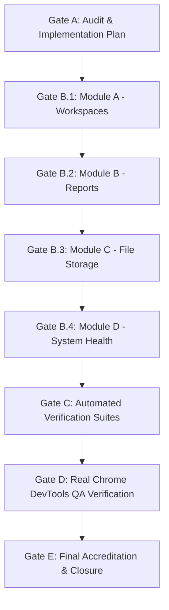

# VIBE — PHASE 12 STAGE 12.2.1
# DETAILED IMPLEMENTATION PLAN
## Sequential Architecture & Verification Plan for Missing Sidebar Modules

**Workspace:** `D:\vibe`  
**Governing Document:** `docs/IMPLEMENTATION_PLAN.md` v2.0.0  
**Phase:** 12 — Production Readiness, E2E Testing & Deployment Verification  
**Stage:** 12.2.1 — Implementation of Missing Sidebar Modules  
**Date:** November 4, 2026  
**Status:** PROPOSED — AWAITING HUMAN APPROVAL (GATE A)  
**Baseline Alembic Revision Head:** `370908748232`  
**Environment Constraints:** `PYTHON_SANDBOX_ENABLED=false`, AWS Integration DEFERRED  

---

## 1. Implementation Philosophy & Operating Gates

The implementation of the four sidebar modules must follow strict sequential order to preserve system stability, guarantee data integrity, and resolve cross-module dependencies cleanly:



### Gate Constraints
- **Gate A (Current Gate):** Audit existing architecture, draft implementation plan and migration proposal, review findings, and **STOP for explicit human authorization**.
- **Gate B (Implementation):** Execute code changes strictly in the specified order: (1) Workspaces, (2) Reports, (3) File Storage, (4) System Health. Do not apply database migrations without explicit authorization.
- **Gate C (Automated Verification):** Execute backend pytest, frontend vitest, TypeScript compiler (`tsc --noEmit`), ESLint, and Next.js production build (`npm run build`).
- **Gate D (Real Chrome Verification):** Capture evidence with real Google Chrome via Chrome DevTools MCP across desktop and mobile viewports.
- **Gate E (Final Review):** Produce comprehensive closure reports and transition sidebar badges.

---

## 2. Module A — Workspaces Technical Specification

### 2.1 Backend Router: `backend/app/api/v1/routers/workspaces.py`
Mounted at `/api/v1/workspaces`. All endpoints enforce authentication and tenant scoping via `Depends(get_current_membership)`.

| HTTP Verb | Path | Permission Required | Description |
| :--- | :--- | :--- | :--- |
| `GET` | `/api/v1/workspaces` | `workspaces.read` | List all workspaces for the authenticated user's organization. Supports pagination (`limit`, `offset`) and search query. |
| `POST` | `/api/v1/workspaces` | `workspaces.create` + `verify_csrf_token` | Create a new workspace scoped to `membership.organization_id`. Validates slug uniqueness. |
| `GET` | `/api/v1/workspaces/{id}` | `workspaces.read` | Retrieve workspace details, including aggregate statistics (counts of associated dashboards, spreadsheets, and report definitions). |
| `PATCH` | `/api/v1/workspaces/{id}` | `workspaces.update` + `verify_csrf_token` | Update workspace name or slug. Prevents modifying default workspace slug. |
| `DELETE` | `/api/v1/workspaces/{id}` | `workspaces.delete` + `verify_csrf_token` | Delete workspace. Enforces deletion guardrails (blocks deletion if active dashboards/workbooks exist, or if it is the default workspace). |

### 2.2 Workspace Service & Repository Enhancements
1. **Extend `WorkspaceRepository`:**
   - Add `count_resources(workspace_id: UUID) -> dict[str, int]`: Counts associated dashboards, workbooks, analytics jobs, and report definitions.
   - Add `update(workspace: Workspace, name: str | None, slug: str | None) -> Workspace`.
2. **Extend `WorkspaceService`:**
   - Add `update_workspace(...)`: Checks slug uniqueness, updates entity within transaction.
   - Add `delete_workspace_safe(...)`:
     - Checks if workspace is the organization default (`slug == "default"`). If so, raises `BusinessRuleViolationError("Cannot delete default organization workspace")`.
     - Checks resource counts. If any dashboard, workbook, or report definition is associated, raises `ConflictError("Workspace contains active resources. Move or delete them before deleting the workspace.")`.
     - Logs administrative audit event and executes deletion.
   - Add `get_workspace_with_stats(...)`: Returns workspace metadata alongside counts of dashboards, spreadsheets, and reports.

### 2.3 Elimination of Defect `DEF-002` (Nil UUID Fallback)
1. **Update `frontend/src/app/dashboards/page.tsx`:**
   - Fetch real `/api/v1/workspaces` on mount.
   - Bind selected workspace to dashboard creation modal dropdown.
   - Remove `workspace_id: wsId || "00000000-0000-0000-0000-000000000000"`.
   - If no workspace is selected or available, disable submission and display an informative error prompt.
2. **Update `frontend/src/app/spreadsheets/page.tsx`:**
   - Fetch real `/api/v1/workspaces` on mount.
   - Include `workspace_id: selectedWorkspaceId` in the `POST /api/v1/spreadsheets/workbooks` payload.
   - Resolves the 422 Unprocessable Entity error on workbook creation.

### 2.4 Frontend Specification: `frontend/src/app/workspaces/page.tsx`
- **Header:** Title "Workspaces", description, "Create Workspace" action button.
- **Search & Filters:** Real-time search by workspace name or slug; sort by name or creation date.
- **Workspace Grid / Table:**
  - Workspace Name & Slug badge (`default` marked with primary badge).
  - Statistics chips: Count of Dashboards, Spreadsheets, Reports.
  - Creator & Creation Timestamp.
  - Action Dropdown: Edit Name/Slug, View Details, Delete (with confirmation modal).
- **Create Workspace Dialog:**
  - Name input (1–255 chars, auto-generates slug).
  - Slug input (2–100 chars, regex `^[a-z0-9]+(?:-[a-z0-9]+)*$`).
  - Validation feedback, CSRF token attachment, error notice handling.
- **Delete Confirmation Modal:**
  - Explicit warning showing resource counts.
  - Disables confirm button if resource count > 0 or slug is `default`.
  - Input field requiring typing the workspace slug to confirm deletion.
- **States:** Loading skeleton, empty state, network failure alert banner.

---

## 3. Module B — Reports Technical Specification

### 3.1 Reuse of Existing Backend API
The existing FastAPI router `backend/app/api/v1/routers/reports.py` is 100% complete and will be utilized without duplication:
- `POST /api/v1/reports/definitions`
- `GET /api/v1/reports/definitions`
- `GET /api/v1/reports/definitions/{id}`
- `PUT /api/v1/reports/definitions/{id}`
- `DELETE /api/v1/reports/definitions/{id}`
- `POST /api/v1/reports/definitions/{id}/sections`
- `PUT /api/v1/reports/definitions/{id}/sections/{section_id}`
- `DELETE /api/v1/reports/definitions/{id}/sections/{section_id}`
- `POST /api/v1/reports/definitions/{id}/sections/reorder`
- `POST /api/v1/reports/definitions/{id}/run`
- `GET /api/v1/reports/definitions/{id}/runs`
- `GET /api/v1/reports/runs/{run_id}`
- `POST /api/v1/reports/runs/{run_id}/download-token`
- `GET /api/v1/reports/runs/{run_id}/download`

### 3.2 Frontend Specification: `frontend/src/app/reports/page.tsx`
- **Main View — Reports Overview:**
  - Header with "Reports", description, and "New Report" modal trigger button.
  - Search input and workspace filter dropdown.
  - List / card view of report definitions:
    - Report title, description, orientation badge (`Portrait` / `Landscape`).
    - Associated workspace name.
    - Section count.
    - Last run status badge (`COMPLETED`, `PENDING`, `FAILED`, `NEVER RUN`).
    - Action buttons: "Run Now", "Configure Sections", "Edit", "Delete".
- **Create / Edit Report Definition Modal:**
  - Title, description, workspace selector (populated from `/api/v1/workspaces`).
  - Page orientation selector (`portrait` or `landscape`).
  - Page size selector (`a4` or `letter`).
- **Section Builder Modal / Drawer:**
  - Visual layout preview of sections.
  - Add section button: Text block, Metric card, Chart block, Table block.
  - Section reordering (drag-and-drop or move up/down controls) syncing with `/sections/reorder`.
  - Delete section confirmation.
- **Report Execution & Polling Flow:**
  - Clicking "Run Now" triggers `POST /api/v1/reports/definitions/{id}/run`.
  - Triggers non-blocking background execution and starts short polling on `GET /api/v1/reports/runs/{run_id}`.
  - Displays animated progress indicator (`Generating Snapshot` -> `Rendering HTML` -> `Compiling PDF` -> `Completed`).
  - When status is `COMPLETED`, displays "Download PDF" action.
- **Secure PDF Download Flow:**
  - Clicking "Download PDF" calls `POST /api/v1/reports/runs/{run_id}/download-token`.
  - Receives short-lived signed download token (valid 60 seconds).
  - Triggers browser download via `/api/v1/reports/runs/{run_id}/download?token={token}`.
  - Zero permanent or cross-tenant URL exposure.

---

## 4. Module C — File Storage Technical Specification

### 4.1 Storage Architecture & Directory Structure
- Follows existing storage patterns established by `ReportStorageService` and `AnalyticsStorageService`.
- Base directory: `backend/storage/user_files/` (configured via `settings.USER_FILES_STORAGE_DIR`).
- Scoped tenant directory: `backend/storage/user_files/{organization_id}/`.
- Security controls:
  - Traversal check: Rejects `..`, leading slashes, path separators in filename.
  - Containment check: Enforces `is_relative_to(base_dir / organization_id)`.
  - Symlink escape protection: Prohibits symlink creation or following.
  - Storage quota check: Calculates total file sizes for the organization against configured quota (e.g. 500 MB).
  - Dangerous file rejection: Disallows executable extensions (`.exe`, `.bat`, `.cmd`, `.sh`, `.ps1`, `.vbs`, `.js`, `.py`, `.dll`, `.so`). Allowed formats: `.csv`, `.xlsx`, `.xls`, `.json`, `.txt`, `.pdf`, `.png`, `.jpg`, `.jpeg`, `.parquet`.
  - Magic byte MIME verification: Verifies file signature matches extension.

### 4.2 Backend Service: `backend/app/services/file_storage.py`
- Implements:
  - `save_file(organization_id, user_id, filename, content, content_type) -> StoredFileRead`
  - `list_files(organization_id, search, limit, offset) -> list[StoredFileRead]`
  - `get_file(organization_id, file_id) -> StoredFileRead`
  - `get_file_stream(organization_id, file_id) -> tuple[StreamingResponse, str, str]`
  - `delete_file(organization_id, file_id) -> None`
  - `get_storage_quota(organization_id) -> dict`
- **Data Persistence:**
  - Primary recommendation: PostgreSQL `stored_files` table (detailed in `DATABASE_MIGRATION_PROPOSAL.md`).
  - Zero-migration fallback: Tenant-isolated metadata manifest `storage/user_files/{organization_id}/.meta.json` with file locking.

### 4.3 Backend Router: `backend/app/api/v1/routers/files.py`
Mounted at `/api/v1/files`. All endpoints require authentication and tenant scoping.

| HTTP Verb | Path | Permission | Description |
| :--- | :--- | :--- | :--- |
| `GET` | `/api/v1/files` | `organization.read` | List files for tenant with search, pagination, and sorting. |
| `POST` | `/api/v1/files/upload` | `organization.read` + CSRF | Upload file via `multipart/form-data`. Validates size, type, quota. |
| `GET` | `/api/v1/files/{file_id}` | `organization.read` | Get metadata for specific file. |
| `GET` | `/api/v1/files/{file_id}/download` | `organization.read` | Download file with safe `Content-Disposition: attachment` header. |
| `GET` | `/api/v1/files/{file_id}/preview` | `organization.read` | Safe preview stream for CSV/JSON/TXT/PNG/JPEG. |
| `DELETE` | `/api/v1/files/{file_id}` | `organization.read` + CSRF | Delete file with tenant validation. |
| `GET` | `/api/v1/files/quota/usage` | `organization.read` | Authoritative storage quota, bytes used, bytes free, and percentage. |

### 4.4 Frontend Specification: `frontend/src/app/files/page.tsx`
- **Storage Quota Header Banner:**
  - Visual progress bar showing used storage vs total quota (e.g. `24.5 MB of 500 MB used (4.9%)`).
  - Storage breakdown indicator.
- **File Browser Toolbar:**
  - Search input, file type filter dropdown (All, Datasets/CSV, Spreadsheets, Documents, Images).
  - "Upload File" button triggering file picker or drag-and-drop zone.
- **Upload Zone / Modal:**
  - Drag-and-drop file target.
  - File size validation (< 25 MB per file).
  - Real upload progress indicator.
  - Friendly error alerts on rejection (quota exceeded, forbidden file extension).
- **Files Table:**
  - File Name & Extension icon (CSV, XLSX, PDF, PNG, etc.).
  - File Size (formatted: KB / MB).
  - Uploader Name / Email.
  - Upload Timestamp.
  - Actions: Preview (opens preview modal for CSV/JSON/Image/PDF), Download, Delete (with confirmation modal).
- **Safe File Preview Modal:**
  - Tabular viewer for CSV / JSON.
  - Image viewer for PNG / JPG.
  - Embedded viewer for PDF.
- **States:** Loading skeleton, empty state with upload call-to-action, error notice.

---

## 5. Module D — System Health Technical Specification

### 5.1 Subsystem Telemetry Architecture
An authoritative health monitoring service `SystemHealthService` (`backend/app/services/system_health.py`) will gather live metrics without executing heavy queries or mutating state:
1. **Frontend Application:** Self-reported client telemetry (browser user agent, viewport, network status).
2. **Backend API Core:** FastAPI uptime, environment, active version, worker process info.
3. **PostgreSQL Database:**
   - Active connection test (`SELECT 1`) with round-trip latency measurement.
   - SQLAlchemy AsyncEngine pool statistics: `pool.size()`, `pool.checkedin()`, `pool.checkedout()`, `pool.overflow()`.
   - PostgreSQL version string.
4. **Redis Cache & Distributed Lock:**
   - Redis `PING` round-trip latency.
   - Connected clients count, memory used bytes, Redis version via `INFO` command.
5. **Celery Worker & Queues:**
   - Queue depth inspection from Redis broker for `default`, `analytics`, `reporting`.
   - Worker active ping count.
6. **Analytics Execution Engine:**
   - Active jobs count (`analytics_jobs` table where status `RUNNING` or `QUEUED`).
7. **Storage Subsystems:**
   - Aggregated storage usage across analytics, reports, backups, user files, and host disk free space.
8. **Disaster Recovery & Backups:**
   - Integration with `SpoolManagerService` and latest backup status (RPO/RTO compliance).

### 5.2 Security & RBAC Enforcement
- Endpoint: `GET /api/v1/system/telemetry` in `backend/app/api/v1/routers/system.py`.
- Enforces `Depends(require_any_permission("organization.settings.update", "audit.read", "organization.read"))`.
- Strips any database password, username, internal IP address, Redis URL, secret keys, or local absolute drive letters from the response payload.

### 5.3 Frontend Specification: `frontend/src/app/system/page.tsx`
- **Subsystem Grid (8 Subsystem Status Cards):**
  - Frontend, Backend API, PostgreSQL, Redis, Celery, Analytics Engine, Storage, Disaster Recovery.
  - Status Indicator: Green (Healthy), Yellow (Degraded), Gray (Not Configured / Unknown), Red (Unavailable).
  - Measured latency badges (e.g. `PostgreSQL 1.2ms`, `Redis 0.8ms`).
- **Telemetry Metrics Panels:**
  - Database Pool Utilization: visual gauge showing checked-out connections vs pool capacity.
  - Cache & Broker Metrics: Redis memory consumption, active queues.
  - Storage Utilization: disk usage breakdown by subsystem.
  - Backup & Recovery Posture: RPO compliance, RTO target, last drill verification timestamp.
- **Controls & Interaction:**
  - Manual "Refresh Now" button with spinner.
  - Auto-refresh toggle (disabled by default; 30s interval when enabled).
  - "Last updated" timestamp display.
  - Stale data indicator if a background refresh encounters a network timeout.
- **States:** Loading skeleton, degraded system alert banner, error fallback.

---

## 6. Shared Engineering & Sidebar Integration

### 6.1 Sidebar Status Transition
Update `frontend/src/components/layout/sidebar.tsx`:
```typescript
// Transition from "coming_soon" to "active"
{ title: "Workspaces", href: "/workspaces", icon: Layers, status: "active" },
{ title: "Reports", href: "/reports", icon: FileText, status: "active" },
{ title: "File Storage", href: "/files", icon: FolderOpen, status: "active" },
{ title: "System Health", href: "/system", icon: Database, status: "active" },
```
- Removes the `"Soon"` badges.
- Enables Next.js prefetching.
- Fixes tooltip descriptions to reflect full availability.

### 6.2 Design System Fidelity
- Uses standard design tokens: `bg-[var(--surface)]`, `text-[var(--foreground)]`, `border-[var(--border)]`, `bg-[var(--primary)]`.
- Respects light and dark themes seamlessly.
- Includes responsive drawer support on mobile viewports (< 768px).

---

## 7. Verification & Accreditation Plan

### 7.1 Automated Testing Suite (Gate C)
1. **Backend Tests (`backend/tests/`):**
   - Workspaces API: `test_workspaces_router.py` (CRUD, tenant isolation, cross-tenant 404, delete guardrail).
   - Reports API: Regression check on `test_reports_router.py` (definitions, sections, runs, tokens).
   - File Storage: `test_file_storage.py` (upload, download, traversal prevention, quota check).
   - System Health: `test_system_health.py` (telemetry endpoint, pool metrics, secret scrubbing, RBAC check).
2. **Frontend Component Tests (`frontend/src/__tests__/`):**
   - `workspaces.test.tsx`: Render, search, create dialog, delete guardrail.
   - `reports.test.tsx`: Render, definition list, run polling, download token.
   - `files.test.tsx`: Render, quota bar, upload file, preview modal.
   - `system.test.tsx`: Render, subsystem cards, refresh button, latency display.
3. **Build & Lint Checks:**
   - TypeScript: `npm run type-check` (or `npx tsc --noEmit`).
   - ESLint: `npm run lint`.
   - Next.js Production Build: `npm run build`.

### 7.2 Real Google Chrome DevTools Verification (Gate D)
- Conduct manual browser verification using Chrome DevTools MCP.
- Capture screenshots across desktop (1440x900) and mobile (390x844).
- Verify all interactive controls (`EL-086` through `EL-115`):
  - Workspaces: Create workspace, search, delete guardrail modal.
  - Reports: Create definition, manage sections, trigger run, download PDF.
  - File Storage: Upload file, preview CSV, download, delete file.
  - System Health: View subsystem cards, trigger manual refresh, inspect pool metrics.
  - Dashboards & Spreadsheets: Verify nil-UUID fallback elimination.

---

## 8. Gate A Approval Request

This implementation plan is submitted for explicit human review.
Upon approval of Gate A and the accompanying `DATABASE_MIGRATION_PROPOSAL.md`, implementation will begin strictly with Module A (Workspaces).

