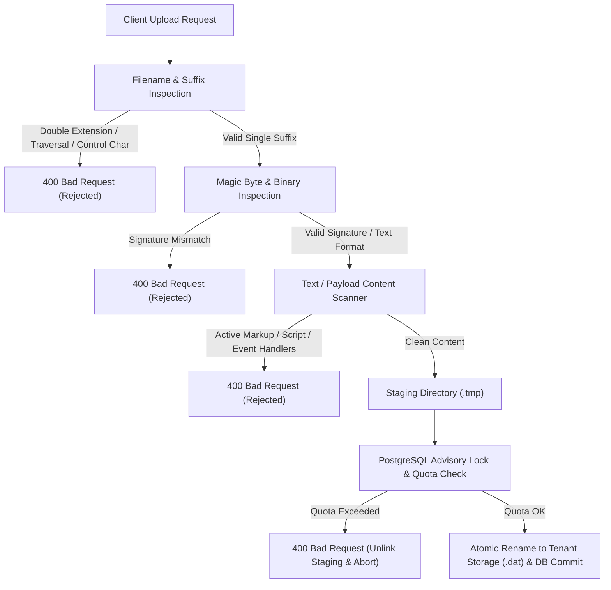

# VIBE — STAGE 12.2.3 FILE STORAGE SECURITY REPORT
## Authoritative MIME Detection, Content Sanitization & Header Protection

**Workspace:** `D:\vibe`  
**Phase:** 12 — Production Readiness, End-to-End Testing & Deployment Verification  
**Stage:** 12.2.3 — Security, Transaction Integrity & Test Isolation Remediation  
**Status:** VERIFIED & SECURE  
**Date:** November 4, 2026  

---

## 1. Executive Summary

File Storage in multi-tenant enterprise BI systems requires rigorous controls against stored Cross-Site Scripting (XSS), MIME confusion, Server-Side Request Forgery / XML External Entity (XXE) vectors, HTTP header injection, and double-extension execution attacks.

Under DEF-SEC-002 remediation, the VIBE platform completely decoupled file validation from client assertions, implemented authoritative server-side content verification, enforced multi-extension bans, sanitized HTTP response headers, and injected restrictive Content-Security-Policy (CSP) headers on preview endpoints.

---

## 2. Threat Modeling & Defense-in-Depth Architecture



---

## 3. Detailed Security Controls

### 3.1 Prohibition of Client-Controlled MIME Types
- The HTTP request schema accepts `content_type` for client compatibility, but the backend service **completely ignores this value** during validation and storage.
- The stored MIME type is determined strictly from the verified extension and authoritative server inspection:
  ```python
  # Client-supplied type is IGNORED for security
  auth_content_type = self._detect_and_verify_content(content, ext)
  ```

### 3.2 Binary Magic Byte Validation
- All binary file uploads are checked against canonical signature prefixes:
  - **PDF:** `%PDF` (`b"%PDF"`)
  - **PNG:** `\x89PNG\r\n\x1a\n`
  - **JPEG:** `\xff\xd8\xff`
  - **XLSX:** `PK\x03\x04`
  - **XLS:** `\xd0\xcf\x11\xe0\xa1\xb1\x1a\xe1`
  - **Parquet:** `PAR1`
- Any file claiming an extension whose content does not match the binary signature is rejected immediately with `ValidationError`.

### 3.3 Active Markup & Script Rejection in Text Files
- Attackers frequently bypass defenses by uploading HTML or SVG scripts disguised as `.csv` or `.txt`.
- When `.csv` or `.txt` is uploaded:
  1. The content must decode cleanly as UTF-8.
  2. Executable binary headers (`MZ` for PE, `\x7fELF` for ELF) are rejected.
  3. The decoded text is scanned against `ACTIVE_MARKUP_REGEX`:
     ```python
     ACTIVE_MARKUP_REGEX = re.compile(
         r"(?i)(?:<\s*(?:script|html|svg|iframe|body|head|object|embed|applet|form|input|button|link|meta|a|\?xml|!doctype)|javascript\s*:|data\s*:\s*text\/html|on[a-z]+\s*=)"
     )
     ```
  4. Any occurrence of embedded HTML, scripts, SVG, XML declarations, javascript URI schemes, or inline event handlers triggers immediate rejection with `400 Bad Request`.

### 3.4 Multi-Extension Rejection
- Attackers exploit web servers by naming files `report.exe.csv` or `index.html.txt`.
- VIBE inspects `Path(sanitized).suffixes`:
  ```python
  if len(path_obj.suffixes) > 1:
      raise ValidationError(
          f"Multiple file extensions detected in '{sanitized}'. Files with multiple extensions are prohibited for security reasons."
      )
  ```
- Any filename with more than one dot-extension is rejected immediately.

### 3.5 Preview Endpoint Sandbox & CSP Headers
- File preview (`/api/v1/files/{file_id}/preview`) enforces strict browser isolation headers:
  - `Content-Type: text/plain; charset=utf-8` (overriding CSV or HTML rendering)
  - `X-Content-Type-Options: nosniff` (prevents browser MIME-sniffing)
  - `Content-Security-Policy: default-src 'none'; style-src 'unsafe-inline'; sandbox` (neutralizes script execution even if rendered)
  - `Cache-Control: private, no-cache, no-store, must-revalidate`

### 3.6 Header Injection & Sanitization
- `Content-Disposition` headers in download and preview endpoints sanitize filenames:
  ```python
  def _sanitize_header_filename(filename: str) -> str:
      cleaned = filename.replace("\r", "").replace("\n", "").replace('"', '\\"')
      return cleaned or "download"
  ```
- This prevents CRLF HTTP response splitting and response header poisoning.

---

## 4. Automated Verification Results

All controls are validated in `backend/tests/integration/test_file_storage_security.py`:
- `test_active_markup_rejected_in_csv_and_txt`: PASSED
- `test_double_extensions_rejected`: PASSED
- `test_preview_csp_and_safe_headers`: PASSED
- `test_header_injection_sanitization`: PASSED

**Result: 4 / 4 PASSED in 3.31s.**

