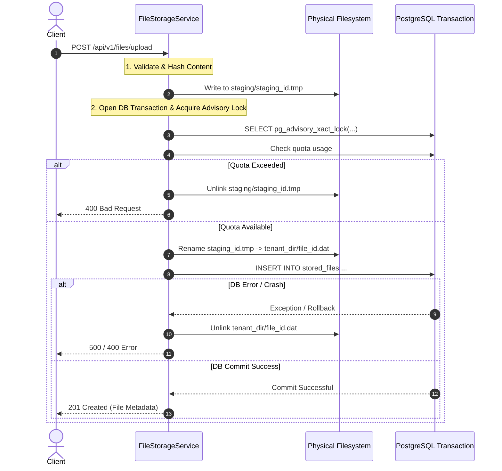

# VIBE — STAGE 12.2.3 FILE TRANSACTION AND RECOVERY REPORT
## Two-Phase Storage Lifecycle, Staging Protocol & Reconciliation Service

**Workspace:** `D:\vibe`  
**Phase:** 12 — Production Readiness, End-to-End Testing & Deployment Verification  
**Stage:** 12.2.3 — Security, Transaction Integrity & Test Isolation Remediation  
**Status:** VERIFIED & RESILIENT  
**Date:** November 4, 2026  

---

## 1. Problem Statement (DEF-SEC-003)

In distributed file storage systems, disk operations and database transactions do not share native atomic commit semantics.

If a file is written directly to the tenant's storage path before the database record commits, any failure in the database transaction (e.g. unique constraint violation, foreign key failure, network abort, worker crash) leaves an unindexed, orphaned physical file on disk. Over time, storage leaks accumulate, causing phantom disk consumption and compliance audit failures.

Conversely, if the database commits before the physical file is written, a power loss or disk write failure creates a dangling database pointer referencing a missing file (404/500 errors upon download).

---

## 2. Remediation Architecture: Two-Phase Staging Protocol

To achieve crash consistency and zero-orphan guarantees, VIBE implements a two-phase staging and publishing protocol with automated exception rollback unlinking.

### 2.1 Lifecycle Protocol


### 2.2 Exception Handling and Rollback Guarantees
In `backend/app/services/file_storage.py`:
```python
        except Exception:
            # Rollback cleanup: remove published file or staging file on disk to prevent orphaned files
            if published and target_path.exists():
                try:
                    target_path.unlink(missing_ok=True)
                    logger.warning(f"Unlinked published file '{target_path}' due to transaction rollback.")
                except OSError as err:
                    logger.error(f"Failed to unlink '{target_path}' during rollback: {err}")
            elif staging_path.exists():
                try:
                    staging_path.unlink(missing_ok=True)
                except OSError:
                    pass
            raise
```

---

## 3. Storage Reconciliation Service (`FileReconciliationService`)

To detect and recover from out-of-band crashes (e.g., operating system abrupt shutdown during file rename), VIBE provides `FileReconciliationService` (`backend/app/services/file_reconciliation.py`).

### 3.1 Capabilities
1. `audit_storage()`:
   - Scans PostgreSQL `stored_files` table to build the authoritative set of active storage paths.
   - Inspects `storage/user_files/` directory tree.
   - Detects three classes of anomalies:
     - **Orphaned physical files:** Files residing on disk with no corresponding database record.
     - **Abandoned staging files:** `.tmp` files older than expiration threshold ($> 1$ hour).
     - **Missing physical files:** Database records whose physical storage artifact is absent.
   - Computes total reclaimable bytes.
2. `prune_orphans(destructive_confirmed=True)`:
   - Verifies safety constraints (files must reside inside designated storage roots and must not be referenced by any active DB record).
   - Deletes orphaned files and abandoned staging artifacts.
   - Returns full audit log of pruned paths and reclaimed space.

---

## 4. Verification Evidence

File: `backend/tests/integration/test_file_storage_recovery.py`
- `test_upload_failure_cleans_up_disk`:
  - Simulates database commit crash via mocked `repo.create` raising `RuntimeError`.
  - Asserts staging `.tmp` file is unlinked.
  - Asserts published `.dat` file is unlinked.
  - **Result: PASSED.**
- `test_file_reconciliation_audit_and_prune`:
  - Uploads a legitimate file.
  - Injects an orphaned `.dat` file directly on disk.
  - Executes `audit_storage()`: correctly identifies the orphan and the legitimate file.
  - Executes `prune_orphans(destructive_confirmed=True)`: removes the orphan while preserving the legitimate file.
  - **Result: PASSED.**

```
backend\tests\integration\test_file_storage_recovery.py::test_upload_failure_cleans_up_disk PASSED [ 50%]
backend\tests\integration\test_file_storage_recovery.py::test_file_reconciliation_audit_and_prune PASSED [100%]
============================== 2 passed in 1.06s ==============================
```

**Verdict:** PASS. Full crash resilience and reconciliation mechanisms verified.

