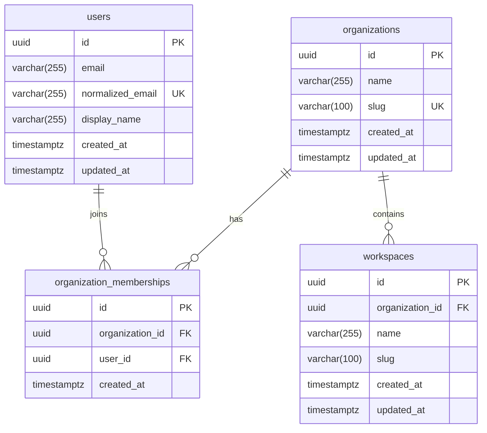

# PHASE 3 FINAL ACCEPTANCE REPORT
## Enterprise Admin & Data Intelligence Platform — Backend Repositories, Migrations & Service Architecture

**Evaluation Timestamp:** 2026-11-01  
**Project Workspace:** `D:\vibe`  
**Phase Status:** **PHASE 3 COMPLETED & VERIFIED**  
**Phase 4 Status:** **BLOCKED & UNTOUCHED (Awaiting explicit user authorization)**

---

## 1. Executive Summary

Phase 3 implementation has established a production-grade, maintainable, and strictly multi-tenant backend foundation using FastAPI, SQLAlchemy 2.x (Asyncio), PostgreSQL 16, and Alembic.

Key achievements:
- **Foundational Domain Entities:** `Organization`, `User`, `OrganizationMembership`, and `Workspace` modeled with UUID primary keys, timezone-aware UTC timestamps, explicit foreign keys, composite unique constraints, and cascade deletions.
- **Alembic Incremental Migration:** Created and applied revision `5b9cdc88b118` from baseline `f50478da1aca`. Verified clean upgrade, downgrade, and re-upgrade lifecycle on a disposable PostgreSQL database.
- **Repository Layer:** Clean asynchronous query repositories enforcing bound parameters, pagination, and strict tenant scoping. Repositories do not commit transactions.
- **Service Layer & Transaction Ownership:** Implemented atomic multi-step organization provisioning (`provision_organization_atomic`) with proven transaction rollback across all entities on failure.
- **Multi-Tenant Isolation:** Demonstrated that workspaces cannot leak or be accessed across tenant boundaries; cross-tenant access attempts trigger security alerts and raise `CrossTenantAccessError` (HTTP 403).
- **Automated Verification:** 27 backend tests passing in 1.15s (13 unit tests, 14 integration tests). Existing Phase 1 infrastructure tests and Phase 2 frontend design system (31 tests) remain 100% passing.
- **Phase Boundary Respected:** No authentication, password hashing, sessions, MFA, RBAC (roles/permissions), spreadsheet engines, or frontend changes were introduced.

---

## 2. Files Created & Modified

### New Backend Files Created
| File Path | Responsibility |
| :--- | :--- |
| [`backend/app/db/base.py`](file:///d:/vibe/backend/app/db/base.py) | Declarative Base with explicit metadata constraint/index naming conventions (`pk_*`, `fk_*`, `uq_*`, `ix_*`) and `utc_now` helper |
| [`backend/app/db/transaction.py`](file:///d:/vibe/backend/app/db/transaction.py) | Atomic unit-of-work transaction context manager supporting nested savepoints (`begin_nested()`) |
| [`backend/app/models/organization.py`](file:///d:/vibe/backend/app/models/organization.py) | `Organization` entity with unique slug and cascade relationships |
| [`backend/app/models/user.py`](file:///d:/vibe/backend/app/models/user.py) | `User` profile entity with normalized email uniqueness (auth-agnostic) |
| [`backend/app/models/membership.py`](file:///d:/vibe/backend/app/models/membership.py) | `OrganizationMembership` linking table with composite unique constraint `(organization_id, user_id)` |
| [`backend/app/models/workspace.py`](file:///d:/vibe/backend/app/models/workspace.py) | `Workspace` entity with tenant-scoped uniqueness `(organization_id, slug)` |
| [`backend/app/models/__init__.py`](file:///d:/vibe/backend/app/models/__init__.py) | Model exports for Alembic metadata autodiscovery |
| [`backend/app/core/exceptions.py`](file:///d:/vibe/backend/app/core/exceptions.py) | Domain exceptions (`EntityNotFoundError`, `EntityAlreadyExistsError`, `CrossTenantAccessError`, `BusinessRuleViolationError`) |
| [`backend/app/schemas/organization.py`](file:///d:/vibe/backend/app/schemas/organization.py) | Pydantic schemas for Organization creation, read, update, and atomic provisioning |
| [`backend/app/schemas/user.py`](file:///d:/vibe/backend/app/schemas/user.py) | Pydantic schemas for User creation, read, and email normalization |
| [`backend/app/schemas/membership.py`](file:///d:/vibe/backend/app/schemas/membership.py) | Pydantic schemas for Membership creation and read |
| [`backend/app/schemas/workspace.py`](file:///d:/vibe/backend/app/schemas/workspace.py) | Pydantic schemas for Workspace creation, read, and update |
| [`backend/app/schemas/__init__.py`](file:///d:/vibe/backend/app/schemas/__init__.py) | Consolidated schema exports |
| [`backend/app/repositories/organization.py`](file:///d:/vibe/backend/app/repositories/organization.py) | Organization persistence operations (create, get_by_id, get_by_slug, list_all, delete) |
| [`backend/app/repositories/user.py`](file:///d:/vibe/backend/app/repositories/user.py) | User persistence operations (create, get_by_id, get_by_normalized_email, list_all) |
| [`backend/app/repositories/membership.py`](file:///d:/vibe/backend/app/repositories/membership.py) | Membership operations (create, get, list_by_organization, list_by_user, delete) |
| [`backend/app/repositories/workspace.py`](file:///d:/vibe/backend/app/repositories/workspace.py) | Workspace operations strictly scoped to `organization_id` |
| [`backend/app/repositories/__init__.py`](file:///d:/vibe/backend/app/repositories/__init__.py) | Repository layer exports |
| [`backend/app/services/organization.py`](file:///d:/vibe/backend/app/services/organization.py) | Organization lifecycle & atomic multi-entity provisioning service |
| [`backend/app/services/user.py`](file:///d:/vibe/backend/app/services/user.py) | User management & email normalization service |
| [`backend/app/services/workspace.py`](file:///d:/vibe/backend/app/services/workspace.py) | Workspace service with tenant-scoping validation & cross-tenant security checks |
| [`backend/app/services/__init__.py`](file:///d:/vibe/backend/app/services/__init__.py) | Service layer exports |
| [`backend/alembic/versions/5b9cdc88b118_create_organizations_users_workspaces.py`](file:///d:/vibe/backend/alembic/versions/5b9cdc88b118_create_organizations_users_workspaces.py) | Incremental migration script defining tables, indexes, constraints, and cascades |
| [`backend/tests/conftest.py`](file:///d:/vibe/backend/tests/conftest.py) | Test fixtures for clean async PostgreSQL sessions (`NullPool`) |
| [`backend/tests/unit/test_schemas.py`](file:///d:/vibe/backend/tests/unit/test_schemas.py) | Unit tests for email normalization, slug regex validation, and Pydantic schemas |
| [`backend/tests/unit/test_unit_services.py`](file:///d:/vibe/backend/tests/unit/test_unit_services.py) | Unit tests for service exception propagation with mocked repositories |
| [`backend/tests/integration/test_repositories.py`](file:///d:/vibe/backend/tests/integration/test_repositories.py) | Integration tests for real PostgreSQL CRUD, constraints, and cascade deletes |
| [`backend/tests/integration/test_integration_services.py`](file:///d:/vibe/backend/tests/integration/test_integration_services.py) | Integration tests for atomic provisioning, rollback verification, and tenant isolation |
| [`docs/backend-architecture.md`](file:///d:/vibe/docs/backend-architecture.md) | Comprehensive architecture documentation with ER diagram and multi-tenant rules |

### Existing Files Modified
- [`backend/app/main.py`](file:///d:/vibe/backend/app/main.py): Added structured domain exception handlers (404, 409, 403, 400).
- [`backend/app/db/session.py`](file:///d:/vibe/backend/app/db/session.py): Refactored to import shared `Base` from `app.db.base`.
- [`backend/alembic/env.py`](file:///d:/vibe/backend/alembic/env.py): Updated target metadata to import from `app.models`.
- [`backend/pytest.ini`](file:///d:/vibe/backend/pytest.ini): Configured `asyncio_default_fixture_loop_scope = function` for reliable loop lifecycles.
- [`docs/CHANGELOG.md`](file:///d:/vibe/docs/CHANGELOG.md): Appended Phase 3 release notes.

---

## 3. Entity Relationship Diagram



---

## 4. Migration Revision Details & Disposable Verification

### 4.1 Migration History
```
<base> -> f50478da1aca, init_baseline
f50478da1aca -> 5b9cdc88b118 (head), create_organizations_users_workspaces
```

### 4.2 Lifecycle Verification on Disposable Database (`vibe_migration_test`)
Tested migration execution on a dedicated disposable database instance without resetting or dropping the live development database:
1. `CREATE DATABASE vibe_migration_test;`
2. `alembic upgrade head` — successfully executed upgrade `-> f50478da1aca -> 5b9cdc88b118`.
3. `alembic current` — verified at `5b9cdc88b118 (head)`.
4. `alembic downgrade f50478da1aca` — cleanly dropped tables, constraints, and indexes.
5. `alembic current` — verified at `f50478da1aca`.
6. `alembic upgrade head` — successfully re-applied `5b9cdc88b118`.
7. `DROP DATABASE vibe_migration_test;` — cleaned up disposable instance.

---

## 5. Repository & Service Inventory

### Repositories (`app/repositories/`)
- **`OrganizationRepository`**: `create`, `get_by_id`, `get_by_slug`, `list_all`, `delete`.
- **`UserRepository`**: `create`, `get_by_id`, `get_by_normalized_email`, `list_all`.
- **`MembershipRepository`**: `create`, `get`, `list_by_organization`, `list_by_user`, `delete`.
- **`WorkspaceRepository`**: `create`, `get_by_id` (scoped), `get_by_slug` (scoped), `list_by_organization` (scoped), `delete`.

### Services (`app/services/`)
- **`OrganizationService`**:
  - `create_organization(data: OrganizationCreate)`
  - `provision_organization_atomic(data: ProvisionOrganizationInput)`: Atomically provisions Organization, Owner User, Membership, and default Workspace in a single transaction.
  - `get_organization(org_id)`
  - `get_organization_by_slug(slug)`
  - `list_organizations(limit, offset)`
- **`UserService`**:
  - `create_user(data: UserCreate)`
  - `get_or_create_user(data: UserCreate)`
  - `get_user_by_id(user_id)`
  - `get_user_by_email(email)`
- **`WorkspaceService`**:
  - `create_workspace(organization_id, data: WorkspaceCreate)`
  - `get_workspace(workspace_id, organization_id)`: Raises `CrossTenantAccessError` (HTTP 403) on cross-tenant attempts.
  - `get_workspace_by_slug(slug, organization_id)`
  - `list_workspaces(organization_id, limit, offset)`

---

## 6. Transaction Handling & Rollback Proof

All business mutations are wrapped in `async with transaction(session):`:
- **Savepoints for Composed Operations:** If the session is already in a transaction, `session.begin_nested()` generates a PostgreSQL `SAVEPOINT`, enabling safe nested transaction boundaries.
- **Automated Rollback:** If an unhandled exception or constraint error occurs, `transaction` catches the error and executes an explicit rollback.
- **Empirical Test Proof (`test_atomic_organization_provisioning_rollback_on_failure`):**
  When workspace creation failed via a simulated runtime error during atomic organization provisioning:
  - Organization was **NOT** committed (`scalar_one_or_none() is None`).
  - Owner User was **NOT** committed (`scalar_one_or_none() is None`).
  - Zero partial records leaked into the database.

---

## 7. Multi-Tenant Data Isolation Proof

Tested in [`test_workspace_service_cross_tenant_isolation`](file:///d:/vibe/backend/tests/integration/test_integration_services.py):
1. **Tenant Isolation:** Workspace created under Tenant Alpha cannot be queried using Tenant Beta's `organization_id`.
2. **Security Violation Detection:** Attempting to retrieve Tenant Alpha's workspace via Tenant Beta explicitly raises `CrossTenantAccessError` with `code="CROSS_TENANT_ACCESS_DENIED"` and logs a security alert.
3. **Listing Isolation:** `list_workspaces(org_beta.id)` returns zero workspaces belonging to Tenant Alpha.
4. **Per-Tenant Slug Uniqueness:** Tenant Alpha and Tenant Beta can each independently have a workspace with slug `"financials"` without conflicting, protected by `uq_workspaces_org_slug (organization_id, slug)`.

---

## 8. Verification Results

### 8.1 Backend Test Suite (pytest)
```
tests/integration/test_infrastructure.py::test_live_postgres_connectivity_integration PASSED
tests/integration/test_infrastructure.py::test_live_redis_connectivity_integration PASSED
tests/integration/test_infrastructure.py::test_live_ready_endpoint_integration PASSED
tests/integration/test_integration_services.py::test_atomic_organization_provisioning_success PASSED
tests/integration/test_integration_services.py::test_atomic_organization_provisioning_rollback_on_failure PASSED
tests/integration/test_integration_services.py::test_workspace_service_cross_tenant_isolation PASSED
tests/integration/test_integration_services.py::test_user_service_get_or_create PASSED
tests/integration/test_repositories.py::test_organization_repository_crud_and_uniqueness PASSED
tests/integration/test_repositories.py::test_user_repository_crud_and_uniqueness PASSED
tests/integration/test_repositories.py::test_membership_repository_composite_uniqueness PASSED
tests/integration/test_repositories.py::test_workspace_repository_tenant_scoping_and_uniqueness PASSED
tests/integration/test_repositories.py::test_foreign_key_cascade_deletes PASSED
tests/unit/test_health.py::test_health_check_unit PASSED
tests/unit/test_health.py::test_readiness_check_mocked PASSED
tests/unit/test_schemas.py::test_email_normalization PASSED
tests/unit/test_schemas.py::test_user_create_validation PASSED
tests/unit/test_schemas.py::test_slug_validation PASSED
tests/unit/test_schemas.py::test_organization_schemas PASSED
tests/unit/test_workspace_schemas PASSED
tests/unit/test_membership_schema PASSED
tests/unit/test_provision_organization_input_validation PASSED
tests/unit/test_unit_services.py::test_user_service_duplicate_email PASSED
tests/unit/test_unit_services.py::test_user_service_not_found PASSED
tests/unit/test_unit_services.py::test_organization_service_duplicate_slug PASSED
tests/unit/test_unit_services.py::test_organization_service_not_found PASSED
tests/unit/test_unit_services.py::test_workspace_service_org_not_found PASSED
tests/unit/test_unit_services.py::test_workspace_service_cross_tenant_access_detection PASSED

============================= 27 passed in 1.15s ==============================
```

### 8.2 Backend Quality Checks
- **Ruff Linter (`ruff check .`):** `All checks passed!` (Exit Code: 0)
- **Ruff Formatter (`ruff format --check .`):** `42 files already formatted` (Exit Code: 0)
- **Mypy Static Type Checker (`mypy app --explicit-package-bases`):** `Success: no issues found in 32 source files` (Exit Code: 0)

### 8.3 Frontend Quality & Test Suite Verification
- **ESLint (`npm run lint`):** `0 errors, 0 warnings` (Exit Code: 0)
- **TypeScript (`npx tsc --noEmit`):** `0 errors` (Exit Code: 0)
- **Vitest (`npx vitest run`):** `31 passed (31)` (Exit Code: 0)
- **Production Build (`npm run build`):** Exit Code: 0

---

## 9. Known Scope Boundaries & Next Phase Alignment

1. **Authentication Deferred to Phase 4:** `User` exists as a pure identity profile. No password hashes, passkey credentials, session tokens, or JWTs were introduced.
2. **RBAC Deferred to Phase 5:** `OrganizationMembership` defines tenant affiliation. Roles and permission matrices will layer on top in Phase 5.
3. **Internal Services Only:** No unauthenticated public endpoints for organization or workspace creation were exposed. Endpoints will be exposed through authenticated routes in subsequent phases.
4. **Redis Status:** Redis remains operational in Docker Compose and tested via health checks, but intentionally untouched by this domain logic.
