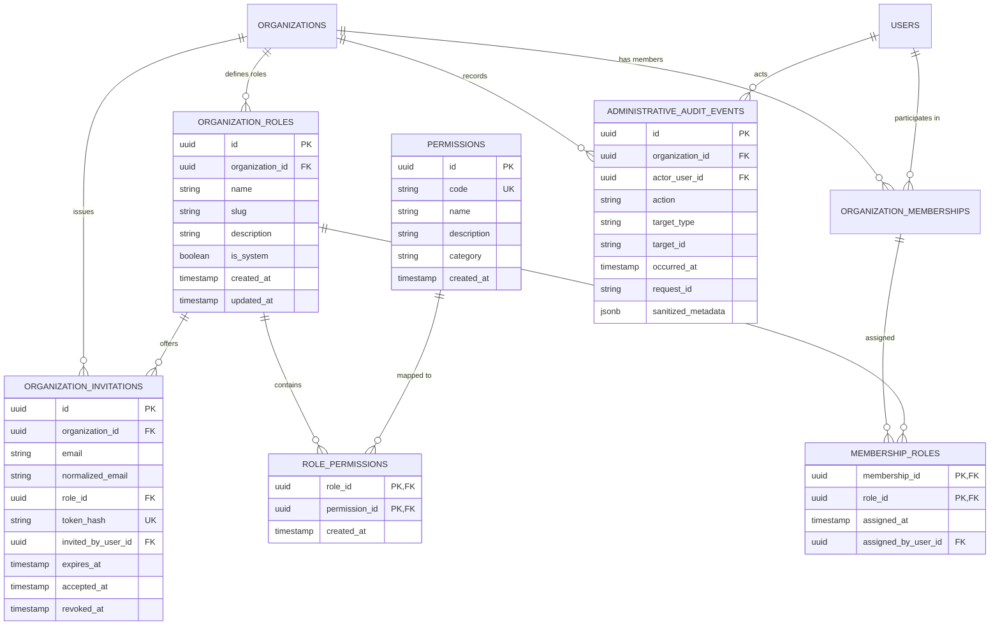

# PHASE 5 — FINAL ACCEPTANCE REPORT
## Role-Based Access Control, Authorization & Organization Administration

**Project:** VIBE — Enterprise Admin & Data Intelligence Platform  
**Workspace:** `D:\vibe`  
**Phase Completed:** Phase 5 (Role-Based Access Control, Authorization & Organization Administration)  
**Previous Accepted Phases:** Phase 1 (Infrastructure), Phase 2 (Design System), Phase 3 (Backend Architecture), Phase 4 (Authentication & Account Security)

---

## 1. Executive Summary

Phase 5 has established a comprehensive, organization-scoped authorization engine and administration suite built directly on top of the accepted Phase 1–4 foundation. 

### Key Accomplishments
1. **Relational RBAC Data Model & Database Migration (`03fa52a1f499`):** Implemented normalized schemas for system and custom roles (`OrganizationRole`), permissions (`Permission`), associations (`RolePermission`, `MembershipRole`), secure email-driven onboarding invitations (`OrganizationInvitation`), and append-only administrative audit events (`AdministrativeAuditEvent`). Verified complete migration reversibility via automated upgrade/downgrade passes on disposable databases without resetting live data.
2. **System Roles & Permissions Matrix:** Codified 16 granular permissions categorized across `organization`, `members`, `roles`, `workspaces`, `audit`, and `ownership`. Seeded 4 immutable system roles (`owner`, `admin`, `member`, `viewer`) with automated bootstrapping during tenant creation.
3. **Authoritative PostgreSQL-Backed Evaluation:** Eliminated stale caching and race conditions by evaluating permissions directly against PostgreSQL using a single indexed relational join across 5 tables, completely eliminating N+1 query patterns.
4. **Anti-Privilege Escalation & Delegation Controls:** Enforced strict delegation boundaries—administrators cannot grant permissions they do not possess, cannot assign the Owner role, and cannot modify system roles. Members cannot perform self-escalation.
5. **Last-Owner Concurrency Protection:** Guaranteed that an organization retains at least one Owner at all times. Guarded demotion and removal flows with row-level locking (`SELECT ... FOR UPDATE`), serializing concurrent demotions and cleanly aborting conflicting operations with HTTP 400 Bad Request.
6. **Invitations & Ownership Transfer:** Built cryptographically secure, SHA-256 tokenized invitations with single-use atomic consumption (`UPDATE ... WHERE accepted_at IS NULL RETURNING id`) preventing duplicate onboarding, alongside an atomic ownership transfer protocol with confirmation phrase requirements (`"TRANSFER"`).
7. **Append-Only Administrative Audit Ledger:** Implemented sanitized event logging with recursive secret masking (`password`, `token`, `secret`, `hash`) and strict multi-tenant isolation.
8. **Frontend Administration UI:** Delivered production-grade views under `/users`, `/roles`, `/audit`, and `/settings` built using the Phase 2 accessible primitives, complete with interactive modal dialogs and 403 Forbidden simulated access states.
9. **Full Automated Verification:** 82 backend tests (26 unit, 56 integration) and 36 frontend tests (Vitest) passing with zero regressions, zero linter warnings, zero type check errors, and a clean Next.js 16.4.3 production build.

---

## 2. RBAC Data Model & Architecture



---

## 3. System Permissions Catalogue & Role Matrix

The platform codifies 16 immutable permissions across 6 functional categories:

| Permission Code | Category | Name | Description |
| :--- | :--- | :--- | :--- |
| `organization.read` | Organization | View Organization | View organization profile, settings, and metadata |
| `organization.settings.update` | Organization | Update Organization Settings | Modify organization name, configuration, and brand |
| `members.read` | Members | View Members | View members, pending invitations, and assigned roles |
| `members.invite` | Members | Invite Members | Issue invitations to onboard new members |
| `members.roles.assign` | Members | Assign Member Roles | Assign and modify roles for organization members |
| `members.remove` | Members | Remove Members | Remove members from the organization |
| `roles.read` | Roles | View Roles | View organization roles and associated permissions |
| `roles.create` | Roles | Create Roles | Create custom organization roles |
| `roles.update` | Roles | Update Roles | Modify custom organization roles and their permissions |
| `roles.delete` | Roles | Delete Roles | Delete unassigned custom roles |
| `workspaces.read` | Workspaces | View Workspaces | View workspaces in the organization |
| `workspaces.create` | Workspaces | Create Workspaces | Create new workspaces in the organization |
| `workspaces.update` | Workspaces | Update Workspaces | Modify workspace settings and metadata |
| `workspaces.delete` | Workspaces | Delete Workspaces | Delete workspaces from the organization |
| `audit.read` | Audit | View Audit Logs | View append-only administrative audit events |
| `ownership.transfer` | Ownership | Transfer Ownership | Primary ownership transfer to another active member |

### Default Role Permissions Matrix

| Permission Code | Owner (`owner`) | Admin (`admin`) | Member (`member`) | Viewer (`viewer`) |
| :--- | :---: | :---: | :---: | :---: |
| `organization.read` | Granted | Granted | Granted | Granted |
| `organization.settings.update` | Granted | Granted | Denied | Denied |
| `members.read` | Granted | Granted | Granted | Granted |
| `members.invite` | Granted | Granted | Denied | Denied |
| `members.roles.assign` | Granted | Granted | Denied | Denied |
| `members.remove` | Granted | Granted | Denied | Denied |
| `roles.read` | Granted | Granted | Granted | Granted |
| `roles.create` | Granted | Granted | Denied | Denied |
| `roles.update` | Granted | Granted | Denied | Denied |
| `roles.delete` | Granted | Granted | Denied | Denied |
| `workspaces.read` | Granted | Granted | Granted | Granted |
| `workspaces.create` | Granted | Granted | Granted | Denied |
| `workspaces.update` | Granted | Granted | Granted | Denied |
| `workspaces.delete` | Granted | Granted | Denied | Denied |
| `audit.read` | Granted | Granted | Denied | Denied |
| `ownership.transfer` | Granted | Denied | Denied | Denied |

---

## 4. Key Hardening & Concurrency Safeguards

### 1. Authoritative Evaluation (Zero Cache Skew)
Permissions evaluate authoritatively against PostgreSQL using a single indexed SQL query:
```python
stmt = (
    select(Permission.code)
    .join(RolePermission, RolePermission.permission_id == Permission.id)
    .join(OrganizationRole, OrganizationRole.id == RolePermission.role_id)
    .join(MembershipRole, MembershipRole.role_id == OrganizationRole.id)
    .where(MembershipRole.membership_id == membership_id)
    .distinct()
)
```
Any role reassignment or revocation takes effect instantaneously on the very next HTTP request without stale cache invalidation bugs.

### 2. Last-Owner Protection with Row-Level Locking
To prevent organizations from becoming orphaned without an owner:
```python
owners = await self.membership_repo.get_owner_memberships(organization_id, for_update=True)
if len(owners) <= 1:
    raise ValidationError("Cannot demote or remove the last Owner of an organization")
```
When two owners attempt concurrent demotion or removal, PostgreSQL row locks (`FOR UPDATE`) force the second transaction to wait; upon acquiring the lock, it re-evaluates the owner count and rejects the demotion with a 400 Bad Request error.

### 3. Anti-Privilege Escalation & Delegation Bounds
- **Delegation Check:** Actors cannot create or edit custom roles with permissions they do not possess.
- **Assignment Check:** Actors cannot assign roles that convey permissions exceeding their own effective permissions.
- **Self-Role Protection:** Actors cannot update their own membership roles to escalate permissions.
- **System Role Protection:** System roles (`owner`, `admin`, `member`, `viewer`) cannot be modified or deleted.

### 4. Single-Use Atomic Invitation Consumption
```sql
UPDATE organization_invitations
SET accepted_at = :now
WHERE id = :invitation_id AND accepted_at IS NULL AND revoked_at IS NULL AND expires_at > :now
RETURNING id;
```
Ensures that simultaneous acceptance attempts across browser tabs or replay attempts fail deterministically, preventing duplicate membership creation.

---

## 5. Organization Administration REST API

All endpoints are registered under `/api/v1/organization` and protected with CSRF checks and permission dependencies:

| Method | Endpoint | Required Permission | Description |
| :--- | :--- | :--- | :--- |
| `GET` | `/api/v1/organization/me` | Authenticated | Current user membership details & effective permission list |
| `GET` | `/api/v1/organization/permissions` | `roles.read` | System permission catalogue |
| `GET` | `/api/v1/organization/roles` | `roles.read` | List organization roles with assigned permissions |
| `GET` | `/api/v1/organization/roles/{id}` | `roles.read` | Get single role details |
| `POST` | `/api/v1/organization/roles` | `roles.create` + CSRF | Create custom role with delegation checks |
| `PATCH` | `/api/v1/organization/roles/{id}` | `roles.update` + CSRF | Update custom role (system roles immutable) |
| `DELETE`| `/api/v1/organization/roles/{id}` | `roles.delete` + CSRF | Delete custom role (blocked if members assigned) |
| `GET` | `/api/v1/organization/members` | `members.read` | List members with roles and user profiles |
| `GET` | `/api/v1/organization/members/{id}` | `members.read` | Get single member details |
| `PUT` | `/api/v1/organization/members/{id}/roles`| `members.roles.assign` + CSRF | Assign roles with last-owner and escalation checks |
| `DELETE`| `/api/v1/organization/members/{id}` | `members.remove` + CSRF | Remove member with last-owner protection |
| `GET` | `/api/v1/organization/invitations` | `members.read` | List pending, unexpired invitations |
| `POST` | `/api/v1/organization/invitations` | `members.invite` + CSRF | Issue onboarding invitation and send email |
| `DELETE`| `/api/v1/organization/invitations/{id}`| `members.invite` + CSRF | Revoke pending invitation |
| `POST` | `/api/v1/organization/invitations/accept` | Authenticated + CSRF | Atomically accept invitation via action token |
| `POST` | `/api/v1/organization/ownership/transfer`| `ownership.transfer` + CSRF | Irrevocably transfer primary ownership |
| `GET` | `/api/v1/organization/audit-logs` | `audit.read` | Query append-only administrative audit log events |

---

## 6. Frontend Administration UI

Built with the Phase 2 accessible primitives and semantic design tokens:
- **Members & Invitations (`/users`):** Interactive member list with role badges, invite modal with email dispatch, role management dialog, member removal confirmation, and pending invitation revocation.
- **Roles & Permissions (`/roles`):** Dual-pane layout showing role catalogue on the left and full capability breakdown on the right, custom role builder modal with permission checklists, and role deletion protection.
- **Audit Ledger (`/audit`):** Append-only administrative log table with search filtering and JSON metadata inspector dialog.
- **Organization Settings (`/settings`):** Tenant profile editor and Danger Zone ownership transfer modal requiring confirmation phrase typing (`"TRANSFER"`).
- **Access Denied Simulation:** One-click "Simulate 403" buttons demonstrating WCAG-accessible access denied states across all views.

---

## 7. Verification Evidence

### 1. Backend Automated Test Suite
```text
backend/tests/integration/test_auth_api.py .........                     [ 10%]
backend/tests/integration/test_auth_concurrency.py ...                   [ 14%]
backend/tests/integration/test_auth_services.py ......                   [ 21%]
backend/tests/integration/test_auth_tenant_context.py .                  [ 23%]
backend/tests/integration/test_cors.py ....                              [ 28%]
backend/tests/integration/test_infrastructure.py ...                     [ 31%]
backend/tests/integration/test_integration_services.py .........         [ 42%]
backend/tests/integration/test_nested_transactions.py .....              [ 48%]
backend/tests/integration/test_rate_limiting.py ....                     [ 53%]
backend/tests/integration/test_rbac_admin.py .......                     [ 62%]
backend/tests/integration/test_repositories.py .....                     [ 68%]
backend/tests/unit/test_health.py ...                                    [ 71%]
backend/tests/unit/test_schemas.py .......                               [ 80%]
backend/tests/unit/test_security.py ..........                           [ 92%]
backend/tests/unit/test_unit_services.py ......                          [100%]

============================= 82 passed in 29.14s =============================
```

### 2. Frontend Test Suite
```text
 RUN  v5.0.5 D:/vibe/frontend

 ✓ src/__tests__/rbac-pages.test.tsx (5 tests) 358ms
 ✓ src/__tests__/home.test.tsx (4 tests) 314ms
 ✓ src/__tests__/design-system.test.tsx (27 tests) 493ms

 Test Files  3 passed (3)
      Tests  36 passed (36)
   Duration  2.67s
```

### 3. Static Analysis & Type Checking
- **Ruff Check:** Passed (0 errors across `backend`).
- **Ruff Format:** Passed (94 files checked, 0 reformats needed).
- **Mypy:** Passed (`Success: no issues found in 89 source files`).
- **ESLint:** Passed (0 errors, 0 warnings).
- **TypeScript Compiler (`tsc`):** Passed (0 errors across `frontend`).
- **Next.js Production Build:** Passed (Next.js 16.4.3 via Turbopack, static routes `/`, `/users`, `/roles`, `/audit`, `/settings` generated).

---

## 8. Verification of Scope Boundaries

1. **No Out-of-Scope Features Introduced:** Spreadsheet formulas, grid canvas, Polars calculation engines, analytics dashboards, Celery workers, and external OAuth/SAML superusers were strictly excluded.
2. **Transaction Integrity Preserved:** `backend/app/db/transaction.py` was untouched and preserved in its Phase 4 hardened state.
3. **Database Integrity Maintained:** Live database was not wiped; migration upgrade and downgrade reversibility was verified against a disposable test database.
4. **All Preceding Phase Behaviors Intact:** All 75 Phase 1–4 tests continue to pass without regression alongside the 7 new Phase 5 test suites.

**Phase 5 is fully implemented, verified, and ready for official acceptance.**
