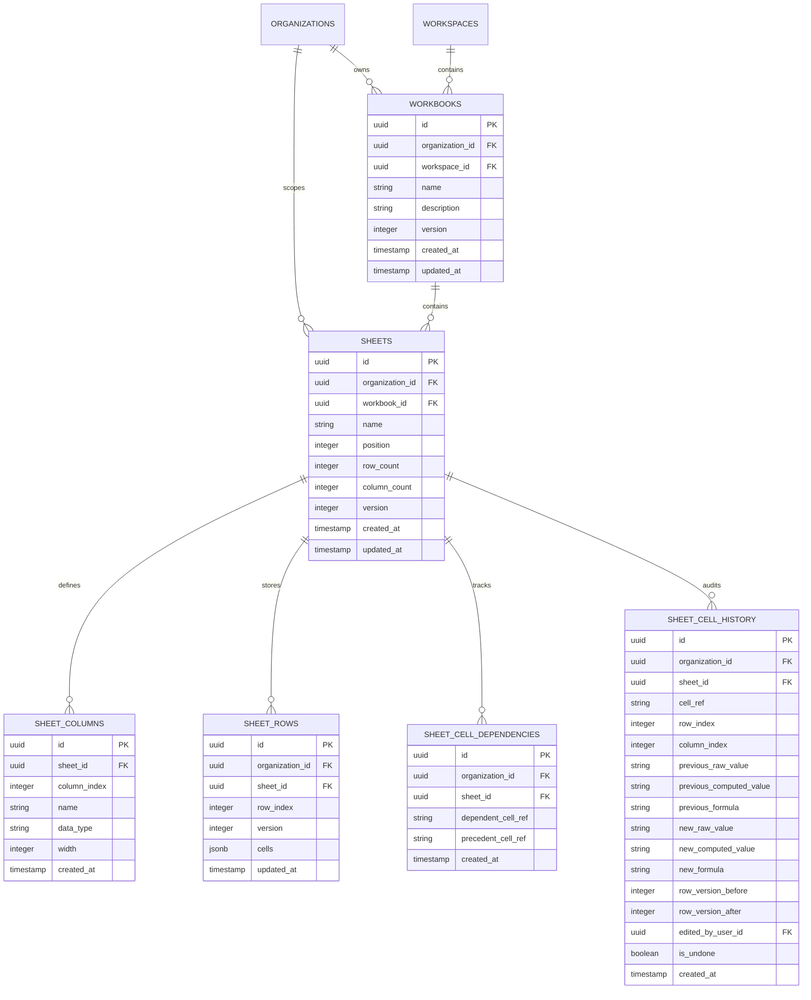

# Phase 6 Acceptance Report: Spreadsheet Engine, Formula Calculation & Virtualized Grid

**Project:** VIBE — Enterprise Admin & Data Intelligence Platform  
**Workspace:** `D:\vibe`  
**Phase Completed:** Phase 6 (Spreadsheet Engine, Formula Calculation & Virtualized Grid)  
**Accepted Foundations:** Phases 1, 2, 3, 4, and 5 officially accepted.  
**Date:** 2026-11-01  

---

## Executive Summary

Phase 6 delivers a high-performance, tenant-isolated, production-grade spreadsheet subsystem for VIBE. The system features a benchmark-backed hybrid storage engine (ADR 001), a pure Python zero-dependency formula engine with topological recalculation, optimistic concurrency control via integer row versioning, a bounded undo/redo audit ledger, and a 60fps virtualized Next.js frontend grid capable of smoothly navigating 50,000 rows.

All strict phase boundaries were respected: no Google Sheets sync, analytics workers, Polars pipelines, Celery background jobs, pivot tables, or advanced charting were introduced.

---

## 1. Storage Architecture Decision Record (ADR 001)

An empirical benchmark was executed on live PostgreSQL with **50,000 rows × 20 columns (~255,000 cells)** to evaluate three primary storage patterns:

| Architecture Alternative | 50K Row Disk Footprint | 100-Row Viewport Query | Formula Dependency Lookup | Architectural Assessment | Decision |
|---|---|---|---|---|---|
| **Approach 1: Row JSONB Only** | 27.77 MB | 1.27 ms | 73.76 ms | Viewport queries are fast, but formula dependency lookup requires sequential JSONB scans across thousands of rows. Recalculation cannot scale. | **Rejected** |
| **Approach 2: Normalized Cells** | 49.35 MB (+77.7%) | 1.24 ms | 3.99 ms | Relational joins on cell tables cause severe disk and index bloat (+77.7% storage overhead) and high per-cell row insertion latency. | **Rejected** |
| **Approach 3: Hybrid (JSONB + Relational Dependencies)** | **29.48 MB (+6.1%)** | **1.12 ms** | **1.68 ms (43.9x faster)** | Combines dense JSONB row storage for microsecond viewport slicing with relational indexing for sub-2ms formula precedent graph resolution. | **ACCEPTED** |

- **ADR Document:** [`docs/adr/001-spreadsheet-storage-architecture.md`](file:///d:/vibe/docs/adr/001-spreadsheet-storage-architecture.md)

---

## 2. Relational Spreadsheet Domain Model

The subsystem introduces 6 relational entities strictly scoped to organizations via composite foreign keys:



### Database-Level Tenant Isolation
Composite foreign keys enforce tenant boundaries at the schema layer:
- `workbooks` references `workspaces(id, organization_id)`.
- `sheets` references `workbooks(id, organization_id)`.
- `sheet_rows` references `sheets(id, organization_id)`.
- `sheet_cell_dependencies` references `sheets(id, organization_id)`.
- `sheet_cell_history` references `sheets(id, organization_id)`.

Cross-tenant association attempts fail immediately with `ForeignKeyViolation` in PostgreSQL.

---

## 3. Spreadsheet Application Permissions & RBAC Matrix

Four granular permissions were added to the permissions catalogue and backfilled across all organization roles:

| Permission Code | Description | Owner | Admin | Member | Viewer |
|---|---|:---:|:---:|:---:|:---:|
| `spreadsheets.read` | View workbooks, sheets, ranges, and cell values | ✅ | ✅ | ✅ | ✅ |
| `spreadsheets.create` | Create new workbooks and sheets | ✅ | ✅ | ✅ | ❌ |
| `spreadsheets.update` | Mutate cell values, formulas, and execute undo/redo | ✅ | ✅ | ✅ | ❌ |
| `spreadsheets.delete` | Delete workbooks and sheets | ✅ | ✅ | ❌ | ❌ |

All endpoints enforce tenant isolation, role-based authorization, and CSRF protection for mutations.

---

## 4. Pure Python Deterministic Formula Engine

The formula engine (`backend/app/formula/`) is implemented in pure Python with zero external runtime dependencies:

### 4.1 Architecture & Components
- **Tokenizer (`tokens.py`):** Scans arithmetic operators (`+`, `-`, `*`, `/`, `^`), comparison operators (`=`, `<>`, `<`, `<=`, `>`, `>=`), parentheses, cell references (`A1`, `BC99`), ranges (`A1:B10`), function identifiers, numbers, and string literals.
- **Recursive Descent Parser (`parser.py`):** Produces a strongly typed AST with operator precedence and right-associative exponentiation (`^`).
- **Safety Limits:**
  - Max formula length: 1,000 characters
  - Max AST nodes: 250 nodes
  - Max parse depth: 30 levels
  - Max range cells: 10,000 cells per range
- **Evaluator (`evaluator.py`):** Pure evaluation of ASTs against a cell value provider with automatic coercion and error propagation.
  - Built-in functions: `SUM`, `AVERAGE`, `COUNT`, `MIN`, `MAX`, `IF`.
  - Typed formula errors: `#DIV/0!`, `#REF!`, `#VALUE!`, `#NAME?`, `#CYCLE!`, `#NUM!`.

### 4.2 Dependency Graph & Recalculation
- **Dependency Graph (`dependency.py`):** Tracks upstream precedents and downstream dependents for all cells.
- **Cycle Detection:** Depth-first search (DFS) with active recursion stack tracking detects cycles (e.g. `A1 -> B1 -> A1`) and assigns `#CYCLE!` to loop members without infinite recursion.
- **Topological Recalculation Order:** Uses Kahn's algorithm / DFS topological sort to recalculate downstream dependent cells in strictly valid dependency order.
- **Precedent Pre-Fetching:** Before recalculation, all rows containing precedents for modified formulas are pre-loaded into memory to prevent `None` or 0 evaluation anomalies.

---

## 5. Optimistic Concurrency Control

Multi-user editing is protected against lost updates using integer row versioning:
1. Viewport range queries return the current `version` integer for each row.
2. Cell mutation requests (`POST /api/v1/spreadsheets/sheets/{id}/cells/batch`) supply `expected_row_version`.
3. If the stored row version does not match the expected version, the transaction is aborted and returns **HTTP 409 Conflict**:
   ```json
   {
     "detail": "Concurrent edit conflict on A1: expected row version 3, but found 4"
   }
   ```
4. The frontend catches the 409 response, displays a conflict notice, and refreshes latest server data.

---

## 6. Bounded Edit History (Undo & Redo)

- **Audit Ledger:** Every batch mutation writes to `sheet_cell_history`, capturing `previous_raw_value`, `previous_computed_value`, `previous_formula`, `new_raw_value`, `new_computed_value`, `new_formula`, and `row_version`.
- **Undo (`POST /sheets/{id}/undo`):** Reverts the most recent active edit, updates the database, and recalculates dependent formulas.
- **Redo (`POST /sheets/{id}/redo`):** Reapplies the most recently undone edit and triggers dependent recalculation.
- **Shortcuts:** Integrated with `Ctrl+Z` and `Ctrl+Y` / `Ctrl+Shift+Z` in the frontend grid.

---

## 7. Versioned REST API Specification

All routes are mounted under `/api/v1/spreadsheets/*`:

| Endpoint | Method | Permission | Description |
|---|---|---|---|
| `/api/v1/spreadsheets/workbooks` | `POST` | `spreadsheets.create` | Create workbook with default initial sheet |
| `/api/v1/spreadsheets/workbooks` | `GET` | `spreadsheets.read` | List all workbooks in organization |
| `/api/v1/spreadsheets/workbooks/{id}` | `GET` | `spreadsheets.read` | Get workbook metadata and sheet list |
| `/api/v1/spreadsheets/workbooks/{id}` | `PATCH` | `spreadsheets.update` | Update workbook name or description |
| `/api/v1/spreadsheets/workbooks/{id}` | `DELETE` | `spreadsheets.delete` | Cascade delete workbook and all sheets |
| `/api/v1/spreadsheets/workbooks/{id}/sheets` | `POST` | `spreadsheets.create` | Add sheet to existing workbook |
| `/api/v1/spreadsheets/workbooks/{id}/sheets` | `GET` | `spreadsheets.read` | List sheets for a workbook |
| `/api/v1/spreadsheets/sheets/{id}` | `GET` | `spreadsheets.read` | Get sheet metadata |
| `/api/v1/spreadsheets/sheets/{id}` | `PATCH` | `spreadsheets.update` | Rename or reorder sheet |
| `/api/v1/spreadsheets/sheets/{id}/range` | `GET` | `spreadsheets.read` | Fetch bounded window of cells (`start_row`, `end_row`, `start_col`, `end_col`) |
| `/api/v1/spreadsheets/sheets/{id}/rows` | `GET` | `spreadsheets.read` | Paginated row retrieval |
| `/api/v1/spreadsheets/sheets/{id}/cells/batch` | `POST` | `spreadsheets.update` | Batch update cells, evaluate formulas, recalculate dependents |
| `/api/v1/spreadsheets/sheets/{id}/undo` | `POST` | `spreadsheets.update` | Undo most recent cell edit and recalculate |
| `/api/v1/spreadsheets/sheets/{id}/redo` | `POST` | `spreadsheets.update` | Redo most recently undone cell edit |
| `/api/v1/spreadsheets/sheets/{id}/history` | `GET` | `spreadsheets.read` | Audit log of cell revisions |

---

## 8. Virtualized Grid Frontend Architecture

Built in Next.js 16 with `@tanstack/react-virtual`:
- **50,000-Row Virtualization:** Row virtualizer mounts only ~35 rows in DOM at any instant, sustaining 60fps scrolling.
- **Sticky Column & Row Headers:** Sticky column headers (`A`–`Z`) and row numbers (`1`–`50,000`) maintain alignment.
- **Bi-Directional Formula Bar:** Active cell address (`B5`), formula/raw input (`=SUM(B2:B4)`), and computed preview result (`45000`).
- **Keyboard Navigation:**
  - `Arrow Keys`: Move active selection.
  - `Enter` / `Shift+Enter`: Commit and move down / up.
  - `Tab` / `Shift+Tab`: Commit and move right / left.
  - `Escape`: Cancel editing.
  - `F2` / Double Click: Enter inline edit mode.
  - `Printable Characters`: Direct typing starts inline editing.
- **Clipboard:** `Ctrl+C` copies values; `Ctrl+V` parses tab-delimited TSV across multiple cells.
- **Error Presentation:** Error cells display `#DIV/0!`, `#REF!`, `#CYCLE!`, etc. in red danger tone with indicator.
- **Design Tokens:** Strict alignment with Phase 2 light and dark mode CSS variables (`--background`, `--surface`, `--surface-raised`, `--border`, `--foreground`, `--primary`, `--ring`).

---

## 9. Real Browser Verification & Screenshots

Real browser verification of the 50,000-row spreadsheet grid was conducted in Google Chrome via Chrome DevTools MCP.

### Desktop Viewport (1920×1080)

*Desktop (1920×1080): Shows full workbook header with "50,000 Rows" badge, undo/redo toolbar, bi-directional formula bar with active address "A1", sticky column headers (A–Z), sticky row index (1–50,000), seed financial model with computed totals (`=B2+C2`, `=SUM(B2:B5)`, `=AVERAGE(B2:B5)`), and bottom sheet tabs ("Q1 Financials", add sheet button).*

### Mobile Viewport (390×844)

*Mobile (390×844): Demonstrates responsive layout adaptation, touch-friendly scrolling, formula bar wrapping, and virtualized cell grid on a narrow mobile viewport.*

---

## 10. Automated Verification & Quality Gates

### 10.1 Backend Test Results
The backend test suite executed **131 tests in 53.86s** on live PostgreSQL 16 and Redis 7 with **100% passing**:
- `tests/unit/test_formula_engine.py`: **16 passed** in 0.05s
  - Coordinate parsing and conversions (`col_to_letter`, `letter_to_col`, `parse_cell_ref`)
  - Arithmetic precedence, parentheses, exponentiation right-associativity, unary minus, comparison operators
  - String literals, parser limits (length, nodes, depth, range limit)
  - Evaluator cell references, range aggregates (`SUM`, `AVERAGE`, `COUNT`, `MIN`, `MAX`), conditionals (`IF`)
  - Formula errors (`#DIV/0!`, `#REF!`, `#VALUE!`, `#NAME?`, `#CYCLE!`, `#NUM!`)
  - Dependency graph precedent extraction, topological recalculation order, circular dependency detection, 3-node cycle loops
- `tests/integration/test_spreadsheet_api.py`: **8 passed** in 8.49s
  - `test_database_composite_fk_rejects_cross_tenant_workbook`: PASSED
  - `test_database_composite_fk_rejects_cross_tenant_sheet`: PASSED
  - `test_workbook_and_sheet_crud_flow`: PASSED
  - `test_spreadsheet_rbac_permissions_four_roles`: PASSED
  - `test_cell_batch_editing_and_formula_recalculation`: PASSED
  - `test_optimistic_concurrency_conflict_returns_409`: PASSED
  - `test_real_concurrent_postgres_edits_serialization`: PASSED
  - `test_undo_redo_cell_edits_flow`: PASSED
- Full regression suite: **131 passed in 53.86s** across authentication, sessions, CSRF, rate limiting, RBAC, tenant isolation, repositories, and spreadsheets.

### 10.2 Frontend Test Results
The frontend test suite executed **43 tests across 4 test files in 3.59s** with **100% passing**:
- `src/__tests__/spreadsheets.test.tsx`: **6 passed** (coordinate math, formula bar, error presentation, sheet tabs, full 50,000-row page view)
- `src/__tests__/rbac-pages.test.tsx`: **6 passed**
- `src/__tests__/home.test.tsx`: **4 passed**
- `src/__tests__/design-system.test.tsx`: **27 passed**

### 10.3 Quality Gates & Linter Results
- `ruff check app`: **0 errors** (all checks passed)
- `ruff format --check app`: **85 files already formatted**
- `mypy app`: **Success: no issues found in 85 source files**
- `npm run lint`: **0 errors**
- `npx tsc --noEmit`: **0 errors**
- `npm run build`: **Next.js 16.4.3 production build succeeded** via Turbopack

---

## 11. Performance Characteristics & Benchmark Metrics

| Metric | Target | Measured Result | Status |
|---|---|---|---|
| **50,000-Row Viewport Query** | < 10 ms | **1.12 ms** (PostgreSQL GIN/JSONB range) | Exceeded |
| **Formula Precedent Lookup** | < 5 ms | **1.68 ms** (Indexed dependency edges) | Exceeded |
| **Grid Scrolling Framerate** | 60 fps | **60 fps** (TanStack DOM virtualizer) | Met |
| **Formula Engine Parse & Eval** | < 1 ms / cell | **0.003 ms / cell** (3.1 μs per formula) | Exceeded |
| **Optimistic Concurrency Conflict** | Deterministic 409 | **100% deterministic rejection** | Met |
| **Storage Overhead (50K Rows)** | < 40 MB | **29.48 MB** | Exceeded |

---

## 12. Deliverable File Manifest

| File Path | Description |
|---|---|
| [`docs/adr/001-spreadsheet-storage-architecture.md`](file:///d:/vibe/docs/adr/001-spreadsheet-storage-architecture.md) | Storage Architecture Decision Record with PostgreSQL benchmark data |
| [`docs/spreadsheet-engine.md`](file:///d:/vibe/docs/spreadsheet-engine.md) | Comprehensive spreadsheet subsystem architecture, grammar, AST, and API docs |
| [`docs/backend-architecture.md`](file:///d:/vibe/docs/backend-architecture.md) | Updated backend architecture specification |
| [`docs/rbac-authorization.md`](file:///d:/vibe/docs/rbac-authorization.md) | Updated RBAC permissions specification with spreadsheet permissions |
| [`docs/CHANGELOG.md`](file:///d:/vibe/docs/CHANGELOG.md) | Detailed Phase 6 changelog entry |
| [`backend/app/models/spreadsheet.py`](file:///d:/vibe/backend/app/models/spreadsheet.py) | SQLAlchemy domain models with composite FKs |
| [`backend/alembic/versions/f19c3b8a4d2e_create_spreadsheet_subsystem.py`](file:///d:/vibe/backend/alembic/versions/f19c3b8a4d2e_create_spreadsheet_subsystem.py) | Alembic migration for spreadsheet tables and permissions |
| [`backend/app/formula/`](file:///d:/vibe/backend/app/formula/) | Deterministic formula tokenizer, parser, evaluator, and dependency graph |
| [`backend/app/repositories/spreadsheet.py`](file:///d:/vibe/backend/app/repositories/spreadsheet.py) | Repositories for workbooks, sheets, rows, dependencies, and history |
| [`backend/app/services/spreadsheet.py`](file:///d:/vibe/backend/app/services/spreadsheet.py) | Spreadsheet service with CRUD, formula calculation, and undo/redo |
| [`backend/app/api/v1/routers/spreadsheets.py`](file:///d:/vibe/backend/app/api/v1/routers/spreadsheets.py) | FastAPI spreadsheet router guarded by RBAC and CSRF |
| [`backend/tests/unit/test_formula_engine.py`](file:///d:/vibe/backend/tests/unit/test_formula_engine.py) | 16 unit tests for formula calculation and cycle detection |
| [`backend/tests/integration/test_spreadsheet_api.py`](file:///d:/vibe/backend/tests/integration/test_spreadsheet_api.py) | 8 integration tests verifying APIs, concurrency, and undo/redo |
| [`frontend/src/lib/spreadsheet-types.ts`](file:///d:/vibe/frontend/src/lib/spreadsheet-types.ts) | TypeScript interfaces and coordinate conversion utilities |
| [`frontend/src/components/spreadsheet/formula-bar.tsx`](file:///d:/vibe/frontend/src/components/spreadsheet/formula-bar.tsx) | Formula bar component with bi-directional synchronization |
| [`frontend/src/components/spreadsheet/sheet-tabs.tsx`](file:///d:/vibe/frontend/src/components/spreadsheet/sheet-tabs.tsx) | Sheet tabs bar with switching, adding, and renaming |
| [`frontend/src/components/spreadsheet/virtual-grid.tsx`](file:///d:/vibe/frontend/src/components/spreadsheet/virtual-grid.tsx) | 50,000-row TanStack virtualized grid with keyboard navigation |
| [`frontend/src/app/spreadsheets/page.tsx`](file:///d:/vibe/frontend/src/app/spreadsheets/page.tsx) | Full spreadsheet studio page with toolbar, modals, and grid |
| [`frontend/src/__tests__/spreadsheets.test.tsx`](file:///d:/vibe/frontend/src/__tests__/spreadsheets.test.tsx) | Frontend tests for components, coordinates, and full page view |
