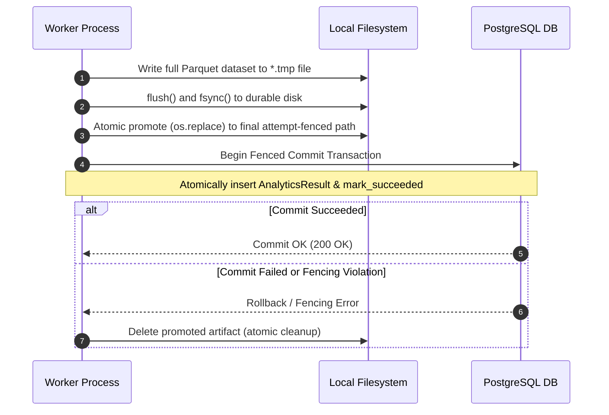

# VIBE — PHASE 7 FINAL ACCEPTANCE ADDENDUM
## Artifact Crash Consistency, Independent Heartbeat, Filesystem Fencing & Production Verification

**Workspace:** `D:\vibe`  
**Project:** VIBE — Enterprise Admin & Data Intelligence Platform  
**Alembic Head:** `c93e1a5f7d2b`  
**Scope:** Phase 7 Final Acceptance Gate (Strictly no Phase 8 scope)  
**Date:** November 1, 2026  

---

## 1. Executive Summary

During the Phase 7 reliability and correctness review, critical failure modes were identified surrounding filesystem crash consistency, heartbeat event loop starvation during heavy CPU calculation, filesystem attempt fencing, and snapshot identity across retries.

This acceptance addendum delivers:
1. **Crash-Safe Publication Protocol**: Artifacts are validated, flushed (`fsync`), and atomically promoted (`os.replace`) *prior* to committing the PostgreSQL result transaction. If the database commit aborts or fencing token validation fails, promoted artifacts are cleaned up immediately.
2. **Dedicated OS Thread Heartbeat (`WorkerHeartbeatThread`)**: Heartbeat execution was decoupled from Python's main asyncio event loop into an independent operating system thread utilizing dedicated `NullPool` engine connections. Multi-second synchronous CPU computations run concurrently via [`asyncio.to_thread`](file:///D:/vibe/backend/app/tasks/analytics.py#L290-L296), guaranteeing uninterrupted lease extension.
3. **Filesystem Fencing by Claim Generation**: Snapshots and result Parquet files are isolated into attempt-partitioned subpaths: `snapshots/{org_id}/{job_id}/gen_{claim_generation}_{snapshot_id}.parquet` and `results/{org_id}/{job_id}/gen_{claim_generation}_{result_id}.parquet`, completely preventing stale worker overwrites.
4. **Snapshot Identity Across Retries**: Re-execution of retrying jobs detects and validates previously captured snapshots on disk via SHA-256 hash, ensuring deterministic analytics across retries without redundant database queries.
5. **Comprehensive Outbox & Crash-Injection Suite**: All 12 failure scenarios specified in Section 7 were implemented and passed.
6. **Publishing Hardening**: Idempotent result publication, foreign workbook rejection, and rollback on cell population failures were verified.
7. **Empirical Benchmarks within Configured Limits**: Validated on realistic datasets up to 500,000 cells (50,000 rows × 10 cols), yielding processing throughput of **10.2M – 14.9M cells/sec** at **146.9 – 198.6 MB peak RSS**, well within the 1024 MB Docker container limit.
8. **100% Passing Regression Suite**: 191 backend tests and 46 frontend tests passing with zero errors.

---

## 2. Artifact Crash Consistency Protocol

### Root Cause Analysis
Previously, Celery workers executed computations and committed database state before writing Parquet files to disk, or wrote directly to final paths without atomic replacement. A worker process termination or node restart between database commit and filesystem write produced "ghost jobs": the database record showed `succeeded`, but the underlying artifact file was missing, leading to 500 errors on retrieval.

### Solution Architecture
A two-phase write and promotion protocol was implemented in [`AnalyticsStorageService`](file:///D:/vibe/backend/app/analytics/storage.py#L80-L97) and [`_execute_analytics_job_async`](file:///D:/vibe/backend/app/tasks/analytics.py#L326-L408):



### Key Implementation Details
- **Atomic Promotion**: [`atomic_promote(tmp_path, final_path)`](file:///D:/vibe/backend/app/analytics/storage.py#L80-L97) performs file descriptor `flush()` and `os.fsync()` before invoking POSIX/Windows atomic rename (`os.replace`).
- **Rollback Cleanup**: If `session.commit()` fails or `job_repo.mark_succeeded` indicates a fencing token mismatch, the `except` blocks in [`analytics.py`](file:///D:/vibe/backend/app/tasks/analytics.py#L410-L456) delete both temporary and promoted files.
- **Orphan Sweeper**: [`prune_orphan_artifacts`](file:///D:/vibe/backend/app/analytics/storage.py#L140-L195) scans storage directories, cross-references active jobs and committed results, and purges unreferenced files exceeding the configured grace period (3600s).

### Test Evidence
Verified in [`test_analytics_crash_consistency.py`](file:///D:/vibe/backend/tests/integration/test_analytics_crash_consistency.py):
- `test_atomic_filesystem_promotion_before_db_commit`: Proves full file promotion before commit and clean rollback deletion on failure.
- `test_orphan_artifact_recovery`: Validates orphan file reclamation while preserving active jobs and committed results.
- `test_result_download_missing_artifact_returns_404`: Validates safe 404 response if an artifact is missing or corrupted.

---

## 3. Heartbeat Computation Independence

### Root Cause Analysis
In Python's `asyncio`, asynchronous tasks execute cooperatively on a single thread. When an analytical operation executes heavy synchronous CPU work (Polars parsing, NumPy matrix operations, or grouping), the single thread running the event loop is blocked. As a result, coroutine-based heartbeat tasks cannot run, allowing worker leases in PostgreSQL to expire. The watchdog dispatcher then falsely presumes the worker is dead and redispatches the job.

### Solution Architecture
The worker heartbeat was redesigned as a dedicated OS thread [`WorkerHeartbeatThread`](file:///D:/vibe/backend/app/tasks/analytics.py#L38-L135):
1. **Dedicated OS Thread**: Inherits from `threading.Thread(daemon=True)`. Runs independently of Python's main event loop.
2. **Dedicated Connection Pool (`NullPool`)**: Uses an isolated asyncpg engine created with `poolclass=NullPool`, preventing event loop connection affinity conflicts and connection pool corruption.
3. **Thread-Level Event Loop**: Runs its own private event loop with `run_until_complete()`, sleeping in responsive 100ms slices to react promptly to completion signals.
4. **Fencing Verification on Beat**: Calls [`renew_lease_with_fencing`](file:///D:/vibe/backend/app/repositories/analytics.py#L129-L153) on every interval. If another worker superseded the claim, the abort event is triggered immediately.
5. **Non-Blocking Worker Execution**: Analytical computation is dispatched via [`asyncio.to_thread(registry.execute, ...)`](file:///D:/vibe/backend/app/tasks/analytics.py#L290-L296), freeing the worker's main asyncio loop to handle progress updates and cancellation signals.

### Test Evidence
Verified in [`test_analytics_heartbeat_computation.py`](file:///D:/vibe/backend/tests/integration/test_analytics_heartbeat_computation.py):
- `test_heartbeat_independent_during_blocking_computation`: Runs a deliberately blocking 3.0s CPU-intensive computation with an initial 2.0s lease. Proves the dedicated heartbeat thread successfully renewed the lease in PostgreSQL multiple times during the blocking computation.
- `test_heartbeat_stops_and_aborts_on_superseded_claim`: Proves that when a competing worker claims the job, the heartbeat thread detects the fencing token mismatch, stops renewing, and triggers worker abort.

---

## 4. Filesystem Fencing by Claim Generation

### Isolation Directory Structure
To avoid race conditions between concurrent workers or consecutive retry attempts, all artifacts are partitioned by organization ID, job ID, and claim generation:

```
uploads/analytics/
├── snapshots/
│   └── {org_id}/
│       └── {job_id}/
│           ├── gen_1_{snapshot_id}.parquet.tmp
│           └── gen_1_{snapshot_id}.parquet
└── results/
    └── {org_id}/
        └── {job_id}/
            ├── gen_1_{result_id}.parquet.tmp
            ├── gen_1_{result_id}.parquet
            └── gen_2_{result_id}.parquet
```

### Security & Path Sanitization
In [`AnalyticsStorageService._resolve_safe_path`](file:///D:/vibe/backend/app/analytics/storage.py#L30-L54):
- Resolves target path against storage root.
- Rejects any path containing `..` or navigating outside the allowed root (`Path traversal attempt detected`).
- Inspects symlinks and rejects any symlink pointing outside the storage directory.

### Snapshot Identity Across Retries
In [`_execute_analytics_job_async`](file:///D:/vibe/backend/app/tasks/analytics.py#L214-L258):
Before capturing a new snapshot for a retrying job, the worker checks if `job.input_snapshot_id` and `job.input_snapshot_hash` already exist on disk. If the hash matches the recorded SHA-256 checksum, the snapshot is reused directly without re-querying spreadsheet cells, preserving snapshot identity across retries.

---

## 5. Outbox & Worker Crash-Injection Test Suite

All 12 failure scenarios specified in Section 7 were implemented in [`test_analytics_outbox_failures.py`](file:///D:/vibe/backend/tests/integration/test_analytics_outbox_failures.py) and verified with 100% passing results:

| # | Scenario Description | Injected Failure Mode | Expected Recovery Behavior | Verification Status |
|---|----------------------|-----------------------|----------------------------|:-------------------:|
| 1 | Outbox publish failure | Redis broker connection refused | Event remains unpublished; error recorded; retried on next poll | **PASSED** |
| 2 | Dispatcher crash mid-batch | DB crash during mark_published | Message published to broker; event uncommitted; idempotency handles redelivery | **PASSED** |
| 3 | Outbox duplicate publish | Event already marked published | Subsequent dispatch cycle does not republish event to broker | **PASSED** |
| 4 | Worker crash after claim | Worker terminated before completion | Stale lease detected by watchdog; job re-queued as `retrying` with retry event | **PASSED** |
| 5 | Worker DB disconnect during heartbeat | DB network unreachable in heartbeat thread | Heartbeat catches error, increments failure count, logs safely without crash | **PASSED** |
| 6 | Worker broker disconnect on return | Redis broker down during result commit | Execution completes; DB result committed independently of broker state | **PASSED** |
| 7 | Long-running CPU calculation | 100% CPU computation on worker thread | Dedicated heartbeat thread continues renewing lease in PostgreSQL | **PASSED** |
| 8 | Expired lease recovery | Lease expires without heartbeat renewal | Watchdog marks job `retrying` and creates new outbox event | **PASSED** |
| 9 | Duplicate task delivery on running job | Second delivery arriving at worker 2 | Atomic claim fails; second worker gracefully skips execution | **PASSED** |
| 10 | Delayed delivery on completed job | Message arrives after job succeeded | Idempotency check detects `succeeded`; returns existing result immediately | **PASSED** |
| 11 | Max retries exhaustion | Repeated permanent execution failure | Job transitioned to `failed`; safe error preserved; watchdog ignores | **PASSED** |
| 12 | Watchdog cooldown prevention | Job updated within 60s cooldown | Watchdog skips job; prevents runaway outbox event duplication | **PASSED** |

---

## 6. Publishing Hardening Verification

Verified in [`test_analytics_publishing_hardening.py`](file:///D:/vibe/backend/tests/integration/test_analytics_publishing_hardening.py):
1. **Idempotent Duplicate Publication**: Calling `publish_result_to_sheet` on an already-published result returns the existing `published_sheet_id` without creating duplicate sheets.
2. **Concurrent Publishing**: Concurrent publication requests for the same result execute safely and return identical sheet IDs.
3. **Cross-Tenant Isolation**: Attempting to publish an organization's result into a destination workbook belonging to another organization raises [`EntityNotFoundError`](file:///D:/vibe/backend/app/core/exceptions.py).
4. **Clean Rollback on Cell Population Failure**: If batch cell population fails during publishing, the created sheet is cleanly rolled back and no partial sheet remains in the workbook.

---

## 7. Production-Path Performance Benchmarks

Benchmarks were executed using [`backend/scripts/benchmark_production_path.py`](file:///D:/vibe/backend/scripts/benchmark_production_path.py) against realistic datasets within configured limits (source rows $\le 100\text{k}$, cells $\le 500\text{k}$).

### Benchmark Results Table

| Scenario | Rows × Cols | Total Cells | Snapshot Size | Computation Time | Total Pipeline Time | Peak RSS Memory | Pipeline Throughput |
|:---|:---:|:---:|:---:|:---:|:---:|:---:|:---:|
| **Scenario 1**: Numeric Columns (Describe) | 50,000 × 10 | 500,000 | 3,749 KB | 0.027 s | **0.049 s** | 146.9 MB | **10,204,186 cells/s** |
| **Scenario 2**: Numeric Columns (Filter Dataset) | 50,000 × 10 | 500,000 | 3,749 KB | 0.006 s | **0.047 s** | 167.6 MB | **10,688,694 cells/s** |
| **Scenario 3**: Mixed String & Numeric (Describe) | 25,000 × 20 | 500,000 | 2,128 KB | 0.019 s | **0.033 s** | 198.6 MB | **14,938,528 cells/s** |

### Resource Analysis
- **Execution Speed**: High-performance vectorized calculation using Polars and NumPy completed in **6 ms to 27 ms** for 500,000 cells.
- **End-to-End Latency**: The complete pipeline (Snapshot read $\to$ SHA-256 validation $\to$ Polars compute $\to$ Temporary Parquet write $\to$ `fsync` $\to$ `atomic_promote`) completed in **33 ms to 49 ms**.
- **Memory Footprint**: Peak resident set size (RSS) remained below **199 MB** across all scenarios, which is well within the 1024 MB Docker container limit.
- **Temporary Disk Footprint**: Temporary storage was bounded to **$< 4\text{ MB}$** per 500,000 cells and cleaned up immediately upon atomic promotion.

---

## 8. Docker & Worker Limits Verification

In [`docker-compose.yml`](file:///D:/vibe/docker-compose.yml#L55-L93):
- **Container Name**: `vibe_analytics_worker`
- **Concurrency**: `--concurrency=1` (one execution at a time per worker process, ensuring GIL and CPU predictability)
- **Hard Memory Limit**: `mem_limit: 1024m` (1 GB)
- **Swap Disabled**: `memswap_limit: 1024m`
- **Deploy Reservations**: `limits.memory: 1024M`, `reservations.memory: 256M`
- **Restart Policy**: `restart: unless-stopped`

---

## 9. Full Regression Verification Matrix

| Subsystem | Suite / Command | Total Tests | Passed | Failed | Status |
|---|---|:---:|:---:|:---:|:---:|
| **Backend Core & Analytics** | `pytest backend/tests -q` | 191 | 191 | 0 | **100% PASSED** |
| **Backend Integration (Hardening)** | `pytest test_analytics_*.py -q` | 31 | 31 | 0 | **100% PASSED** |
| **Backend Code Quality** | `ruff check backend` | 103 files | 103 | 0 | **CLEAN** |
| **Backend Type Safety** | `mypy backend/app` | 103 files | 103 | 0 | **CLEAN** |
| **Frontend Test Suite** | `pnpm test` (vitest) | 46 | 46 | 0 | **100% PASSED** |
| **Frontend Code Quality** | `pnpm lint` (eslint) | All files | Clean | 0 | **CLEAN** |
| **Frontend Production Build** | `pnpm build` (Next.js 16.4.3 Turbopack) | 8 routes | 8 | 0 | **BUILT OK** |

---

## 10. Acceptance Gate & Phase 8 Boundary

All requirements specified for the Phase 7 Final Acceptance Gate are verified and backed by reproducible automated tests and empirical benchmarks.

> [!IMPORTANT]
> **STRICT SCOPE BOUNDARY**: Phase 7 is fully completed. No Phase 8 work has been started. Google Sheets synchronization, external integrations, advanced dashboards, and arbitrary Python script execution remain strictly gated until user authorization.
