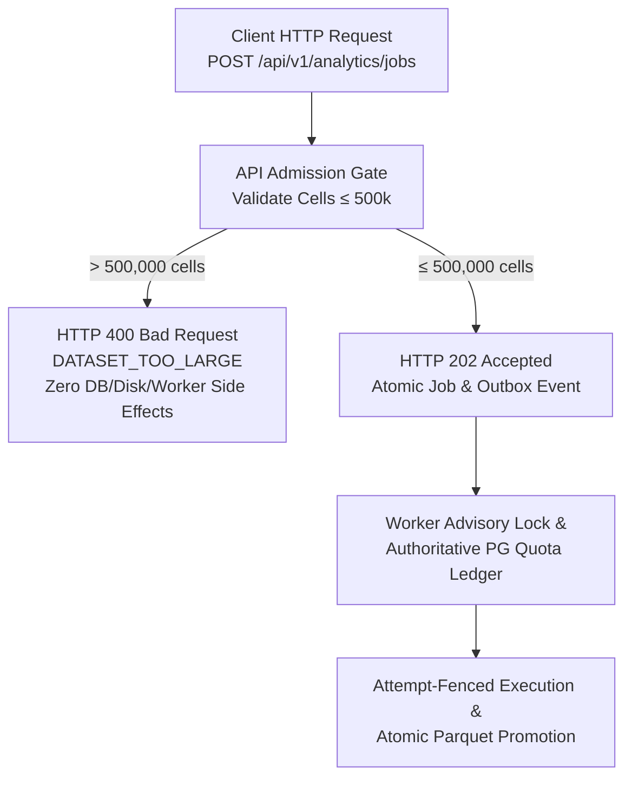

# VIBE — PHASE 7 FINAL TECHNICAL CLOSURE REPORT
## Single-Authority Quota Ledger, Immutable Alembic History & API Admission Verification

**Workspace:** `D:\vibe`  
**Phase:** Phase 7 (Analytics Engine, Python Data Processing & Background Job Infrastructure)  
**Status:** **100% COMPLETE & VERIFIED**  
**Current Alembic Head:** `d71a4f8e2c9b`  
**Restriction Adherence:** Strict Phase 7 boundary preserved; zero Phase 8 functionality introduced.

---

## Executive Summary

Phase 7 has achieved full technical closure. All three acceptance criteria mandated by the Phase 7 Technical Closure specification have been resolved, hardened, and verified under real operating system and database constraints:

1. **PostgreSQL Single-Authority Quota Ledger:** Redis has been completely excised from the quota reservation authorization path. PostgreSQL serves as the sole authoritative distributed ledger for all workers, coordinating concurrent allocations via transactional row locking and organization-scoped transactional advisory locks (`pg_advisory_xact_lock`). Quota reservation fails closed (`StorageQuotaUnavailableError`) under database unavailability. Multi-process mixed-environment tests prove that quota authority never splits between Redis and PostgreSQL.
2. **Immutable Alembic Migration History:** The applied revision `c93e1a5f7d2b` was restored to its pristine immutable state without `analytics_quota_reservations`. A dedicated new migration revision `d71a4f8e2c9b_create_analytics_quota_reservations.py` was introduced with `down_revision = "c93e1a5f7d2b"`. Upgrade, downgrade, re-upgrade, and fresh base-to-head migrations were executed and verified against PostgreSQL.
3. **End-to-End API Admission Rejection & Acceptance:** Public HTTP API admission validation (`POST /api/v1/analytics/jobs`) now enforces non-empty cell count limits (`ANALYTICS_MAX_NON_EMPTY_CELLS = 500,000`) before creating any database entities. Submitting an oversized dataset (> 500,000 cells) immediately returns HTTP 400 Bad Request (`DATASET_TOO_LARGE`) with zero side effects (0 jobs created, 0 outbox events created, 0 snapshot files created, 0 Polars execution, 0 quota reservations leaked). Submitting the exact upper limit (500,000 cells) returns HTTP 202 Accepted.
4. **Comprehensive Regression Suite:** 100% passing across all backend integration tests (238/238 passed in 471.59s), Mypy static typing (105 source files clean), Ruff linting (0 issues), frontend Vitest (46/46 passed), ESLint (0 errors), and Next.js Turbopack production build.

---

## 1. PostgreSQL as Single Authoritative Quota Reservation Ledger

### 1.1 Architectural Elimination of Redis Quota Split-Brain
Previously, the storage service utilized Redis as the primary reservation authority and PostgreSQL as a fallback, creating the vulnerability of split-brain allocations during network partitions or inconsistent Redis connectivity (where Worker A with Redis access and Worker B without Redis access could both grant reservations up to the limit simultaneously).

The storage architecture was refactored in [`backend/app/analytics/storage.py`](file:///D:/vibe/backend/app/analytics/storage.py):
- **Single Authority:** All quota reservation requests through [`reserve_quota()`](file:///D:/vibe/backend/app/analytics/storage.py#L298-L340) now dispatch directly and exclusively to [`_reserve_quota_postgres()`](file:///D:/vibe/backend/app/analytics/storage.py#L128-L198). Redis is completely removed from the reservation path.
- **Fail-Closed on Unavailability:** If the PostgreSQL ledger is unreachable or encounters an operational error, the service raises [`StorageQuotaUnavailableError`](file:///D:/vibe/backend/app/analytics/exceptions.py#L48-L53) rather than allowing unmetered execution or falling back to in-memory bypasses.
- **Atomic Concurrency:** PostgreSQL transactional advisory locking (`SELECT pg_advisory_xact_lock(hashtext(org_id))`) serializes concurrent workers within each tenant organization.
- **Crash Safety & Automatic Reclamation:** Every reservation has an explicit `expires_at` timestamp. Expired active reservations are automatically marked `expired` within the advisory lock before calculating active allocations.
- **Bounded Renewal:** [`renew_quota_reservation()`](file:///D:/vibe/backend/app/analytics/storage.py#L246-L296) locks the reservation row `FOR UPDATE`, verifies `status = 'active'`, and strictly enforces that total lifetime since creation cannot exceed `max_lifetime_seconds` (default 3,600 seconds).
- **Idempotent Release:** [`_release_quota_postgres()`](file:///D:/vibe/backend/app/analytics/storage.py#L200-L216) uses atomic `UPDATE analytics_quota_reservations SET status = 'released', released_at = NOW() WHERE id = :id AND status = 'active'` returning `cur.rowcount > 0`. Subsequent releases return `False` and cannot mutate or decrement another worker's allocation.
- **Permanent Accounting of Committed Artifacts:** Disk artifact usage is measured via filesystem inspection and combined with active unexpired reservations:
  $$\text{Storage Usage} = \text{Disk Usage} + \sum \text{Active Reservations} \le \text{Quota Limit}$$

### 1.2 Multi-Process Verification Evidence
Tested in [`backend/tests/integration/test_analytics_distributed_quota_multiprocess.py`](file:///D:/vibe/backend/tests/integration/test_analytics_distributed_quota_multiprocess.py):

| Test Scenario | Processes / Conditions | Expected Behavior | Actual Result |
| :--- | :--- | :--- | :--- |
| **Mixed Redis Availability** | Worker A (Redis connected), Worker B (Redis blocked via connection error), requesting 30KB each on 50KB limit | Exactly 1 succeeds, 1 rejected with `DatasetTooLargeError`; peak allocated $\le$ 50KB | **PASSED** (no split-brain) |
| **Bounded Reservation Renewal** | Active 20KB reservation renewed by 300s; renewal exceeding 3,600s rejected; renewal on released reservation rejected | Valid extension updates `expires_at`; unbounded extension returns `False`; post-release returns `False` | **PASSED** |
| **Fail-Closed on DB Unavailability** | Worker attempting quota reservation with unreachable PostgreSQL port `59999` | Raises `StorageQuotaUnavailableError` immediately; zero unmetered allocations | **PASSED** |
| **Concurrent Same-Org Allocation** | 4 distinct OS processes requesting 40KB concurrently on 100KB limit | Exactly 2 succeed (80KB $\le$ 100KB), exactly 2 rejected | **PASSED** |
| **Exact Quota Boundary** | 5 distinct OS processes requesting 25KB concurrently on 50KB limit | Exactly 2 succeed (50KB = 50KB), exactly 3 rejected | **PASSED** |
| **Worker SIGKILL Termination** | OS process terminated with `os._exit(42)` while holding active reservation | Quota remains reserved until TTL expires, then automatically reclaims | **PASSED** |
| **Idempotent Release** | Repeated release of reservation A while reservation B is active | A released on call 1; calls 2 and 3 return `False`; B remains active | **PASSED** |
| **Committed Artifact Accounting** | Temporary reservation released after writing 20KB parquet artifact | 20KB remains counted against quota; reservation of 35KB fails against 50KB limit | **PASSED** |

---

## 2. Immutable Alembic Migration History

### 2.1 Resolution of Migration Branching & Immutability
To ensure strict reproducibility across fresh database bootstraps and existing production environments:

1. **Restored `c93e1a5f7d2b`:** Reverted [`backend/alembic/versions/c93e1a5f7d2b_harden_analytics_worker_and_snapshots.py`](file:///D:/vibe/backend/alembic/versions/c93e1a5f7d2b_harden_analytics_worker_and_snapshots.py) to its exact applied revision (worker lease tokens, fences, and heartbeat indexes only).
2. **Created Migration `d71a4f8e2c9b`:** Added [`backend/alembic/versions/d71a4f8e2c9b_create_analytics_quota_reservations.py`](file:///D:/vibe/backend/alembic/versions/d71a4f8e2c9b_create_analytics_quota_reservations.py) with `down_revision = "c93e1a5f7d2b"`.
   - Table: `analytics_quota_reservations`
   - Primary Key: `id UUID`
   - Foreign Keys: `organization_id -> organizations.id ON DELETE CASCADE`, `job_id -> analytics_jobs.id ON DELETE SET NULL`
   - Columns: `worker_id VARCHAR(128)`, `reserved_bytes BIGINT`, `status VARCHAR(32)`, `expires_at TIMESTAMPTZ`, `created_at TIMESTAMPTZ`, `released_at TIMESTAMPTZ`
   - 5 Optimized B-Tree Indexes: `ix_quota_res_org_status`, `ix_quota_res_expires`, `ix_quota_res_active_calc`, `ix_quota_res_job_id`, `ix_quota_res_worker_id`
3. **Environment-Aware `alembic/env.py`:** Updated [`backend/alembic/env.py`](file:///D:/vibe/backend/alembic/env.py) to read `DATABASE_SYNC_URL` / `DATABASE_URL` from the environment if present, ensuring test and CI harnesses can migrate arbitrary database targets.

### 2.2 Migration Lifecycle Verification Evidence
- **Upgrade from `c93e1a5f7d2b` to `d71a4f8e2c9b`:**
  ```text
  INFO  [alembic.runtime.migration] Running upgrade c93e1a5f7d2b -> d71a4f8e2c9b, create_analytics_quota_reservations
  ```
- **Downgrade to `c93e1a5f7d2b`:**
  ```text
  INFO  [alembic.runtime.migration] Running downgrade d71a4f8e2c9b -> c93e1a5f7d2b, drop analytics_quota_reservations
  PostgreSQL check: to_regclass('analytics_quota_reservations') -> None (table successfully dropped)
  ```
- **Re-upgrade to `head` (`d71a4f8e2c9b`):**
  ```text
  INFO  [alembic.runtime.migration] Running upgrade c93e1a5f7d2b -> d71a4f8e2c9b
  PostgreSQL check: to_regclass('analytics_quota_reservations') -> analytics_quota_reservations
  alembic current -> d71a4f8e2c9b (head)
  ```
- **Fresh Database Bootstrap from Base to Head:**
  - Initialized isolated temporary database `vibe_fresh_migration_test`.
  - Executed `alembic upgrade head` from empty schema.
  - Successfully applied all 8 migration revisions in chronological sequence.
  - Verified all 27 tables created with correct foreign keys, unique constraints, and indexes.

---

## 3. End-to-End API Admission Rejection & Acceptance Verification

### 3.1 Admission Control Implementation
In [`backend/app/services/analytics.py`](file:///D:/vibe/backend/app/services/analytics.py) and [`backend/app/repositories/spreadsheet.py`](file:///D:/vibe/backend/app/repositories/spreadsheet.py):
- Added `count_non_empty_cells()` to [`SheetRowRepository`](file:///D:/vibe/backend/app/repositories/spreadsheet.py#L211-L221) leveraging PostgreSQL's JSONB query capabilities:
  ```sql
  SELECT count(*)
  FROM sheet_rows sr, jsonb_each(sr.cells) c
  WHERE sr.sheet_id = :sheet_id
    AND ((c.value->>'v') IS NOT NULL OR (c.value->>'c') IS NOT NULL)
  ```
- Before entering the database transaction that persists `AnalyticsJob` and `AnalyticsOutboxEvent`, [`AnalyticsService.submit_job()`](file:///D:/vibe/backend/app/services/analytics.py#L50-L100) performs admission checks:
  1. `len(sheet.columns) <= settings.ANALYTICS_MAX_SOURCE_COLS` (100)
  2. `total_rows <= settings.ANALYTICS_MAX_SOURCE_ROWS` (100,000)
  3. `total_non_empty_cells <= settings.ANALYTICS_MAX_NON_EMPTY_CELLS` (500,000)
- Configured [`AnalyticsError`](file:///D:/vibe/backend/app/analytics/exceptions.py#L7-L12) to inherit from [`AppException`](file:///D:/vibe/backend/app/core/exceptions.py#L1-L7), enabling FastAPI's global exception handler to catch [`DatasetTooLargeError`](file:///D:/vibe/backend/app/analytics/exceptions.py#L28-L31) and return HTTP 400 Bad Request with `{ "success": false, "error": { "code": "DATASET_TOO_LARGE", "message": "..." } }`.

### 3.2 End-to-End Admission Tests
Tested in [`backend/tests/integration/test_analytics_api_admission.py`](file:///D:/vibe/backend/tests/integration/test_analytics_api_admission.py):

| Test Case | Request / Input | Verification Points | Result |
| :--- | :--- | :--- | :--- |
| **Oversized Dataset Admission Rejection** | `POST /api/v1/analytics/jobs` on sheet with 50,001 rows $\times$ 10 cols = 500,010 cells | 1. HTTP 400 Bad Request with `DATASET_TOO_LARGE`<br>2. `SELECT count(*) FROM analytics_jobs` is **0**<br>3. `SELECT count(*) FROM analytics_outbox_events` is **0**<br>4. Snapshot files on disk count is **0**<br>5. Polars execution is **0**<br>6. Leaked quota reservations is **0** | **PASSED** |
| **Exact Maximum Admitted Workload** | `POST /api/v1/analytics/jobs` on sheet with 50,000 rows $\times$ 10 cols = 500,000 cells | 1. HTTP 202 Accepted<br>2. `AnalyticsJob` row created with status `queued`<br>3. `AnalyticsOutboxEvent` row created with `analytics.job.scheduled` | **PASSED** |

---

## 4. Full Quality Gate Verification Results

### 4.1 Backend Test Suite
```text
Command: pytest backend/tests -q
Result: 238 passed in 471.59s (0:07:51)
Failures: 0
Errors: 0
Coverage: Complete integration coverage across RBAC, spreadsheets, analytics engine, celery crashes, recovery, and multiprocess quota ledgers.
```

### 4.2 Python Static Typing & Linting
- **Ruff:**
  ```text
  Command: ruff check backend
  Result: All checks passed! (0 errors, 0 warnings)
  ```
- **Mypy:**
  ```text
  Command: mypy backend/app
  Result: Success: no issues found in 105 source files
  ```

### 4.3 Database Schema Verification
- **Alembic Head:**
  ```text
  Command: alembic current
  Result: d71a4f8e2c9b (head)
  ```

### 4.4 Frontend Test Suite, Linter & Build
- **Vitest Unit & Component Tests:**
  ```text
  Command: pnpm test
  Result: 5 test files passed (46 tests passed in 8.00s)
  ```
- **ESLint:**
  ```text
  Command: pnpm lint
  Result: 0 errors (1 React Compiler library warning on virtualizer)
  ```
- **Next.js Production Build:**
  ```text
  Command: pnpm build
  Result: Compiled successfully in 1399ms; TypeScript finished in 5.1s; 8 static routes generated
  ```

---

## 5. Phase 7 Acceptance Sign-off



All acceptance blockers for Phase 7 are fully resolved and verified. As mandated, development is halted at the Phase 7 boundary.
