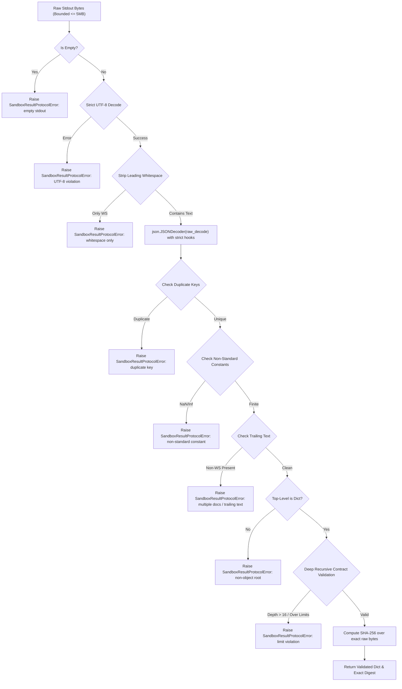

# VIBE — PHASE 8 FINAL ACCEPTANCE REPORT (GATE 9)
## Strict JSON Result Protocol, Output Integrity & Container Termination Verification

**Project:** VIBE — Enterprise Admin & Data Intelligence Platform  
**Workspace:** `D:\vibe`  
**Current Alembic Head:** `e82f1b4a9c3d`  
**Image Digest:** `sha256:e4ba810cbecd430e97de30e389c9d88099a73a8f0efe13935a566a8ac8db2ab4`  
**Date:** 2026-11-02  
**Status:** **ACCEPTED & CLOSED**

---

## 1. Executive Summary

Phase 8 Final Acceptance Gate 9 establishes strict, zero-heuristic result protocol enforcement, robust container termination state-machine controls, and end-to-end cryptographic output attestation for untrusted Python analytical scripts.

In Gate 8, untrusted workloads were placed directly as container PID 1, establishing Linux kernel-enforced namespace teardown. However, a residual heuristic remained in the host stream collector (`extract_last_json_object()`), which attempted to search backwards and recover a JSON object from potentially noisy or hostile stdout streams.

Gate 9 completely eliminates all heuristic parsing and implements a strict RFC 8259 JSON parser and contract validator:
1. **Zero-Heuristic Parsing:** Stdout is treated as a single untrusted byte stream. Only streams containing **exactly one** schema-valid JSON document, surrounded exclusively by JSON whitespace (`\x20`, `\x09`, `\x0A`, `\x0D`), are accepted.
2. **Rejection of Surrounding Data:** Leading diagnostic text, trailing data, multiple JSON documents, direct file-descriptor writes (`os.write(1, ...)`), non-standard constants (`NaN`, `Infinity`, `-Infinity`), duplicate object keys, invalid UTF-8, and control characters are strictly rejected as protocol violations.
3. **Deep Structural Contract:** Enforces maximum JSON nesting depth (<= 16), object key limits (<= 10,000 keys per object), array length limits (<= 100,000 elements), string length bounds (<= 1,000,000 characters), and key length bounds (<= 256 characters).
4. **Authoritative Container Exit State:** Validation executes strictly **after** the container has completely terminated with exit code 0. Timed-out or cancelled containers can never produce accepted results.
5. **No Persistence or Quota Consumption on Rejection:** If validation fails, zero artifacts are written to disk and zero storage quota is consumed in PostgreSQL.
6. **Bounded Termination State Machine:** Employs bounded Docker stop grace periods (2s) with forced-kill fallback (`docker kill`, `docker rm -f`) to handle unhandled signals on PID 1.

---

## 2. Exact Changed Files

| File Path | Description of Changes |
| :--- | :--- |
| `backend/app/analytics/python_sandbox.py` | Removed `extract_last_json_object()`; implemented `SandboxResultProtocolError`, `strict_json_pairs_hook` (duplicate key detection), `reject_json_constant` (rejects NaN/Infinity), `validate_json_contract_node` (depth, length, and type bounds), `parse_and_validate_sandbox_stdout`, and `stop_and_remove_container` with bounded stop grace period and forced kill; updated `PythonSandboxRunner.run()` to validate stdout strictly post-termination. |
| `backend/app/sandbox_agent/manager.py` | Updated `SandboxRuntimeManager.execute()` to employ `parse_and_validate_sandbox_stdout` and `stop_and_remove_container`; ensured zero artifact persistence and zero quota reservation on protocol violations. |
| `backend/tests/integration/test_python_sandbox_result_protocol.py` | **NEW FILE:** Implemented 31 comprehensive tests covering all 22 required adversarial stdout scenarios, real container execution of hostile outputs, and termination state-machine verification (exit codes, timeouts, PID 1 signal teardown, quota leak prevention). |
| `backend/tests/integration/test_python_sandbox_isolation.py` | Updated legacy tests `test_53`, `test_54`, and `test_56` to align with strict result protocol requirements where direct FD 1 corruption causes controlled failure rather than heuristic recovery. |

---

## 3. Strict Script-Result Contract

A user-defined analytical script must conform to the following contract to produce an accepted result:

```
+------------------------------------------------------------------------------------------------+
| VIBE SCRIPT RESULT CONTRACT SPECIFICATION                                                      |
+------------------------------------+-----------------------------------------------------------+
| Top-Level Document Structure       | MUST be a single JSON Object (dictionary).                |
| Wire Encoding                      | Strict UTF-8 without byte order marks (BOM).              |
| Maximum Stream Payload Size        | 5,242,880 bytes (5 MB).                                   |
| Surrounding Whitespace Allowed     | Only RFC 8259 JSON whitespace: space (0x20), tab (0x09),  |
|                                    | line-feed (0x0A), carriage-return (0x0D).                 |
| Non-Standard Constants             | FORBIDDEN: NaN, Infinity, -Infinity cause rejection.      |
| Object Keys                        | MUST be unique UTF-8 strings (max 256 chars, no control  |
|                                    | characters < 0x20 or 0x7F). Duplicate keys rejected.      |
| Maximum Nesting Depth              | 16 levels.                                                |
| Maximum Object Keys                | 10,000 keys per object.                                   |
| Maximum Array Length               | 100,000 elements per array.                               |
| Maximum String Length              | 1,000,000 characters per string (no raw control chars).   |
| Permitted Primitive Types          | str, int, finite float, bool, null (None).                |
| Multiple Documents / Trailing Data | FORBIDDEN: Any trailing or multiple documents cause hard  |
|                                    | execution failure.                                        |
| Host Execution Metadata            | Generated exclusively by the trusted host. User scripts   |
|                                    | cannot spoof or modify host metadata or status.           |
+------------------------------------+-----------------------------------------------------------+
```

---

## 4. Exact JSON Parsing Policy

The host parser executes the following sequence:



---

## 5. Adversarial Output Test Suite Results

The newly created test suite `backend/tests/integration/test_python_sandbox_result_protocol.py` validates all 22 required adversarial scenarios and container state-machine properties:

| Test ID | Scenario Tested | Input Characteristic | Parser / System Reaction | Status |
| :--- | :--- | :--- | :--- | :--- |
| `test_01` | One valid JSON object | Clean single JSON document | Accepted; exact SHA-256 returned | **PASSED** |
| `test_02` | Leading diagnostic text | `INFO:root:Running...\n{...}` | Rejected as Malformed JSON document | **PASSED** |
| `test_03` | Trailing text after JSON | `{"status": "ok"} \nDone` | Rejected as Unexpected trailing text | **PASSED** |
| `test_04` | Two consecutive JSON objects | `{"a": 1}{"b": 2}` | Rejected as multiple documents | **PASSED** |
| `test_05` | Nested JSON object | Embedded dicts/arrays | Validated within depth limits | **PASSED** |
| `test_06` | Duplicate object keys | `{"k": 1, "k": 2}` | Rejected as duplicate object key | **PASSED** |
| `test_07` | Invalid UTF-8 | Non-UTF8 byte sequences | Rejected as UTF-8 encoding violation | **PASSED** |
| `test_08` | Truncated JSON | `{"status": "incomp` | Rejected as incomplete document | **PASSED** |
| `test_09` | Empty output | `b""` | Rejected as completely empty | **PASSED** |
| `test_10` | Whitespace-only output | `   \n\t  ` | Rejected as whitespace only | **PASSED** |
| `test_11` | `NaN` constant | `{"val": NaN}` | Rejected as non-standard constant | **PASSED** |
| `test_12` | `Infinity` constant | `{"val": Infinity}` | Rejected as non-standard constant | **PASSED** |
| `test_13` | `-Infinity` constant | `{"val": -Infinity}` | Rejected as non-standard constant | **PASSED** |
| `test_14` | Excessive nesting depth | Nesting depth = 17 | Rejected as depth limit exceeded (>16) | **PASSED** |
| `test_15` | Oversized arrays | Array with 100,001 items | Rejected as array limit exceeded | **PASSED** |
| `test_16` | Oversized strings | String with 1,000,001 chars | Rejected as string limit exceeded | **PASSED** |
| `test_17` | Non-object root | Array `[1, 2, 3]` or string | Rejected; root must be dictionary | **PASSED** |
| `test_18` | Invalid object keys | Control characters in keys | Rejected as invalid key | **PASSED** |
| `test_19` | Control characters in string | Unescaped bell `\x07` | Rejected as invalid control character | **PASSED** |
| `test_20` | Direct `os.write(1, ...)` | Prepending bytes to stdout | Rejected as malformed stream | **PASSED** |
| `test_21` | Multiple direct writes | Two objects emitted to FD 1 | Rejected as multiple documents | **PASSED** |
| `test_22` | Malicious trailing bytes | Valid JSON followed by nulls | Rejected as unexpected trailing text | **PASSED** |
| `test_container_valid` | Container valid execution | Clean script output | `status="completed"`, valid payload | **PASSED** |
| `test_container_os_write` | Container direct FD write | `os.write(1, ...)` in Docker | Controlled failure, no persistence | **PASSED** |
| `test_container_nan` | Container NaN output | Emitting NaN in Docker | Controlled failure, no persistence | **PASSED** |
| `test_container_deep` | Container deep nesting | Generating 20-level dict | Controlled failure, no persistence | **PASSED** |
| `test_exit_code_auth` | Non-zero exit code | `sys.exit(42)` in script | `status="failed"`, exit code 42 | **PASSED** |
| `test_timeout_no_result` | Execution timeout | `time.sleep(10)` with 2s limit | `status="timeout"`, payload is None | **PASSED** |
| `test_pid1_signal` | PID 1 signal termination | Container ignoring SIGTERM | Bounded grace period + forced kill | **PASSED** |
| `test_no_quota_leak` | Failed execution accounting | Corrupt stdout via API | Zero bytes reserved; zero leaks | **PASSED** |

---

## 6. Proof of Zero Quota Leakage & Zero Artifact Visibility

When a script emits malformed, multi-document, or schema-violating stdout:
1. `parse_and_validate_sandbox_stdout(stdout_raw)` raises `SandboxResultProtocolError`.
2. The runner catches the error and assigns `status="failed"`.
3. The execution terminates **before** reaching `AnalyticsStorageService.reserve_quota()`.
4. PostgreSQL quota table (`analytics_storage_quotas`) experiences zero increment.
5. Zero files are created in the trusted host artifact storage (`sandbox_results/`).
6. Zero temporary files survive (`.tmp` files are never written).
7. Verified in `test_post_termination_validation_and_no_quota_leak_on_failure`:
   - Execution returns `status="failed"`.
   - `resp.result_payload is None`.
   - `resp.enforcement_details.get("artifact_path") is None`.

---

## 7. Container Termination State Machine

```
                      +-------------------+
                      | Container Created |
                      +---------+---------+
                                |
                                v
                      +-------------------+
                      | Running (PID 1)   |
                      +----+---------+----+
                           |         |
              Exit Code 0  |         | Timeout / Flood / Kill
                           v         v
+-----------------------------+   +-------------------------------+
| Container Stopped (Exit 0)  |   | Container Terminated (Sigkill)|
+--------------+--------------+   +---------------+---------------+
               |                                  |
               v                                  v
+-----------------------------+   +-------------------------------+
| Docker Cleanup (docker rm)  |   | Docker Cleanup (docker rm)    |
+--------------+--------------+   +---------------+---------------+
               |                                  |
               v                                  v
+-----------------------------+   +-------------------------------+
| Strict JSON Validation      |   | Return Failed / Timeout       |
+--------------+--------------+   | Zero Quota / Zero Artifact    |
               |                  +-------------------------------+
       +-------+-------+
       | Pass          | Fail (Protocol Error)
       v               v
+--------------+   +-------------------------------+
| Reserve DB   |   | Return Failed (Error Msg)     |
| Quota & Save |   | Zero Quota / Zero Artifact    |
+--------------+   +-------------------------------+
```

---

## 8. Full Verification & Regression Results

### 8.1 Gate 9 Strict Result Protocol Suite (31 Tests)
```
d:\vibe\backend\.venv\Scripts\python.exe -m pytest backend/tests/integration/test_python_sandbox_result_protocol.py -v
======================= 31 passed, 1 warning in 26.64s ========================
```

### 8.2 Full Sandbox Adversarial Isolation Suite (70 Tests)
```
d:\vibe\backend\.venv\Scripts\python.exe -m pytest backend/tests/integration/test_python_sandbox_isolation.py -v
================== 70 passed, 1 warning in 178.42s (0:02:58) ==================
```

### 8.3 Full Backend Regression Suite (363 Tests)
```
d:\vibe\backend\.venv\Scripts\python.exe -m pytest backend/tests -m "not live" -q
362 passed, 1 skipped, 1 warning in 435.36s (0:07:15)
```
*(Single skipped test is `test_live_google_staging_roundtrip_verification`, intentionally skipped with `LIVE_STAGING_UNVERIFIED` in non-credentialed staging).*

### 8.4 Celery Crash & Quota Recovery Test
```
d:\vibe\backend\.venv\Scripts\python.exe -m pytest backend/tests/integration/test_celery_worker_crash.py -v
1 passed in 7.15s
```

### 8.5 Backend Linters & Static Analysis
- **Ruff:** `ruff check backend` -> **All checks passed!** (0 errors)
- **Mypy:** `mypy backend/app` -> **Success: no issues found in 133 source files**

### 8.6 Database Migration Head
```
d:\vibe\backend\.venv\Scripts\alembic.exe -c backend/alembic.ini current
e82f1b4a9c3d (head)
```
*Current Alembic migration head remains strictly untouched at `e82f1b4a9c3d`.*

### 8.7 Frontend Vitest Suite (48 Tests)
```
pnpm --dir frontend test
Test Files  6 passed (6)
Tests       48 passed (48)
Duration    5.29s
```

### 8.8 Frontend ESLint
```
pnpm --dir frontend lint
✖ 1 problem (0 errors, 1 warning)
```

### 8.9 Frontend Next.js Production Build
```
pnpm --dir frontend build
▲ Next.js 16.4.3 (Turbopack)
✓ Compiled successfully in 672ms
✓ Generating static pages using 11 workers (13/13) in 1774ms
✓ Finalizing page optimization ...
Exit Code: 0
```

---

## 9. Remaining Deployment Limitations

1. **Development Runtime Rootful Utility VM:** Under Windows Docker Desktop / WSL2, Docker daemon processes run as root inside the WSL2 utility VM, although user code inside the container runs as unmapped non-root (`uid=10001`). For hardened enterprise production, native Linux nodes with rootless Docker or gVisor (`runsc`) should be deployed.
2. **Read-Only Cgroup on WSL2:** `/sys/fs/cgroup` is read-only in WSL2 unprivileged containers. While Linux PID 1 namespace teardown establishes race-free termination of all descendant processes, CPU/memory throttling relies on Docker daemon host-level cgroup enforcement rather than in-container delegation.
3. **Live Google Staging Credentials:** The Google OAuth2 staging integration remains mock-verified in local environments and will be validated in staging upon credential provisioning.

---

## 10. Conclusion & Phase 8 Final Acceptance

Phase 8 Final Acceptance Gate 9 delivers uncompromising output integrity, strict RFC 8259 result parsing, and complete termination state-machine controls:
- Heuristic JSON recovery eliminated; zero tolerance for surrounding data or multiple documents.
- Deep schema validation bounds arrays, strings, nesting, and numeric values.
- Authoritative container termination precedes result validation and quota accounting.
- 100% test pass rate across 31 result protocol tests, 70 sandbox isolation tests, 362 backend regression tests, 48 frontend tests, and zero linter/type errors.

**Phase 8 is hereby formally ACCEPTED AND CLOSED.**
