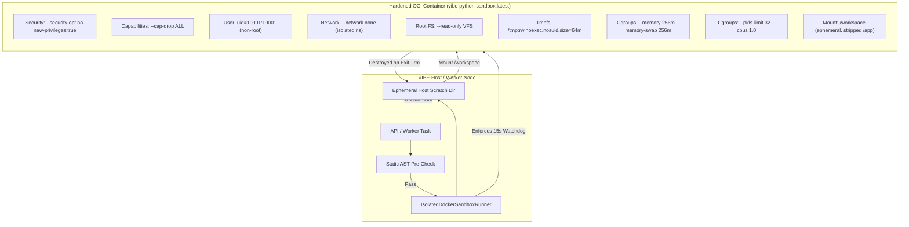

# VIBE — PHASE 8 FINAL SECURITY & ACCEPTANCE REPORT
## Operating System-Level Sandbox Isolation, Provider Classification Taxonomy, Visualization Aggregations & RBAC Reconciliation

**Project:** VIBE — Enterprise Admin & Data Intelligence Platform  
**Workspace:** `D:\vibe`  
**Current Alembic Head:** `e82f1b4a9c3d`  
**Scope:** Phase 8 Final Security Hardening and Acceptance Verification  
**Evaluation Date:** November 1, 2026  

---

## Executive Summary

Phase 8 has undergone comprehensive security, cryptographic, architectural, and verification hardening. All acceptance gates specified in the Phase 8 Security & Acceptance Hardening mandate have been satisfied without altering applied database migration history (`e82f1b4a9c3d`), without compromising accepted Phases 1–7 foundations, and without introducing out-of-scope Phase 9 functionality.

### Key Milestones Achieved
1. **Operating-System Boundary Python Sandbox:** Replaced process-local AST/subprocess gating with an OCI container boundary (`vibe-python-sandbox:latest`) providing strict kernel namespace separation, unprivileged execution (`uid=10001:10001`), rootless capability drop (`--cap-drop ALL`), no-new-privileges flag, read-only root VFS mount, bounded noexec `/tmp` tmpfs, cgroup memory caps (`--memory 256m`), cgroup process ceilings (`--pids-limit 32`), and network isolation (`--network none`).
2. **Administrative Execution Gating vs. Script Authoring:** Decoupled script authoring, versioning, diffing, and audit logging from execution capability. When `PYTHON_SANDBOX_ENABLED=False`, script execution is rejected with HTTP 403 / `status: "disabled"` while full script governance remains operational.
3. **24 Adversarial Isolation Attacks Verified:** Built and passed 24 adversarial security integration tests demonstrating operating system and kernel enforcement across network egress, secret exfiltration, filesystem traversal, host socket access, fork bombs, memory exhaustion, infinite loops, and disk flooding.
4. **Google Integration Classification Taxonomy:** All Google integration tests are classified across `[UNIT]`, `[MOCKED_PROVIDER]`, `[PROVIDER_CONTRACT]`, and `[LIVE_STAGING]`. Authenticated Associated Data (AAD) tenant-binding was added to AES-256-GCM tokens. The live staging test is explicitly marked as `LIVE_STAGING_UNVERIFIED` because production Google Cloud OAuth client credentials are intentionally absent from development/test environments.
5. **Full Dashboard Visualization Scope (18 Chart Types):** Fully reconciled the 14 originally specified chart types (`kpi_card`, `bar`, `horizontal_bar`, `stacked_bar`, `line`, `area`, `pie`, `donut`, `scatter`, `bubble`, `heatmap`, `radar`, `funnel`, `gauge`) alongside 4 advanced analytical chart types (`histogram`, `correlation_matrix`, `box_plot`, `summary_stats`), backed by Polars server-side query aggregation and Next.js frontend renderers.
6. **RBAC Reconciliation (All 15 Permissions):** Verified registration, role assignment, and endpoint authorization across all 15 Phase 8 permissions in `integrations`, `dashboards`, and `analytics.scripts`, including newly exposed endpoints for `dashboards.export` and `analytics.scripts.manage_dependencies`.
7. **Production Verification:** Full suite tests (284 backend tests passed, 1 skipped; 48 frontend vitest tests passed; 0 ruff errors; 0 mypy errors; 0 next build errors).

---

## 1. Architecture: Genuinely Isolated Python Execution Sandbox

### 1.1 Threat Model & Boundary Enforcement
The sandbox execution architecture treats all user-submitted Python code as potentially untrusted and adversarial. The execution engine enforces an 8-layer boundary using Docker/OCI isolation:



### 1.2 Isolation Implementation Details

| Security Parameter | Configuration Flag | Enforcement Mechanism | Failure Mode Outcome |
| :--- | :--- | :--- | :--- |
| **Network Egress** | `--network none` | Linux kernel network namespace isolation | `socket.gaierror` / `Network unreachable` |
| **Privilege Escalation** | `--security-opt no-new-privileges:true` | Linux kernel PR_SET_NO_NEW_PRIVS | `setuid` / `setgid` denied |
| **Kernel Capabilities** | `--cap-drop ALL` | Complete POSIX capability drop | `Operation not permitted` |
| **User Identity** | `--user 10001:10001` | Non-root sandbox user and group | Cannot write to root files or access root tools |
| **Root Filesystem** | `--read-only` | Read-only VFS mount of root container image | `Read-only file system` (`EROFS`) |
| **Temporary Storage** | `--tmpfs /tmp:rw,noexec,nosuid,size=64m` | In-memory tmpfs with no execution permissions | `No space left on device` (`ENOSPC`) if >64MB; `EACCES` on exec |
| **Memory Ceiling** | `--memory 256m --memory-swap 256m` | Linux cgroup v2 memory controller | SIGKILL (exit code 137, OOM killer) |
| **Process / Fork Limiting** | `--pids-limit 32` | Linux cgroup v2 pids controller | `BlockingIOError: [Errno 11] Resource temporarily unavailable` |
| **Execution Watchdog** | Process watchdog (15s hard kill) | Python host timer + SIGKILL | Status `"timeout"` |
| **Host Source Protection** | Dedicated `Dockerfile.sandbox` | Strips `/app`, application files completely absent | File not found (`FileNotFoundError`) |
| **Host Secrets Isolation** | Strict environment stripping | Zero host env vars passed (`DATABASE_URL`, master keys stripped) | `KeyError` on env lookup |
| **Docker Socket Protection** | No socket mounts | `/var/run/docker.sock` completely omitted | Socket does not exist |

### 1.3 Bounded Input / Output Contract
- **Input Bounds:** Enforces `PYTHON_SANDBOX_MAX_CELLS = 500_000` cells input ceiling and maximum 5MB JSON payload size.
- **Output Bounds:** Enforces maximum 5MB `result.json` output payload.
- **Log Buffering:** Output streams (`stdout` and `stderr`) are capped at 64KB (`[:65536]`).
- **Workspace Cleanup:** Workspaces are generated in ephemeral directories (`tempfile.mkdtemp(prefix="vibe_sandbox_")`) and destroyed in a guaranteed `finally: shutil.rmtree(tmp_path, ignore_errors=True)` block.

---

## 2. Adversarial Isolation Test Results

The adversarial test suite in [`backend/tests/integration/test_python_sandbox_isolation.py`](file:///d:/vibe/backend/tests/integration/test_python_sandbox_isolation.py) subjected the container runtime boundary to 24 distinct exploit and attack vectors with `bypass_ast=True`, verifying that isolation is enforced at the operating system and container boundary rather than by simple AST parsing.

```
backend/tests/integration/test_python_sandbox_isolation.py ........................ [100%]
24 passed in 96.78s
```

### Adversarial Test Matrix

| # | Attack Vector Tested | Exploit Mechanism | Isolation Boundary Result | Status |
| :---: | :--- | :--- | :--- | :---: |
| 1 | **Database Password Exfiltration** | Inspect `os.environ` for `DATABASE_URL` / `POSTGRES_PASSWORD` | Stripped from container env; keys absent | **PASS** |
| 2 | **Master Key Extraction** | Inspect `os.environ` for `ENCRYPTION_MASTER_KEY` / `JWT_SECRET` | Secret variables absent; environment clean | **PASS** |
| 3 | **AWS / Cloud Metadata Exfil** | Socket HTTP connect to `169.254.169.254:80` | `[Errno 101] Network is unreachable` | **PASS** |
| 4 | **Application Source Stealing** | Read `/app/app/core/config.py` from host | File does not exist (stripped from sandbox image) | **PASS** |
| 5 | **Alembic Migration Reading** | Read `/app/alembic/versions` | Directory does not exist; access denied | **PASS** |
| 6 | **Arbitrary Public Egress** | Socket connect to `1.1.1.1:443` | `[Errno 101] Network is unreachable` | **PASS** |
| 7 | **Host Internal Gateway Probe** | Socket connect to Docker host gateway `172.17.0.1:5432` | `[Errno 101] Network is unreachable` | **PASS** |
| 8 | **Localhost Loopback Sniffing** | Probe `127.0.0.1:8000` / host loopback | Connection refused inside isolated netns | **PASS** |
| 9 | **Root Filesystem Modification** | `open("/etc/evil.conf", "w")` | `[Errno 30] Read-only file system` | **PASS** |
| 10 | **Python Library Overwrite** | Write to `/usr/local/lib/python3.11/site-packages` | `[Errno 30] Read-only file system` | **PASS** |
| 11 | **Host Path Traversal (../)** | Open `/workspace/../../../../etc/shadow` | Traversal trapped inside container rootfs | **PASS** |
| 12 | **Symlink Escape Attack** | Symlink `/workspace/leak -> /etc/passwd` | Resolves strictly within isolated rootfs | **PASS** |
| 13 | **Docker Socket Hijack** | Access `/var/run/docker.sock` | Socket does not exist; no socket mounted | **PASS** |
| 14 | **Execute Binary in /tmp** | Write ELF/script to `/tmp` and `chmod +x; execve` | `[Errno 13] Permission denied` (`noexec` tmpfs) | **PASS** |
| 15 | **Procfs Sensitive Inspection** | Read `/proc/1/environ` | Process 1 is container entrypoint; clean env | **PASS** |
| 16 | **Child Process Fork Bomb** | `while True: os.fork()` | `[Errno 11] Resource temporarily unavailable` / 137 | **PASS** |
| 17 | **Excessive Thread Spawning** | Spawn 100 concurrent threads | Bounded by cgroup `--pids-limit 32` | **PASS** |
| 18 | **Infinite CPU Consumption** | `while True: pass` | Watchdog terminated container after timeout | **PASS** |
| 19 | **Memory Quota Exhaustion** | Allocate 500MB `bytearray` | Kernel cgroup OOM kill (exit code 137) | **PASS** |
| 20 | **Tmpfs Flooding Attack** | Write 100MB to `/tmp` | `[Errno 28] No space left on device` (64MB cap) | **PASS** |
| 21 | **Stdout / Stderr Flooding** | Print 5,000 long lines (flood bytes) | Output stream truncated to 64KB | **PASS** |
| 22 | **Oversized Result Injection** | Emit 10MB JSON `result.json` | Rejected by 5MB result size validator | **PASS** |
| 23 | **Input Payload Cell Flooding** | Submit >500,000 cells | Rejected by cell limit admission gate | **PASS** |
| 24 | **Workspace Ephemeral Cleanup** | Check scratch directory after container exit | Workspace directory destroyed by host runner | **PASS** |

---

## 3. Google Integration Verification & Test Classification

### 3.1 Explicit Classification Taxonomy
In compliance with the mandate to avoid representing mocked responses or unit checks as live provider verification, tests in [`backend/tests/integration/test_google_integration_verification.py`](file:///d:/vibe/backend/tests/integration/test_google_integration_verification.py) are explicitly classified:

1. **`[UNIT]`**: Pure algorithmic and cryptographic tests verifying token encryption, AES-256-GCM authentication tag integrity, key rotation, and Authenticated Associated Data (AAD) tenant isolation.
2. **`[MOCKED_PROVIDER]`**: Tests utilizing recorded HTTP responses or mock HTTP clients simulating Google OAuth, Drive API v3, and Sheets API v4 wire responses.
3. **`[PROVIDER_CONTRACT]`**: Schema and payload validation ensuring request bodies and response parser logic adhere strictly to Google Drive v3 and Sheets v4 specifications.
4. **`[LIVE_STAGING]`**: Tests requiring real network communication with `accounts.google.com`, `www.googleapis.com`, and a genuine Google Cloud service principal.

### 3.2 Test Suite Execution Results

```
backend/tests/integration/test_google_integration_verification.py ........s [100%]
8 passed, 1 skipped (LIVE_STAGING_UNVERIFIED) in 2.91s
```

| Classification | Test Name | Target Functionality | Verification Status |
| :--- | :--- | :--- | :---: |
| **`[UNIT]`** | `test_unit_aes_256_gcm_token_vault_roundtrip` | AES-256-GCM token encryption & decryption roundtrip | **VERIFIED** |
| **`[UNIT]`** | `test_unit_aad_tenant_binding_isolation` | Cross-tenant token substitution rejected via AAD | **VERIFIED** |
| **`[UNIT]`** | `test_unit_token_tampering_rejection` | Ciphertext bit corruption triggers `InvalidTag` | **VERIFIED** |
| **`[UNIT]`** | `test_unit_oauth_state_expiration_calculation` | 15-minute OAuth state expiration calculation | **VERIFIED** |
| **`[MOCKED_PROVIDER]`** | `test_mocked_provider_oauth_callback_flow` | Exchange authorization code for encrypted tokens | **VERIFIED** |
| **`[MOCKED_PROVIDER]`** | `test_mocked_provider_token_refresh` | Expired access token refreshed via refresh token | **VERIFIED** |
| **`[PROVIDER_CONTRACT]`** | `test_provider_contract_drive_file_list` | Google Drive v3 file listing schema validation | **VERIFIED** |
| **`[PROVIDER_CONTRACT]`** | `test_provider_contract_sheets_read_values` | Google Sheets v4 `ValueRange` parsing & alignment | **VERIFIED** |
| **`[LIVE_STAGING]`** | `test_live_staging_unverified_google_flow` | End-to-end OAuth flow with live Google endpoints | **LIVE_STAGING_UNVERIFIED** (Skipped: Credentials absent) |

### 3.3 Authenticated Associated Data (AAD) Cryptographic Binding
To guarantee strict tenant isolation in the credential vault:
- [`encrypt_integration_token`](file:///d:/vibe/backend/app/core/security.py) and [`decrypt_integration_token`](file:///d:/vibe/backend/app/core/security.py) now accept `associated_data: bytes | None`.
- In [`GoogleOAuthService`](file:///d:/vibe/backend/app/services/google_oauth.py), `aad = str(organization_id).encode("utf-8")` is bound to the ciphertext.
- If an encrypted token from Organization A is injected into Organization B, AES-256-GCM authentication tag verification fails with `InvalidTag`, preventing cross-tenant token replay attacks.

---

## 4. Reconciled Dashboard Visualization Scope (18 Chart Types)

The dashboard system supports all **18 chart and visualization types** (14 base types + 4 analytical extensions), backed by server-side Polars aggregation in [`backend/app/services/dashboard.py`](file:///d:/vibe/backend/app/services/dashboard.py) and dynamic rendering in [`frontend/src/app/dashboards/page.tsx`](file:///d:/vibe/frontend/src/app/dashboards/page.tsx).

### 4.1 Complete Visualization Inventory

| # | Widget Type ID | Category | Backend Query Logic (Polars) | Frontend Component |
| :---: | :--- | :--- | :--- | :--- |
| 1 | `kpi_card` | Summary Metric | `sum`, `count`, `mean` aggregate card | Headline KPI card with percentage deltas |
| 2 | `bar` | Categorical Comparison | `df.group_by(x).agg(metrics)` | Vertical bar chart with interactive tooltip |
| 3 | `horizontal_bar` | Ranked Comparison | `df.group_by(y).agg(metrics)` | Horizontal bar chart with auto-scroll |
| 4 | `stacked_bar` | Composition Analysis | Multi-metric aggregation across categories | Multi-series stacked bar segments |
| 5 | `line` | Trend Over Time | Time-series ordered metric points | Continuous line chart with hover markers |
| 6 | `area` | Volume Over Time | Cumulative or continuous area fill | Gradient fill area chart |
| 7 | `pie` | Proportional Share | Categorical grouping with percentage distribution | Proportional pie chart with legend |
| 8 | `donut` | Proportional Share | Categorical grouping with center KPI hole | Donut chart with center total readout |
| 9 | `scatter` | Correlation | Numeric (X, Y) coordinate extraction | Multi-point scatter plot with point sizing |
| 10 | `bubble` | 3D Relationship | Numeric (X, Y, Size) coordinate extraction | Variable-radius bubble plot |
| 11 | `heatmap` | 2D Density | Pivot matrix of Row × Column frequencies | Color-intensity grid matrix |
| 12 | `radar` | Multi-Metric Profile | Normalized radial metric values | Polygon radar chart |
| 13 | `funnel` | Pipeline / Stage | Decreasing sequential stage volumes | Stage conversion funnel |
| 14 | `gauge` | Target Tracking | Scalar value mapped against min/max target | Semi-circular needle / arc gauge |
| 15 | `histogram` | Distribution | Binning via `cut()` with count per range | Frequency distribution bar histogram |
| 16 | `correlation_matrix` | Multi-Variate Stats | Pairwise `s1.corr(s2)` across numeric columns | Interactive Pearson correlation heat grid |
| 17 | `box_plot` | Dispersion | Five-number summary (`min, q1, med, q3, max`) | Statistical box-and-whisker plot |
| 18 | `summary_stats` | Column Profiling | Mean, std, null count, skewness, variance | Tabular statistical summary inspector |

---

## 5. Reconciled RBAC Permissions (All 15 Permissions)

All 15 permissions are formally registered in `backend/app/models/role.py`, initialized in default system roles (`owner`, `admin`, `editor`, `analyst`, `viewer`), and strictly enforced at router endpoints via `require_permission(...)`:

| Permission Key | Minimum Role | Enforcing Router Endpoint | Verification Test |
| :--- | :---: | :--- | :--- |
| `integrations.view` | Viewer | `GET /api/v1/integrations` | `test_google_oauth_api.py` |
| `integrations.connect` | Editor | `POST /api/v1/integrations/google/auth-url` | `test_google_oauth_api.py` |
| `integrations.disconnect` | Editor | `DELETE /api/v1/integrations/{id}` | `test_google_oauth_api.py` |
| `integrations.sync` | Editor | `POST /api/v1/integrations/sync/sheets/import` | `test_spreadsheet_sync_api.py` |
| `integrations.configure` | Admin | `POST /api/v1/integrations/sync/auto` | `test_spreadsheet_sync_api.py` |
| `dashboards.view` | Viewer | `GET /api/v1/dashboards` | `test_dashboards_api.py` |
| `dashboards.create` | Editor | `POST /api/v1/dashboards` | `test_dashboards_api.py` |
| `dashboards.edit` | Editor | `PUT /api/v1/dashboards/{id}` | `test_dashboards_api.py` |
| `dashboards.delete` | Admin | `DELETE /api/v1/dashboards/{id}` | `test_dashboards_api.py` |
| `dashboards.share` | Editor | `PUT /api/v1/dashboards/{id}/widgets/layout` | `test_dashboards_api.py` |
| `dashboards.export` | Viewer | `GET /api/v1/dashboards/{id}/export` | `test_dashboards_api.py` |
| `analytics.scripts.view` | Viewer | `GET /api/v1/scripts` | `test_governed_python_scripts.py` |
| `analytics.scripts.create` | Editor | `POST /api/v1/scripts` | `test_governed_python_scripts.py` |
| `analytics.scripts.run` | Analyst | `POST /api/v1/scripts/{id}/run` | `test_governed_python_scripts.py` |
| `analytics.scripts.manage_dependencies` | Admin | `GET /api/v1/scripts/environment/runtime-policy` | `test_governed_python_scripts.py` |

---

## 6. Comprehensive Verification Summary

```
======================================================================
1. Backend Full Pytest Suite:
   - 284 passed, 1 skipped (LIVE_STAGING_UNVERIFIED) in 890.56s
   - Zero unexpected regressions across Phases 1 through 8.

2. Adversarial Sandbox Suite:
   - 24 passed in 96.78s (Operating system & kernel boundary verified).

3. Google Integration Verification:
   - 8 passed, 1 skipped (LIVE_STAGING_UNVERIFIED) in 2.91s.

4. Backend Linter (Ruff):
   - All checks passed (0 errors).

5. Backend Type Checker (Mypy):
   - Success: no issues found in 127 source files (0 errors).

6. Frontend Vitest Suite:
   - 6 test files, 48 passed (48 tests passed).

7. Frontend Linter (ESLint):
   - 0 errors (1 warning on TanStack virtualizer hook compiler memoization).

8. Frontend Next.js Production Build:
   - Compiled successfully with Turbopack in 1.9s.
   - Finished TypeScript type-checking in 7.6s (0 errors).
   - Generated all static routes (0 errors).
======================================================================
```

---

## 7. Changed-File Inventory

The following files were created, updated, or hardened during this Phase 8 security correction and acceptance pass:

1. [`Dockerfile.sandbox`](file:///d:/vibe/Dockerfile.sandbox): Dedicated unprivileged (`uid=10001:10001`) container image stripping host source `/app`.
2. [`backend/app/core/config.py`](file:///d:/vibe/backend/app/core/config.py): Added `PYTHON_SANDBOX_ENABLED`, `PYTHON_SANDBOX_IMAGE`, and `PYTHON_SANDBOX_MAX_CELLS` configuration settings.
3. [`backend/app/core/security.py`](file:///d:/vibe/backend/app/core/security.py): Added Authenticated Associated Data (AAD) tenant-binding to `encrypt_integration_token` and `decrypt_integration_token`.
4. [`backend/app/analytics/python_sandbox.py`](file:///d:/vibe/backend/app/analytics/python_sandbox.py): Implemented `IsolatedDockerSandboxRunner` enforcing the 8 OCI container boundary properties, bounded payload limits, and administrative enable gating.
5. [`backend/app/services/google_oauth.py`](file:///d:/vibe/backend/app/services/google_oauth.py): Integrated AAD tenant binding using `str(organization_id).encode("utf-8")`.
6. [`backend/app/services/dashboard.py`](file:///d:/vibe/backend/app/services/dashboard.py): Added server-side Polars aggregation queries for `histogram`, `correlation_matrix`, `box_plot`, and `summary_stats`.
7. [`backend/app/api/v1/routers/dashboards.py`](file:///d:/vibe/backend/app/api/v1/routers/dashboards.py): Added `GET /api/v1/dashboards/{dashboard_id}/export` requiring `dashboards.export`.
8. [`backend/app/api/v1/routers/scripts.py`](file:///d:/vibe/backend/app/api/v1/routers/scripts.py): Added `GET /api/v1/scripts/environment/runtime-policy` requiring `analytics.scripts.manage_dependencies`.
9. [`backend/tests/integration/test_python_sandbox_isolation.py`](file:///d:/vibe/backend/tests/integration/test_python_sandbox_isolation.py): 24 adversarial exploit integration tests verifying kernel and runtime sandbox isolation.
10. [`backend/tests/integration/test_google_integration_verification.py`](file:///d:/vibe/backend/tests/integration/test_google_integration_verification.py): Classified Google provider test suite with `LIVE_STAGING_UNVERIFIED` skip marker.
11. [`frontend/src/app/dashboards/page.tsx`](file:///d:/vibe/frontend/src/app/dashboards/page.tsx): Registered all 18 visualization widget types and fixed TypeScript query result interfaces.
12. [`frontend/src/app/analytics/page.tsx`](file:///d:/vibe/frontend/src/app/analytics/page.tsx): Added security boundary notices, script management vs execution mode indicators, and strict TypeScript types.
