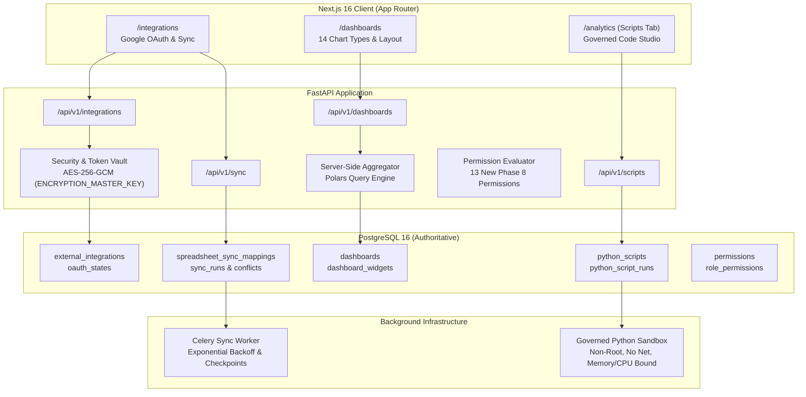

# VIBE — PHASE 8 ARCHITECTURE & IMPLEMENTATION PLAN
## External Integrations, Advanced Analytics, Dashboards & Governed Python Execution

**Status:** APPROVED & IN PROGRESS  
**Starting Head:** `d71a4f8e2c9b`  
**Target Head:** `e82f1b4a9c3d` (New Migration)  
**Scope:** Phase 8 Stages 1–6

---

## 1. System Architecture Overview

---

## 2. Stage-by-Stage Implementation Roadmap

### Stage 1: Architecture, Data Models & Alembic Migration
- Define SQLAlchemy models with composite tenant foreign keys:
  - `ExternalIntegration`, `OAuthState`
  - `SpreadsheetSyncMapping`, `SpreadsheetSyncRun`, `SpreadsheetSyncConflict`
  - `Dashboard`, `DashboardWidget`
  - `PythonScript`, `PythonScriptRun`
- Define 13 new permissions:
  - Integrations: `integrations.read`, `integrations.manage`, `integrations.sync`
  - Dashboards: `dashboards.read`, `dashboards.create`, `dashboards.update`, `dashboards.delete`, `dashboards.share`, `dashboards.export`
  - Scripts: `analytics.scripts.read`, `analytics.scripts.create`, `analytics.scripts.update`, `analytics.scripts.execute`, `analytics.scripts.delete`, `analytics.scripts.manage_dependencies`
- Create Alembic migration `e82f1b4a9c3d_create_phase8_integrations_dashboards_scripts.py` with `down_revision = "d71a4f8e2c9b"`.
- Verify upgrade, downgrade, re-upgrade, and fresh database bootstrap.

### Stage 2: Google OAuth & Integration Management Subsystem
- Implementation of `GoogleOAuthService` in `backend/app/services/google_oauth.py`:
  - PKCE / secure state verification with TTL.
  - AES-256-GCM encryption of `refresh_token` and `access_token` at rest.
  - Automatic token refresh before API calls.
  - Token revocation endpoint.
- REST Router `/api/v1/integrations`:
  - `GET /integrations/google/auth-url`
  - `POST /integrations/google/callback`
  - `GET /integrations`
  - `DELETE /integrations/{id}`
  - `GET /integrations/{id}/spreadsheets` (browse Google Drive)
  - `GET /integrations/{id}/spreadsheets/{spreadsheet_id}` (preview tabs/data)
- Integration Management UI (`frontend/src/app/integrations/page.tsx`):
  - Connected account display, scope breakdown, connection health indicator, connection/disconnection dialogs.

### Stage 3: Import, Export & Incremental Synchronization
- Google Sheets Import & Export Services:
  - `GoogleSpreadsheetImportService`: imports worksheets into VIBE workbooks while strictly enforcing Phase 6 & Phase 7 dataset and quota limits.
  - `GoogleSpreadsheetExportService`: exports VIBE sheets to Google Sheets with destination confirmation.
- Synchronization Engine:
  - Bidirectional, VIBE-to-Google, and Google-to-VIBE synchronization.
  - Checkpoint tracking and content hashing.
  - Conflict detection producing inspectable `SpreadsheetSyncConflict` records.
  - Celery background runner `run_spreadsheet_sync_task` with concurrency locks and exponential backoff.
- Sync UI (`/integrations` tab or sub-panel):
  - Mapping creation, direction selection, conflict resolution modal (keep VIBE, keep Google, manual edit).

### Stage 4: Advanced Analytics Dashboards & Visualizations
- Dashboard Domain Service:
  - Dashboard and widget CRUD, layout persistence.
  - Query Aggregation Engine using Polars for high-speed server-side aggregation (Sum, Mean, Median, Min, Max, Count, GroupBy, Filtering).
  - 14 Chart Types: Bar, Stacked Bar, Line, Area, Pie, Donut, Scatter, Histogram, Heatmap, Correlation Matrix, Box Plot, KPI Card, Data Table, Summary Statistics.
- Dashboard UI (`frontend/src/app/dashboards/page.tsx`):
  - Responsive multi-column layout, widget builder modal, chart rendering in light and dark themes, CSV/JSON export.

### Stage 5: Governed User-Defined Python Analytics
- Secure Isolated Execution Service (`backend/app/analytics/python_sandbox.py`):
  - Isolated subprocess container / sandbox with non-root user, memory limit (256 MB), CPU quota, execution timeout (15s), network completely disabled.
  - Zero application secrets, zero database credentials, zero host filesystem mounts.
  - Input bounded dataset provided via ephemeral JSON.
  - Output parsed and validated against schema.
- Script Studio UI (`frontend/src/app/analytics/scripts/` or Analytics studio tab):
  - Monaco/Code editor, input dataset selector, execution log stream, result visualizer.

### Stage 6: Verification, Regression & Closure
- Comprehensive automated test suites (OAuth, Import/Export, Sync, Dashboards, Python Sandbox security).
- Execution of full verification: `pytest`, `pnpm test`, `ruff`, `mypy`, `eslint`, Next.js build.
- Final closure report artifact.
