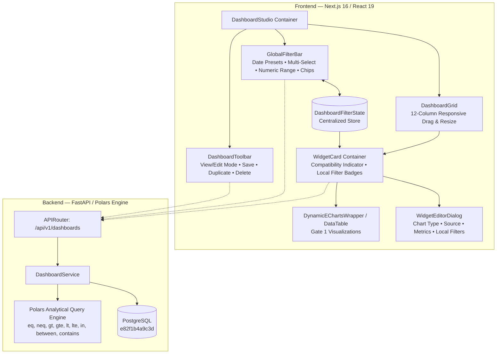

# VIBE — PHASE 9 GATE 2 DISCOVERY REPORT
## Enterprise BI Dashboard Studio, Global Filtering & Interactive Dashboard Builder

**Workspace:** `D:\vibe`  
**Phase:** 9 (Enterprise BI, Interactive Dashboards & On-Demand Reporting)  
**Gate:** 2 of 4  
**Date:** November 2, 2026  
**Alembic Head:** `e82f1b4a9c3d` (Strictly Preserved — Zero Schema Migrations Required)  
**Python Sandbox:** `PYTHON_SANDBOX_ENABLED=false` (Strictly Enforced)  
**Status:** **DISCOVERY COMPLETE — AWAITING USER IMPLEMENTATION AUTHORIZATION**

---

## 1. Executive Summary

A comprehensive architectural and codebase inspection of the VIBE platform was conducted in accordance with Stage A of the Phase 9 Gate 2 Master Implementation specification.

Gate 1 successfully delivered the modular **Apache ECharts visualization engine**, supporting all 10 enterprise visualization configurations, high-contrast accessible themes, declarative value formatting, and bundle-isolated lazy loading.

Gate 2 builds directly upon this foundation to convert the existing static dashboard prototype into an **Enterprise BI Dashboard Studio**, featuring:
- Dual **View Mode** and **Edit Mode** with dirty state tracking and rollback protection.
- Native, zero-dependency **12-column responsive grid layout engine** supporting drag-and-drop repositioning, multi-span resizing, and layout persistence.
- Centralized **Global Dashboard Filtering** with 10 date presets, custom ranges, categorical multi-selection, numeric bounds, search, and booleans.
- Typed, declarative **Cross-Widget Filter Propagation** with automated widget compatibility detection and `AbortController`-backed query lifecycle management.
- **Widget-Level Local Filters and Overrides** combined using safe AND semantics.
- Full dashboard lifecycle workflows: in-place metadata editing, atomic dashboard duplication, and permission-aware deletion with confirmation.

---

## 2. Current Architecture & Codebase Inspection

### 2.1 Backend Architecture
- **Framework & Routing:** FastAPI 0.115+ application structured modularly under `backend/app/api/v1/routers/`. Dashboards and widgets are routed via `dashboards.py` mounted at `/api/v1/dashboards`.
- **Authentication & RBAC:** Tenant-scoped authorization via `OrganizationMembership` and `require_permission()`. Registered permissions include:
  - `dashboards.read`
  - `dashboards.create`
  - `dashboards.update`
  - `dashboards.delete`
  - `dashboards.share`
  - `dashboards.export`
- **CSRF Protection:** State-changing requests (`POST`, `PATCH`, `DELETE`) require `verify_csrf_token` dependency and `X-CSRF-Token` header.
- **Analytical Engine:** In-memory, high-performance Polars DataFrame engine in `backend/app/services/dashboard.py`. Supports data sources:
  - `sheet`: Paginated rows loaded from PostgreSQL `sheet_rows` and parsed into Polars DataFrames.
  - `analytics_result`: Server-side Parquet artifact loaded via `pl.read_parquet(file_path)`.
- **Database Baseline:** Alembic migration head is pinned to `e82f1b4a9c3d`.

### 2.2 Existing Database Schema Inspection
Inspection of `backend/app/models/dashboard.py` reveals that the relational schema is already exceptionally well-designed for Gate 2:

1. **`dashboards` Table:**
   - `id`: UUID (Primary Key)
   - `organization_id`: UUID (Foreign Key `organizations.id`, CASCADE)
   - `workspace_id`: UUID (Foreign Key `workspaces.id`, CASCADE)
   - `created_by_user_id`: UUID (Foreign Key `users.id`, SET NULL)
   - `title`: String(255)
   - `description`: Text (nullable)
   - `layout_config`: **JSONB** (Default `{}`) — **Can store dashboard-level global filter defaults, grid columns, row heights, and layout preferences.**
   - `is_shared`: Boolean (Default `True`)
   - `created_at`, `updated_at`: DateTime(timezone=True)
   - `widgets`: Relationship to `DashboardWidget` (CASCADE delete-orphan)

2. **`dashboard_widgets` Table:**
   - `id`: UUID (Primary Key)
   - `dashboard_id`: UUID (Foreign Key `dashboards.id`, CASCADE)
   - `organization_id`: UUID (Foreign Key `organizations.id`, CASCADE)
   - `title`: String(255)
   - `widget_type`: String(50)
   - `source_type`: String(50) (`sheet` or `analytics_result`)
   - `source_id`: UUID
   - `query_config`: **JSONB** (Default `{}`) — **Stores dimensions, metrics, sorting, pagination, and local filters.**
   - `position_x`: Integer (0–11)
   - `position_y`: Integer (row index)
   - `width`: Integer (columns spanned, 1–12)
   - `height`: Integer (grid rows spanned, 1–12)
   - `sort_order`: Integer
   - `created_at`, `updated_at`: DateTime(timezone=True)

> [!IMPORTANT]
> **No Database Migrations Required:** Because `layout_config` on `dashboards` and `query_config` on `dashboard_widgets` are typed `JSONB` columns, all global filters, widget overrides, grid positions, and studio preferences can be persisted directly using the existing schema without creating any Alembic migrations.

### 2.3 Frontend Architecture
- **Framework:** Next.js 16.4.3 (Turbopack, App Router), React 19.3.0, TypeScript 5, Tailwind CSS v4.
- **Design System:** Radix UI primitives (`@radix-ui/react-*`), Lucide React icons, CSS variables defined in `globals.css` with dark/light theme switching.
- **Gate 1 Chart Integration:**
  - Located in `frontend/src/components/charts/`.
  - Exported dynamically via `next/dynamic` (`ssr: false`) from `components/charts/index.ts`.
  - Lazy-loaded chunk `0pbs5xvr_gr7h.js` (673.5 KB) is loaded strictly on `/dashboards` and `/benchmarks`.
  - Zero bundle overhead on `/`, `/spreadsheets`, `/analytics`, `/users`, etc.

---

## 3. Existing vs. Missing Capabilities Matrix

| Capability Area | Existing Implementation | Gate 2 Requirements & Missing Features |
|---|---|---|
| **Studio Modes** | Static view only. Any mutation calls API immediately without preview or undo. | **View Mode vs. Edit Mode**: Explicit toggle; unsaved dirty tracking (`isDirty`); Save / Cancel with rollback; in-place title & description editing. |
| **Dashboard Management** | Simple `<select>` dropdown to switch dashboard; basic "New Dashboard" modal. | **Full Studio Management**: Searchable dashboard selector; atomic **Duplicate Dashboard** workflow; **Delete Dashboard** with confirmation dialog. |
| **Layout & Grid** | Hardcoded CSS grid (`grid-cols-1 md:grid-cols-2`). Widget coordinates (`position_x`, `width`, etc.) are ignored on client. | **12-Column Responsive Grid**: Interactive drag-and-drop repositioning; resize handles (1 to 12 cols); batch layout saving to `POST /api/v1/dashboards/{id}/layout`. |
| **Global Filtering** | None. Visualizations render static queries without dashboard-wide filtering. | **Centralized Filter Bar**: 10 date presets, custom date range, categorical multi-select, numeric range, search, boolean; clear individual & clear-all; filter chips. |
| **Filter Propagation** | None. Each widget queries independently on mount. | **Cross-Widget Propagation**: Centralized `DashboardFilterState`; query merging with `AbortController` cancellation; debouncing (250ms); zero race conditions. |
| **Widget Local Filters** | None. Query config only specifies dimensions and metrics. | **Local Filter Overrides**: Widget settings drawer with local filters; merged with global filters via safe `AND` semantics; local filter badges. |
| **Filter Compatibility** | None. | **Automated Compatibility Engine**: Evaluates whether widget data source contains filter columns; skips incompatible filters and shows badge indicator. |
| **Backend Polars Filters** | Supports only `eq`, `neq`, `gt`, `lt`, `contains` in `dashboard.py`. | **Enhanced Filter Operators**: Add `gte`, `lte`, `in`, `between` operators to Polars query execution without altering database schema. |
| **Dashboard Duplication** | None. | **Atomic Duplication**: Add `POST /api/v1/dashboards/{id}/duplicate` endpoint copying metadata, layout_config, and all child widgets. |

---

## 4. Technical Design & Architecture Plan



### 4.1 Filter State & Presets (`dashboard-types.ts`)
```typescript
export type DatePreset =
  | "today"
  | "yesterday"
  | "last_7_days"
  | "last_30_days"
  | "last_90_days"
  | "this_month"
  | "previous_month"
  | "this_quarter"
  | "this_year"
  | "custom";

export interface FilterCriterion {
  id: string;
  column: string;
  operator: "eq" | "neq" | "gt" | "gte" | "lt" | "lte" | "in" | "between" | "contains";
  value: string | number | boolean | (string | number)[];
  display_label?: string;
  is_local?: boolean;
}

export interface DashboardFilterState {
  date_preset?: DatePreset;
  date_range?: { start: string; end: string };
  criteria: FilterCriterion[];
}
```

### 4.2 React 19 Drag-and-Drop & Grid Strategy
To avoid third-party React 19 compatibility breaks (e.g., `react-grid-layout` or `react-beautiful-dnd` peer dependency failures), we will implement a dedicated, lightweight HTML5 Pointer/Drag native grid layout component:
- **12-Column Responsive Grid:** `grid-cols-1 md:grid-cols-6 lg:grid-cols-12`.
- **Drag Reordering:** Uses native HTML5 `draggable` with drag handles in edit mode.
- **Resize Handles:** Right-edge and bottom-corner interactive handles allowing widget widths from 3 to 12 columns and heights from 2 to 8 rows.
- **Batch Layout Persistence:** Flushes layout updates to `POST /api/v1/dashboards/{id}/layout` upon saving edit mode.

### 4.3 Query Lifecycle & AbortController
To guarantee zero duplicate active requests and prevent stale response overwrites:
1. Each widget query maintains a dedicated `AbortController` in a React `useRef<Map<string, AbortController>>()`.
2. When a global filter changes, any pending query for that widget is aborted cleanly (`controller.abort()`).
3. Queries are debounced by 250ms to handle rapid filter adjustments or slider drags.
4. Error handling traps `AbortError` silently without displaying error banners to the user.

---

## 5. Potential Regressions & Mitigation Strategy

1. **Gate 1 ECharts Bundle Isolation:**
   - *Risk:* Importing ECharts directly into new dashboard studio components could break code splitting and leak ECharts into the main bundle.
   - *Mitigation:* New studio components will exclusively consume `<DynamicEChartsWrapper />` and `<ChartSkeleton />` from `@/components/charts`. Verification via `route-bundle-stats.json` will be performed.
2. **Existing Regression Tests:**
   - *Risk:* Modifying page headers or DOM structure might break `integrations-and-dashboards.test.tsx` (which expects "Analytics Dashboards", "Global Sales Dashboard", and "Quarterly Revenue").
   - *Mitigation:* All existing heading roles, text contents, and test IDs will be preserved.
3. **Database Schema Constraints:**
   - *Risk:* Introducing new migrations or column requirements.
   - *Mitigation:* Alembic baseline `e82f1b4a9c3d` will remain strictly pinned. Zero schema migrations.
4. **Backend Non-Live Regression Suite:**
   - *Risk:* Enhancing Polars filter operators might affect existing query tests.
   - *Mitigation:* All additions will be purely additive; existing `eq`, `neq`, `gt`, `lt`, `contains` logic will remain unchanged.

---

## 6. Proposed Implementation Plan & File Modifications

### Backend Files
1. **[`backend/app/services/dashboard.py`](file:///D:/vibe/backend/app/services/dashboard.py):**
   - Add `gte`, `lte`, `in`, `between` filter operators to the Polars query execution engine.
   - Add `duplicate_dashboard()` method to `DashboardService` deep-copying dashboard metadata, layout_config, and widgets.
2. **[`backend/app/api/v1/routers/dashboards.py`](file:///D:/vibe/backend/app/api/v1/routers/dashboards.py):**
   - Add `POST /{dashboard_id}/duplicate` endpoint with `dashboards.create` permission.

### Frontend Files
1. **[`frontend/src/components/dashboard/dashboard-types.ts`](file:///D:/vibe/frontend/src/components/dashboard/dashboard-types.ts) [NEW]:**
   - Typed interfaces for filter state, date presets, widget layout items, and studio state.
2. **[`frontend/src/components/dashboard/filter-utils.ts`](file:///D:/vibe/frontend/src/components/dashboard/filter-utils.ts) [NEW]:**
   - Pure functions for date preset calculation (ISO UTC strings), global/local filter merging with safe AND semantics, and widget filter compatibility checking.
3. **[`frontend/src/components/dashboard/filter-bar.tsx`](file:///D:/vibe/frontend/src/components/dashboard/filter-bar.tsx) [NEW]:**
   - Global filter bar component with date preset dropdown, custom date modal, dimension filter popovers, active filter chips, and clear actions.
4. **[`frontend/src/components/dashboard/dashboard-grid.tsx`](file:///D:/vibe/frontend/src/components/dashboard/dashboard-grid.tsx) [NEW]:**
   - 12-column responsive layout engine with view/edit modes, drag handle reordering, and multi-col resize handles.
5. **[`frontend/src/components/dashboard/widget-card.tsx`](file:///D:/vibe/frontend/src/components/dashboard/widget-card.tsx) [NEW]:**
   - Container card for widgets with edit controls, local filter badges, compatibility alerts, and Gate 1 chart rendering.
6. **[`frontend/src/components/dashboard/widget-editor-dialog.tsx`](file:///D:/vibe/frontend/src/components/dashboard/widget-editor-dialog.tsx) [NEW]:**
   - Comprehensive modal dialog for creating/editing widgets, configuring chart types, sources, dimensions, metrics, and local filter overrides.
7. **[`frontend/src/components/dashboard/dashboard-toolbar.tsx`](file:///D:/vibe/frontend/src/components/dashboard/dashboard-toolbar.tsx) [NEW]:**
   - Header action toolbar: View/Edit mode toggle, Save (dirty indicator), Cancel, Duplicate, Delete, and Refresh.
8. **[`frontend/src/app/dashboards/page.tsx`](file:///D:/vibe/frontend/src/app/dashboards/page.tsx) [REFACTOR]:**
   - Refactor page into Enterprise BI Dashboard Studio integrating the new modular components, centralized filter state, and `AbortController` query lifecycle.

### Test Suites to Create
1. **[`frontend/src/__tests__/dashboard-filters.test.ts`](file:///D:/vibe/frontend/src/__tests__/dashboard-filters.test.ts) [NEW]:**
   - Unit tests for date preset math, filter validation, global/local merging, and widget compatibility detection.
2. **[`frontend/src/__tests__/dashboard-studio.test.tsx`](file:///D:/vibe/frontend/src/__tests__/dashboard-studio.test.tsx) [NEW]:**
   - Component tests for View/Edit modes, drag/resize interactions, filter application, save/cancel rollback, and duplication.
3. **[`backend/tests/integration/test_dashboards_gate2.py`](file:///D:/vibe/backend/tests/integration/test_dashboards_gate2.py) [NEW]:**
   - Backend integration tests for `gte`, `lte`, `in`, `between` Polars filters, and `POST /dashboards/{id}/duplicate`.

---

## 7. Discovery Conclusion & Authorization Request

Stage A discovery is **COMPLETE**. All architectural requirements, schemas, and integration points have been mapped.

In strict adherence to the project instructions:
- **Zero application or database source code changes have been made.**
- **Alembic migration head remains at `e82f1b4a9c3d`.**
- **Python Sandbox remains disabled (`PYTHON_SANDBOX_ENABLED=false`).**

**STOPPING HERE.** Awaiting your explicit authorization to begin Stage B implementation.
