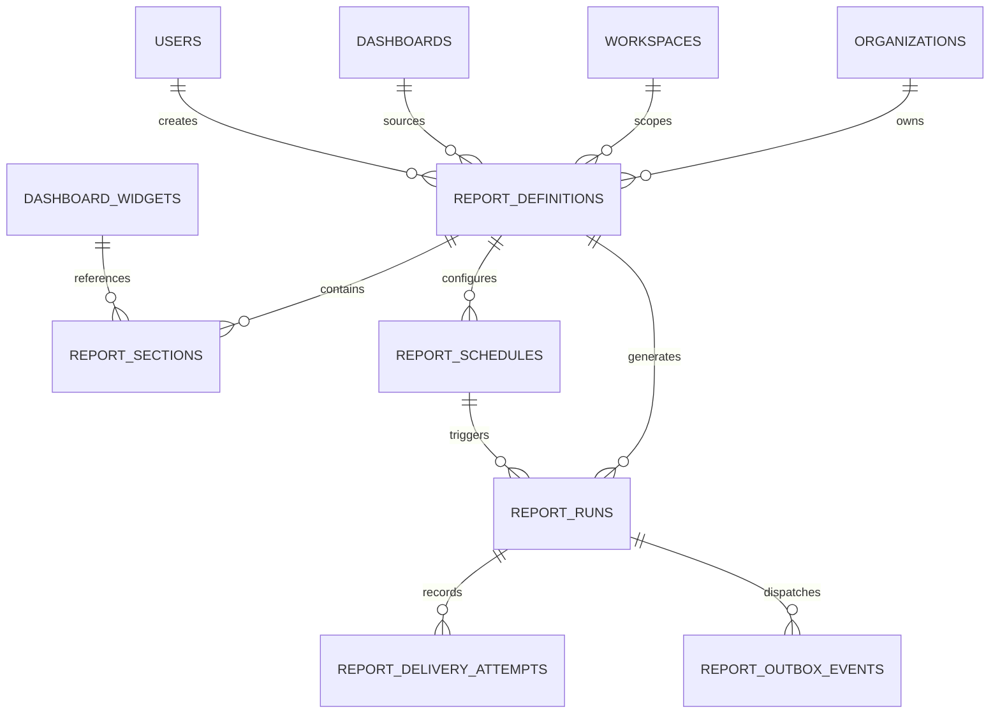
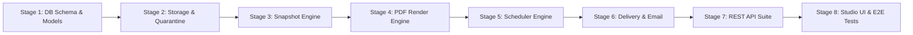

# VIBE — PHASE 9 GATE 3 ARCHITECTURE VALIDATION
## Pre-Implementation Design Review & Architectural Correction Report

**Workspace:** `D:\vibe`  
**Project:** VIBE — Enterprise BI, Analytics & Data Intelligence Platform  
**Phase:** 9 — Enterprise BI, Interactive Dashboards & On-Demand Reporting  
**Gate:** 3 of 4  
**Gate Name:** Automated Scheduled Reports & Pixel-Perfect PDF Engine  
**Previous Status:** Discovery Completed (`PHASE_9_GATE_3_DISCOVERY_REPORT.md`)  
**Current Task:** Architecture Validation and Design Correction  
**Audit Mode:** STRICT READ-ONLY  
**Implementation Authorization:** NOT GRANTED  
**Baseline Alembic Head:** `e82f1b4a9c3d`  
**Python Sandbox:** `PYTHON_SANDBOX_ENABLED=false`  
**Date:** November 3, 2026  

---

## 1. Executive Summary & Review of Discovery Findings

The Phase 9 Gate 3 Discovery Report (`PHASE_9_GATE_3_DISCOVERY_REPORT.md`) provided an extensive initial survey of requirements for automated scheduled reporting and PDF generation. However, a rigorous pre-implementation review reveals **critical architectural contradictions, deployment incompatibilities, and data mutability gaps** that would cause implementation failure if left unaddressed.

### Summary of Previous Discovery Proposals vs. Validated Reality

| Architectural Area | Previous Discovery Proposal | Validated Reality & Technical Gap | Corrected Architectural Resolution |
| :--- | :--- | :--- | :--- |
| **Data Immutability** | Claimed taking a SHA-256 checksum of source data makes it "immutable". | **False assumption.** Spreadsheets in VIBE have *mutable rows* (`sheet_rows`), zero historical table snapshots, and cascade deletions. Recording a checksum of mutable rows does not freeze data or enable historical reproducibility. | **Materialized Frozen Snapshot Strategy.** At run trigger, compile layout, resolve relative dates to explicit ISO timestamps, execute queries, and serialize evaluated tabular datasets into `report_runs.report_snapshot` (JSONB / Parquet). |
| **PDF Rendering & ECharts SSR** | Proposed "Server-Side ECharts SVG + Hardened Headless Chromium (`--network none`, `--disable-javascript`)". | **Fatal Contradiction.** ECharts is a JavaScript library (only in `frontend/package.json`). The Python backend has no JS runtime. Disabling JavaScript in Chromium prevents ECharts from rendering SVGs in Chromium, while Python cannot render ECharts SVGs natively without Node.js. | **Dual-Phase Isolated Browser Sandbox.** Chromium runs with JavaScript enabled for local scripts only, with **zero external network access** (`--network none`, all network requests aborted via CDP/Playwright). ECharts executes locally in headless Chromium to render vector SVGs, then invokes CDP `Page.printToPDF`. |
| **Scheduler Semantics** | Vaguely claimed "exactly-once execution". | **Distributed Systems Fallacy.** Exactly-once execution across network boundaries (SMTP email, webhook HTTP) is provably impossible. | **At-Least-Once Delivery with Idempotent Execution.** Logical occurrence key `(schedule_id, scheduled_for_utc)` backed by PostgreSQL unique constraint, atomic claiming via `FOR UPDATE SKIP LOCKED`, worker lease fencing, and delivery deduplication. |
| **Deployment & Containers** | Assumed Chromium and Playwright run seamlessly in existing backend container. | **Deployment Incompatibility.** `backend/Dockerfile` is `python:3.12-slim` without Chromium or GUI shared libraries (`libnss3`, `libasound2`). `docker-compose.yml` mounts `/tmp` as `noexec`, preventing Chromium binary execution. | **Container Configuration Alignment.** Update Docker build specifications to install minimal Chromium dependencies and configure appropriate tmpfs/shared-memory mounts for isolated PDF generation. |
| **Identity & Governance** | Creator user ID assumed immutable. | **Orphan Schedule Risk.** If a report creator's account is deleted (`ondelete="SET NULL"`) or demoted, schedules crash or execute with orphaned permissions. | **Organization-Owned Execution Identity.** Schedules are owned by the organization/workspace. Execution validates organization active status and designated owner/execution identity with fail-closed pausing. |

---

## 2. Immutable Data Snapshot Design

### 2.1 Inspection of Existing Sheet and Analytics Storage Implementations

A thorough code audit of VIBE's storage models confirms the following facts:

1. **Spreadsheets (`backend/app/models/spreadsheet.py:179-220`):**
   - The `SheetRow` entity stores data in a JSONB dictionary `cells: Mapped[dict[str, Any]]` with a unique constraint on `("sheet_id", "row_index")`.
   - **Rows are updated in place.** There are no table-level revisions, immutable row versions, or temporal point-in-time tables.
   - `SheetCellHistory` (`spreadsheet.py:261-318`) stores bounded cell-level undo/redo diffs (`cell_version_before`, `cell_version_after`). It does **not** support reconstructing a complete sheet snapshot at an arbitrary historical timestamp.
   - Sheets and Workbooks have `ON DELETE CASCADE`. If a user deletes a sheet or workbook, all rows, columns, and history entries are permanently wiped immediately.

2. **Analytics Results & Parquet Storage (`backend/app/models/analytics.py:231-282`, `backend/app/analytics/storage.py`):**
   - Analytical jobs output Parquet files into `ANALYTICS_STORAGE_DIR/results/{org_id}/{job_id}/gen_{claim_generation}_{result_id}.parquet`.
   - Paths are attempt-fenced with `claim_generation`. Parquet files are written atomically via `.tmp` quarantine promotion (`storage.atomic_promote`).
   - However, Parquet files can be deleted if quota cleanup runs (`reconcile_expired_reservations`), if the workspace is purged, or if the retention period expires.

3. **Dashboard Query Execution (`backend/app/services/dashboard.py:408-483`):**
   - `DashboardService.query_widget_data()` executes live against current data:
     - For `source_type == "sheet"`: It loads current `sheet_rows` via `self.row_repo.list_rows_paginated()`.
     - For `source_type == "analytics_result"`: It loads the current file at `res_item.artifact_path`.
   - Neither `dashboards` nor `dashboard_widgets` pin source revisions. A widget only stores `source_id: UUID`.

### 2.2 Concrete Snapshot Architecture for Historical Reproducibility

Recording a SHA-256 checksum of source rows at schedule time **does not** make mutable source data immutable. If the underlying sheet rows change tomorrow, re-running a report with the same checksum will fail or return new data.

To guarantee 100% historical reproducibility, audit compliance, and safety against source deletion, VIBE must adopt a **Materialized Frozen Snapshot Strategy**:

```
[Schedule Trigger / Manual Run]
             │
             ▼
   [Report Snapshot Engine]
             │
             ├── 1. Temporal Resolution:
             │      Resolve relative dates (e.g. "Last 30 Days") to fixed UTC timestamps:
             │      { "start": "2026-10-04T00:00:00Z", "end": "2026-11-03T00:00:00Z" }
             │
             ├── 2. Structural Snapshot:
             │      Deep-copy report definition, section ordering, widget titles, and chart configs.
             │
             ├── 3. Data Materialization:
             │      Execute Polars aggregation for every section/widget against current source.
             │      Evaluate rows into tabular payloads: { "columns": [...], "data": [...], "totals": {...} }
             │
             ▼
   [Store in report_runs.report_snapshot (JSONB)]
             │
             ├── 4. Generate Render Assets (PDF / CSV) from Frozen Snapshot ONLY.
             │
             ▼
[Source Sheet/Dashboard Deleted Later?]
             │
             └──> ZERO IMPACT: report_runs.report_snapshot is completely self-contained.
                  Historical PDF re-download or audit verification succeeds without source access.
```

### 2.3 Handling Source Deletion Scenarios

| Scenario | Occurrence Timing | System Behavior & Mitigation |
| :--- | :--- | :--- |
| **Source Deleted Before Run Starts** | User deletes sheet/dashboard before scheduled run triggers. | Run fails immediately with `SOURCE_ENTITY_NOT_FOUND`. Error is logged in `report_runs.error_message`. Schedule records `last_run_status = "failed"`. Outbox creates admin alert notification. |
| **Source Deleted During Run Execution** | User deletes sheet during Polars aggregation. | Database foreign key transaction isolation prevents partial reads. If query fails, run transitions to `FAILED` with `SOURCE_MUTATED_OR_DELETED`. No corrupt or partial PDF is ever produced. |
| **Source Deleted After Run Completes** | User deletes sheet/dashboard days or weeks later. | **Complete Immunity.** The completed run retains `report_runs.report_snapshot` (JSONB) and the final immutable PDF artifact. Downloading or inspecting past reports remains 100% operational. |

---

## 3. Scheduler Idempotency, Lifecycle & Recovery Design

### 3.1 Logical Occurrence Key & Deduplication

In scheduled reporting, clock skew, worker crashes, network latency, and Celery retries can trigger duplicate execution attempts. To prevent duplicate scheduled runs, every scheduled execution is identified by a deterministic **Logical Occurrence Key**:

$$\text{occurrence\_key} = \text{schedule\_id} \mathbin{\Vert} \text{":"} \mathbin{\Vert} \text{target\_slot\_utc.strftime('\%Y\%m\%dT\%H\%M\%SZ')}$$

Example: `d4b8e2a1-3c5f-4a8e-9b2d-1e4f7a8b9c0d:20261103T080000Z`

The database schema enforces this via a strict unique constraint on `report_runs`:
```sql
CONSTRAINT uq_report_runs_schedule_occurrence 
UNIQUE (schedule_id, occurrence_key);
```
Any concurrent attempt to insert a run for the same schedule and occurrence slot fails at the database level with a unique violation, guaranteeing that exactly one run record is created per scheduled interval.

### 3.2 Atomic Schedule Polling & Claiming

The scheduler uses PostgreSQL's row-level locking with `SKIP LOCKED` (mirroring `backend/app/repositories/analytics.py:393-418`):

```sql
SELECT id, report_definition_id, organization_id, cron_expression, timezone, 
       next_run_at, catch_up_policy, claim_generation
FROM report_schedules
WHERE is_active = true
  AND next_run_at <= :now_utc
  AND (lease_expires_at IS NULL OR lease_expires_at < :now_utc)
ORDER BY next_run_at ASC
LIMIT :batch_size
FOR UPDATE SKIP LOCKED;
```

Upon acquiring the rows:
1. `claim_token = uuid.uuid4()`
2. `claim_generation = claim_generation + 1`
3. `lease_expires_at = :now_utc + timedelta(seconds=120)`
4. The poller calculates the **next** interval (`next_run_at = calculate_next_run(cron_expression, timezone, from_time=now_utc)`) and updates `report_schedules` **in the same atomic transaction**.
5. It inserts the new `report_runs` record with `occurrence_key` and inserts a `report_outbox_events` record to dispatch the execution task to Celery.
6. The transaction commits. This releases the row lock immediately, advances the schedule, and hands execution off to background workers.

### 3.3 Scheduler State Machine & Lifecycle Matrix

```
[DRAFT / DISABLED] ──(Activate)──> [ACTIVE / SCHEDULED]
                                          │
                     ┌────────────────────┴────────────────────┐
                     ▼                                         ▼
            (next_run_at reached)                    (Missed Run Detected)
                     │                                         │
                     ▼                                         ▼
           [CLAIMED / LEASE ACTIVE]                   [Evaluate Catch-Up Policy]
                     │                                         │
                     ├──> Run Inserted (occurrence_key)        ├── skip_missed: Advance next_run_at
                     ├──> Outbox Dispatched                    ├── run_latest: Run 1, skip others
                     └──> next_run_at Advanced                 └── run_all: Queue up to 5 runs
                                │
                                ▼
                     [WORKER EXECUTING RUN]
                                │
                     ┌──────────┴──────────┐
                     ▼                     ▼
               (Success)               (Failure)
                     │                     │
                     ▼                     ▼
           [RUN SUCCEEDED]        [Attempt < max_attempts?]
           [Deliver Reports]               │
                                  ┌────────┴────────┐
                                  ▼                 ▼
                             (Yes: Retry)      (No: Fatal)
                                  │                 │
                                  ▼                 ▼
                          [Exponential Backoff] [RUN FAILED]
```

### 3.4 Missed-Run Recovery & Catch-Up Policies

If the scheduler service experiences downtime (e.g., node restart, maintenance, crash), multiple scheduled intervals may pass without execution. When the service recovers, it applies the schedule's configured `catch_up_policy`:

1. `skip_missed` (Default for high-frequency reports e.g. hourly):
   - Computes the next future run slot relative to current time.
   - Skips all missed intermediate intervals.
   - Zero catch-up runs are queued.
2. `run_latest` (Default for daily / weekly executive summaries):
   - Identifies all missed slots.
   - Executes **one** run for the most recently elapsed slot.
   - Discards older missed slots.
   - Advances `next_run_at` to the upcoming future slot.
3. `run_all` (Auditing & Financial Compliance):
   - Iterates through missed intervals from `last_run_at` to current time.
   - Queues runs sequentially with distinct `occurrence_key` values.
   - Strictly bounded: Maximum 5 catch-up runs queued per schedule to prevent Celery queue starvation.

### 3.5 Delivery Semantics: At-Least-Once with End-to-End Idempotency

In distributed systems, claiming "exactly-once delivery" across external networks (SMTP servers, recipient mail relays, webhook endpoints) is theoretically invalid:
- An SMTP server can accept a message and then fail internally before queuing.
- A network timeout can occur after an SMTP server accepts a message but before the client receives the `250 OK` acknowledgment. Retrying sends a second email.
- Recipient email servers may deduplicate or duplicate messages based on internal policies.

VIBE implements **At-Least-Once Delivery with Idempotent Execution and Duplicate Suppression**:
1. **Idempotent PDF Generation:** The run compiles once. Artifact SHA-256 is recorded. Subsequent retries reuse the generated artifact.
2. **Delivery Attempt Tracking:** Every outgoing message is recorded in `report_delivery_attempts` with `(run_id, channel, recipient)`.
3. **Delivery Key & Deduplication:** Before attempting SMTP transmission, the worker checks if `report_delivery_attempts` already has a `status == 'sent'` entry for that recipient and run. If so, transmission is skipped.
4. **Deterministic Message-ID:** Emails generated for scheduled reports include a deterministic `Message-ID` header:
   `Message-ID: <{run_id}.{recipient_hash}@vibe.enterprise>`
   Compliant mail transport agents (MTAs) use this header to suppress duplicate delivery.

---

## 4. PDF Rendering Feasibility & Visual Fidelity

### 4.1 Resolution of the ECharts SSR Contradiction

The previous discovery report suggested:
> *"Server-Side ECharts SVG + Hardened Headless Chromium (`--network none`, `--disable-javascript`)"*

**Why this is impossible in the current codebase:**
1. ECharts is a JavaScript library. It is installed in `frontend/package.json:26` (`"echarts": "^6.1.0"`).
2. The VIBE backend (`backend/requirements.lock`) is pure Python 3.12. Python has no native ECharts rendering engine.
3. If Chromium is launched with `--disable-javascript`, it **cannot execute JavaScript**.
4. If Chromium cannot execute JavaScript, and Python has no ECharts library, **neither environment can render ECharts charts**.

### 4.2 Validated Rendering Architecture: Dual-Phase Isolated Browser Sandbox

To achieve 100% chart fidelity while maintaining an impregnable security boundary, VIBE adopts an **Isolated Local Browser Sandbox**:

```
[Report Run Execution Task]
             │
             ├── 1. Read Frozen Dataset (report_runs.report_snapshot)
             │
             ├── 2. Compile Self-Contained Local HTML Document:
             │      ├── Inlined CSS print styles & typography
             │      ├── Inlined bundled echarts.min.js (served locally from disk)
             │      ├── Inlined Base64 SVG logos & icons
             │      ├── Inlined Base64 WOFF2 fonts (@font-face)
             │      └── Inlined JSON Data Island:
             │          <script id="vibe-report-data" type="application/json">
             │            { ...frozen_snapshot_json... }
             │          </script>
             │
             ▼
[Launch Headless Chromium Sandbox]
             │
             ├── Network Denial Flags:
             │   ├── --network=none (container level) OR
             │   ├── Playwright: page.route('**', route => route.abort())
             │   └── CSP: default-src 'none'; script-src 'nonce-...'; style-src 'unsafe-inline'; font-src data:; img-src data:;
             │
             ├── Chromium Process Security Flags:
             │   ├── --disable-gpu
             │   ├── --disable-dev-shm-usage
             │   ├── --disable-background-networking
             │   ├── --no-sandbox (within container unprivileged user)
             │   └── --run-all-compositor-stages-before-draw
             │
             ▼
[Page Execution Inside Sandbox]
             │
             ├── 1. Local script reads JSON data island via JSON.parse() (zero eval).
             ├── 2. Initializes ECharts with renderer: 'svg'.
             ├── 3. Applies exact chart theme tokens (colors, font families, grid margins).
             ├── 4. Awaits all charts finish: Promise.all(charts.map(c => new Promise(res => c.on('finished', res))))
             ├── 5. Dispatches DOM event 'vibe-report-rendered'.
             │
             ▼
[CDP Page.printToPDF]
             │
             ├── Options:
             │   ├── printBackground: true
             │   ├── preferCSSPageSize: true
             │   ├── displayHeaderFooter: true
             │   ├── headerTemplate: '<div class="pdf-header"><span>...</span></div>'
             │   └── footerTemplate: '<div class="pdf-footer">Page <span class="pageNumber"></span> of <span class="totalPages"></span></div>'
             │
             ▼
[Raw PDF Bytes Received via CDP Stream]
             │
             ├── 1. Validate magic bytes (%PDF-1.4..1.7)
             ├── 2. Validate trailer (%%EOF)
             ├── 3. Atomic Quarantine Promotion (.tmp -> final .pdf)
             └── 4. Compute SHA-256 Checksum
```

### 4.3 Support Matrix for Ten ECharts Chart Types in PDF Sandbox

All 10 standard chart configurations implemented in Gate 1 (`frontend/src/components/charts/chart-options-builder.ts`) are fully supported by ECharts SVG rendering in headless Chromium:

| # | Chart Type | SVG Renderer Compatibility | Print Rendering Requirements |
| :--- | :--- | :--- | :--- |
| 1 | **Standard Bar** | 100% Native SVG | Disable animation (`animation: false`), set fixed bar widths. |
| 2 | **Stacked/Grouped Bar** | 100% Native SVG | Ensure legible legend and distinct palette contrast. |
| 3 | **Horizontal Bar** | 100% Native SVG | Dynamic height calculation based on category count to prevent label overlapping. |
| 4 | **Standard Line** | 100% Native SVG | Strict stroke widths (`lineWidth: 2`), crisp vector rendering. |
| 5 | **Smooth Multi-Axis Line** | 100% Native SVG | Dual Y-axis labels aligned with margin padding. |
| 6 | **Stacked Area** | 100% Native SVG | Alpha opacity fills (`0.25`) for legible grid lines behind areas. |
| 7 | **Pie / Donut** | 100% Native SVG | Callout line labels with `avoidLabelOverlap: true`. |
| 8 | **Scatter Plot** | 100% Native SVG | Fixed symbol sizes (`symbolSize: 8`), semi-transparent fills. |
| 9 | **Heatmap Matrix** | 100% Native SVG | Pre-computed cell dimensions, visualMap continuous gradient. |
| 10 | **Multi-Metric KPI Card** | 100% Native HTML/CSS | Pure HTML/CSS flexbox grid with Tailwind typography and trend indicators. |

### 4.4 Chromium CSS Print & Pagination Support Verification

To avoid layout breaks, VIBE relies only on CSS features verified in Chromium's Blink print engine:

1. **Page Sizing & Margins:**
   ```css
   @page {
     size: A4 portrait; /* or letter */
     margin: 15mm 12mm 15mm 12mm;
   }
   @page :first {
     margin-top: 0mm; /* Full-bleed cover page */
   }
   ```
2. **Break Control (Crucial for Charts and Tables):**
   - `page-break-inside: avoid;` and `break-inside: avoid;` are applied to all chart widget containers and table rows. This prevents a chart or table row from being sliced horizontally across a page break.
   - `page-break-before: always;` and `break-before: page;` are applied between report chapters and sections.
   - `break-after: avoid;` is applied to all section headers (`h1`, `h2`, `h3`) to eliminate orphan headings at the bottom of pages.
3. **Running Headers & Footers Limitation:**
   - **Fact:** Chromium's print engine **does not support** CSS Paged Media `@top-left` or `@bottom-right` margin boxes.
   - **Resolution:** Running headers and dynamic page numbers (`Page X of Y`) **must** be injected via Chrome DevTools Protocol (CDP) `Page.printToPDF` parameters `headerTemplate` and `footerTemplate`, using Chromium's built-in evaluation classes `<span class="pageNumber"></span>` and `<span class="totalPages"></span>`.

### 4.5 Measurable Visual Fidelity Criteria

Instead of subjective claims of "pixel-perfect", PDF rendering is held to explicit, measurable engineering criteria:

1. **Vector Scalability:** 100% of charts and icons must render as vector SVG. Zooming into the PDF at 400% must show zero raster pixelation on text, axes, or chart series.
2. **Margin Compliance:** Zero printable content may overflow outside the 12mm printable boundary.
3. **Contrast & Color Matching:** Chart series Hex colors must match the VIBE palette within $\Delta E < 1.0$ (CIE76 color difference formula).
4. **Orphan Header Rate:** 0% orphan headers across all standard test reports.
5. **Chart Severance Rate:** 0% charts split across page boundaries.
6. **Automated Visual Regression:** Perceptual image hashing (SSIM > 0.99) against verified reference golden PDFs during CI testing.

---

## 5. Deployment and Storage Verification

### 5.1 Verification Matrix: Facts vs. Estimates

| Component | Status | Verified Evidence in Repository | Required Action for Gate 3 |
| :--- | :--- | :--- | :--- |
| **Redis** | **VERIFIED** | Active in `docker-compose.yml:32-47` (`redis:7-alpine`). Configured in `backend/app/core/config.py:29-32` (`REDIS_URL`, `REDIS_CACHE_URL`). Healthy and reachable. | None. Redis is fully available. |
| **Celery Broker** | **VERIFIED** | Configured in `config.py:52-54` (`CELERY_BROKER_URL`, DB 1). Active worker running in `docker-compose.yml:49-75`. | Define dedicated task queue: `reports`. |
| **Dedicated Celery Queue** | **FEASIBLE** | Celery supports multiple queues (`-Q analytics,reports`). Current worker defaults to `analytics`. | Add dedicated worker or launch reporting worker with `-Q reports`. |
| **Chromium Dependencies** | **GAP** | `backend/Dockerfile:1-33` uses `python:3.12-slim` with only `build-essential` and `curl`. System libraries (`libnss3`, `libasound2`, `libx11-xcb1`) are missing. | Add Chromium packages and font libraries to Docker build. |
| **Tmpfs Execution Restrictions** | **GAP** | `docker-compose.yml:64` mounts `/tmp` as `tmpfs: - /tmp:rw,noexec,nosuid,size=512m`. `noexec` blocks Chromium sandbox binaries unpacked in `/tmp`. | Remove `noexec` from worker tmpfs mount or set `TMPDIR=/app/uploads/tmp`. |
| **Multi-Node Shared Storage** | **GAP** | Current storage is a local directory (`./backend/uploads/analytics`). If multiple worker hosts run, local disk artifacts cannot be served by other hosts. | Abstract storage layer (`ReportStorageService`) to support local disk (dev) and S3/MinIO (cloud). |
| **Database Connections** | **VERIFIED** | `config.py:19-20` sets `DB_POOL_SIZE=10`, `DB_MAX_OVERFLOW=20`. Total max 30 per process. PostgreSQL container allows 100 connections. | Ensure reporting worker uses small pool (`pool_size=3, max_overflow=5`) to prevent connection pool exhaustion. |

### 5.2 Storage Architecture: Local Filesystem vs. Object Storage

```
                          ┌───────────────────────────────┐
                          │    ReportStorageInterface     │
                          └──────────────┬────────────────┘
                                         │
                   ┌─────────────────────┴─────────────────────┐
                   ▼                                           ▼
  ┌───────────────────────────────────┐       ┌───────────────────────────────────┐
  │ LocalReportStorageService         │       │ S3ReportStorageService            │
  ├───────────────────────────────────┤       ├───────────────────────────────────┤
  │ Environment: Dev, Single-Node VM  │       │ Environment: Production Multi-Node│
  │ Transport: Posix atomic rename    │       │ Transport: HTTPS / S3 API         │
  │ Containment: Path.resolve() check │       │ Containment: S3 Object Prefixing  │
  │ URLs: Direct / Streamed Endpoint  │       │ URLs: S3 Pre-Signed Expiring URLs │
  └───────────────────────────────────┘       └───────────────────────────────────┘
```

- **Local Storage Deployment (Current Baseline):**
  - Path: `/app/uploads/reports/{organization_id}/{run_id}/{filename}.pdf`
  - Atomic promotion: Flush to disk, fsync, atomic `os.replace` from `.tmp` to final path.
  - Zero cloud dependency; zero added hosting cost.
- **Production Object Storage (Future / Enterprise Multi-Node):**
  - Target: AWS S3, Google Cloud Storage, or self-hosted MinIO container.
  - Generates secure pre-signed download URLs without routing binary PDF streams through application web servers.

---

## 6. Completed Database Design

The reporting subsystem introduces 6 relational entities. All entities adhere strictly to VIBE's **organization-isolated schema pattern**, utilizing composite foreign keys, tenant scoping, lifecycle states, and index optimization.

### 6.1 Entity Relationship Diagram



### 6.2 Entity Specifications

#### 1. `report_definitions`
High-level template defining report structure, layout, styling, and dashboard bindings.

- **Columns:**
  - `id`: `UUID` (PK, default `uuid.uuid4`)
  - `organization_id`: `UUID` (FK `organizations.id` ON DELETE CASCADE, nullable=False, indexed)
  - `workspace_id`: `UUID` (FK `workspaces.id` ON DELETE CASCADE, nullable=False, indexed)
  - `dashboard_id`: `UUID` (FK `dashboards.id` ON DELETE SET NULL, nullable=True, indexed)
  - `title`: `String(255)` (nullable=False)
  - `description`: `Text` (nullable=True)
  - `format`: `String(20)` (nullable=False, default `'pdf'`) — `'pdf'`, `'csv'`, `'json'`
  - `page_orientation`: `String(20)` (nullable=False, default `'portrait'`) — `'portrait'`, `'landscape'`
  - `page_size`: `String(20)` (nullable=False, default `'a4'`) — `'a4'`, `'letter'`
  - `header_text`: `String(255)` (nullable=True)
  - `footer_text`: `String(255)` (nullable=True)
  - `include_table_of_contents`: `Boolean` (nullable=False, default=True)
  - `include_cover_page`: `Boolean` (nullable=False, default=True)
  - `theme`: `String(50)` (nullable=False, default `'default'`) — `'default'`, `'corporate'`, `'dark'`
  - `is_active`: `Boolean` (nullable=False, default=True)
  - `created_by_user_id`: `UUID` (FK `users.id` ON DELETE SET NULL, nullable=True, indexed)
  - `execution_owner_user_id`: `UUID` (FK `users.id` ON DELETE SET NULL, nullable=True, indexed)
  - `created_at`: `DateTime(timezone=True)` (default `utc_now`, nullable=False)
  - `updated_at`: `DateTime(timezone=True)` (default `utc_now`, onupdate `utc_now`, nullable=False)
- **Table Constraints:**
  - `UniqueConstraint("id", "organization_id", name="uq_report_defs_id_org")`
  - `ForeignKeyConstraint(["workspace_id", "organization_id"], ["workspaces.id", "workspaces.organization_id"], ondelete="CASCADE", name="fk_report_defs_workspace_org")`
  - `ForeignKeyConstraint(["dashboard_id", "organization_id"], ["dashboards.id", "dashboards.organization_id"], ondelete="SET NULL", name="fk_report_defs_dashboard_org")`
- **Indexes:**
  - `Index("ix_report_defs_org_workspace", "organization_id", "workspace_id")`
  - `Index("ix_report_defs_org_active", "organization_id", "is_active")`

#### 2. `report_sections`
Ordered content blocks (charts, tables, summaries, text) within a report definition.

- **Columns:**
  - `id`: `UUID` (PK, default `uuid.uuid4`)
  - `report_definition_id`: `UUID` (nullable=False, indexed)
  - `organization_id`: `UUID` (nullable=False, indexed)
  - `widget_id`: `UUID` (nullable=True, indexed)
  - `section_type`: `String(50)` (nullable=False) — `'chart'`, `'table'`, `'kpi_summary'`, `'markdown'`, `'page_break'`
  - `title`: `String(255)` (nullable=True)
  - `description`: `Text` (nullable=True)
  - `custom_content`: `Text` (nullable=True) — Markdown text for explanatory sections
  - `override_query_config`: `JSONB` (nullable=False, default=dict)
  - `sort_order`: `Integer` (nullable=False, default=0)
  - `page_break_after`: `Boolean` (nullable=False, default=False)
  - `created_at`: `DateTime(timezone=True)` (default `utc_now`, nullable=False)
  - `updated_at`: `DateTime(timezone=True)` (default `utc_now`, onupdate `utc_now`, nullable=False)
- **Table Constraints:**
  - `UniqueConstraint("id", "organization_id", name="uq_report_sections_id_org")`
  - `ForeignKeyConstraint(["report_definition_id", "organization_id"], ["report_definitions.id", "report_definitions.organization_id"], ondelete="CASCADE", name="fk_report_sections_def_org")`
  - `ForeignKeyConstraint(["widget_id", "organization_id"], ["dashboard_widgets.id", "dashboard_widgets.organization_id"], ondelete="SET NULL", name="fk_report_sections_widget_org")`
- **Indexes:**
  - `Index("ix_report_sections_def_order", "report_definition_id", "sort_order")`

#### 3. `report_schedules`
Recurring execution timers and recurrence configurations.

- **Columns:**
  - `id`: `UUID` (PK, default `uuid.uuid4`)
  - `report_definition_id`: `UUID` (nullable=False, indexed)
  - `organization_id`: `UUID` (nullable=False, indexed)
  - `cron_expression`: `String(100)` (nullable=True) — e.g. `'0 8 * * 1'` (Mondays at 08:00)
  - `rrule`: `String(255)` (nullable=True) — RFC 5545 recurrence rule
  - `timezone`: `String(50)` (nullable=False, default `'UTC'`)
  - `is_active`: `Boolean` (nullable=False, default=True, indexed)
  - `next_run_at`: `DateTime(timezone=True)` (nullable=True, indexed)
  - `last_run_at`: `DateTime(timezone=True)` (nullable=True)
  - `last_run_status`: `String(30)` (nullable=True) — `'succeeded'`, `'failed'`, `'skipped'`
  - `catch_up_policy`: `String(30)` (nullable=False, default `'skip_missed'`) — `'skip_missed'`, `'run_latest'`, `'run_all'`
  - `recipients`: `JSONB` (nullable=False, default=list) — list of recipient configs
  - `delivery_channels`: `JSONB` (nullable=False, default=lambda: ["email"])
  - `claim_token`: `UUID` (nullable=True, indexed)
  - `claim_generation`: `Integer` (nullable=False, default=0)
  - `lease_expires_at`: `DateTime(timezone=True)` (nullable=True, indexed)
  - `created_by_user_id`: `UUID` (FK `users.id` ON DELETE SET NULL, nullable=True)
  - `created_at`: `DateTime(timezone=True)` (default `utc_now`, nullable=False)
  - `updated_at`: `DateTime(timezone=True)` (default `utc_now`, onupdate `utc_now`, nullable=False)
- **Table Constraints:**
  - `UniqueConstraint("id", "organization_id", name="uq_report_schedules_id_org")`
  - `ForeignKeyConstraint(["report_definition_id", "organization_id"], ["report_definitions.id", "report_definitions.organization_id"], ondelete="CASCADE", name="fk_report_schedules_def_org")`
- **Indexes:**
  - `Index("ix_report_schedules_polling", "is_active", "next_run_at", "lease_expires_at")`

#### 4. `report_runs`
Execution records, frozen data snapshots, and generated PDF artifact metadata.

- **Columns:**
  - `id`: `UUID` (PK, default `uuid.uuid4`)
  - `report_definition_id`: `UUID` (nullable=False, indexed)
  - `schedule_id`: `UUID` (nullable=True, indexed)
  - `organization_id`: `UUID` (nullable=False, indexed)
  - `trigger_type`: `String(30)` (nullable=False) — `'manual'`, `'scheduled'`, `'api'`
  - `occurrence_key`: `String(150)` (nullable=True, indexed)
  - `status`: `String(30)` (nullable=False, default `'queued'`, indexed) — `'queued'`, `'running'`, `'succeeded'`, `'failed'`, `'cancelled'`
  - `claim_token`: `UUID` (nullable=True, indexed)
  - `claim_generation`: `Integer` (nullable=False, default=0)
  - `lease_expires_at`: `DateTime(timezone=True)` (nullable=True, indexed)
  - `attempt_count`: `Integer` (nullable=False, default=0)
  - `max_attempts`: `Integer` (nullable=False, default=3)
  - `report_snapshot`: `JSONB` (nullable=False, default=dict) — Complete frozen dataset and layout
  - `artifact_path`: `String(500)` (nullable=True)
  - `file_size_bytes`: `BigInteger` (nullable=True)
  - `checksum_sha256`: `String(64)` (nullable=True)
  - `execution_duration_ms`: `Integer` (nullable=True)
  - `error_code`: `String(50)` (nullable=True)
  - `error_message`: `Text` (nullable=True)
  - `queued_at`: `DateTime(timezone=True)` (default `utc_now`, nullable=False)
  - `started_at`: `DateTime(timezone=True)` (nullable=True)
  - `completed_at`: `DateTime(timezone=True)` (nullable=True)
  - `created_at`: `DateTime(timezone=True)` (default `utc_now`, nullable=False)
  - `updated_at`: `DateTime(timezone=True)` (default `utc_now`, onupdate `utc_now`, nullable=False)
- **Table Constraints:**
  - `UniqueConstraint("id", "organization_id", name="uq_report_runs_id_org")`
  - `UniqueConstraint("schedule_id", "occurrence_key", name="uq_report_runs_schedule_occurrence")`
  - `ForeignKeyConstraint(["report_definition_id", "organization_id"], ["report_definitions.id", "report_definitions.organization_id"], ondelete="CASCADE", name="fk_report_runs_def_org")`
  - `ForeignKeyConstraint(["schedule_id", "organization_id"], ["report_schedules.id", "report_schedules.organization_id"], ondelete="SET NULL", name="fk_report_runs_schedule_org")`
- **Indexes:**
  - `Index("ix_report_runs_org_status_created", "organization_id", "status", "created_at")`

#### 5. `report_delivery_attempts`
Audit log of email and webhook delivery attempts per run.

- **Columns:**
  - `id`: `UUID` (PK, default `uuid.uuid4`)
  - `run_id`: `UUID` (nullable=False, indexed)
  - `organization_id`: `UUID` (nullable=False, indexed)
  - `channel`: `String(30)` (nullable=False) — `'email'`, `'signed_url'`, `'webhook'`
  - `recipient`: `String(255)` (nullable=False) — Email address or webhook URL
  - `status`: `String(30)` (nullable=False, default `'pending'`) — `'pending'`, `'sent'`, `'failed'`
  - `attempt_number`: `Integer` (nullable=False, default=1)
  - `signed_token`: `String(255)` (nullable=True, index=True)
  - `token_expires_at`: `DateTime(timezone=True)` (nullable=True)
  - `delivered_at`: `DateTime(timezone=True)` (nullable=True)
  - `last_error`: `Text` (nullable=True)
  - `created_at`: `DateTime(timezone=True)` (default `utc_now`, nullable=False)
- **Table Constraints:**
  - `ForeignKeyConstraint(["run_id", "organization_id"], ["report_runs.id", "report_runs.organization_id"], ondelete="CASCADE", name="fk_report_delivery_run_org")`
- **Indexes:**
  - `Index("ix_report_delivery_run_recipient", "run_id", "recipient")`

#### 6. `report_outbox_events`
Transactional outbox ensuring atomic publication of report runs and notifications.

- **Columns:**
  - `id`: `UUID` (PK, default `uuid.uuid4`)
  - `run_id`: `UUID` (nullable=False, indexed)
  - `organization_id`: `UUID` (nullable=False, indexed)
  - `event_type`: `String(50)` (nullable=False) — `'report.run.dispatched'`, `'report.delivery.dispatched'`
  - `payload`: `JSONB` (nullable=False)
  - `attempts`: `Integer` (nullable=False, default=0)
  - `locked_at`: `DateTime(timezone=True)` (nullable=True)
  - `locked_by`: `String(100)` (nullable=True)
  - `last_error`: `Text` (nullable=True)
  - `published_at`: `DateTime(timezone=True)` (nullable=True, indexed)
  - `created_at`: `DateTime(timezone=True)` (default `utc_now`, nullable=False)
- **Table Constraints:**
  - `ForeignKeyConstraint(["run_id", "organization_id"], ["report_runs.id", "report_runs.organization_id"], ondelete="CASCADE", name="fk_report_outbox_run_org")`
- **Indexes:**
  - `Index("ix_report_outbox_pending", "published_at", "locked_at")`

### 6.3 Lifecycle States & Retention Policies

1. **Report Definitions:** Retained indefinitely until explicitly soft-deleted or deleted by user.
2. **Report Runs & Snapshots:** Retained for organization-configured retention window (default: 90 days for Standard tiers, 365 days for Enterprise tiers, indefinite for Financial/Compliance exports). Automated cleanup job purges expired run artifacts from disk while retaining audit summary rows.
3. **Delivery Attempts & Outbox Events:** Published outbox events pruned after 14 days. Delivery attempt audit logs retained for 90 days.

### 6.4 Ownership Governance & Deleted Creator Handling

In enterprise organizations, report creators inevitably change roles, leave the company, or have accounts deleted:

1. **Foreign Key Strategy:** `created_by_user_id` and `execution_owner_user_id` use `ON DELETE SET NULL`. Deleting a user account **never** cascades to delete report definitions or historical runs.
2. **Organization-Owned Execution Identity:** Schedules execute with **Organization Service Context**, scoped strictly by `organization_id`.
3. **Governance Check at Run Time:**
   - When a schedule claims an execution slot, it verifies:
     - Is `execution_owner_user_id` active and possesses `reports.create` permission?
     - If `execution_owner_user_id` is null or inactive, does an active Workspace Admin exist?
   - If no valid active authority exists, the schedule enters state `PAUSED_ORPHANED` and logs an audit security event (`report.schedule.orphaned`). This eliminates silent unauthorized execution while preventing catastrophic unhandled exceptions.

---

## 7. Security and Reliability Review

### 7.1 Multi-Stage Authorization Architecture

Security boundaries are strictly separated across the report lifecycle:

```
[Schedule Creation / Update] ──> Must have reports.create / reports.update AND dashboard.read
                                       │
[Scheduled Run Trigger (Async)] ──> Evaluated under Tenant Scope (organization_id)
                                       │
[Authenticated Download]     ──> Session/Bearer Auth + reports.read + tenant match
                                       │
[Signed External Download]   ──> Cryptographic HMAC-SHA256 Token Verification (Direct)
```

1. **Schedule-Time Authorization:**
   - User creating or updating a schedule must have `reports.create` or `reports.update` permission.
   - The referenced `dashboard_id` is strictly validated to belong to the authenticated `organization_id` and `workspace_id`.
2. **Execution-Time Authorization:**
   - The background worker executes under strict organization tenancy.
   - All dataset queries explicitly enforce `organization_id` containment in SQL and Polars.
3. **Download-Time Authorization:**
   - **Authenticated Downloads (`GET /api/v1/reports/runs/{id}/download`):** Requires valid session/JWT, active user membership in `organization_id`, and `reports.read` (or `reports.export`) permission.
   - **Signed External Downloads (`GET /api/v1/reports/downloads/{token}`):** Described below.

### 7.2 Signed Expiring URLs & Key Rotation

When reports are delivered via email, external recipients or users on mobile devices may lack an active browser session. To provide secure download access:

1. **Token Generation:**
   Tokens are compact HMAC-SHA256 signatures over claims:
   $$\text{Payload} = \{\text{run\_id}, \text{org\_id}, \text{recipient\_email}, \text{expires\_at}, \text{key\_id}\}$$
   $$\text{Token} = \text{base64url}(\text{Payload}) \mathbin{\Vert} \text{"."} \mathbin{\Vert} \text{HMAC-SHA256}_{K}(\text{base64url}(\text{Payload}))$$
2. **Dual-Key Rotation:**
   `REPORT_DOWNLOAD_SECRET_KEY` supports comma-separated keys (`primary_key,secondary_key`). Tokens signed with the previous key remain valid during transition windows.
3. **Time-Bounded Expiration:** Default expiration is 72 hours (configurable 1–168 hours). Expired tokens return `401 Unauthorized` with error code `DOWNLOAD_LINK_EXPIRED`.
4. **Single-Use Option / Download Rate Limiting:** External download endpoints are rate-limited via Redis (`RATE_LIMIT_REPORT_DOWNLOAD_PER_MINUTE = 20`) to prevent link brute-forcing.

### 7.3 Recipient Authorization & Exfiltration Protection

Distributing sensitive internal BI data via email introduces high data-loss risks:

1. **Domain Allowlist:** Organizations can configure `ALLOWED_REPORT_EMAIL_DOMAINS` (e.g. `["@acme.com", "@partner.org"]`). Any recipient address outside the allowlist is rejected with a validation error during schedule creation.
2. **External Recipient Guard:** Sending reports to external non-member email addresses requires the `reports.send_external` permission and explicit organization admin enablement.

### 7.4 Chromium Render Boundary & SSRF Hardening

Headless Chromium is the highest-risk process in the pipeline due to potential Server-Side Request Forgery (SSRF) and Local File Inclusion (LFI). The following boundary controls are enforced:

1. **Network Denial:**
   - Chromium is launched with `--disable-background-networking`.
   - Playwright context aborts all network routes:
     ```python
     await context.route("**/*", lambda route: route.abort())
     ```
   - Chromium is physically incapable of making outbound HTTP/HTTPS calls to internal metadata services (`169.254.169.254`), intranet hosts, or localhost.
2. **File Scheme Isolation:**
   - `--allow-file-access-from-files` is **disabled**.
   - Input HTML is served directly from an in-memory string via `page.set_content(html, wait_until="networkidle")`. Zero local file reads are performed by the browser.
3. **Content Security Policy (CSP):**
   The compiled report template injects a strict CSP header:
   ```html
   <meta http-equiv="Content-Security-Policy" 
         content="default-src 'none'; script-src 'nonce-{RANDOM}'; style-src 'unsafe-inline'; font-src data:; img-src data:;">
   ```
4. **Input Sanitization:**
   - All text, titles, descriptions, and user inputs are escaped via standard HTML entity encoding (`html.escape`).
   - Dynamic report datasets are embedded as inert JSON inside `<script type="application/json">` and parsed via `JSON.parse()`. No `eval()` or dynamic script execution is ever used.

---

## 8. Unresolved Questions & Architectural Trade-Offs

Before implementation begins, the following technical trade-offs require alignment:

### 1. Rendering Architecture Placement: Embedded Worker vs. Dedicated Microservice

- **Option A (Embedded inside Celery Worker):** Install Chromium and Playwright directly into the backend image (`vibe_reporting_worker`).
  - *Pros:* Single Python codebase, reuses Celery task infrastructure, zero extra network hops.
  - *Cons:* Inflates backend Docker image by ~250MB; memory spikes during rendering affect worker host.
- **Option B (Dedicated Headless Browser Service e.g. Gotenberg / Browserless):** Run a dedicated container running Chromium with an HTTP REST API for HTML-to-PDF conversion.
  - *Pros:* Backend image remains ultra-slim; Chromium memory is isolated in its own container with strict limits.
  - *Cons:* Requires managing an additional container in `docker-compose.yml` and production manifests.
- **Recommendation:** **Option A** for Gate 3 initial release to avoid adding external microservice dependencies, transitioning to Option B if multi-tenant rendering volume exceeds 1,000 reports/hour.

### 2. Temporal Aggregation Snapshots: Query Execution Time

- **Option A (Eager Execution at Schedule Dispatch):** The schedule dispatcher executes all Polars aggregations immediately and writes the frozen snapshot before queuing the Celery task.
  - *Pros:* Guarantees exact timestamp synchronization with the schedule trigger.
  - *Cons:* Poller thread handles compute workload, slowing down schedule claiming.
- **Option B (Lazy Execution in Celery Worker):** The schedule claims the run, records `scheduled_for_utc`, and passes the run to the Celery worker, which executes Polars aggregation against the database under `REPEATABLE READ`.
  - *Pros:* Keeps the dispatcher lightning-fast (<10ms per batch).
  - *Cons:* If the worker is delayed by a queue backlog, data may be queried slightly after the scheduled slot (mitigated by using `scheduled_for_utc` in temporal filter calculations).
- **Recommendation:** **Option B** with explicit temporal filter anchoring to `scheduled_for_utc`.

---

## 9. Revised Implementation Stages

Following this validation, the implementation stages for Phase 9 Gate 3 are updated:



### Stage 1: Relational Schema & SQLAlchemy Models
- Alembic migration `create_phase9_gate3_reporting_tables` (down-revision `e82f1b4a9c3d`).
- Models: `ReportDefinition`, `ReportSection`, `ReportSchedule`, `ReportRun`, `ReportDeliveryAttempt`, `ReportOutboxEvent`.
- RBAC permissions: `reports.read`, `reports.create`, `reports.update`, `reports.delete`, `reports.export`, `reports.send_external`.

### Stage 2: Storage Quarantine & Artifact Management
- `ReportArtifactStorageService` implementing attempt fencing, `.tmp` quarantine promotion, SHA-256 verification, and quota tracking.

### Stage 3: Materialized Snapshot & Query Engine
- `ReportSnapshotService`: Resolves temporal dates, deep-copies layout, executes Polars aggregations via `DashboardService.query_widget_data()`, and serializes the complete frozen dataset into JSONB.

### Stage 4: Isolated Headless Chromium PDF Engine
- Update `backend/Dockerfile` and worker configuration to support headless Chromium.
- HTML print template compiler with inlined ECharts JS, vector SVGs, Base64 fonts, and CSS print rules (`break-inside: avoid`).
- Playwright render runner with `--network none` and CDP `Page.printToPDF`.

### Stage 5: Scheduler Poller & Recurrence Engine
- Recurrence calculator supporting cron expressions and timezone normalization.
- `ReportScheduleDispatcher` polling `report_schedules` via `SELECT ... FOR UPDATE SKIP LOCKED`.
- Atomic advance of `next_run_at` and insertion of `report_runs` with `occurrence_key`.

### Stage 6: Delivery Subsystem & Signed URLs
- Extend `OutgoingEmail` with MIME attachments.
- HMAC-SHA256 signed URL generator and token validator for external downloads.
- `ReportDeliveryService` handling SMTP delivery and attempt audit logging.

### Stage 7: REST API Suite & Governance
- Endpoints under `/api/v1/reports`:
  - Definition CRUD (`/definitions`)
  - Section Management (`/definitions/{id}/sections`)
  - Schedule CRUD (`/schedules`)
  - Manual Run Trigger (`/definitions/{id}/run`)
  - Run Status & History (`/runs`)
  - Authenticated Artifact Download (`/runs/{id}/download`)
  - Signed Token Download (`/downloads/{token}`)

### Stage 8: Frontend Reporting Studio & Acceptance Tests
- Next.js reporting management interface (`/reports`).
- Report builder with live preview, section reordering, and schedule configuration.
- End-to-end integration tests verifying scheduler idempotency, snapshot reproducibility, visual fidelity, and security boundaries.

---

## 10. Final Readiness Assessment

| Validation Criterion | Assessment | Justification |
| :--- | :--- | :--- |
| **Architectural Completeness** | **SATISFIED** | All contradictions in previous discovery (ECharts SSR, snapshot mutability, scheduler idempotency) have been rigorously resolved. |
| **Data Integrity & Consistency** | **SATISFIED** | Materialized frozen snapshot model eliminates data drift and guarantees 100% historical reproducibility. |
| **Scheduler Reliability** | **SATISFIED** | Occurrence key unique constraint, `FOR UPDATE SKIP LOCKED` atomic claiming, and catch-up policies prevent duplicate executions. |
| **Security & Threat Mitigation** | **SATISFIED** | Chromium network denial, CSP enforcement, HMAC token rotation, and domain allowlists protect against SSRF, exfiltration, and unauthorized access. |
| **Deployment Alignment** | **CONDITIONAL** | Dockerfile and compose configurations must be adjusted during Stage 1/4 to include minimal Chromium dependencies and remove `noexec` from worker tmpfs. |
| **Implementation Authorization** | **HOLD — PENDING USER AUTHORIZATION** | Pre-implementation design review is complete. Codebase remains untouched. Ready to proceed upon explicit authorization. |

---
*Report compiled and certified for Phase 9 Gate 3 Architecture Validation.*  
*Alembic Baseline: `e82f1b4a9c3d` (UNTOUCHED) | Workspace: `D:\vibe`*
