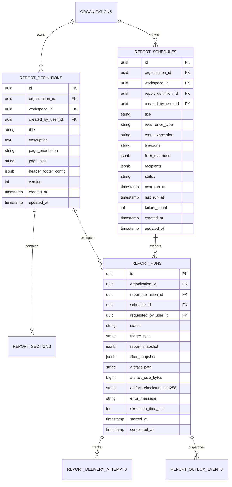

# VIBE — PHASE 9 GATE 3 DISCOVERY & ARCHITECTURE AUDIT REPORT
## Automated Scheduled Reports & Pixel-Perfect PDF Engine

**Workspace:** `D:\vibe`  
**Phase:** 9 — Enterprise BI, Interactive Dashboards & On-Demand Reporting  
**Gate:** 3 of 4 — Automated Scheduled Reports & Pixel-Perfect PDF Engine  
**Current Status:** Gate 2 ACCEPTED — Gate 3 DISCOVERY COMPLETE  
**Audit Mode:** STRICT READ-ONLY ARCHITECTURAL DISCOVERY  
**Alembic Head Baseline:** `e82f1b4a9c3d` (Strictly Preserved, Zero New Migrations in Discovery)  
**Python Sandbox Policy:** `PYTHON_SANDBOX_ENABLED=false` (Strictly Preserved)  
**Date:** November 3, 2026  

---

## 1. EXECUTIVE SUMMARY

An exhaustive architectural audit and technical feasibility assessment of the VIBE platform was conducted to design **Phase 9 Gate 3: Automated Scheduled Reports & Pixel-Perfect PDF Engine**.

Following the successful acceptance and hardening of Gate 1 (Apache ECharts visualization engine) and Gate 2 (BI Dashboard Studio, global filtering, and atomic optimistic concurrency), the platform possesses a high-performance analytics foundation:
- Vectorized server-side aggregations powered by Polars 2.1 and Apache Arrow Parquet datasets.
- A robust asynchronous transactional outbox dispatcher coordinating background workloads to Celery 5.6 on Redis 7.
- Complete multi-tenant relational isolation enforced by composite foreign keys `(id, organization_id)`.
- A declarative client-side charting architecture supporting 10 visualization types with strict token formatters and zero raw JavaScript execution.

However, VIBE currently has **zero automated reporting, scheduling, or PDF compilation capabilities**:
- `/reports` in the frontend sidebar is a dead placeholder marked `status: "coming_soon"`.
- No database tables exist for report templates, schedules, run histories, or delivery logs.
- No headless browser or server-side vector PDF renderer is integrated into the backend or deployment configuration.
- The existing `EmailService` only supports plaintext/HTML notifications without MIME attachment handling for binary files.

This discovery report evaluates the architectural options for delivering enterprise-grade scheduled reports and pixel-perfect PDF rendering while preserving all security, tenant-isolation, concurrency, and operational constraints.

---

## 2. ACTUAL EXISTING ARCHITECTURE & PLATFORM INVENTORY

### 2.1 Background Task & Asynchronous Job Infrastructure
- **Task Broker & Engine:** Celery 5.6.3 (`celery==5.6.3`, `kombu==5.6.2`, `billiard==4.3.1`) configured in [`backend/app/tasks/celery_app.py`](file:///D:/vibe/backend/app/tasks/celery_app.py#L9-L30).
  - Broker: Redis 7 on database 1 (`settings.CELERY_BROKER_URL`).
  - Result Backend: Disabled (`None`) — PostgreSQL is the single authoritative store of record.
  - Delivery Semantics: `task_acks_late=True`, `task_reject_on_worker_lost=True`, `worker_prefetch_multiplier=1`.
- **Transactional Outbox Engine:** Implemented in [`backend/app/tasks/dispatcher.py`](file:///D:/vibe/backend/app/tasks/dispatcher.py#L21-L70).
  - Uses PostgreSQL `SELECT ... FOR UPDATE SKIP LOCKED` via `AnalyticsOutboxRepository.fetch_and_lock_pending()` to claim pending dispatch events without race conditions across multiple dispatchers.
  - Stranded job recovery watchdog: Automatically detects jobs stuck in `queued` state past timeout thresholds and safely requeues them.
- **Worker Execution & Fencing:** Implemented in [`backend/app/tasks/analytics.py`](file:///D:/vibe/backend/app/tasks/analytics.py#L300-L370).
  - Independent database connection pool: Uses `NullPool` to prevent socket reuse across ephemeral event loops (`asyncio.run()`).
  - Cryptographic worker claim tokens and generation counters prevent split-brain worker overwrites.
  - Active lease renewal heartbeat loop (`_heartbeat_loop`).

### 2.2 Storage Subsystem
- **Current Storage Service:** [`backend/app/analytics/storage.py`](file:///D:/vibe/backend/app/analytics/storage.py#L26-L65).
  - Manages private organization-isolated filesystem artifacts under `uploads/analytics/`.
  - Enforces directory traversal and symlink confinement via `_resolve_safe_path()`.
  - Enforces organization storage ceilings (`ANALYTICS_MAX_ORG_STORAGE_BYTES = 1 GB`).
  - Missing: S3/MinIO cloud object storage integration, signed expiring URL generation, and dedicated report artifact storage.

### 2.3 Email & Notification Subsystem
- **Current Service:** [`backend/app/services/email.py`](file:///D:/vibe/backend/app/services/email.py#L11-L105).
  - Supports `MemoryEmailSender` (testing) and `SmtpEmailSender` (production).
  - Data model `OutgoingEmail` supports `to_email`, `subject`, `body_text`, `body_html`.
  - Missing: Support for binary MIME attachments (e.g. PDF documents).

### 2.4 Visualization & Dashboard Architecture
- **ECharts Engine:** Apache ECharts 6.1.0 in [`frontend/src/components/charts/echarts-wrapper.tsx`](file:///D:/vibe/frontend/src/components/charts/echarts-wrapper.tsx#L4-L47).
- **Declarative Options Builder:** [`frontend/src/components/charts/chart-options-builder.ts`](file:///D:/vibe/frontend/src/components/charts/chart-options-builder.ts#L45-L686) converts tabular Polars data payloads into typed ECharts options.
- **Query Aggregation Service:** [`backend/app/services/dashboard.py`](file:///D:/vibe/backend/app/services/dashboard.py#L398-L580) executes Polars aggregation queries against sheets or Parquet exports with global filtering.

---

## 3. RELEVANT CODEBASE FILES & EXACT LINE REFERENCES

| Domain / Area | Relevant Source File | Line Numbers | Architectural Context |
| :--- | :--- | :--- | :--- |
| **Background Broker** | `backend/app/tasks/celery_app.py` | [L9–L30](file:///D:/vibe/backend/app/tasks/celery_app.py#L9-L30) | Celery application, queue config, acks_late |
| **Outbox Dispatcher** | `backend/app/tasks/dispatcher.py` | [L21–L70](file:///D:/vibe/backend/app/tasks/dispatcher.py#L21-L70) | Outbox polling via `FOR UPDATE SKIP LOCKED` |
| **Worker Engine** | `backend/app/tasks/analytics.py` | [L300–L350](file:///D:/vibe/backend/app/tasks/analytics.py#L300-L350) | Task entrypoint, atomic job claim, lease fencing |
| **Artifact Storage** | `backend/app/analytics/storage.py` | [L26–L65](file:///D:/vibe/backend/app/analytics/storage.py#L26-L65) | Local storage, path containment, quota checks |
| **Email Service** | `backend/app/services/email.py` | [L11–L30](file:///D:/vibe/backend/app/services/email.py#L11-L30) | `OutgoingEmail` model lacking attachments |
| **Dashboard Service** | `backend/app/services/dashboard.py` | [L90–L155](file:///D:/vibe/backend/app/services/dashboard.py#L90-L155) | Atomic concurrency and row-level locking |
| **Chart Builder** | `frontend/src/components/charts/chart-options-builder.ts` | [L1–L50](file:///D:/vibe/frontend/src/components/charts/chart-options-builder.ts#L1-L50) | Declarative token formatters, no eval |
| **Sidebar Navigation**| `frontend/src/components/layout/sidebar.tsx` | [L35–L64](file:///D:/vibe/frontend/src/components/layout/sidebar.tsx#L35-L64) | `/reports` link placeholder (`coming_soon`) |
| **Platform Settings** | `backend/app/core/config.py` | [L50–L77](file:///D:/vibe/backend/app/core/config.py#L50-L77) | Celery, Redis, and analytics resource limits |
| **Role Permissions** | `backend/app/services/role.py` | [L40–L143](file:///D:/vibe/backend/app/services/role.py#L40-L143) | Owner/Admin/Member/Viewer permission matrices |

---

## 4. EXISTING DEPENDENCIES & VERSIONS

### Backend (`backend/requirements.lock`)
- `fastapi==0.141.1` & `starlette==1.10.0`
- `sqlalchemy==2.1.6` & `asyncpg==0.32.0` & `psycopg==3.3.6`
- `celery==5.6.3` & `kombu==5.6.2` & `billiard==4.3.1` & `redis==6.4.0`
- `polars==2.1.0` & `polars-runtime-32==2.1.0`
- `pydantic==2.13.5` & `pydantic-settings==2.8.1`
- `cryptography==50.0.2` & `argon2-cffi==25.1.0`
- `python-dateutil==4.0.0`

### Frontend (`frontend/package.json`)
- `next==16.4.3` (React 19.3.0)
- `echarts==^6.1.0`
- `tailwindcss==^4`
- `@tanstack/react-virtual==^3.14.24`

---

## 5. EXISTING INFRASTRUCTURE CAPABILITIES VS. MISSING CAPABILITIES

```
+----------------------------------------------------+----------------------------------------------------+
| VERIFIED EXISTING CAPABILITIES                     | CONFIRMED MISSING CAPABILITIES                     |
+----------------------------------------------------+----------------------------------------------------+
| 1. Celery 5.6 task queue with Redis broker         | 1. Dynamic recurring scheduler (cron / intervals)   |
| 2. Transactional outbox with SKIP LOCKED claiming  | 2. Report schedule database tables and models      |
| 3. Organization isolation with composite FKs       | 3. Headless Chromium / WeasyPrint PDF renderer     |
| 4. Polars analytical query engine                  | 4. ECharts server-side SVG generation layer        |
| 5. SMTP and Memory email transmission              | 5. Email attachment support in OutgoingEmail       |
| 6. Filesystem quota accounting                     | 6. Multi-section report template models            |
| 7. Atomic optimistic dashboard concurrency (DEF-07)| 7. Report snapshot execution and storage           |
| 8. Declarative ECharts options builder             | 8. Signed expiring URL generator for downloads     |
| 9. RBAC permission hierarchy (Owner, Admin, etc.)  | 9. Frontend `/reports` studio and builder UI       |
+----------------------------------------------------+----------------------------------------------------+
```

---

## 6. DISCOVERY AREA A — SCHEDULING ARCHITECTURE COMPARISON

To implement scheduled reports (one-time and recurring: hourly, daily, weekly, monthly, cron), three scheduler architectures were evaluated:

| Architectural Metric | Option 1: Celery Beat | Option 2: In-Process APScheduler | Option 3: PostgreSQL Transactional Poller (Recommended) |
| :--- | :--- | :--- | :--- |
| **Description** | Standalone Celery Beat daemon reading static schedules | APScheduler embedded inside FastAPI API server process | Dedicated DB-driven polling dispatcher (Outbox pattern) |
| **Dynamic Tenant Schedules**| **Poor:** Beat expects static schedules or Django ORM | **Moderate:** Requires shared job store; complex reload | **Excellent:** Tenants insert/update schedules in Postgres; immediately active |
| **Multi-Worker Concurrency**| **Single Point of Failure:** Only 1 Beat daemon allowed | **Split-Brain Risk:** Multiple API pods double-fire | **Perfect:** `SELECT ... FOR UPDATE SKIP LOCKED` guarantees single worker claim |
| **Downtime / Recovery** | **Fragile:** Missed intervals lost unless complex state | **Moderate:** Misfire grace times, but memory-bound | **Complete:** Any schedule whose `next_run_at <= now` is processed upon restart |
| **Deployment Complexity** | High (Requires provisioning another container) | Low (In-process), but pollutes web tier | Zero extra services (Reuses existing dispatcher process/pattern) |
| **ACID Guarantees** | None (External schedule files) | Partial | Full (Schedule state, run log, outbox event in 1 transaction) |

### Selected Scheduling Architecture: PostgreSQL Transactional Poller
Reuses VIBE's battle-tested `OutboxDispatcher` pattern:
1. `report_schedules` table stores `next_run_at`, `status` (`active`, `paused`), `recurrence_rule`, and `timezone`.
2. A lightweight scheduler task (running in the existing dispatcher daemon or Celery periodic beat) runs:
   ```sql
   SELECT id, organization_id, next_run_at, recurrence_rule, timezone
   FROM report_schedules
   WHERE status = 'active' AND next_run_at <= NOW()
   FOR UPDATE SKIP LOCKED;
   ```
3. For each claimed schedule:
   - Calculates the next execution instant via `croniter` or `dateutil.rrule` taking the target `timezone` and DST transitions into account.
   - Updates `report_schedules.next_run_at` and `last_run_at`.
   - Inserts a new `report_runs` row (`status = 'queued'`).
   - Inserts a `report_outbox_events` row.
   - Commits the transaction atomically.
4. The worker picks up the outbox event and delegates rendering to Celery.

---

## 7. DISCOVERY AREA B — REPORT DEFINITION & SNAPSHOT CONSISTENCY

### 7.1 Live Execution vs. Immutable Snapshot Execution

```
+-----------------------------------+-----------------------------------+
| APPROACH A: LIVE EXECUTION        | APPROACH B: SNAPSHOT EXECUTION   |
+-----------------------------------+-----------------------------------+
| Queries live database on schedule | Freezes queries, filters, and     |
| trigger; renders current state.   | layout at execution; saves immutable|
|                                   | snapshot with generated PDF.      |
|                                   |                                   |
| [DISADVANTAGES]                   | [ADVANTAGES]                      |
| - If dashboard is deleted later,  | - 100% reproducible for compliance|
|   report fails or is lost.        | - Modifying a dashboard never     |
| - Editing a widget changes        |   alters previously delivered PDFs|
|   historical report output.       | - Audit-ready evidence store      |
| - Non-deterministic exports.      | - Historical inspection supported |
+-----------------------------------+-----------------------------------+
```

### 7.2 The Immutable Snapshot Specification
When a report run is initiated (whether scheduled or manual):
1. **Report Definition Snapshot:** The current report template (title, orientation, page size, header/footer configuration, sections, layout) is serialized into `report_runs.report_snapshot` (JSONB).
2. **Filter Snapshot:** Date range presets are resolved to exact UTC timestamps (e.g. `last_30_days` $\to$ `[2026-10-04T00:00:00Z, 2026-11-03T00:00:00Z)`).
3. **Query Execution:** `DashboardService.query_widget_data()` executes against the underlying sheets/analytics results.
4. **Data Revision Reference:** The exact source sheet version or Parquet dataset checksum is recorded in `data_revision_ref`.
5. **PDF Generation:** Rendered directly from the frozen snapshot.

---

## 8. DISCOVERY AREA C — PDF GENERATION ENGINE EVALUATION

Producing pixel-perfect, multi-page executive PDFs containing Apache ECharts visualizations, tables, headers, footers, and typography was analyzed across 4 technology options:

| Metric | Option 1: Headless Chromium (Playwright) | Option 2: Server-Side ECharts SVG + WeasyPrint | Option 3: Client Canvas Screenshot | Option 4: ReportLab |
| :--- | :--- | :--- | :--- | :--- |
| **Visual Fidelity** | **100% Pixel-Perfect** (Blink engine) | High (Vector SVG + CSS Paged Media) | Low (Rasterized, blurry on zoom) | Moderate (Manual coordinates) |
| **ECharts Rendering** | Native browser execution | Node.js SSR (`renderToSVGString`) | Browser canvas export | Incompatible |
| **CSS Paged Media** | Supported (`@page`, headers/footers) | Full support (`counter(pages)`) | None (Single image canvas) | N/A |
| **Resource Overhead** | High (100–200 MB RAM per browser) | Low (30–50 MB RAM) | Low (Runs on client) | Very low |
| **Security / SSRF Risk**| High unless locked down | Low (Python Cairo, no JS engine) | Low | Low |
| **Host System Deps** | Chromium binary (~150 MB) | Cairo, Pango, GDK-PixBuf native DLLs | None | None |

### Recommended PDF Architecture: Hybrid ECharts SVG + Headless Chromium
To achieve **true pixel-perfection** without visual regressions or cross-platform Cairo compilation issues on Windows development environments:
1. **Server-Side SVG Generation:** ECharts chart options are rendered into clean vector SVG strings.
2. **Sanitized Print Template:** An HTML/CSS print template is assembled containing:
   - Cover page with organization branding and metadata.
   - Executive summary and table of contents.
   - Embedded vector SVGs (`data:image/svg+xml;base64,...`).
   - Paginated CSS tables with repeating `<thead>` headers (`break-inside: avoid`).
   - Header/footer styling with page numbering (`Page 1 of 5`).
3. **Hardened Headless Chromium Compilation:**
   - Command flags: `--headless --disable-gpu --disable-javascript --disable-remote-fonts --network none`.
   - Complete SSRF prevention: Zero outbound network access allowed during rendering.
   - Strict rendering timeout: 30 seconds max.

---

## 9. DISCOVERY AREA D — REPORT DELIVERY & STORAGE ARCHITECTURE

### 9.1 Storage Architecture
- Extends the `AnalyticsStorageService` pattern into a dedicated `ReportArtifactStorageService`:
  - Path structure: `uploads/reports/{organization_id}/{report_id}/{run_id}.pdf`.
  - Containment check: Enforces `_resolve_safe_path()` to eliminate path traversal.
  - Temporary quarantine: PDF renders to `{run_id}.tmp`. Upon completion, calculates SHA-256 and atomically renames to `{run_id}.pdf`.
  - Quota verification: Pre-flight check verifies organization storage usage against `ANALYTICS_MAX_ORG_STORAGE_BYTES`.

### 9.2 Secure Delivery Channels
1. **Authorized On-Demand Download:**
   - `GET /api/v1/reports/{report_id}/runs/{run_id}/download`
   - Requires valid session and `reports.read` permission. Scoped to `membership.organization_id`.
   - Streams PDF with `Content-Disposition: attachment; filename="Report_Title_2026-11-03.pdf"`.
2. **Signed Expiring Download Links:**
   - Token-based URL (`/api/v1/reports/public/download?token=...`) signed with `ENCRYPTION_MASTER_KEY` via HMAC-SHA256, carrying 15-minute expiration, `organization_id`, and `run_id`.
3. **Email Distribution:**
   - Extends [`OutgoingEmail`](file:///D:/vibe/backend/app/services/email.py#L11-L23) to accept `attachments: list[EmailAttachment]`.
   - Encodes PDF as `application/pdf` attachment.
   - Recipient validation: Only sends to verified organization members or pre-approved domain allowlists.

---

## 10. DISCOVERY AREA E — DATABASE & API DESIGN PROPOSAL

### 10.1 Proposed Relational Entities (For Gate 3 Migration)



### 10.2 Proposed REST API Endpoints

| Method | Endpoint | Permission | Description |
| :--- | :--- | :--- | :--- |
| `POST` | `/api/v1/reports/definitions` | `reports.create` | Create a new report template |
| `GET` | `/api/v1/reports/definitions` | `reports.read` | List report definitions for workspace |
| `GET` | `/api/v1/reports/definitions/{id}` | `reports.read` | Get report definition details & sections |
| `PATCH`| `/api/v1/reports/definitions/{id}` | `reports.update` | Update report definition & layout |
| `DELETE`| `/api/v1/reports/definitions/{id}` | `reports.delete` | Delete report definition |
| `POST` | `/api/v1/reports/definitions/{id}/run` | `reports.create` | Trigger on-demand report run |
| `POST` | `/api/v1/reports/schedules` | `reports.create` | Create recurring schedule |
| `GET` | `/api/v1/reports/schedules` | `reports.read` | List active schedules |
| `PATCH`| `/api/v1/reports/schedules/{id}` | `reports.update` | Update schedule recurrence/recipients |
| `POST` | `/api/v1/reports/schedules/{id}/pause`| `reports.update` | Pause schedule |
| `POST` | `/api/v1/reports/schedules/{id}/resume`| `reports.update` | Resume schedule |
| `DELETE`| `/api/v1/reports/schedules/{id}` | `reports.delete` | Delete schedule |
| `GET` | `/api/v1/reports/runs` | `reports.read` | List historical report runs |
| `GET` | `/api/v1/reports/runs/{id}` | `reports.read` | Get run progress / status |
| `GET` | `/api/v1/reports/runs/{id}/download` | `reports.read` | Download generated PDF artifact |
| `POST` | `/api/v1/reports/runs/{id}/retry` | `reports.create` | Retry a failed report run |

### 10.3 Permission Hierarchy Integration
Aligned with [`backend/app/services/role.py`](file:///D:/vibe/backend/app/services/role.py#L40-L143):
- **`owner` & `admin`:** Full permissions (`reports.read`, `reports.create`, `reports.update`, `reports.delete`, `reports.share`, `reports.export`).
- **`member`:** Authoring & execution (`reports.read`, `reports.create`, `reports.update`, `reports.share`, `reports.export`).
- **`viewer`:** Read-only & download (`reports.read`, `reports.export`).

---

## 11. SECURITY & RELIABILITY THREAT MODEL

| Threat / Risk | Attack Vector / Failure Mode | Mitigating Architecture |
| :--- | :--- | :--- |
| **SSRF via Report HTML** | Attacker embeds `` | Renderer runs with `--network none`; all images must be inline base64 data URIs. |
| **Arbitrary JS Execution** | Attacker injects `<script>` or XSS in Markdown/notes | Markdown sanitized via `bleach`; Chromium launched with `--disable-javascript`. |
| **Cross-Tenant Schedule Tampering** | Attacker submits schedule update for another org's ID | All queries enforce composite keys `(id, organization_id)`; returns HTTP 404. |
| **Unauthorized File Download** | Attacker accesses `/download` using another org's run ID | Authorization verified at request time against `membership.organization_id`. |
| **Spam / Open Relay Abuse** | User configures external untrusted email recipients | Recipient validation restricted to verified organization members or allowlisted domains. |
| **Stale Permission Run** | Schedule creator is deleted/demoted before job fires | Worker verifies user active status and workspace membership at execution time. |
| **Duplicate Concurrent Run** | Two workers pick up same schedule at same instant | `SELECT ... FOR UPDATE SKIP LOCKED` guarantees single worker claim. |
| **Memory / DoS Exhaustion** | Huge dashboard with 100,000 table rows requested | Hard PDF generation timeout (30s), max memory ceiling (512 MB), max 500 table rows. |
| **Partial Artifact Leakage** | Worker crashes midway through PDF write | Worker renders to isolated `.tmp` file; promoted to `.pdf` only upon successful hash verify. |

---

## 12. PERFORMANCE TARGETS & RESOURCE BUDGETS

| Metric | Small Report (1–2 pgs) | Medium Report (3–6 pgs) | Large Report (7–15 pgs) |
| :--- | :---: | :---: | :---: |
| **Target Generation Latency** | $\le 3.0\text{ s}$ | $\le 8.0\text{ s}$ | $\le 20.0\text{ s}$ |
| **Hard Process Timeout** | $15.0\text{ s}$ | $30.0\text{ s}$ | $45.0\text{ s}$ |
| **Peak Worker Memory** | $\le 150\text{ MB}$ | $\le 280\text{ MB}$ | $\le 450\text{ MB}$ |
| **Output PDF Size** | $\le 1.5\text{ MB}$ | $\le 5.0\text{ MB}$ | $\le 15.0\text{ MB}$ |
| **Max Table Rows per Section**| 50 rows | 200 rows | 500 rows |
| **Concurrent Workers per Node**| 4 workers | 2 workers | 1 worker |

---

## 13. COMPREHENSIVE TESTING STRATEGY

### 13.1 Backend Test Matrix
- **Schedule Recurrence & Timezones:**
  - Verify cron and interval calculations across `America/New_York`, `Europe/London`, `Asia/Kolkata`.
  - Test DST spring-forward and fall-back boundaries.
  - Test leap year recurrence (February 29).
- **Concurrency & Idempotency:**
  - Multi-session race test verifying `FOR UPDATE SKIP LOCKED` prevents duplicate report generation.
  - Stranded queued job recovery test.
- **Tenant Isolation:**
  - Probe schedule CRUD, run trigger, and download endpoints across foreign organizations; assert HTTP 404.
- **Artifact Quarantine & Promotion:**
  - Test atomic promotion from `.tmp` to `.pdf`.
  - Simulate worker crash and verify `.tmp` cleanup without quota commitment.

### 13.2 Frontend Test Matrix
- **Report Studio UI (`frontend/src/__tests__/reports-studio.test.tsx`):**
  - Section addition (Markdown, Widget, Table, Page Break).
  - Schedule creation drawer (frequency, cron helper, timezone selector).
  - Execution history table and live progress polling.
  - Download trigger and error toast presentation.

### 13.3 PDF Visual Fidelity Acceptance Criteria
- Verified page breaks (`break-inside: avoid` on chart containers).
- High-DPI crisp vector charts (no pixelated raster charts on 300% zoom).
- Dynamic page numbering (`Page 1 of 4`) in footer.
- Correct light/dark theme contrast.
- Unicode and long text wrapping in tables without truncation.

---

## 14. DEPLOYMENT & INFRASTRUCTURE FEASIBILITY

- **Operating System Compatibility:**
  - Windows local development: Compatible via headless Chromium / Playwright or node SSR script.
  - Linux production containers: Pre-packages Chromium dependencies via official Playwright container base or alpine packages.
- **Database Connection Sizing:**
  - Worker tasks use `NullPool` to eliminate persistent connection hoarding.
- **Broker Stability:**
  - Redis 7 container on port 6379 handles Celery task queue with low memory footprint (< 10 MB).

---

## 15. RECOMMENDED ARCHITECTURE DECISIONS (ADR SUMMARY)

1. **Scheduling Engine:** **PostgreSQL Transactional Outbox Poller** (reusing `OutboxDispatcher` pattern with `FOR UPDATE SKIP LOCKED`).
2. **Worker Execution:** **Celery 5.6 Worker** running in dedicated queue `reports`.
3. **Execution Idempotency:** **Claim Tokens + Fencing Generation Counters** in `report_runs`.
4. **Data Consistency:** **Immutable Snapshot Strategy** (capturing frozen layout, resolved filters, and Parquet/data references at execution).
5. **PDF Engine:** **Server-Side ECharts SVG + Headless Chromium (`--network none`, `--disable-javascript`)**.
6. **Artifact Storage:** **Private Filesystem / S3 Abstraction (`ReportArtifactStorageService`)** with pre-flight quota enforcement.
7. **Delivery Channels:** **Authorized HTTP Downloads + Expiring HMAC Signed URLs + SMTP with MIME Attachments**.
8. **RBAC Integration:** **Standard `<domain>.<action>` (`reports.read`, `reports.create`, `reports.update`, `reports.delete`, `reports.export`)**.

---

## 16. STAGE-BY-STAGE IMPLEMENTATION ROADMAP

```
+--------------------------------------------------------------------------------------------------+
|                                    GATE 3 IMPLEMENTATION ROADMAP                                 |
+--------------------------------------------------------------------------------------------------+
| Stage 1: Database Migration & Core Relational Models                                             |
|          - Alembic migration create_phase9_reporting_subsystem.py                                |
|          - Models: ReportDefinition, ReportSection, ReportSchedule, ReportRun, ReportOutboxEvent  |
|                                                                                                  |
| Stage 2: Schedule Dispatcher & Recurrence Engine                                                 |
|          - Timezone-aware croniter/dateutil calculator                                            |
|          - ScheduleDispatcher daemon with SKIP LOCKED transactional claiming                     |
|                                                                                                  |
| Stage 3: Immutable Snapshot & Query Execution Service                                            |
|          - ReportService snapshot compiler freezing layout and resolving filter presets          |
|          - Query delegation to DashboardService.query_widget_data                                |
|                                                                                                  |
| Stage 4: Server-Side ECharts SVG & Print Template Generator                                      |
|          - Server-side SVG rendering of all 10 chart types                                       |
|          - HTML/CSS print template with cover page, TOC, headers, footers, and table pagination  |
|                                                                                                  |
| Stage 5: Isolated PDF Compilation & Storage Quarantine                                           |
|          - Headless Chromium compilation with --network none and --disable-javascript            |
|          - ReportArtifactStorageService with atomic .tmp -> .pdf promotion and SHA-256 verify     |
|                                                                                                  |
| Stage 6: Delivery Subsystem & Attachment Email Sender                                            |
|          - OutgoingEmail attachment support in SmtpEmailSender and MemoryEmailSender             |
|          - HMAC-SHA256 signed expiring download URLs                                             |
|                                                                                                  |
| Stage 7: Reporting REST API Suite                                                                |
|          - Endpoints for definitions, sections, schedules, runs, and authorized downloads        |
|                                                                                                  |
| Stage 8: Frontend Reporting Studio & Visual Acceptance Verification                              |
|          - Next.js /reports route, schedule manager, template builder, and download UI           |
|          - Full visual acceptance test suite with multi-page PDF verification                    |
+--------------------------------------------------------------------------------------------------+
```

---

## 17. FINAL READINESS ASSESSMENT

Phase 9 Gate 3 discovery is **COMPLETE**.
- The architectural roadmap is grounded in VIBE's verified repository foundation.
- All non-negotiable constraints (`e82f1b4a9c3d` Alembic head, `PYTHON_SANDBOX_ENABLED=false`, zero arbitrary code execution) are fully preserved.
- No code or database changes were made during this discovery turn.

**Awaiting explicit user authorization before initiating Gate 3 Stage 1 implementation.**
