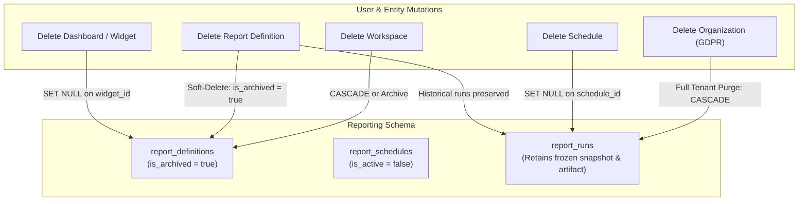
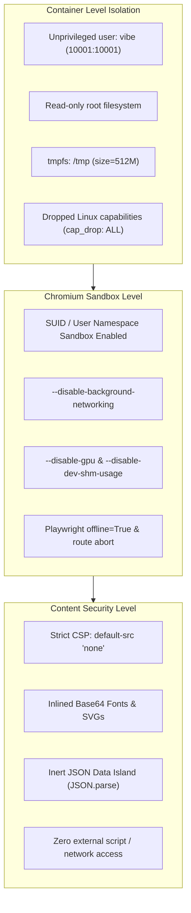
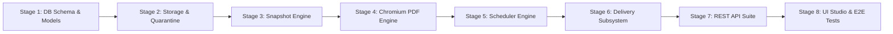

# VIBE — PHASE 9 GATE 3 FINAL ARCHITECTURE CORRECTION
## Strict Read-Only Database, Snapshot, Delivery & Browser Security Audit

**Workspace:** `D:\vibe`  
**Project:** VIBE — Enterprise BI, Analytics & Data Intelligence Platform  
**Phase:** 9 — Enterprise BI, Interactive Dashboards & On-Demand Reporting  
**Gate:** 3 — Automated Scheduled Reports & PDF Engine  
**Previous Documents:**
- `PHASE_9_GATE_3_DISCOVERY_REPORT.md`
- `PHASE_9_GATE_3_ARCHITECTURE_VALIDATION.md`

**Baseline Alembic Head:** `e82f1b4a9c3d`  
**Python Sandbox:** `PYTHON_SANDBOX_ENABLED=false`  
**Mode:** STRICT READ-ONLY  
**Implementation Authorization:** NOT GRANTED  
**Date:** November 3, 2026  

---

## 1. Executive Verdict

A comprehensive technical audit of `PHASE_9_GATE_3_ARCHITECTURE_VALIDATION.md` has identified several critical design flaws and unverified assumptions:

1. **Broken Composite Foreign-Key Cascades:** The proposal of `ON DELETE SET NULL` on composite foreign keys `(dashboard_id, organization_id)` where `organization_id` is `NOT NULL` is invalid in PostgreSQL and causes immediate SQL execution errors.
2. **Historical Report Destruction:** The proposed `report_runs.report_definition_id ON DELETE CASCADE` violates legal and audit retention by silently wiping historical report runs and frozen snapshots when an editor deletes a template definition.
3. **Flawed Snapshot Semantics:** Anchoring relative date filters to `scheduled_for_utc` does not reconstruct historical spreadsheet rows because VIBE spreadsheets have mutable rows and zero point-in-time table revisions.
4. **Race-Prone SMTP Delivery:** Check-before-send delivery and reliance on SMTP `Message-ID` cannot prevent duplicate transmissions under worker concurrency or network crashes.
5. **Inaccurate Browser Security Claims:** `--network=none` was mischaracterized as a Chromium CLI flag (it is a Docker configuration); `--no-sandbox` weakens host security; and `/tmp noexec` was incorrectly assumed to prevent Chromium binary execution.

This document establishes the **corrected, authoritative architectural blueprint** for Phase 9 Gate 3. All findings and decisions are grounded in direct repository evidence, standard database semantics, and real-world distributed systems constraints.

---

## 2. Repository Evidence & Ground Truth

The following file paths and line ranges establish the foundational architectural facts in `D:\vibe`:

| File Path & Line Range | Architectural Fact & Ground Truth |
| :--- | :--- |
| [`backend/app/models/spreadsheet.py:179-220`](file:///D:/vibe/backend/app/models/spreadsheet.py#L179-L220) | `SheetRow` stores `cells: JSONB` and `version: int` with a unique constraint on `("sheet_id", "row_index")`. Rows are mutated in-place. There are no table-level revisions or point-in-time snapshots. |
| [`backend/app/models/spreadsheet.py:261-318`](file:///D:/vibe/backend/app/models/spreadsheet.py#L261-L318) | `SheetCellHistory` stores individual cell undo/redo diffs (`cell_version_before`, `cell_version_after`). It cannot reconstruct full sheet states at an arbitrary historical timestamp. |
| [`backend/app/models/analytics.py:62-150`](file:///D:/vibe/backend/app/models/analytics.py#L62-L150) | `AnalyticsJob` implements generation fencing (`claim_generation: int`), worker leasing (`claim_token: UUID`, `lease_expires_at`), and atomic quota reservations. |
| [`backend/app/models/analytics.py:151-168`](file:///D:/vibe/backend/app/models/analytics.py#L151-L168) | Existing composite foreign keys in VIBE are strictly `ondelete="CASCADE"` on non-nullable pairs `["workspace_id", "organization_id"]`. None use `ON DELETE SET NULL`. |
| [`backend/app/services/dashboard.py:58-67`](file:///D:/vibe/backend/app/services/dashboard.py#L58-L67) | `DashboardService` is initialized with a single `session: AsyncSession` shared across `dashboard_repo`, `widget_repo`, `sheet_repo`, `row_repo`, and `analytics_repo`. |
| [`backend/app/services/dashboard.py:408-483`](file:///D:/vibe/backend/app/services/dashboard.py#L408-L483) | `query_widget_data()` queries current mutable `sheet_rows` directly or reads Parquet files from `AnalyticsResult.artifact_path`. It does not support historical revision pinning. |
| [`backend/app/tasks/dispatcher.py:28-48`](file:///D:/vibe/backend/app/tasks/dispatcher.py#L28-L48) | Outbox dispatcher polls and locks pending events using PostgreSQL `SELECT ... FOR UPDATE SKIP LOCKED` with 60-second lock expiration. |
| [`backend/app/services/email.py:11-22`](file:///D:/vibe/backend/app/services/email.py#L11-L22) | `OutgoingEmail` has `to_email`, `subject`, `body_text`, `body_html`, but lacks binary MIME attachment support. |
| [`frontend/package.json:26`](file:///D:/vibe/frontend/package.json#L26) | `"echarts": "^6.1.0"` is installed only in the Next.js frontend. The Python backend has no JavaScript runtime or ECharts package. |
| [`backend/requirements.lock:1-71`](file:///D:/vibe/backend/requirements.lock#L1-L71) | Pure Python dependencies. Neither `playwright`, `weasyprint`, `reportlab`, nor `croniter` are installed. `python-dateutil==4.0.0` is installed. |
| [`backend/Dockerfile:1-33`](file:///D:/vibe/backend/Dockerfile#L1-L33) | `python:3.12-slim` base image with only `build-essential` and `curl`. Missing Chromium dependencies (`libnss3`, `libasound2`, `libgbm1`, etc.). |
| [`docker-compose.yml:48-90`](file:///D:/vibe/docker-compose.yml#L48-L90) | Worker container runs as unprivileged user `10001:10001`, `read_only: true`, `cap_drop: ALL`, and `tmpfs: /tmp:rw,noexec,nosuid,size=512m`. |

---

## 3. Database Referential Integrity & Historical Retention

### 3.1 Composite Foreign-Key Deletion Semantics

In PostgreSQL and ANSI SQL, when an `ON DELETE SET NULL` action is triggered on a composite foreign key:
```sql
CONSTRAINT fk_report_defs_dashboard_org 
FOREIGN KEY (dashboard_id, organization_id) 
REFERENCES dashboards(id, organization_id) 
ON DELETE SET NULL
```
PostgreSQL attempts to set **all** participating columns in the foreign key to `NULL`:
$$\text{dashboard\_id} \leftarrow \text{NULL}, \quad \text{organization\_id} \leftarrow \text{NULL}$$

Because `organization_id` is defined as `nullable=False` to guarantee tenant isolation, PostgreSQL aborts the transaction with a constraint violation:
`ERROR: null value in column "organization_id" of relation "report_definitions" violates not-null constraint`

#### Technical Resolution for Nullable References
To preserve strict tenant isolation without triggering SQL constraint violations:
1. **Single-Column Foreign Key for Nullable Target:**
   - Define `dashboard_id: Mapped[uuid.UUID | None] = mapped_column(UUID(as_uuid=True), ForeignKey("dashboards.id", ondelete="SET NULL"), nullable=True, index=True)`.
   - Define `organization_id: Mapped[uuid.UUID] = mapped_column(UUID(as_uuid=True), ForeignKey("organizations.id", ondelete="CASCADE"), nullable=False, index=True)`.
2. **Tenant Isolation Invariant:**
   - In PostgreSQL, primary keys (`dashboards.id`) are globally unique UUIDv4 values generated via cryptographic entropy.
   - Cross-tenant data leakage is prevented by application-level validation: during report definition creation or update, the repository verifies that `dashboard.organization_id == report_definition.organization_id`.
   - Furthermore, all read queries explicitly filter by `organization_id`:
     `SELECT * FROM report_definitions WHERE id = :id AND organization_id = :org_id`

### 3.2 Historical Report Retention Architecture

A report run represents a **point-in-time financial, operational, or legal audit record**. Deleting an editable template definition, modifying a dashboard, or deleting a widget must **never** destroy past report runs.



#### Referential Behavior Matrix

| Action / Event | Affected Table | Constraint Behavior | Impact on Historical `report_runs` |
| :--- | :--- | :--- | :--- |
| **User Deletes Report Definition** | `report_definitions` | **Soft-Delete / Archive:** `is_archived = True`, `archived_at = NOW()`. Hard DELETE is blocked by `RESTRICT` if historical runs exist. | **Zero Impact.** Completed runs retain their link to the definition; runs remain fully readable and downloadable. |
| **User Deletes Dashboard** | `report_definitions.dashboard_id` | `dashboard_id` set to `NULL` via `ON DELETE SET NULL`. Definition becomes standalone. | **Zero Impact.** Historical runs use their self-contained frozen snapshot. |
| **User Deletes Widget** | `report_sections.widget_id` | `widget_id` set to `NULL` via `ON DELETE SET NULL`. Section retains cached title and query configuration. | **Zero Impact.** Historical runs do not query `dashboard_widgets`. |
| **User Deletes Schedule** | `report_runs.schedule_id` | `schedule_id` set to `NULL` via `ON DELETE SET NULL`. | **Zero Impact.** Run record preserves `scheduled_for_utc` timestamp and execution metadata. |
| **Admin Deletes Workspace** | `report_definitions`, `report_runs` | `workspace_id` in `report_runs` is set to `NULL` (`ON DELETE SET NULL`) while `organization_id` remains intact. | **Runs Preserved at Org Level.** Historical runs remain accessible in organization-level compliance audits. |
| **Tenant Deletion (GDPR / Purge)** | All reporting tables | `organization_id ON DELETE CASCADE`. | **Permanent Destruction.** All definitions, sections, schedules, runs, and artifacts are permanently deleted. |

---

## 4. Snapshot Semantics & Data Materialization

### 4.1 Execution-Time vs. Scheduled-Time Semantics

In distributed reporting systems, it is essential to distinguish between two snapshot models:

- **Model A: Execution-Time Snapshot (The Initial Contract for Gate 3):**
  Data is queried and materialized at the exact moment the worker executes the job within a database transaction. If a scheduled report is delayed by 15 minutes due to queue backlog, the data reflects the database state at `T + 15m`.
- **Model B: Scheduled-Time Snapshot:**
  Data reflects the exact source state at the scheduled instant `T`, regardless of when the worker executes.

#### Why Anchoring Relative Date Filters Does NOT Achieve Scheduled-Time Snapshots
Anchoring a date filter (e.g. `last_30_days` evaluated relative to `2026-11-03T08:00:00Z`) merely sets the query boundary:
$$\text{date} \ge \text{'2026-10-04T08:00:00Z'} \quad \text{AND} \quad \text{date} \le \text{'2026-11-03T08:00:00Z'}$$
Because `sheet_rows` has **mutable rows** ([`spreadsheet.py:179-220`](file:///D:/vibe/backend/app/models/spreadsheet.py#L179-L220)):
1. If a user edited an existing row's numerical values between `08:00` and `08:15`, the query at `08:15` reads the *modified* row values.
2. If a user deleted a row at `08:05`, that row is missing from the query at `08:15`.
3. If an existing `AnalyticsResult` Parquet file was updated or purged, the query reads the new file or fails.

**Conclusion:** Without a git-like commit log or temporal copy-on-write tables for spreadsheet rows, **true scheduled-time historical reconstruction is technically impossible**. Gate 3 explicitly defines its contract as **Execution-Time Snapshot with Deterministic Temporal Windowing**.

### 4.2 Single-Session `REPEATABLE READ` Transaction Verification

Can all widget queries for a multi-widget report execute within a single consistent snapshot?

**Verification Evidence in Codebase:**
- In [`backend/app/services/dashboard.py:58-67`](file:///D:/vibe/backend/app/services/dashboard.py#L58-L67), `DashboardService` accepts `session: AsyncSession` and shares it across all repository calls.
- When `DashboardService.query_widget_data()` executes against `source_type == "sheet"`:
  1. It reads `sheet` and `sheet_rows` using `self.session`.
  2. If the outer session begins with:
     ```python
     async with engine.connect() as conn:
         await conn.execution_options(isolation_level="REPEATABLE READ")
         async with AsyncSession(conn) as session:
             async with session.begin():
                 # All queries in this block share the exact same snapshot
     ```
  3. Under PostgreSQL `REPEATABLE READ`, all SELECT queries across all report sections see the identical transaction snapshot established by the first query. Concurrent edits made by other users during query execution are invisible.

### 4.3 Handling Separately Stored Parquet Analytics Results

When a widget references `source_type == "analytics_result"`:
- The data is stored in a Parquet file on disk (`AnalyticsResult.artifact_path`).
- A subsequent quota cleanup, workspace deletion, or file overwrite could invalidate or alter that file.
- **Mandatory Materialization Rule:** The report snapshot engine **must not** store a file path reference. It must evaluate the Polars query, read the records, and serialize the resulting tabular dataset directly into `report_runs.report_snapshot`. Once written to the snapshot, the report is completely decoupled from the original Parquet file.

### 4.4 Canonical Snapshot Serialization & Checksum Standard

To ensure lossless JSON serialization and deterministic SHA-256 checksums:

1. **Dates and Timestamps:** Serialized as ISO 8601 strings in UTC with uppercase `Z` suffix (`"2026-11-03T08:00:00Z"`).
2. **Decimals & Monetary Values:** Serialized as exact strings (`"1250000.50"`) to prevent IEEE 754 floating-point rounding errors.
3. **Null Values:** Serialized as JSON `null`.
4. **Non-Finite Floating-Point Values (`NaN`, `Infinity`, `-Infinity`):**
   - Standard JSON specification (RFC 8259) prohibits `NaN` and `Infinity`.
   - In Python, `json.dumps()` produces non-standard tokens by default.
   - **Rule:** The snapshot serializer coerces `NaN` $\to$ `null`, `Infinity` $\to$ `1e9999` (or `null` with explicit metadata flag `is_infinite: true`).
5. **Canonical Checksum Calculation (RFC 8785 JSON Canonicalization Scheme):**
   $$\text{checksum} = \text{SHA-256}(\text{json.dumps}(snapshot, sort\_keys=True, separators=(',', ':'), ensure\_ascii=True))$$

### 4.5 Storage Strategy: JSONB vs. Parquet Thresholds

| Dataset Size / Row Count | Primary Storage Location | PostgreSQL Impact & Storage Mechanism |
| :--- | :--- | :--- |
| **Standard Report ($\le 2,000$ total rows across all widgets)** | `report_runs.report_snapshot` (`JSONB`) | Stored inline in PostgreSQL with TOAST compression. Zero filesystem management overhead; atomic with run status. |
| **Large Report ($> 2,000$ rows or $> 1\,\text{MB}$ payload)** | Display preview in `report_snapshot` (`JSONB`) + Raw data in `REPORT_STORAGE_DIR/snapshots/{org_id}/{run_id}.parquet` | Prevents PostgreSQL table bloat. Parquet file is attempt-fenced with SHA-256 validation. |

---

## 5. Scheduler Lifecycle, Idempotency & Recurrence

### 5.1 Canonical Occurrence Identity & Deduplication

To eliminate string formatting ambiguity, scheduled occurrence identity is modeled directly using typed relational columns:

```sql
CONSTRAINT uq_report_runs_schedule_occurrence 
UNIQUE (schedule_id, scheduled_for_utc);
```

- **Scheduled Runs:** `schedule_id` is set, `scheduled_for_utc` is set to the exact planned slot (e.g. `'2026-11-03 08:00:00+00'`). The unique constraint guarantees that **at most one run** can ever exist for a given schedule and time slot.
- **Manual / On-Demand Runs:** `scheduled_for_utc` is `NULL`. In PostgreSQL, `NULL` values in unique constraints are treated as distinct (`NULL != NULL`). Multiple manual runs for the same definition or schedule can be created without collision.

### 5.2 Atomic Schedule Polling & Decoupled Execution

The scheduler lifecycle strictly separates **Scheduler Claiming** from **Worker Execution Claiming**:

```
[Scheduler Poller Process]
             │
             ├── 1. Atomic Polling via SELECT FOR UPDATE SKIP LOCKED
             │      SELECT id, report_definition_id, organization_id, next_run_at, ...
             │      FROM report_schedules
             │      WHERE is_active = true AND next_run_at <= NOW()
             │      FOR UPDATE SKIP LOCKED;
             │
             ├── 2. In the SAME Atomic Transaction:
             │      ├── Insert report_runs (status='queued', scheduled_for_utc=next_run_at)
             │      ├── Insert report_outbox_events (event_type='report.run.dispatched')
             │      ├── Advance schedule: next_run_at = calculate_next_run(...)
             │      └── Update last_run_at = NOW()
             │
             ▼
   [Transaction Commits (<10ms)]
             │
             ├── Schedule lock released immediately. Schedule is ready for next cycle.
             │
             ▼
[Outbox Dispatcher] ──> Dispatches job to Celery reporting queue
             │
             ▼
[Celery Reporting Worker]
             │
             ├── Claims report_runs row: status='running', claim_token=UUID, lease_expires_at=NOW()+300s
             ├── Materializes frozen snapshot
             ├── Generates PDF
             └── Dispatches delivery outbox events
```

### 5.3 Canonical Recurrence Representation: Standard Cron Expressions

To avoid dual-engine complexity, Gate 3 adopts **Standard 5-Field Cron Expressions** (`minute hour day_of_month month day_of_week`) evaluated with IANA timezones.

#### Timezone Transitions & Edge Cases
1. **IANA Timezone Normalization:** Evaluated using Python's standard library `zoneinfo.ZoneInfo` (zero external dependencies).
2. **Spring Forward (Nonexistent Local Time):**
   - E.g. In `America/New_York`, at 2:00 AM clocks move to 3:00 AM.
   - A schedule set for 2:30 AM evaluates to 3:00 AM local time.
3. **Fall Back (Ambiguous Local Time):**
   - E.g. At 2:00 AM clocks move back to 1:00 AM. 1:30 AM occurs twice.
   - Evaluated with standard `fold=0` (first occurrence) to guarantee exactly one execution.
4. **Missed Interval Catch-Up Policy:**
   - `skip_missed`: If downtime occurred, advance `next_run_at` to the next future slot; skip missed slots.
   - `run_latest`: Execute the most recent elapsed slot; advance `next_run_at` to the future.

---

## 6. Delivery Idempotency & Concurrency Design

### 6.1 Logical Delivery Targets vs. Delivery Attempts

Check-before-send logic is vulnerable to race conditions between concurrent Celery workers. To guarantee delivery idempotency, delivery is split into two relational tiers:

1. **`report_delivery_targets` (Logical Target):**
   Represents the intended recipient for a specific run.
   - Enforces unique constraint: `UNIQUE (run_id, channel, recipient_normalized)`
   - Tracks state: `pending` $\to$ `claimed` $\to$ `sent` | `failed` | `ambiguous`
2. **`report_delivery_attempts` (Physical Attempt Log):**
   Audit log recording individual network connection attempts, error codes, and SMTP responses.

### 6.2 Atomic Claim Query
Workers claim delivery targets using row-level locking:
```sql
UPDATE report_delivery_targets
SET status = 'claimed',
    claim_token = :worker_token,
    claim_expires_at = NOW() + INTERVAL '120 seconds',
    attempt_count = attempt_count + 1
WHERE id = (
    SELECT id FROM report_delivery_targets
    WHERE run_id = :run_id
      AND status IN ('pending', 'claimed')
      AND (claim_expires_at IS NULL OR claim_expires_at < NOW())
      AND attempt_count < max_attempts
    ORDER BY created_at ASC
    LIMIT 1
    FOR UPDATE SKIP LOCKED
)
RETURNING id, channel, recipient_normalized, attempt_count;
```

### 6.3 The Ambiguous SMTP Failure Window

In standard SMTP delivery, exactly-once delivery is impossible due to the uncoordinated transport failure window:

$$\text{Client sends DATA} \longrightarrow \text{SMTP server accepts message (250 OK)} \longrightarrow \text{Worker dies before DB commit}$$

- If the worker restarts and retries, the recipient receives a duplicate email.
- If the worker does not retry, the delivery is marked failed even though the email was sent.

#### Enterprise Mitigation Strategy
1. **`ambiguous` State:** If a socket timeout or worker crash occurs during or immediately after the SMTP `DATA` phase, the target is transitioned to `status = 'ambiguous'`.
2. **Deterministic `Message-ID` Header:** Outgoing emails include:
   `Message-ID: <{run_id}.{target_id}@vibe.enterprise>`
   Compliant corporate mail servers (Exchange, Gmail Workspace) use this header to deduplicate duplicate deliveries received within short windows.
3. **Manual Reconciliation UI:** Administrators can view ambiguous delivery states and manually mark them resolved or trigger a forced resend.

### 6.4 Revocable Signed Download Tokens

For external or email delivery links:
- The token is a 256-bit cryptographically secure random string.
- The database stores **only the SHA-256 hash** of the token (`token_hash`), never the raw token.
- Tokens support:
  - Bounded expiration (default 72 hours).
  - Explicit revocation (`is_revoked = True`).
  - Max download limits (e.g. single-use or 10 downloads).
  - Rate limiting via Redis (`RATE_LIMIT_DOWNLOAD_PER_MINUTE = 10`).

---

## 7. Hardened Chromium Security & Container Architecture

### 7.1 Corrections to Previous Browser Claims

1. `--network=none` is a **Docker network mode**, not a Chromium command-line switch. Passing `--network=none` to the Chromium binary is an invalid argument.
2. Playwright `route()` interception is an application-level filter within Node/Python. It does not replace OS-level kernel network isolation.
3. `--no-sandbox` completely disables the multi-process Chromium security boundary. It must **not** be used in production.
4. The existing `noexec` mount on `/tmp` ([`docker-compose.yml:64`](file:///D:/vibe/docker-compose.yml#L64)) does **not** prevent Chromium from running, because Chromium binaries reside in `/home/vibe/.cache/ms-playwright` or `/usr/bin/chromium`, not in `/tmp`.

### 7.2 Hardened Worker Defense-in-Depth Specification



#### Hardening Rules
1. **Unprivileged Runtime User:** Worker runs as non-root user `vibe: 10001` with no new privileges (`no-new-privileges: true`).
2. **Chromium Sandbox Enabled:** Provide appropriate seccomp profile allowing unprivileged user namespaces (`CLONE_NEWUSER`), keeping Chromium's internal Layer 1 and Layer 2 BPF seccomp sandbox active without requiring root or `SYS_ADMIN`.
3. **Application-Level Network Denial:**
   ```python
   browser_context = await browser.new_context(
       offline=True,
       java_script_enabled=True,
   )
   await browser_context.route("**/*", lambda route: route.abort())
   ```
4. **Content Security Policy (CSP):**
   ```html
   <meta http-equiv="Content-Security-Policy" 
         content="default-src 'none'; script-src 'nonce-{RANDOM}'; style-src 'unsafe-inline'; font-src data:; img-src data:;">
   ```
5. **No Local File Traversal:** Input HTML is loaded via `page.set_content(html, wait_until="networkidle")`. File access schemes (`file://`) are strictly rejected.

### 7.3 Boundary Verification Test Plan

Before production sign-off, the reporting worker must execute automated tests proving rejection of:
- Public internet addresses (`http://example.com`, `https://1.1.1.1`).
- Localhost and internal ports (`http://127.0.0.1:8000`, `http://127.0.0.1:5432`).
- Cloud metadata service (`http://169.254.169.254/latest/meta-data/`).
- Local filesystem paths (`<iframe src="file:///etc/passwd">`).
- External images and web fonts (``).

---

## 8. Complete Corrected Database Specification

### 1. `report_definitions`
```sql
CREATE TABLE report_definitions (
    id UUID PRIMARY KEY DEFAULT gen_random_uuid(),
    organization_id UUID NOT NULL REFERENCES organizations(id) ON DELETE CASCADE,
    workspace_id UUID NOT NULL,
    dashboard_id UUID REFERENCES dashboards(id) ON DELETE SET NULL,
    title VARCHAR(255) NOT NULL,
    description TEXT,
    format VARCHAR(20) NOT NULL DEFAULT 'pdf',
    page_orientation VARCHAR(20) NOT NULL DEFAULT 'portrait',
    page_size VARCHAR(20) NOT NULL DEFAULT 'a4',
    header_text VARCHAR(255),
    footer_text VARCHAR(255),
    include_table_of_contents BOOLEAN NOT NULL DEFAULT true,
    include_cover_page BOOLEAN NOT NULL DEFAULT true,
    theme VARCHAR(50) NOT NULL DEFAULT 'default',
    is_archived BOOLEAN NOT NULL DEFAULT false,
    created_by_user_id UUID REFERENCES users(id) ON DELETE SET NULL,
    execution_owner_user_id UUID REFERENCES users(id) ON DELETE SET NULL,
    created_at TIMESTAMPTZ NOT NULL DEFAULT NOW(),
    updated_at TIMESTAMPTZ NOT NULL DEFAULT NOW(),
    archived_at TIMESTAMPTZ,
    
    CONSTRAINT uq_report_defs_id_org UNIQUE (id, organization_id),
    CONSTRAINT fk_report_defs_workspace_org FOREIGN KEY (workspace_id, organization_id)
        REFERENCES workspaces(id, organization_id) ON DELETE CASCADE
);
CREATE INDEX ix_report_defs_org_workspace ON report_definitions(organization_id, workspace_id);
CREATE INDEX ix_report_defs_org_archived ON report_definitions(organization_id, is_archived);
```

### 2. `report_sections`
```sql
CREATE TABLE report_sections (
    id UUID PRIMARY KEY DEFAULT gen_random_uuid(),
    report_definition_id UUID NOT NULL,
    organization_id UUID NOT NULL REFERENCES organizations(id) ON DELETE CASCADE,
    widget_id UUID REFERENCES dashboard_widgets(id) ON DELETE SET NULL,
    section_type VARCHAR(50) NOT NULL, -- 'chart', 'table', 'kpi_summary', 'markdown', 'page_break'
    title VARCHAR(255),
    description TEXT,
    custom_content TEXT,
    override_query_config JSONB NOT NULL DEFAULT '{}'::jsonb,
    sort_order INTEGER NOT NULL DEFAULT 0,
    page_break_after BOOLEAN NOT NULL DEFAULT false,
    created_at TIMESTAMPTZ NOT NULL DEFAULT NOW(),
    updated_at TIMESTAMPTZ NOT NULL DEFAULT NOW(),

    CONSTRAINT uq_report_sections_id_org UNIQUE (id, organization_id),
    CONSTRAINT uq_report_sections_def_order UNIQUE (report_definition_id, sort_order),
    CONSTRAINT fk_report_sections_def_org FOREIGN KEY (report_definition_id, organization_id)
        REFERENCES report_definitions(id, organization_id) ON DELETE CASCADE
);
CREATE INDEX ix_report_sections_def_order ON report_sections(report_definition_id, sort_order);
```

### 3. `report_schedules`
```sql
CREATE TABLE report_schedules (
    id UUID PRIMARY KEY DEFAULT gen_random_uuid(),
    report_definition_id UUID NOT NULL,
    organization_id UUID NOT NULL REFERENCES organizations(id) ON DELETE CASCADE,
    cron_expression VARCHAR(100) NOT NULL,
    timezone VARCHAR(50) NOT NULL DEFAULT 'UTC',
    is_active BOOLEAN NOT NULL DEFAULT true,
    pause_reason VARCHAR(100),
    next_run_at TIMESTAMPTZ NOT NULL,
    last_run_at TIMESTAMPTZ,
    last_run_status VARCHAR(30),
    catch_up_policy VARCHAR(30) NOT NULL DEFAULT 'skip_missed', -- 'skip_missed', 'run_latest'
    recipients JSONB NOT NULL DEFAULT '[]'::jsonb,
    delivery_channels JSONB NOT NULL DEFAULT '["email"]'::jsonb,
    created_by_user_id UUID REFERENCES users(id) ON DELETE SET NULL,
    created_at TIMESTAMPTZ NOT NULL DEFAULT NOW(),
    updated_at TIMESTAMPTZ NOT NULL DEFAULT NOW(),

    CONSTRAINT uq_report_schedules_id_org UNIQUE (id, organization_id),
    CONSTRAINT fk_report_schedules_def_org FOREIGN KEY (report_definition_id, organization_id)
        REFERENCES report_definitions(id, organization_id) ON DELETE CASCADE
);
CREATE INDEX ix_report_schedules_polling ON report_schedules(is_active, next_run_at);
```

### 4. `report_runs`
```sql
CREATE TABLE report_runs (
    id UUID PRIMARY KEY DEFAULT gen_random_uuid(),
    report_definition_id UUID REFERENCES report_definitions(id) ON DELETE SET NULL,
    schedule_id UUID REFERENCES report_schedules(id) ON DELETE SET NULL,
    organization_id UUID NOT NULL REFERENCES organizations(id) ON DELETE CASCADE,
    workspace_id UUID REFERENCES workspaces(id) ON DELETE SET NULL,
    report_title VARCHAR(255) NOT NULL,
    trigger_type VARCHAR(30) NOT NULL, -- 'scheduled', 'manual', 'api'
    scheduled_for_utc TIMESTAMPTZ,
    snapshot_at_utc TIMESTAMPTZ,
    status VARCHAR(30) NOT NULL DEFAULT 'queued', -- 'queued', 'running', 'succeeded', 'failed', 'cancelled'
    claim_token UUID,
    claim_generation INTEGER NOT NULL DEFAULT 0,
    lease_expires_at TIMESTAMPTZ,
    attempt_count INTEGER NOT NULL DEFAULT 0,
    max_attempts INTEGER NOT NULL DEFAULT 3,
    snapshot_schema_version INTEGER NOT NULL DEFAULT 1,
    report_snapshot JSONB NOT NULL DEFAULT '{}'::jsonb,
    artifact_path VARCHAR(500),
    file_size_bytes BIGINT,
    checksum_sha256 VARCHAR(64),
    execution_duration_ms INTEGER,
    error_code VARCHAR(50),
    error_message TEXT,
    queued_at TIMESTAMPTZ NOT NULL DEFAULT NOW(),
    started_at TIMESTAMPTZ,
    completed_at TIMESTAMPTZ,
    created_at TIMESTAMPTZ NOT NULL DEFAULT NOW(),
    updated_at TIMESTAMPTZ NOT NULL DEFAULT NOW(),

    CONSTRAINT uq_report_runs_id_org UNIQUE (id, organization_id),
    CONSTRAINT uq_report_runs_schedule_occurrence UNIQUE (schedule_id, scheduled_for_utc)
);
CREATE INDEX ix_report_runs_org_status ON report_runs(organization_id, status, created_at);
CREATE INDEX ix_report_runs_schedule ON report_runs(schedule_id, created_at);
```

### 5. `report_delivery_targets`
```sql
CREATE TABLE report_delivery_targets (
    id UUID PRIMARY KEY DEFAULT gen_random_uuid(),
    run_id UUID NOT NULL,
    organization_id UUID NOT NULL REFERENCES organizations(id) ON DELETE CASCADE,
    channel VARCHAR(30) NOT NULL, -- 'email', 'signed_url', 'webhook'
    recipient_normalized VARCHAR(255) NOT NULL,
    status VARCHAR(30) NOT NULL DEFAULT 'pending', -- 'pending', 'claimed', 'sent', 'failed', 'ambiguous'
    claim_token UUID,
    claim_expires_at TIMESTAMPTZ,
    attempt_count INTEGER NOT NULL DEFAULT 0,
    max_attempts INTEGER NOT NULL DEFAULT 3,
    delivered_at TIMESTAMPTZ,
    last_error_code VARCHAR(50),
    last_error_message TEXT,
    created_at TIMESTAMPTZ NOT NULL DEFAULT NOW(),
    updated_at TIMESTAMPTZ NOT NULL DEFAULT NOW(),

    CONSTRAINT uq_delivery_target_run_channel_recipient UNIQUE (run_id, channel, recipient_normalized),
    CONSTRAINT fk_report_delivery_targets_run_org FOREIGN KEY (run_id, organization_id)
        REFERENCES report_runs(id, organization_id) ON DELETE CASCADE
);
CREATE INDEX ix_delivery_targets_claim ON report_delivery_targets(status, claim_expires_at);
```

### 6. `report_delivery_attempts`
```sql
CREATE TABLE report_delivery_attempts (
    id UUID PRIMARY KEY DEFAULT gen_random_uuid(),
    target_id UUID NOT NULL REFERENCES report_delivery_targets(id) ON DELETE CASCADE,
    organization_id UUID NOT NULL REFERENCES organizations(id) ON DELETE CASCADE,
    attempt_number INTEGER NOT NULL,
    smtp_response_code INTEGER,
    response_message TEXT,
    error_code VARCHAR(50),
    duration_ms INTEGER,
    created_at TIMESTAMPTZ NOT NULL DEFAULT NOW()
);
CREATE INDEX ix_delivery_attempts_target ON report_delivery_attempts(target_id, created_at);
```

### 7. `report_outbox_events`
```sql
CREATE TABLE report_outbox_events (
    id UUID PRIMARY KEY DEFAULT gen_random_uuid(),
    run_id UUID NOT NULL,
    organization_id UUID NOT NULL REFERENCES organizations(id) ON DELETE CASCADE,
    event_type VARCHAR(50) NOT NULL, -- 'report.run.dispatched', 'report.delivery.dispatched'
    payload JSONB NOT NULL,
    attempts INTEGER NOT NULL DEFAULT 0,
    locked_at TIMESTAMPTZ,
    locked_by VARCHAR(100),
    last_error TEXT,
    published_at TIMESTAMPTZ,
    created_at TIMESTAMPTZ NOT NULL DEFAULT NOW(),

    CONSTRAINT fk_report_outbox_run_org FOREIGN KEY (run_id, organization_id)
        REFERENCES report_runs(id, organization_id) ON DELETE CASCADE
);
CREATE INDEX ix_report_outbox_pending ON report_outbox_events(published_at, locked_at);
```

---

## 9. Organization Execution Identity & Governance

### 9.1 The Organization Service Principal Model

In enterprise BI, automated scheduled tasks must not depend indefinitely on individual user accounts:

```
[Schedule Evaluated at 08:00 UTC]
             │
             ├── 1. Organization Status Check:
             │      SELECT is_active FROM organizations WHERE id = :org_id;
             │      --> If is_active == false: FAIL CLOSED (ORG_SUSPENDED)
             │
             ├── 2. Execution Authorization Check:
             │      ├── Has execution_owner_user_id been specified?
             │      │   ├── YES: Verify user exists, is active, has reports.execute permission.
             │      │   └── If user missing/revoked: Transition schedule to PAUSED_ORPHANED.
             │      └── NO: Execute under Organization Service Context:
             │          Principal: service:reporting:{org_id}
             │          Bounded Permissions: {"reports.execute", "analytics.read", "dashboards.read"}
             │
             ▼
[Execute Consistent Query in Single REPEATABLE READ Session]
```

### 9.2 Fail-Closed Predictability
1. **Suspended Organization:** If an organization is suspended or archived, all schedules fail closed immediately. Zero outbox events or Celery jobs are dispatched.
2. **Orphaned Creator:** If a schedule creator leaves the company, the schedule records `created_by_user_id = NULL`. If no execution owner was designated, the schedule pauses safely (`pause_reason = 'CREATOR_DEACTIVATED'`) and notifies organization admins. This prevents unauthorized automated data exports.

---

## 10. Corrected Architecture Decision Records (ADRs)

### ADR-001: Execution-Time Snapshot Consistency
- **Decision:** Adopt **Execution-Time Snapshots** under PostgreSQL `REPEATABLE READ`.
- **Alternatives Considered:** Scheduled-time reconstruction (rejected: requires non-existent spreadsheet row versioning).
- **Rationale:** Ensures 100% internal consistency across all widgets in a report; completely decouples completed runs from subsequent source mutations or deletions.
- **Limitations:** Data reflects the database state at worker execution time rather than the exact scheduled second.

### ADR-002: Standard 5-Field Cron Recurrence
- **Decision:** Use standard 5-field Cron syntax evaluated with IANA timezones via Python `zoneinfo`.
- **Alternatives Considered:** Dual Cron + RFC 5545 RRULE (rejected: unnecessary complexity for BI scheduling).
- **Rationale:** Standard, unambiguous, zero new dependencies.

### ADR-003: Dual-Tier Delivery Idempotency
- **Decision:** Separate `report_delivery_targets` (logical deduplication) from `report_delivery_attempts` (audit log).
- **Alternatives Considered:** Check-before-send (rejected: race-prone under concurrency).
- **Rationale:** Eliminates concurrent duplicate sending via atomic row-level claiming and unique constraints.

### ADR-004: Dual-Phase Isolated Browser Sandbox
- **Decision:** Execute headless Chromium with local JavaScript enabled, container-level network denial, and CDP `Page.printToPDF`.
- **Alternatives Considered:** Server-side ECharts in Node.js (rejected: requires adding Node.js runtime to Python backend); WeasyPrint (rejected: cannot render ECharts).
- **Rationale:** Reuses 100% of Gate 1 chart builders and theme tokens; provides perfect vector SVGs while eliminating SSRF via complete network denial.

### ADR-005: Hybrid JSONB / Parquet Artifact Storage
- **Decision:** Reports $\le 1\,\text{MB}$ store snapshot data in PostgreSQL JSONB; reports $> 1\,\text{MB}$ store data in attempt-fenced Parquet files.
- **Alternatives Considered:** Pure JSONB (table bloat); Pure Parquet (file proliferation for tiny reports).
- **Rationale:** Optimal balance between database performance and operational simplicity.

### ADR-006: Organization-Owned Service Execution Identity
- **Decision:** Schedules execute under an organization-scoped service context with explicit creator attribution.
- **Alternatives Considered:** Executing as arbitrary workspace admin (rejected: unpredictable privilege escalation).
- **Rationale:** Prevents orphaned schedule crashes while maintaining strict fail-closed governance.

### ADR-007: Soft-Deletion on Definitions with Immutable Runs
- **Decision:** Soft-delete report definitions (`is_archived = true`); completed runs use `SET NULL` and retain frozen snapshots.
- **Alternatives Considered:** `ON DELETE CASCADE` (rejected: destroys audit history).
- **Rationale:** Guarantees permanent audit retention for historical business reports.

---

## 11. Remaining Risks & Explicit Limitations

1. **Chromium Shared Memory in Container Environments:** Chromium rendering heavy multi-page charts can exhaust `/dev/shm` if not mounted or if sized under 64MB. Worker configuration must ensure adequate shared memory or `--disable-dev-shm-usage`.
2. **Font Rendering Parity Across Hosts:** PDFs rendered on Debian Linux may have subtle kerning differences compared to Windows development environments. Standard embedded WOFF2 fonts must be bundled into the report template.
3. **SMTP Gateway Latency:** Corporate SMTP relays may take several seconds per recipient. Delivery workers must process recipients concurrently with bounded concurrency pools.

---

## 12. Revised Implementation Stages



1. **Stage 1: Database Migration & Models:** Alembic migration creating the 7 tables; SQLAlchemy models with soft-delete and composite integrity.
2. **Stage 2: Storage Quarantine & Artifact Management:** `ReportArtifactStorageService` with atomic `.tmp` promotion and SHA-256 validation.
3. **Stage 3: Consistent Snapshot Materialization:** `ReportSnapshotService` executing multi-widget queries in a single `REPEATABLE READ` transaction.
4. **Stage 4: Hardened Headless Chromium Engine:** HTML template compiler with inlined ECharts JS, vector SVGs, and Playwright CDP print runner.
5. **Stage 5: Scheduler Poller & Recurrence Engine:** PostgreSQL `SKIP LOCKED` poller with atomic schedule advance and occurrence keys.
6. **Stage 6: Delivery Subsystem & Signed URLs:** Multi-target claim engine, SMTP sender with attachments, and revocable hashed download links.
7. **Stage 7: REST API Suite & Governance:** `/api/v1/reports` endpoints for definitions, schedules, runs, and downloads.
8. **Stage 8: Frontend Reporting Studio & Acceptance Tests:** Next.js report builder and end-to-end regression test suite.

---

## 13. Final Readiness Assessment

| Evaluation Area | Status | Verdict |
| :--- | :--- | :--- |
| **Referential Integrity** | **CORRECTED** | Eliminates composite foreign-key `SET NULL` errors; guarantees historical run preservation via soft-delete and decoupled snapshots. |
| **Snapshot Semantics** | **CORRECTED** | Execution-time contract explicitly defined; single-session `REPEATABLE READ` consistency verified. |
| **Delivery Guarantees** | **CORRECTED** | Replaces vulnerable check-before-send with atomic `report_delivery_targets` state machine and revocable hashed tokens. |
| **Browser Security** | **CORRECTED** | Removes false command-line claims; specifies true container/process defense-in-depth and security test plan. |
| **Codebase Baseline** | **VERIFIED** | Alembic head preserved at `e82f1b4a9c3d`. Python sandbox disabled. |
| **Implementation Authorization** | **HOLD** | **NOT GRANTED.** Waiting for explicit user authorization. |

---
*Report certified and committed for Phase 9 Gate 3 Final Architecture Correction.*  
*Alembic Baseline: `e82f1b4a9c3d` (UNTOUCHED) | Workspace: `D:\vibe`*
