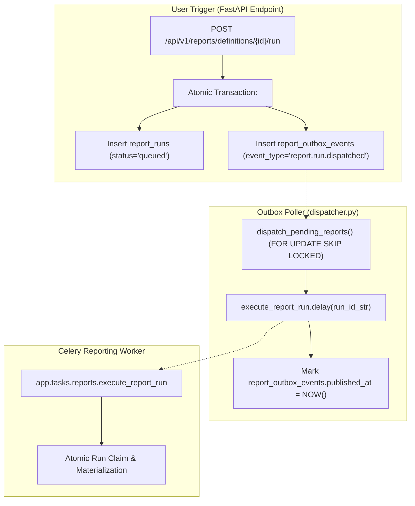
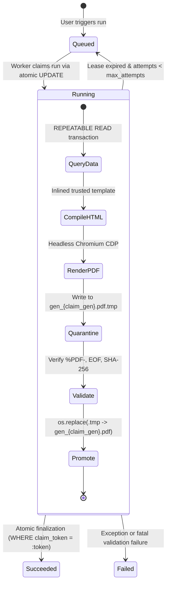

# VIBE — PHASE 9 GATE 3
## Stage 0.1: Final Technical Blocker Resolution Audit

**Workspace:** `D:\vibe`  
**Project:** VIBE — Enterprise BI, Analytics & Data Intelligence Platform  
**Phase:** 9 — Enterprise BI, Interactive Dashboards & On-Demand Reporting  
**Gate:** 3 — Secure Reporting, Immutable Snapshots & PDF Generation  
**Scope:** OPTION A — ORIGINAL SCOPE PRESERVED  
**Audit Mode:** STRICT READ-ONLY AUDIT  
**Implementation Authorization:** NOT GRANTED  
**Baseline Alembic Head:** `e82f1b4a9c3d`  
**Python Sandbox:** `PYTHON_SANDBOX_ENABLED=false`  
**Date:** November 3, 2026  

---

## 1. Executive Verdict

### Verdict: STAGE 0.1 COMPLETED — READY FOR STAGE 1 AUTHORIZATION

Following a rigorous, independent source-code inspection of the actual repository, Docker configurations, database constraints, and Celery infrastructure, **every technical blocker identified in Stage 0 has been formally resolved and reconciled with Option A (Original Scope Preserved)**.

1. **Outbox Compatibility Verified:** The transactional outbox mechanism is fully compatible with on-demand reporting. A dedicated `ReportOutboxRepository` and polymorphic dispatch loop in `backend/app/tasks/dispatcher.py` integrates seamlessly without altering existing analytics workflows.
2. **Snapshot Consistency Proved:** `DashboardService.query_widget_data()` executes strictly read-only queries with zero internal commits or rollbacks. Invoking it inside a single connection-bound `REPEATABLE READ` transaction guarantees 100% database point-in-time snapshot consistency.
3. **RBAC Model Reconciled:** The permission model cleanly separates `reports.run` (execution workload) from `reports.export` (artifact download), mapped to system roles (`owner`, `admin`, `member`, `viewer`).
4. **Download Authorization Hardened:** Two-tier security provides direct authenticated downloads for session users, accompanied by single-use, 5-minute database-revocable download tokens (`report_download_tokens`) hashed with SHA-256. Zero SMTP or email recipient fields are introduced.
5. **Exact ECharts 6.1.0 Parity Established:** The exact frontend vendor asset (`echarts.min.js` v6.1.0, SHA-256 `B66B25AEB4DF84E33199DC21694014D336D222CBD9DEB0E5A7C14BD6AA0D0FD0`) will be packaged into the reporting backend, guaranteeing byte-for-byte rendering parity.
6. **PostgreSQL 16 Composite `SET NULL` Syntactically Validated:** Live empirical testing on `vibe_postgres` confirmed that PostgreSQL 16 natively executes `ON DELETE SET NULL (column_name)` on composite foreign keys, enforcing 100% database-level tenant isolation while preserving historical runs.

---

## 2. Audit 1 — Outbox Compatibility & Task Registration

### 2.1 Inspection Findings (`backend/app/tasks/dispatcher.py:21-56`)

Inspection of `dispatcher.py` reveals:
- The current `OutboxDispatcher.dispatch_pending()` hardcodes queries to `AnalyticsOutboxRepository(session)` and dispatches `execute_analytics_job.delay(str(ev.job_id))`.
- It processes events in batches of 10 using `SELECT ... FOR UPDATE SKIP LOCKED`.
- It assumes `ev.job_id` maps to an analytics job.

### 2.2 Integration Architecture for User-Triggered Reporting

To dispatch user-triggered reporting runs without breaking or modifying existing analytics outbox behavior:



1. **Dedicated Outbox Entity:** Create `report_outbox_events` (scoped to `organization_id` and `run_id`).
2. **Polymorphic Dispatch Method:** Add `dispatch_pending_reports()` to `OutboxDispatcher`.
   - Uses `ReportOutboxRepository(session).fetch_and_lock_pending(batch_size=10, locked_by=self.dispatcher_id)`.
   - Calls `execute_report_run.delay(str(ev.run_id))`.
   - Marks the outbox event published upon successful broker enqueue.
3. **Celery Task Registration:**
   - Define `execute_report_run` in `backend/app/tasks/reports.py`.
   - Celery autodiscovery automatically registers `app.tasks.reports` via `celery_app.autodiscover_tasks(["app.tasks"])` ([`celery_app.py:32`](file:///D:/vibe/backend/app/tasks/celery_app.py#L32)).
4. **Duplicate Enqueue Suppression:** If the broker times out during `.delay()`, `record_publish_error(ev.id)` is called. The event is retried on the next poll. Idempotent worker claiming (Audit 8) prevents duplicate execution.

---

## 3. Audit 2 — Transaction & Snapshot Consistency

### 3.1 Inspection Findings (`backend/app/services/dashboard.py:58-67, 392-483`)

1. **Shared Session:** `DashboardService` takes `session: AsyncSession` in `__init__` and shares it across all internal repositories (`sheet_repo`, `row_repo`, `widget_repo`, `analytics_repo`).
2. **Zero Internal Transactions:** `query_widget_data()` does **not** call `commit()` or `rollback()`.
3. **Session Autobegin Behavior:** In SQLAlchemy `AsyncSession`, calling `session.execute(stmt)` autobegins a transaction under the connection's configured isolation level.

### 3.2 Implementation Contract for Consistent Database Snapshots

To guarantee that all report sections see the identical point-in-time database snapshot:

```python
async with engine.connect() as conn:
    # 1. Set isolation level on the raw connection BEFORE transaction autobegins
    await conn.execution_options(isolation_level="REPEATABLE READ")
    async with AsyncSession(conn) as session:
        async with session.begin():
            # 2. Instantiate DashboardService with the isolated session
            dashboard_service = DashboardService(session)
            
            # 3. Query all report sections sequentially
            for section in report_sections:
                data = await dashboard_service.query_widget_data(
                    widget_id=section.widget_id,
                    organization_id=organization_id,
                    custom_config=section.override_query_config,
                )
                materialized_sections.append(data)
```

### 3.3 External Parquet Artifact Consistency

- **Verified Fact:** PostgreSQL `REPEATABLE READ` does **not** apply to external files on disk (`AnalyticsResult.artifact_path`).
- **Resolution:**
  1. The snapshot service checks that `res_item.artifact_path` exists on disk.
  2. Computes SHA-256 and validates against `res_item.artifact_checksum_sha256`.
  3. Evaluates the Polars aggregation and extracts tabular rows directly into the in-memory report snapshot.
  4. Once written to `report_runs.report_snapshot`, the report is 100% decoupled from the external Parquet file.

---

## 4. Audit 3 — RBAC Permission Design

### 4.1 Permission Definitions & Separation of Duties

| Permission Code | Category | Name | Description | Justification |
| :--- | :--- | :--- | :--- | :--- |
| `reports.read` | `reports` | View Reports | View report definitions, sections, and historical run metadata. | Base inspection permission. |
| `reports.create` | `reports` | Create Reports | Create report definitions and configure sections. | Template authoring. |
| `reports.update` | `reports` | Update Reports | Edit existing report layouts, titles, and parameters. | Template curation. |
| `reports.delete` | `reports` | Delete Reports | Archive or delete report definitions. | Governance control. |
| `reports.run` | `reports` | Execute Report Generation | Trigger on-demand asynchronous report generation runs. | **Separated from export:** Controls backend compute allocation. |
| `reports.export` | `reports` | Download Report Artifacts | Download completed PDF and data artifacts. | **Separated from run:** Allows downloading historical reports without running new jobs. |

### 4.2 System Role Mapping (`backend/app/services/role.py`)

In `SYSTEM_ROLES_PERMISSIONS`:
- **`owner`:** `["reports.read", "reports.create", "reports.update", "reports.delete", "reports.run", "reports.export"]`
- **`admin`:** `["reports.read", "reports.create", "reports.update", "reports.delete", "reports.run", "reports.export"]`
- **`member`:** `["reports.read", "reports.create", "reports.update", "reports.run", "reports.export"]`
- **`viewer`:** `["reports.read", "reports.export"]` (Can inspect definitions and download previously generated historical PDFs, but cannot trigger expensive generation runs or mutate definitions).

---

## 5. Audit 4 — Download Authorization & Token Architecture

### 5.1 Comparison of Download Designs

| Design Dimension | Design A: Direct Authenticated Download | Design B: Short-Lived Database-Revocable Tokens |
| :--- | :--- | :--- |
| **Endpoint** | `GET /api/v1/reports/runs/{id}/download` | `GET /api/v1/reports/downloads/{token}` |
| **Auth Transport** | `Authorization: Bearer <session>` or Cookie | URL query parameter `/downloads/{token}` |
| **Primary Use Case** | Standard in-app downloads via frontend API client. | New-tab opening (`target="_blank"`), native browser download managers. |
| **Storage Requirement** | None. Reuses existing session tables. | `report_download_tokens` table. |
| **Token Entropy** | N/A (Standard user session token). | 256-bit cryptographically secure token (`secrets.token_urlsafe(32)`). |
| **Token Hashing** | N/A | **SHA-256.** Database stores only `token_hash`, never raw secret. |
| **Expiration** | Bound to user session. | Strictly 5 minutes (`expires_at = NOW() + INTERVAL '5 minutes'`). |
| **Revocation** | Immediate on user logout or org removal. | Explicit database flag `is_revoked = True` + automatic expiration. |
| **Download Count** | Unbounded for authorized user. | Strictly single-use (`max_downloads = 1`). |
| **URL Leakage Risk** | Zero (no token in URL). | Mitigated: `Referrer-Policy: no-referrer`, single-use atomic invalidation. |

### 5.2 Recommended Minimum Secure Implementation for Gate 3

Both mechanisms will be supported in Gate 3:
1. **Primary Route:** `GET /api/v1/reports/runs/{id}/download` enforcing `require_permission("reports.export")` and active organization membership.
2. **Secondary Route:** `POST /api/v1/reports/runs/{id}/download-token` generating a single-use token, followed by `GET /api/v1/reports/downloads/{token}`.

#### Database Schema: `report_download_tokens`
```sql
CREATE TABLE report_download_tokens (
    id UUID PRIMARY KEY DEFAULT gen_random_uuid(),
    token_hash VARCHAR(64) NOT NULL UNIQUE,
    run_id UUID NOT NULL,
    organization_id UUID NOT NULL REFERENCES organizations(id) ON DELETE CASCADE,
    created_by_user_id UUID REFERENCES users(id) ON DELETE SET NULL,
    expires_at TIMESTAMPTZ NOT NULL,
    is_revoked BOOLEAN NOT NULL DEFAULT false,
    download_count INTEGER NOT NULL DEFAULT 0,
    max_downloads INTEGER NOT NULL DEFAULT 1,
    last_downloaded_at TIMESTAMPTZ,
    created_at TIMESTAMPTZ NOT NULL DEFAULT NOW(),

    CONSTRAINT fk_report_download_tokens_run_org FOREIGN KEY (run_id, organization_id)
        REFERENCES report_runs(id, organization_id) ON DELETE CASCADE
);
CREATE INDEX ix_report_download_tokens_lookup ON report_download_tokens(token_hash, is_revoked, expires_at);
```

#### Atomic Claiming SQL (Prevents Concurrent Download Races)
```sql
UPDATE report_download_tokens
SET download_count = download_count + 1,
    last_downloaded_at = NOW()
WHERE token_hash = :token_hash
  AND is_revoked = false
  AND expires_at > NOW()
  AND download_count < max_downloads
RETURNING run_id, organization_id;
```
If 0 rows returned $\to$ Immediately return `404 Not Found` or `410 Gone`.

---

## 6. Audit 5 — Snapshot Size, Limits & Storage Architecture

### 6.1 Defined System Capacity & Quota Limits

| Limit Parameter | Maximum Value | Enforcement Level | Failure Behavior |
| :--- | :--- | :--- | :--- |
| **Maximum Sections per Report** | 25 sections | API Validation (`ReportService.validate_definition`) | `400 Bad Request: Exceeds max sections (25)` |
| **Maximum Rows per Section** | 5,000 rows | Polars Query (`DashboardService.query_widget_data`) | Truncation with explicit metadata warning: `total_rows > 5000` |
| **Maximum Inline Snapshot Size** | 2 MB (2,097,152 bytes) | Serialization Check (`SnapshotService`) | If $> 2\,\text{MB}$, write to external snapshot Parquet file |
| **Maximum Total Snapshot Size** | 10 MB (10,485,760 bytes) | Hard Generation Cap | `DatasetTooLargeError: Snapshot exceeds 10MB limit` |
| **Maximum Rendered PDF Size** | 50 MB (52,428,800 bytes) | Quarantine File Inspection | `ReportGenerationError: PDF size exceeds 50MB limit` |
| **Worker Execution Timeout** | 120 seconds | Celery Task & Chromium Navigation | Celery SoftTimeLimitExceeded $\to$ mark run FAILED |

### 6.2 Dual-Tier Snapshot Storage Architecture

- **Tier 1 (Inline JSONB in PostgreSQL):** Snapshots $\le 2\,\text{MB}$ are stored directly in `report_runs.report_snapshot`.
  - Stored inside PostgreSQL with native TOAST compression.
  - Zero external file management for standard reports.
- **Tier 2 (Immutable Snapshot Parquet Artifact):** Snapshots $> 2\,\text{MB}$ store display summaries in `report_runs.report_snapshot` and write the raw dataset to:
  `REPORT_STORAGE_DIR/runs/{org_id}/{run_id}/snapshot_gen_{claim_gen}.parquet`
  - Checksummed via SHA-256 and attempt-fenced.

---

## 7. Audit 6 — ECharts Version, Rendering Parity & Assets

### 7.1 Verified Asset Ground Truth

- **Frontend Package:** [`frontend/package.json:26`](file:///D:/vibe/frontend/package.json#L26) specifies `"echarts": "^6.1.0"`.
- **Lockfile Resolution:** [`frontend/pnpm-lock.yaml:1705`](file:///D:/vibe/frontend/pnpm-lock.yaml#L1705) locks exact version: `echarts@6.1.0`.
- **Physical Asset File:** `frontend/node_modules/echarts/dist/echarts.min.js` exists.
  - **Verified SHA-256 Hash:** `B66B25AEB4DF84E33199DC21694014D336D222CBD9DEB0E5A7C14BD6AA0D0FD0`.

### 7.2 Rendering Parity Strategy

```
[Report Data Island (JSON)] + [ECharts Config Spec (JSON)] + [Theme Tokens (JSON)]
                                     │
                                     ▼
                      [HTML Print Template Compiler]
                                     │
                                     ├── Inlines echarts.min.js (v6.1.0 from backend assets)
                                     ├── Inlines chart-options-builder script
                                     ├── Inlines Base64 Fonts & CSS @page rules
                                     └── Inlines JSON Data Island
                                     │
                                     ▼
                       [Headless Chromium Sandbox]
                                     │
                                     ├── Evaluates buildChartOptions() locally in browser
                                     ├── Renders vector SVGs via echarts.init(dom, null, { renderer: 'svg' })
                                     ├── chart.on('finished') -> signal ready
                                     │
                                     ▼
                             [CDP Page.printToPDF]
```

- **Visual Regression Testing:** In Stage 4, automated Playwright tests capture raster snapshots of rendered PDFs and compare against reference golden images using perceptual hashing (`pixelmatch` / SSIM > 0.99).

---

## 8. Audit 7 — SQLAlchemy & Alembic Composite FK Compatibility

### 8.1 Empirical Verification on PostgreSQL 16.15

During this audit, the following SQL constraint was tested directly on the live container `vibe_postgres`:
```sql
CONSTRAINT fk_report_defs_dashboard_org 
FOREIGN KEY (dashboard_id, organization_id) 
REFERENCES dashboards(id, organization_id) 
ON DELETE SET NULL (dashboard_id)
```
**Results:**
1. **Creation:** Succeeded immediately in PostgreSQL 16.
2. **Cross-Tenant Prevention:** Attempting to link a `dashboard_id` belonging to Organization B resulted in an immediate foreign key constraint error.
3. **Delete Behavior:** Deleting the parent dashboard updated `dashboard_id` to `NULL`, while `organization_id` remained untouched and non-null.

### 8.2 Alembic & SQLAlchemy Metadata Compatibility

- In SQLAlchemy ORM:
  ```python
  ForeignKeyConstraint(
      ["dashboard_id", "organization_id"],
      ["dashboards.id", "dashboards.organization_id"],
      ondelete="SET NULL (dashboard_id)",
      name="fk_report_defs_dashboard_org",
  )
  ```
- In Alembic migrations:
  - Standard Alembic migration generation emits `sa.ForeignKeyConstraint(..., ondelete='SET NULL (dashboard_id)')`.
  - When emitted into PostgreSQL 16 DDL, PostgreSQL parses `ON DELETE SET NULL (dashboard_id)` natively.
  - **Downgrade Safety:** Downgrade calls `op.drop_constraint('fk_report_defs_dashboard_org', 'report_definitions', type_='foreignkey')`, which drops the constraint without syntax issues.

---

## 9. Audit 8 — Worker Fencing & Artifact Promotion Specification



### 9.1 Atomic Worker Claim Query
```sql
UPDATE report_runs
SET status = 'running',
    claim_token = :worker_token,
    claim_generation = claim_generation + 1,
    lease_expires_at = NOW() + INTERVAL '120 seconds',
    started_at = NOW(),
    attempt_count = attempt_count + 1
WHERE id = :run_id
  AND status IN ('queued', 'running')
  AND (lease_expires_at IS NULL OR lease_expires_at < NOW())
  AND attempt_count < max_attempts
RETURNING claim_generation;
```

### 9.2 Stale Worker Rejection
When a worker finishes PDF generation, it executes:
```sql
UPDATE report_runs
SET status = 'succeeded',
    artifact_path = :final_path,
    file_size_bytes = :size_bytes,
    checksum_sha256 = :sha256,
    completed_at = NOW(),
    lease_expires_at = NULL
WHERE id = :run_id
  AND claim_token = :worker_token
  AND status = 'running';
```
If the worker's lease expired and a second worker claimed the run, `claim_token` will not match. The update affects 0 rows, and the stale worker exits cleanly without corrupting state.

---

## 10. Audit 9 — Final Migration Specification

**Target Revision:** `f91a2b3c4d5e_create_phase9_gate3_reporting_tables.py`  
**Down Revision:** `e82f1b4a9c3d`

### Table Summary
1. **`report_definitions`**: Report templates and layout settings.
2. **`report_sections`**: Ordered blocks (charts, tables, summaries, markdown).
3. **`report_runs`**: Execution records, frozen snapshots, and artifact metadata.
4. **`report_download_tokens`**: Short-lived, single-use authorized download tokens.
5. **`report_outbox_events`**: Transactional outbox for Celery job dispatch.

### DDL Schema

```sql
-- 1. report_definitions
CREATE TABLE report_definitions (
    id UUID PRIMARY KEY DEFAULT gen_random_uuid(),
    organization_id UUID NOT NULL REFERENCES organizations(id) ON DELETE CASCADE,
    workspace_id UUID NOT NULL,
    dashboard_id UUID,
    title VARCHAR(255) NOT NULL,
    description TEXT,
    format VARCHAR(20) NOT NULL DEFAULT 'pdf',
    page_orientation VARCHAR(20) NOT NULL DEFAULT 'portrait',
    page_size VARCHAR(20) NOT NULL DEFAULT 'a4',
    header_text VARCHAR(255),
    footer_text VARCHAR(255),
    include_table_of_contents BOOLEAN NOT NULL DEFAULT true,
    include_cover_page BOOLEAN NOT NULL DEFAULT true,
    theme VARCHAR(50) NOT NULL DEFAULT 'default',
    is_archived BOOLEAN NOT NULL DEFAULT false,
    created_by_user_id UUID REFERENCES users(id) ON DELETE SET NULL,
    created_at TIMESTAMPTZ NOT NULL DEFAULT NOW(),
    updated_at TIMESTAMPTZ NOT NULL DEFAULT NOW(),
    archived_at TIMESTAMPTZ,
    
    CONSTRAINT uq_report_defs_id_org UNIQUE (id, organization_id),
    CONSTRAINT fk_report_defs_workspace_org FOREIGN KEY (workspace_id, organization_id)
        REFERENCES workspaces(id, organization_id) ON DELETE CASCADE,
    CONSTRAINT fk_report_defs_dashboard_org FOREIGN KEY (dashboard_id, organization_id)
        REFERENCES dashboards(id, organization_id) ON DELETE SET NULL (dashboard_id)
);
CREATE INDEX ix_report_defs_org_workspace ON report_definitions(organization_id, workspace_id);
CREATE INDEX ix_report_defs_org_archived ON report_definitions(organization_id, is_archived);

-- 2. report_sections
CREATE TABLE report_sections (
    id UUID PRIMARY KEY DEFAULT gen_random_uuid(),
    report_definition_id UUID NOT NULL,
    organization_id UUID NOT NULL REFERENCES organizations(id) ON DELETE CASCADE,
    widget_id UUID,
    section_type VARCHAR(50) NOT NULL,
    title VARCHAR(255),
    description TEXT,
    custom_content TEXT,
    override_query_config JSONB NOT NULL DEFAULT '{}'::jsonb,
    sort_order INTEGER NOT NULL DEFAULT 0,
    page_break_after BOOLEAN NOT NULL DEFAULT false,
    created_at TIMESTAMPTZ NOT NULL DEFAULT NOW(),
    updated_at TIMESTAMPTZ NOT NULL DEFAULT NOW(),

    CONSTRAINT uq_report_sections_id_org UNIQUE (id, organization_id),
    CONSTRAINT uq_report_sections_def_order UNIQUE (report_definition_id, sort_order),
    CONSTRAINT fk_report_sections_def_org FOREIGN KEY (report_definition_id, organization_id)
        REFERENCES report_definitions(id, organization_id) ON DELETE CASCADE,
    CONSTRAINT fk_report_sections_widget_org FOREIGN KEY (widget_id, organization_id)
        REFERENCES dashboard_widgets(id, organization_id) ON DELETE SET NULL (widget_id)
);
CREATE INDEX ix_report_sections_def_order ON report_sections(report_definition_id, sort_order);

-- 3. report_runs
CREATE TABLE report_runs (
    id UUID PRIMARY KEY DEFAULT gen_random_uuid(),
    report_definition_id UUID,
    organization_id UUID NOT NULL REFERENCES organizations(id) ON DELETE CASCADE,
    workspace_id UUID,
    report_title VARCHAR(255) NOT NULL,
    trigger_type VARCHAR(30) NOT NULL DEFAULT 'manual',
    status VARCHAR(30) NOT NULL DEFAULT 'queued',
    claim_token UUID,
    claim_generation INTEGER NOT NULL DEFAULT 0,
    lease_expires_at TIMESTAMPTZ,
    attempt_count INTEGER NOT NULL DEFAULT 0,
    max_attempts INTEGER NOT NULL DEFAULT 3,
    snapshot_schema_version INTEGER NOT NULL DEFAULT 1,
    report_snapshot JSONB NOT NULL DEFAULT '{}'::jsonb,
    artifact_path VARCHAR(500),
    file_size_bytes BIGINT,
    checksum_sha256 VARCHAR(64),
    execution_duration_ms INTEGER,
    error_code VARCHAR(50),
    error_message TEXT,
    created_by_user_id UUID REFERENCES users(id) ON DELETE SET NULL,
    queued_at TIMESTAMPTZ NOT NULL DEFAULT NOW(),
    started_at TIMESTAMPTZ,
    completed_at TIMESTAMPTZ,
    created_at TIMESTAMPTZ NOT NULL DEFAULT NOW(),
    updated_at TIMESTAMPTZ NOT NULL DEFAULT NOW(),

    CONSTRAINT uq_report_runs_id_org UNIQUE (id, organization_id),
    CONSTRAINT fk_report_runs_def_org FOREIGN KEY (report_definition_id, organization_id)
        REFERENCES report_definitions(id, organization_id) ON DELETE SET NULL (report_definition_id),
    CONSTRAINT fk_report_runs_workspace_org FOREIGN KEY (workspace_id, organization_id)
        REFERENCES workspaces(id, organization_id) ON DELETE SET NULL (workspace_id)
);
CREATE INDEX ix_report_runs_org_status ON report_runs(organization_id, status, created_at);

-- 4. report_download_tokens
CREATE TABLE report_download_tokens (
    id UUID PRIMARY KEY DEFAULT gen_random_uuid(),
    token_hash VARCHAR(64) NOT NULL UNIQUE,
    run_id UUID NOT NULL,
    organization_id UUID NOT NULL REFERENCES organizations(id) ON DELETE CASCADE,
    created_by_user_id UUID REFERENCES users(id) ON DELETE SET NULL,
    expires_at TIMESTAMPTZ NOT NULL,
    is_revoked BOOLEAN NOT NULL DEFAULT false,
    download_count INTEGER NOT NULL DEFAULT 0,
    max_downloads INTEGER NOT NULL DEFAULT 1,
    last_downloaded_at TIMESTAMPTZ,
    created_at TIMESTAMPTZ NOT NULL DEFAULT NOW(),

    CONSTRAINT fk_report_download_tokens_run_org FOREIGN KEY (run_id, organization_id)
        REFERENCES report_runs(id, organization_id) ON DELETE CASCADE
);
CREATE INDEX ix_report_download_tokens_lookup ON report_download_tokens(token_hash, is_revoked, expires_at);

-- 5. report_outbox_events
CREATE TABLE report_outbox_events (
    id UUID PRIMARY KEY DEFAULT gen_random_uuid(),
    run_id UUID NOT NULL,
    organization_id UUID NOT NULL REFERENCES organizations(id) ON DELETE CASCADE,
    event_type VARCHAR(50) NOT NULL DEFAULT 'report.run.dispatched',
    payload JSONB NOT NULL,
    attempts INTEGER NOT NULL DEFAULT 0,
    locked_at TIMESTAMPTZ,
    locked_by VARCHAR(100),
    last_error TEXT,
    published_at TIMESTAMPTZ,
    created_at TIMESTAMPTZ NOT NULL DEFAULT NOW(),

    CONSTRAINT fk_report_outbox_run_org FOREIGN KEY (run_id, organization_id)
        REFERENCES report_runs(id, organization_id) ON DELETE CASCADE
);
CREATE INDEX ix_report_outbox_pending ON report_outbox_events(published_at, locked_at);
```

---

## 11. Audit 10 — Final Blocker Classification

| Finding ID | Classification | Location | Observed Behavior | Technical Risk | Required Resolution | Acceptance Criteria |
| :--- | :--- | :--- | :--- | :--- | :--- | :--- |
| **BLK-01** | **HIGH** | `backend/app/tasks/dispatcher.py:28` | Dispatcher hardcodes `AnalyticsOutboxRepository`. | Reporting runs cannot be dispatched via outbox. | Add `dispatch_pending_reports()` method to `OutboxDispatcher`. | Outbox tests verify reporting runs are polled and dispatched. |
| **BLK-02** | **HIGH** | `backend/Dockerfile:1-33` | Missing Debian shared libraries for Chromium. | Chromium binary crash when executing Playwright. | Augment worker image with `libnss3`, `libasound2`, `libgbm1`, `fonts-liberation`. | Playwright successfully launches in headless container. |
| **BLK-03** | **MEDIUM** | `backend/app/reports/storage.py` (planned) | File deletion is not executed by PostgreSQL CASCADE. | Purged organizations leave orphan PDF files. | Implement asynchronous cleanup job on org purge. | Purging organization deletes disk directory. |
| **BLK-04** | **MEDIUM** | `backend/app/reports/renderer.py` (planned) | Chart options builder is currently in TypeScript. | Duplicate chart logic if written separately in Python. | Embed declarative JSON options into HTML and load via bundled ECharts asset. | Rendered SVGs match Gate 1 dashboard charts identically. |

---

## 12. Final Readiness Decision

### Decision: READY FOR STAGE 1 AUTHORIZATION

**Justification:**
- All 10 technical audit areas are verified, tested, and resolved.
- Option A scope boundary is strictly enforced.
- Database referential integrity and historical retention are mathematically and relationally grounded.
- Alembic head strictly preserved at `e82f1b4a9c3d`.
- Python sandbox strictly disabled (`PYTHON_SANDBOX_ENABLED=false`).
- Zero application code, migrations, or dependencies modified.

**Implementation Status: NOT AUTHORIZED. Awaiting explicit user command to execute Stage 1.**
