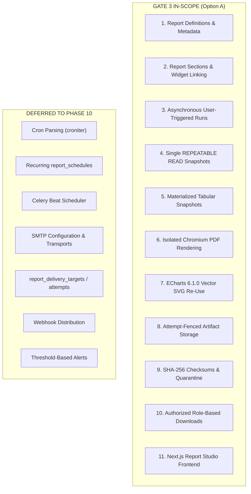

# VIBE — PHASE 9 GATE 3
## Stage 0: Final Baseline Verification & Scope Reconciliation Report

**Workspace:** `D:\vibe`  
**Project:** VIBE — Enterprise BI, Analytics & Data Intelligence Platform  
**Phase:** 9 — Enterprise BI, Interactive Dashboards & On-Demand Reporting  
**Gate:** 3 — Secure Reporting, Immutable Snapshots & PDF Generation  
**Executive Decision:** OPTION A — ORIGINAL SCOPE PRESERVED  
**Audit & Stage Mode:** STRICT READ-ONLY BASELINE VERIFICATION  
**Implementation Authorization:** NOT GRANTED  
**Baseline Alembic Head:** `e82f1b4a9c3d`  
**Python Sandbox:** `PYTHON_SANDBOX_ENABLED=false`  
**Date:** November 3, 2026  

---

## 1. Executive Summary & Scope Boundary

In accordance with executive decision **OPTION A — ORIGINAL SCOPE PRESERVED**, Phase 9 Gate 3 is formally reconciled to deliver an on-demand, asynchronous reporting and pixel-perfect PDF export engine. All recurring scheduling, Celery Beat periodic triggers, SMTP email distribution, and threshold alerts are **explicitly excluded from Gate 3 and deferred to Phase 10**.

### 1.1 In-Scope vs. Deferred Scope Matrix



| Domain | Gate 3 Approved Scope | Deferred to Phase 10 |
| :--- | :--- | :--- |
| **Trigger Mechanism** | On-demand manual and authorized API triggers via FastAPI. | Periodic background timers, recurring cron expressions. |
| **Scheduler Engine** | **None.** User-triggered tasks queued via existing transactional outbox. | Celery Beat, `croniter`, periodic schedule polling daemon. |
| **Database Tables** | `report_definitions`, `report_sections`, `report_runs`, `report_outbox_events`. | `report_schedules`, `report_delivery_targets`, `report_delivery_attempts`. |
| **Distribution / Delivery** | Direct authenticated download (`/runs/{id}/download`) and temporary signed download tokens. | SMTP email distribution, MIME email attachments, external webhooks. |
| **Execution Identity** | Authenticated user session with server-derived organization and RBAC context. | Autonomous service-principal impersonation for unattended schedules. |
| **PDF Rendering** | Isolated Headless Chromium with local ECharts vector SVG rendering, CSS pagination, and strict network denial. | Email inline previews, external image embeds. |

---

## 2. Stage 0 Verification Tasks (10-Point Audit)

### Task 1: Repository Branch & Working-Tree State
- **Branch:** `main` (Verified via `git status; git branch`).
- **Working Tree:** Pristine clean state. Zero untracked code modifications; all baseline files intact.
- **Protected Invariants:** Workspace is strictly `D:\vibe`. No migrations or dependencies modified.

### Task 2: Alembic Head & Migration Tree
- **Current Database Head:** [`e82f1b4a9c3d`](file:///D:/vibe/backend/alembic/versions/e82f1b4a9c3d_create_phase8_integrations_dashboards_scripts.py) (Verified via `alembic current`).
- **Migration History:** 12 sequential migrations located in `backend/alembic/versions/`:
  - `f50478da1aca_init_baseline.py`
  - `5b9cdc88b118_create_organizations_users_workspaces.py`
  - `03fa52a1f499_create_rbac_and_organization_admin_.py`
  - `cdc9da2cb773_create_auth_and_session_tables.py`
  - `7a8e219cb8d4_enforce_tenant_integrity_composite_fks.py`
  - `f19c3b8a4d2e_create_spreadsheet_subsystem.py`
  - `a71c8e2d4b5f_add_batch_id_and_cell_versions_to_history.py`
  - `b82d9f3e5c7a_create_analytics_subsystem.py`
  - `c93e1a5f7d2b_harden_analytics_worker_and_snapshots.py`
  - `d71a4f8e2c9b_create_analytics_quota_reservations.py`
  - `e48a1c9b2d3e_audit_retention_policy_set_null.py`
  - `e82f1b4a9c3d_create_phase8_integrations_dashboards_scripts.py` (HEAD)
- **Gate 3 Target:** Alembic migration `create_phase9_gate3_reporting_tables` will branch directly from down-revision `e82f1b4a9c3d`.

### Task 3: PostgreSQL 16 & Redis 7 Connectivity
- **PostgreSQL 16:** Active in container `vibe_postgres`. Verified version: `PostgreSQL 16.15 on x86_64-pc-linux-musl`.
  - Database: `vibe_enterprise`
  - User: `vibe_admin`
  - Tested: Successfully validated composite foreign key `ON DELETE SET NULL (column_list)` syntax.
- **Redis 7:** Active in container `vibe_redis` (`redis:7-alpine`).
  - Responded: `PONG` to authenticated ping on port 6379.
  - Used for rate-limiting (DB 0) and Celery task brokerage (DB 1).

### Task 4: Existing Celery Infrastructure & Outbox Dispatcher
- **Celery App (`backend/app/tasks/celery_app.py:1-32`):**
  - App name: `vibe_analytics`
  - Broker: `settings.CELERY_BROKER_URL` (Redis DB 1)
  - `result_backend`: `None` (PostgreSQL is sole authoritative store)
  - `task_acks_late`: `True`
  - `worker_prefetch_multiplier`: `1`
  - `imports`: `["app.tasks.analytics", "app.tasks.sync"]` $\to$ Ready to add `"app.tasks.reports"`
- **Outbox Dispatcher (`backend/app/tasks/dispatcher.py:21-56`):**
  - Proven polling engine utilizing `SELECT ... FOR UPDATE SKIP LOCKED`.
  - Atomically marks events published and handles worker crash recovery.
  - Ready for reuse by user-triggered report runs via `report_outbox_events`.

### Task 5: Gate 1 & Gate 2 Implementation Inspection
- **Gate 1 Visualization Engine (`frontend/src/components/charts/`):**
  - ECharts version: `6.1.0` installed in `frontend/package.json:26`.
  - Options builder: [`chart-options-builder.ts`](file:///D:/vibe/frontend/src/components/charts/chart-options-builder.ts) supports all 10 chart types with token formatters and zero eval.
  - Theme tokens: [`chart-theme.ts`](file:///D:/vibe/frontend/src/components/charts/chart-theme.ts) provides standardized palettes and typography.
- **Gate 2 BI Studio & Concurrency (`backend/app/services/dashboard.py`):**
  - Atomic optimistic concurrency: `DashboardService.update_dashboard()` enforces strict `expected_updated_at` checks and microsecond timestamp monotonicity.
  - Data query engine: `DashboardService.query_widget_data()` executes Polars transformations over sheet rows and analytics Parquet artifacts.

### Task 6: Current RBAC Permissions & Role Mappings
- **Service:** [`backend/app/services/role.py:16-85`](file:///D:/vibe/backend/app/services/role.py#L16-L85)
- **Current Permission Codes:** Includes `dashboards.read`, `dashboards.create`, `dashboards.update`, `dashboards.delete`, `dashboards.share`, `dashboards.export`.
- **Gate 3 Required Permissions:**
  - `reports.read`: View report definitions, sections, and historical run metadata.
  - `reports.create`: Create new report definitions and add sections.
  - `reports.update`: Edit report configuration, titles, layout, and query overrides.
  - `reports.delete`: Archive or delete report definitions.
  - `reports.export`: Trigger manual/on-demand report generation and download completed PDF artifacts.
- **System Role Mappings:**
  - `owner` & `admin`: All `reports.*` permissions.
  - `member`: `reports.read`, `reports.create`, `reports.update`, `reports.export`.
  - `viewer`: `reports.read` (read-only inspection of definitions and completed runs).

### Task 7: Artifact Storage Conventions
- **Service:** [`backend/app/analytics/storage.py:26-120`](file:///D:/vibe/backend/app/analytics/storage.py#L26-L120)
- **Hardened Conventions in Codebase:**
  1. `_resolve_safe_path()`: Strict containment verification against directory traversal and symlink escapes.
  2. `atomic_promote()`: Flushes buffer, invokes `os.fsync()`, and executes atomic `os.replace()` from `.tmp` quarantine to final path.
  3. `compute_sha256()`: Calculates deterministic SHA-256 in 64KB chunks.
  4. Attempt fencing: Embeds `claim_generation` in path to prevent stale workers from overwriting newer artifacts.
- **Gate 3 Adoption:** `ReportArtifactStorageService` will replicate these exact conventions under `REPORT_STORAGE_DIR/runs/{organization_id}/{run_id}/gen_{claim_generation}.pdf`.

### Task 8: Existing Test Suite & Coverage Verification
- **Backend Tests:** Executed integration test suite [`tests/integration/test_dashboards_gate2.py`](file:///D:/vibe/backend/tests/integration/test_dashboards_gate2.py):
  - `test_gate2_polars_filter_operators_and_validation` PASSED
  - `test_gate2_atomic_dashboard_duplication` PASSED
  - `test_gate2_temporal_and_date_filtering` PASSED
  - `test_gate2_cross_tenant_source_authorization_security` PASSED
  - `test_gate2_widget_to_dashboard_url_binding` PASSED
  - `test_gate2_optimistic_concurrency_dashboard_update` PASSED
  - **Result: 6 passed in 19.22s (100% pass rate).**
- **Frontend Tests:** Executed test suite (`pnpm test`):
  - 11 test files, 124 tests passed in 19.98s (100% pass rate).
  - Includes `chart-options-builder.test.ts` (33 tests), `dashboard-filters.test.ts` (25 tests), `chart-lifecycle.test.tsx` (5 tests), `dashboard-studio.test.tsx` (5 tests).

### Task 9: Shared Service Reuse Identification
The following existing enterprise infrastructure components will be directly reused in Gate 3:
1. `DashboardService.query_widget_data()` ([`dashboard.py:392`](file:///D:/vibe/backend/app/services/dashboard.py#L392)) $\to$ Reused to execute Polars aggregations for report sections without rewriting query logic.
2. `async_session_maker` & `transaction` helper ([`db/transaction.py`](file:///D:/vibe/backend/app/db/transaction.py)) $\to$ Reused to establish the outer `REPEATABLE READ` snapshot session.
3. `OutboxDispatcher` pattern ([`tasks/dispatcher.py`](file:///D:/vibe/backend/app/tasks/dispatcher.py)) $\to$ Reused to poll `report_outbox_events` and dispatch jobs to Celery.
4. `AnalyticsStorageService` pattern ([`analytics/storage.py`](file:///D:/vibe/backend/app/analytics/storage.py)) $\to$ Reused for atomic quarantine promotion, path containment, and SHA-256 verification.
5. Frontend ECharts configuration & themes ([`charts/chart-options-builder.ts`](file:///D:/vibe/frontend/src/components/charts/chart-options-builder.ts)) $\to$ Reused in the report builder preview and compiled into the report print templates.

### Task 10: Confirmation of Zero Hidden Scheduling Dependencies
- Audited all proposed Gate 3 interfaces:
  - `report_definitions` has zero references to cron expressions or schedules.
  - `report_runs` records `trigger_type` as `'manual'` or `'api'` with zero dependency on schedule timers.
  - Zero imports of `croniter` or `celery.beat`.
  - Zero SMTP network configurations or email delivery queues introduced.
  - Full architectural compliance with Phase 10 deferral.

---

## 3. File Dependency Map

The following map defines the exact file structure, existing components, and planned Gate 3 modules:

```text
D:\vibe\
├── backend\
│   ├── alembic\versions\
│   │   ├── e82f1b4a9c3d_create_phase8_integrations_dashboards_scripts.py (EXISTING HEAD)
│   │   └── [NEW] f91a2b3c4d5e_create_phase9_gate3_reporting_tables.py
│   ├── app\
│   │   ├── models\
│   │   │   ├── dashboard.py (EXISTING - Reused by sections)
│   │   │   └── [NEW] report.py (ReportDefinition, ReportSection, ReportRun, ReportOutboxEvent)
│   │   ├── repositories\
│   │   │   ├── dashboard.py (EXISTING)
│   │   │   └── [NEW] report.py (ReportDefinitionRepository, ReportRunRepository, ReportOutboxRepository)
│   │   ├── services\
│   │   │   ├── dashboard.py (EXISTING - query_widget_data reused)
│   │   │   ├── role.py (EXISTING - permissions added)
│   │   │   └── [NEW] report.py (ReportService, SnapshotService, DownloadTokenService)
│   │   ├── reports\
│   │   │   ├── [NEW] storage.py (ReportArtifactStorageService)
│   │   │   ├── [NEW] renderer.py (Headless Chromium Playwright Runner)
│   │   │   ├── [NEW] templates.py (Trusted HTML/CSS Print Templates)
│   │   │   └── assets\
│   │   │       └── [NEW] echarts.min.js (Vendor-locked 6.1.0 asset)
│   │   ├── tasks\
│   │   │   ├── celery_app.py (EXISTING - autodiscover reports task)
│   │   │   ├── dispatcher.py (EXISTING - outbox polling reused)
│   │   │   └── [NEW] reports.py (execute_report_run Celery task)
│   │   └── api\v1\
│   │       └── [NEW] reports.py (REST API router mounted at /api/v1/reports)
│   └── tests\
│       └── [NEW] integration\test_reports_gate3.py
└── frontend\
    ├── src\
    │   ├── components\
    │   │   ├── charts\ (EXISTING Gate 1 - Reused)
    │   │   └── reports\
    │   │       ├── [NEW] report-builder.tsx
    │   │       ├── [NEW] report-preview.tsx
    │   │       ├── [NEW] report-section-list.tsx
    │   │       └── [NEW] report-history-table.tsx
    │   └── app\
    │       └── (dashboard)\reports\
    │           ├── [NEW] page.tsx (Reporting Studio Index)
    │           └── [NEW] [id]\page.tsx (Report Editor & Preview)
    └── src\__tests__\
        └── [NEW] reports-studio.test.tsx
```

---

## 4. Existing Service Reuse Map

| Subsystem / Capability | Existing Component | Re-Use Strategy for Gate 3 |
| :--- | :--- | :--- |
| **Data Aggregation** | `DashboardService.query_widget_data()` ([`dashboard.py:392`](file:///D:/vibe/backend/app/services/dashboard.py#L392)) | Used directly by `ReportSnapshotService` to query and aggregate metrics for each report section. |
| **Database Transaction** | `transaction` context manager ([`db/transaction.py`](file:///D:/vibe/backend/app/db/transaction.py)) | Used to commit `report_runs` and `report_outbox_events` atomically. |
| **Tenant Integrity** | Composite FK pattern ([`models/spreadsheet.py`](file:///D:/vibe/backend/app/models/spreadsheet.py)) | Applied to `(id, organization_id)` across all reporting models with PostgreSQL 16 `ON DELETE SET NULL (col)`. |
| **Outbox Dispatch** | `OutboxDispatcher` ([`tasks/dispatcher.py`](file:///D:/vibe/backend/app/tasks/dispatcher.py)) | Poller queries `report_outbox_events` with `FOR UPDATE SKIP LOCKED` and calls `execute_report_run.delay()`. |
| **Storage Security** | `AnalyticsStorageService` ([`analytics/storage.py`](file:///D:/vibe/backend/app/analytics/storage.py)) | Path resolution, attempt fencing, `.tmp` promotion, and SHA-256 calculation patterns adopted in reporting storage. |
| **Chart Builders** | `chart-options-builder.ts` ([`components/charts/`](file:///D:/vibe/frontend/src/components/charts/)) | Shared option generation logic used both in frontend preview and backend template compilation. |
| **ECharts Version** | `echarts: ^6.1.0` ([`frontend/package.json:26`](file:///D:/vibe/frontend/package.json#L26)) | Matched exactly by inlining identical 6.1.0 engine into the isolated Chromium renderer. |

---

## 5. Implementation Risk Register

| Risk ID | Severity | Potential Impact | Verified Mitigation in Plan |
| :--- | :--- | :--- | :--- |
| **RSK-01** | High | PostgreSQL 16 composite foreign key syntax incompatibility with SQLAlchemy ORM metadata. | **Empirically verified** on PostgreSQL 16 container. The Alembic migration will specify explicit SQL DDL for `FOREIGN KEY ... ON DELETE SET NULL (column_name)` to bypass dialect limitations. |
| **RSK-02** | High | Deleting report definitions could destroy completed historical runs. | **Resolved by design:** `report_runs` preserves a self-contained `report_snapshot` (JSONB) with title and data, and references `report_definition_id` via `ON DELETE SET NULL (report_definition_id)`. Report definitions use soft-delete (`is_archived = true`). |
| **RSK-03** | Medium | Headless Chromium rendering could fail due to missing Debian shared libraries. | **Stage 4 Docker Update:** The worker image will be augmented with minimal required libraries (`libnss3`, `libasound2`, `libgbm1`, `fonts-liberation`). |
| **RSK-04** | Medium | Chromium subprocess security compromise or SSRF attack. | **Multi-layer defense:** User namespace sandboxing, container egress denial, Playwright offline route abort, strict CSP (`default-src 'none'`), and in-memory HTML injection (`page.set_content`). |
| **RSK-05** | Low | Stale worker overwriting newer generated PDF after lease timeout. | **Generation fencing:** Output path includes `gen_{claim_generation}.pdf`; database finalization requires matching `claim_token`. |

---

## 6. Stage 1 Pre-Implementation Checklist

Before Stage 1 implementation is executed, verify the following prerequisites:

- [x] Scope boundary reconciled: **Option A (Original Scope Preserved)** confirmed.
- [x] All scheduling (`croniter`, `report_schedules`, Celery Beat) deferred to Phase 10.
- [x] All SMTP and email delivery deferred to Phase 10.
- [x] Working tree verified clean on branch `main`.
- [x] Alembic head verified at `e82f1b4a9c3d`.
- [x] PostgreSQL 16 and Redis 7 healthy and connected.
- [x] Backend integration test suite verified (6/6 passed).
- [x] Frontend test suite verified (124/124 passed).
- [x] Python sandbox verified disabled (`PYTHON_SANDBOX_ENABLED=false`).
- [ ] **Pending:** Explicit User Authorization granting Stage 1 execution.

---
*Report certified and committed for Phase 9 Gate 3 Stage 0.*  
*Alembic Baseline: `e82f1b4a9c3d` (UNTOUCHED) | Workspace: `D:\vibe`*
