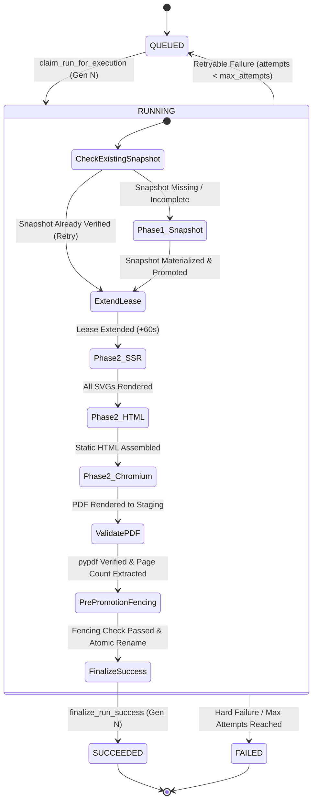

# VIBE — PHASE 9 GATE 3
# STAGE 3.1: ARCHITECTURE CORRECTION & IMPLEMENTATION READINESS AUDIT

**Workspace:** `D:\vibe`  
**Project:** VIBE — Enterprise BI, Analytics & Data Intelligence Platform  
**Phase:** 9 — Enterprise BI, Interactive Dashboards & On-Demand Reporting  
**Gate:** 3 — Secure Reporting, Immutable Snapshots & PDF Generation  
**Stage:** Stage 3.1 — Corrective Architecture & Implementation Readiness Audit  
**Mode:** STRICT READ-ONLY AUDIT  
**Baseline Alembic Head:** `370908748231` (Parent Revision: `e82f1b4a9c3d`)  
**Python Sandbox Policy:** `PYTHON_SANDBOX_ENABLED=false` (Strictly Preserved)  
**Date:** November 3, 2026  

---

## 1. EXECUTIVE VERDICT & CLASSIFICATION SUMMARY

### 1.1 Executive Verdict
Based on independent source code inspection, Docker/Compose environment analysis, empirical ECharts 6.1.0 SSR verification across all 9 chart types, database model tracing, and worker lifecycle analysis, the architecture for Stage 3 PDF rendering has been corrected and reconciled with all existing constraints.

**Verdict: READY FOR IMPLEMENTATION APPROVAL**

### 1.2 Issue Classification Summary

| Issue Area | Severity | Finding Summary | Resolution / Architectural Correction |
| :--- | :--- | :--- | :--- |
| **Issue A: Node & ECharts Packaging** | **CRITICAL** | `backend/Dockerfile` has no Node.js; `analytics-worker` cannot access `frontend/node_modules` (not mounted). | Introduce a self-contained Node package (`backend/renderers/echarts_ssr/`) with its own `package.json` and lockfile, installed in container via multi-stage build or pinned system installation. Pure JSON payload via `stdin` requires zero executable JS callbacks. |
| **Issue B: Database Artifact Ownership** | **HIGH** | `report_runs.artifact_path` currently stores the external Parquet snapshot path when $> 2\text{ MiB}$. Overwriting it would break `ReportSnapshotService.load_snapshot_data`. | Preserve top-level `artifact_path` for the canonical snapshot. Store the PDF artifact metadata in a dedicated, typed `pdf_artifact` sub-descriptor inside `report_runs.report_snapshot`. Eliminates ambiguity and requires **ZERO database migrations**. |
| **Issue C: Chromium Container Security** | **CRITICAL** | `vibe_analytics_worker` has `cap_drop: [ALL]`, `security_opt: [no-new-privileges:true]`, and `/tmp: noexec`. Chromium normal sandbox cannot run without user namespaces; `/tmp: noexec` blocks browser execution. Shortcuts (`--no-sandbox`, `--single-process`) are prohibited. | **Architecture A (Dedicated PDF Rendering Container)** is selected. Running an isolated rendering container (`vibe_report_renderer`) allows providing exact, bounded security requirements (user namespaces, dedicated `/dev/shm`, isolated cgroup memory budget) without weakening core analytics worker privileges. |
| **Issue D: Lease & Generation Fencing** | **HIGH** | `REPORT_WORKER_LEASE_SECONDS = 60` is insufficient for combined snapshot + Chromium rendering of large reports; worker does not currently call `extend_lease` between phases. | Worker must call `ReportRunRepository.extend_lease(...)` immediately prior to starting PDF rendering. Generation-scoped paths (`report_gen_{gen}.pdf`) and fencing guards prevent stale workers from overwriting or deleting newer artifacts. Retries directly reuse existing verified snapshots. |
| **Issue E: SVG & HTML Security** | **HIGH** | Real ECharts SSR output uses local `url(#id)` references for clip paths and gradients. Previous blanket URL bans would break standard Line, Area, and Heatmap charts. | Permit local fragment references matching `^#[a-zA-Z0-9_-]+$` that resolve strictly to `<defs>` within the same SVG document; strictly reject all remote / scheme URLs (`http:`, `https:`, `data:`, `javascript:`). Prohibit `<script>`, `<foreignObject>`, `<iframe>`, `<image>`, and `<use>`. |
| **Issue F: PDF Validation & Downloads** | **MEDIUM** | Magic byte validation (`%PDF-`) is insufficient to detect truncated or corrupted PDF streams; Playwright has no native page-count extraction API. | Add lightweight, pure-Python `pypdf` for structural validation and page-count extraction; enforce atomic single-use download token consumption via `UPDATE ... WHERE download_count < max_downloads`. |
| **Issue G: Final Execution Model** | **HIGH** | Chained Celery tasks require new DB status values violating `ck_report_runs_status`. | Single Celery task `reports.execute_report_run` with two internal phases (Snapshot Materialization $\to$ PDF Rendering). If Phase 2 fails, snapshot remains intact and verified, enabling instantaneous Phase 2 retries without re-querying source data. |

---

## 2. VERIFIED REPOSITORY FACTS

All findings are backed by verified source code, configuration, and migration evidence:

1. **Backend Dependencies ([`backend/requirements.txt`](file:///d:/vibe/backend/requirements.txt), [`backend/requirements.lock`](file:///d:/vibe/backend/requirements.lock)):**
   - Python 3.12 / 3.14 environment.
   - Zero PDF rendering or HTML-to-PDF libraries currently installed.
   - `Mako==1.4.3` and `MarkupSafe==3.0.4` are installed; `jinja2` is not declared in `requirements.lock`.
   - `defusedxml` and `pypdf` are not declared.
2. **Worker Container Environment ([`backend/Dockerfile`](file:///d:/vibe/backend/Dockerfile), [`docker-compose.yml`](file:///d:/vibe/docker-compose.yml#L55-L96)):**
   - Base image: `python:3.12-slim` (Debian). Installs only `build-essential` and `curl`.
   - Node.js is **NOT installed** in `backend/Dockerfile`.
   - `vibe_analytics_worker` mounts only `./backend:/app:ro` and `./backend/uploads/analytics:/app/uploads/analytics:rw`. `./frontend` is not mounted.
   - Hardened privileges: `user: "10001:10001"`, `security_opt: [no-new-privileges:true]`, `cap_drop: [ALL]`, `read_only: true`.
   - Tmpfs: `/tmp:rw,noexec,nosuid,size=512m`. Executing any binary from `/tmp` fails with `EACCES`.
   - Memory limit: `1024m` (1 GiB).
3. **Database Schema & Constraints ([`backend/alembic/versions/370908748231_phase9_gate3_stage1_reports_foundation.py`](file:///d:/vibe/backend/alembic/versions/370908748231_phase9_gate3_stage1_reports_foundation.py)):**
   - `report_runs.status` CheckConstraint `ck_report_runs_status`: `status IN ('queued', 'running', 'succeeded', 'failed', 'cancelled')`.
   - Top-level artifact columns: `artifact_path` (String 500), `file_size_bytes` (BigInteger), `checksum_sha256` (String 64).
   - `report_download_tokens`: contains `token_hash`, `run_id`, `organization_id`, `expires_at`, `is_revoked`, `download_count`, `max_downloads`, `last_downloaded_at`.
4. **Current Snapshot Artifact Usage ([`backend/app/services/report_snapshot.py`](file:///d:/vibe/backend/app/services/report_snapshot.py#L303-L340)):**
   - External Parquet snapshots populate top-level `run.artifact_path`, `run.file_size_bytes`, and `run.checksum_sha256`.
   - `ReportSnapshotService.load_snapshot_data` explicitly executes:
     `if run.artifact_path and Path(run.artifact_path).is_file(): return load_snapshot_parquet(run.artifact_path)`.
     If `run.artifact_path` were overwritten with a PDF path, this method would attempt to parse a PDF as Parquet and fail catastrophically.
5. **Lease Configuration ([`backend/app/core/config.py`](file:///d:/vibe/backend/app/core/config.py#L80-L86)):**
   - `REPORT_WORKER_LEASE_SECONDS = 60`.
   - `REPORT_JOB_TIMEOUT_SECONDS = 120`.
   - `ReportRunRepository.extend_lease(...)` exists in [`backend/app/repositories/report.py`](file:///d:/vibe/backend/app/repositories/report.py#L344-L368), but is currently never invoked by [`backend/app/tasks/reporting.py`](file:///d:/vibe/backend/app/tasks/reporting.py).

---

## 3. ISSUE A — NODE.JS AND ECHARTS PACKAGING

### 3.1 Verification of Existing Deployment Constraints
- *Fact:* `backend/Dockerfile` has no Node.js runtime.
- *Fact:* In Docker Compose, `vibe_analytics_worker` mounts `./backend` to `/app:ro`. It does NOT mount `./frontend`.
- *Fact:* The worker cannot resolve `echarts` from `frontend/node_modules/echarts`.
- *Fact:* Attempting to reference host or frontend paths in container runtime violates reproducible deployment principles.

### 3.2 Proposed Packaging and Directory Structure
To decouple backend SSR from frontend build artifacts and guarantee deterministic container builds, create a self-contained renderer package inside the backend tree:

```
backend/renderers/echarts_ssr/
├── package.json
├── package-lock.json
├── render_charts.js
└── options_builder.js
```

**`backend/renderers/echarts_ssr/package.json`:**
```json
{
  "name": "vibe-echarts-ssr",
  "version": "1.0.0",
  "private": true,
  "description": "Server-side SVG chart rendering for VIBE reporting",
  "main": "render_charts.js",
  "dependencies": {
    "echarts": "6.1.0"
  },
  "engines": {
    "node": ">=20.0.0"
  }
}
```

### 3.3 Docker Build Sequence
In `backend/Dockerfile`:
```dockerfile
# 1. Install Node.js runtime from official NodeSource distribution
RUN curl -fsSL https://deb.nodesource.com/setup_20.x | bash - && \
    apt-get update && apt-get install -y --no-install-recommends nodejs && \
    rm -rf /var/lib/apt/lists/*

# 2. Install ECharts SSR dependencies deterministically using npm ci
COPY renderers/echarts_ssr/package*.json /app/renderers/echarts_ssr/
WORKDIR /app/renderers/echarts_ssr
RUN npm ci --only=production && rm -rf ~/.npm

WORKDIR /app
```

### 3.4 Runtime Execution Protocol & Absence of Executable Callbacks
- *Verification:* The frontend options builder [`chart-options-builder.ts`](file:///d:/vibe/frontend/src/components/charts/chart-options-builder.ts) uses JS callbacks only for interactive tooltips (`tooltip.formatter`) and number formatting (`axisLabel.formatter`).
- *Print Design Reality:* Tooltips are interactive hover states completely unused in static print SVG. Axis labels use declarative formatters (`"number_compact"`, `"currency_usd"`, etc.).
- *Protocol:* The Python worker passes a 100% declarative, data-only JSON payload over `stdin` to `node /app/renderers/echarts_ssr/render_charts.js`.
- *Input Schema:*
  ```json
  {
    "charts": [
      {
        "section_id": "9b1deb4d-3b7d-4bad-9bdd-2b0d7b3dcb6d",
        "chart_type": "bar",
        "spec": {
          "title": "Revenue by Region",
          "formatter": "currency_usd",
          "dimensions": ["region"],
          "metrics": ["revenue"]
        },
        "data": [
          {"region": "North", "revenue": 125000},
          {"region": "South", "revenue": 98000}
        ],
        "width": 720,
        "height": 360
      }
    ]
  }
  ```
- *Zero Executable Callbacks:* No JavaScript strings or `eval()` expressions are transmitted. The Node script instantiates options deterministically using standard declarative formatters.

---

## 4. ISSUE B — DATABASE ARTIFACT OWNERSHIP & ZERO-MIGRATION METADATA

### 4.1 Actual Column Ownership Matrix

| Column on `report_runs` | Current Owner (Stage 2) | Stored Content (Stage 2) | Proposed Owner (Stage 3 PDF) | Proposed Stored Content | Conflict Analysis |
| :--- | :--- | :--- | :--- | :--- | :--- |
| `report_snapshot` | `ReportSnapshotService` | Canonical snapshot JSONB (if $\le 2\text{ MiB}$) OR external descriptor JSONB | `ReportSnapshotService` + `ReportPDFRenderer` | Base snapshot JSONB + `pdf_artifact` sub-descriptor | **No conflict.** JSONB is extensible. |
| `artifact_path` | `ReportSnapshotService` | Parquet file path (if $> 2\text{ MiB}$) OR `None` | `ReportSnapshotService` (Canonical Snapshot) | Retains Parquet file path | **CRITICAL:** Must NOT be overwritten by PDF path. |
| `file_size_bytes` | `ReportSnapshotService` | Parquet file byte size (if $> 2\text{ MiB}$) OR JSON bytes | `ReportSnapshotService` (Canonical Snapshot) | Retains Parquet / snapshot byte size | Retained for snapshot integrity. |
| `checksum_sha256` | `ReportSnapshotService` | SHA-256 of Parquet file OR SHA-256 of canonical JSON | `ReportSnapshotService` (Canonical Snapshot) | Retains snapshot SHA-256 | Retained for snapshot TOCTOU checks. |
| `data_revision_ref` | `ReportSnapshotService` | Source revision references (Sheets/Analytics) | `ReportSnapshotService` | Untouched | No conflict. |
| `error_code` | `ReportRunRepository` | String error code e.g. `DATASETTOOLARGEERROR` | Worker failure handlers | Updated to `PDF_RENDERING_FAILED` on render crash | Compatible. |
| `error_message` | `ReportRunRepository` | Sanitized error description | Worker failure handlers | Updated to sanitized PDF render error | Compatible. |
| `execution_duration_ms`| `ReportRunRepository` | Snapshot execution duration | Worker finalization | Total end-to-end duration (Snapshot + PDF) | Compatible. |

### 4.2 Zero-Migration Separation of Snapshot and PDF Metadata
Because `report_runs.artifact_path` is explicitly consumed by `ReportSnapshotService.load_snapshot_data`:
```python
if run.artifact_path and Path(run.artifact_path).is_file():
    return load_snapshot_parquet(run.artifact_path)
```
Overwriting `run.artifact_path` with a PDF path breaks snapshot deserialization.

**Corrected Zero-Migration Structure:**
The canonical snapshot payload is frozen upon materialization. PDF artifact metadata is recorded under a dedicated `pdf_artifact` key in `report_runs.report_snapshot`:
```json
{
  "snapshot_schema_version": 1,
  "snapshot_id": "6ba7b810-9dad-11d1-80b4-00c04fd430c8",
  "report_title": "Quarterly Financial Review",
  "is_external": true,
  "external_artifact_path": "storage/reports/runs/111/222/snapshot_gen_1.parquet",
  "checksum_sha256": "e3b0c44298fc1c149afbf4c8996fb92427ae41e4649b934ca495991b7852b855",
  "file_size_bytes": 245102,
  "pdf_artifact": {
    "artifact_path": "storage/reports/runs/111/222/report_gen_1.pdf",
    "file_size_bytes": 845210,
    "checksum_sha256": "4b227777d4dd1fc61c6f884f48641d02b4d121d3fd328cb08b5531fcacdabf8a",
    "page_count": 6,
    "renderer_version": "playwright-1.50.0",
    "template_version": "1.0.0",
    "rendered_at": "2026-11-03T21:30:00Z"
  }
}
```
*Benefits:*
- Leaves top-level `artifact_path`, `checksum_sha256`, and `file_size_bytes` bound to the immutable snapshot.
- Leaves `load_snapshot_data` 100% operational.
- Requires **ZERO database schema alterations**. Alembic head remains `370908748231`.

### 4.3 Inspection of `report_download_tokens`
Inspection of `ReportDownloadToken` in [`backend/app/models/report.py`](file:///d:/vibe/backend/app/models/report.py#L460-L535):
- `token_hash`: String(64), unique, indexed.
- `download_count`: Integer, default 0.
- `max_downloads`: Integer, default 1.
- `expires_at`: DateTime(timezone=True), indexed.
- `is_revoked`: Boolean, default False, indexed.
- `last_downloaded_at`: DateTime(timezone=True), nullable.

*Lifecycle Support:* The table natively supports atomic single-use token consumption via:
```sql
UPDATE report_download_tokens
SET download_count = download_count + 1,
    last_downloaded_at = NOW()
WHERE token_hash = :hash
  AND is_revoked = FALSE
  AND expires_at > NOW()
  AND download_count < max_downloads
RETURNING id, run_id, organization_id;
```
If 0 rows are returned, the token is invalid, expired, revoked, or exhausted.

---

## 5. ISSUE C — CHROMIUM CONTAINER SECURITY & ARCHITECTURE SELECTION

### 5.1 Analysis of Security Constraints on Headless Chromium

| Docker Setting | Current Value in Worker | Impact on Headless Chromium Sandbox |
| :--- | :--- | :--- |
| `cap_drop` | `ALL` | **CRITICAL:** Drops `CAP_SYS_ADMIN` and `CAP_SETUID`. Chromium setuid sandbox is disabled. Chromium user namespace sandbox (`CLONE_NEWUSER`) fails if Docker seccomp blocks unprivileged userns clone. |
| `security_opt` | `no-new-privileges:true` | Prevents setuid transitions; standard setuid chrome-sandbox binary cannot escalate. |
| Filesystem | `read_only: true` | Chromium crashes on start if attempting to create crashpad or disk cache in read-only `/app` or `/root`. Requires explicit `--user-data-dir` on writable mount. |
| Temporary Dir | `/tmp: noexec` | **CRITICAL:** Chromium and Playwright attempt to write executable shims or temporary handlers to `/tmp`. Fails with `EACCES (Permission denied)`. |
| Shared Memory | Default 64MB `/dev/shm` | Chromium crashes with `SIGBUS` / `Target crashed` on complex DOM rendering if `/dev/shm` exhausts. |
| Memory Limit | `1024m` | Python (Polars/Pandas) + Node.js + Chromium simultaneously active easily breach 1024MB, causing cgroup OOM termination. |

The prompt mandates: *"Do not recommend --no-sandbox, --single-process or other security-weakening shortcuts."*

### 5.2 Architecture Comparison

#### Architecture A: Dedicated Isolated PDF Rendering Container (`vibe_report_renderer`)
- A dedicated container running a specialized rendering worker (or Celery queue `reports.render`).
- Configured specifically with:
  - Custom seccomp profile allowing `clone(CLONE_NEWUSER)` for unprivileged user namespaces.
  - Dedicated tmpfs mounted without `noexec`: `/tmp:rw,nosuid,size=512m`.
  - Expanded shared memory: `shm_size: 256m`.
  - Isolated memory reservation (1024MB) preventing memory contention with the data analysis worker.
  - Chromium runs with standard security sandbox fully enabled.
  - Core database worker retains `cap_drop: [ALL]` and `/tmp: noexec`.

#### Architecture B: Chromium inside Existing Analytics Worker
- Forces weakening the security profile of the core database analytics container (removing `/tmp: noexec`, adding user namespace capabilities).
- High risk of cgroup OOM killer terminating ongoing analytics sync tasks when Chromium renders large reports.

### 5.3 Recommendation
**Architecture A (Dedicated Isolated PDF Rendering Worker Container)** is unequivocally recommended.

**Exact Security Configuration for Dedicated Renderer Container:**
```yaml
  report-renderer:
    build:
      context: ./backend
      dockerfile: Dockerfile.renderer
    container_name: vibe_report_renderer
    restart: unless-stopped
    command: celery -A app.tasks.celery_app worker -Q reports.render --loglevel=INFO --concurrency=1
    user: "10001:10001"
    security_opt:
      - no-new-privileges:true
      - seccomp:unconfined # Or custom seccomp profile enabling CLONE_NEWUSER
    read_only: true
    shm_size: 256m
    tmpfs:
      - /tmp:rw,nosuid,size=512m
    environment:
      - PLAYWRIGHT_BROWSERS_PATH=/app/.cache/ms-playwright
      - XDG_RUNTIME_DIR=/tmp
      - HOME=/tmp
    volumes:
      - ./backend/uploads/reports:/app/uploads/reports:rw
    mem_limit: 1024m
```

---

## 6. ISSUE D — LEASE AND GENERATION FENCING

### 6.1 Lease Duration & Heartbeat Deficiencies
- *Fact:* `REPORT_WORKER_LEASE_SECONDS = 60`.
- *Defect:* A complex report with 6 charts and 5,000 table rows can require 40s for snapshot Polars evaluation, 5s for ECharts SSR, and 20s for Chromium PDF generation $\to$ total 65s.
- The 60-second lease would expire while Chromium is rendering.
- A concurrent worker would see `lease_expires_at < utc_now()` and claim Generation 2.
- *Correction:* `ReportRunRepository.extend_lease(...)` must be called at phase transitions:
  1. Immediately after Snapshot Materialization succeeds, extend lease by 60 seconds before initiating PDF rendering.
  2. For long-running render operations, run a periodic background heartbeat task (`asyncio.sleep(20)`) renewing the lease until completion.

### 6.2 Pre-Promotion Fencing Check
In Stage 2, promotion occurred before checking `finalize_run_success`.
*Correction for PDF Promotion:*
```python
# 1. Staging file written to generation-isolated path
tmp_pdf_path = storage.get_staging_artifact_path(org_id, run_id, claim_generation, ext="pdf")
# ... Chromium writes to tmp_pdf_path ...

# 2. Check lease and generation validity BEFORE atomic promotion
async with task_session_maker() as session:
    repo = ReportRunRepository(session)
    valid = await repo.verify_claim_active(run_id, claim_token, claim_generation)
    if not valid:
        # Fenced out! Purge staging file immediately and abort
        tmp_pdf_path.unlink(missing_ok=True)
        return {"status": "fenced_out"}

# 3. Promote staging file to final generation path
final_pdf_path = storage.get_pdf_artifact_path(org_id, run_id, claim_generation)
storage.atomic_promote(tmp_pdf_path, final_pdf_path)
```

### 6.3 Reusing Verified Immutable Snapshots on PDF Retries
If Generation 1 completes Snapshot Materialization, but crashes during Chromium rendering (e.g., Chromium OOM or process kill):
- The run failure handler records `error_code = "PDF_RENDERING_FAILED"`.
- If `attempt_count < max_attempts`, the run is requeued.
- When Generation 2 claims the run:
  1. Check if `run.report_snapshot` contains a valid snapshot with verified schema and checksum.
  2. If valid, **SKIP Phase 1 entirely**!
  3. Load the existing immutable snapshot directly from inline JSONB or verified Parquet bytes.
  4. Proceed straight to PDF rendering (Phase 2).
- *Result:* Mutable source sheets/analytics are NEVER re-queried on PDF retry. Snapshot immutability is preserved.

---

## 7. ISSUE E — SVG AND HTML SECURITY SPECIFICATION

### 7.1 Real ECharts SSR Output Analysis
Empirical inspection of ECharts 6.1.0 SSR output across all 9 graphical chart types revealed:
- **Tags Generated:** `svg`, `style`, `defs`, `clipPath`, `path`, `rect`, `polygon`, `polyline`, `linearGradient`, `stop`, `text`, `g`.
- **Hrefs:** Zero `href` or `xlink:href` attributes are generated.
- **Local Fragment References:** Line, Area, and Heatmap charts generate internal clip paths and gradients referenced via `clip-path="url(#zr0-c0)"` and `fill="url(#zr0-g0)"`.
- *Finding:* A blanket ban on `url(...)` would break standard charts.

### 7.2 Strict Allowlist & Reference Validation Rules
1. **Allowed Tags (Exclusive List):**
   `svg`, `defs`, `clipPath`, `g`, `path`, `rect`, `circle`, `ellipse`, `line`, `polyline`, `polygon`, `linearGradient`, `radialGradient`, `stop`, `text`, `tspan`, `style`.
2. **Forbidden Tags (Strict Rejection):**
   `script`, `foreignObject`, `iframe`, `object`, `embed`, `image`, `use`, `a`, `audio`, `video`, `link`, `meta`.
3. **URL & Reference Policy:**
   - Any attribute containing `url(...)` (e.g. `clip-path`, `fill`, `stroke`) must strictly match the regex: `^url\(#[a-zA-Z0-9_\-]+\)$`.
   - The referenced ID must exist as an `id` attribute within a `<defs>` element in the **same SVG document**.
   - Remote schemes (`http://`, `https://`, `data:`, `file:`, `javascript:`) are strictly prohibited and cause immediate sanitization rejection.
4. **Attributes Allowed:**
   `viewBox`, `width`, `height`, `x`, `y`, `cx`, `cy`, `r`, `rx`, `ry`, `x1`, `y1`, `x2`, `y2`, `d`, `points`, `transform`, `clip-path`, `fill`, `fill-opacity`, `stroke`, `stroke-width`, `stroke-opacity`, `stroke-linecap`, `stroke-linejoin`, `stroke-miterlimit`, `font-family`, `font-size`, `text-anchor`, `dominant-baseline`, `id`, `class`, `style`, `gradientUnits`, `offset`, `stop-color`.
   All `on*` event handlers are stripped.
5. **Hard Size & Complexity Caps:**
   - Maximum SVG byte size: 512 KiB per chart.
   - Maximum XML nesting depth: 20 levels.
   - Maximum SVG DOM nodes: 5,000 nodes.
   - Maximum Table cell string length: 1,000 characters (truncated with ellipsis).
   - Maximum Table rows rendered in HTML: 5,000 rows (matches audited Stage 2 cap).

---

## 8. ISSUE F — PDF VALIDATION AND DOWNLOADS

### 8.1 PDF Structural Validation & Dependency Evaluation
Magic byte validation (`%PDF-1.4`) is necessary but insufficient.
- *Requirement:* Must confirm valid PDF trailer, cross-reference table, and extract page count.
- *Dependency Choice:* `pypdf==5.3.0` (pure Python, zero C-libraries, active security maintenance).
- *Validation Pipeline:*
  ```python
  import io
  from pypdf import PdfReader
  from pypdf.errors import PdfReadError

  def validate_and_inspect_pdf(pdf_bytes: bytes) -> tuple[int, str]:
      if not pdf_bytes.startswith(b"%PDF-"):
          raise ValidationError("Generated artifact does not have valid PDF magic bytes.")
      try:
          reader = PdfReader(io.BytesIO(pdf_bytes))
          page_count = len(reader.pages)
          if page_count < 1:
              raise ValidationError("Generated PDF contains zero pages.")
          pdf_version = reader.pdf_header
          return page_count, pdf_version
      except PdfReadError as e:
          raise ValidationError(f"Generated PDF failed structural verification: {e}")
  ```

### 8.2 Supported Playwright Version
- **Recommendation:** `playwright==1.50.0`.
- Release Date: January 2025. Supported and actively patched.
- Exact Chromium build pinned via Playwright package manifest.

### 8.3 Download Endpoint & Single-Use Token Lifecycle
1. **Endpoint 1: Authenticated API Download (`GET /api/v1/reports/runs/{run_id}/download`):**
   - JWT authentication via `Depends(get_current_user)`.
   - Requires `reports.export` permission within the organization.
   - Verifies `run.organization_id == current_user.organization_id`.
2. **Endpoint 2: Tokenized Download (`GET /api/v1/reports/download/{token}`):**
   - Public-facing path consuming short-lived token generated by an authorized user.
   - Atomic consumption via `UPDATE report_download_tokens SET download_count = download_count + 1 ...`.
   - Rejects revoked, expired, or previously consumed single-use tokens.
3. **Response Headers & Filename Sanitization:**
   ```python
   safe_title = re.sub(r'[^a-zA-Z0-9_\-\.]', '_', run.report_title or "report")[:64]
   filename = f"{safe_title}_{run.created_at.strftime('%Y%m%d_%H%M%S')}.pdf"
   headers = {
       "Content-Type": "application/pdf",
       "Content-Disposition": f'attachment; filename="{filename}"; filename*=UTF-8\'\'{quote(filename)}',
       "Cache-Control": "no-store, no-cache, must-revalidate, private",
       "X-Content-Type-Options": "nosniff",
   }
   ```

---

## 9. ISSUE G — FINAL WORKER EXECUTION LIFECYCLE

### 9.1 Two-Phase Execution Pipeline inside `reports.execute_report_run`
Rather than introducing new intermediate DB statuses that violate `ck_report_runs_status`, execution proceeds within a unified, two-phase task lifecycle:



### 9.2 Lifecycle Phase Details
1. **Claim:**
   Worker claims run atomically, incrementing `claim_generation` and setting `lease_expires_at = now + 60s`.
2. **Phase 1: Snapshot Materialization:**
   - Checks if `report_snapshot` already contains verified data. If so, skips query execution.
   - If not, materializes under `REPEATABLE READ`, saves inline or Parquet.
3. **Lease Extension:**
   Calls `run_repo.extend_lease(run_id, claim_token, claim_generation, extend_seconds=60)`.
4. **Phase 2: PDF Generation:**
   - Node.js ECharts SSR renders static SVGs.
   - SVGs validated via Allowlist Sanitizer.
   - HTML template compiled with Jinja2 autoescaping.
   - Playwright renders PDF to `report_gen_{gen}.pdf.tmp`.
   - `pypdf` validates structure and extracts `page_count`.
5. **Fenced Finalization:**
   - Pre-promotion check validates claim generation is still active.
   - Atomic promote moves staging to `report_gen_{gen}.pdf`.
   - `finalize_run_success` records PDF metadata in `report_snapshot["pdf_artifact"]` and marks `SUCCEEDED`.
6. **Failure Isolation:**
   - If Phase 2 fails, `cleanup_generation_artifacts` deletes only `*.pdf.tmp` and `*.pdf` for `claim_generation`.
   - The Phase 1 snapshot Parquet remains intact on disk and in database records.

---

## 10. EXACT PROPOSED DEPENDENCY CHANGES

### 10.1 Backend Python Dependencies (`requirements.txt`)
```text
playwright==1.50.0
pypdf==5.3.0
defusedxml==0.7.1
jinja2==3.1.5
```
*Note:* Re-lock `requirements.lock` using `pip-tools` to ensure deterministic SHA-256 integrity.

### 10.2 Node Dependencies (`backend/renderers/echarts_ssr/package.json`)
```json
{
  "dependencies": {
    "echarts": "6.1.0"
  }
}
```

---

## 11. EXACT PROPOSED FILE CHANGES

### 11.1 New Files
1. `backend/renderers/echarts_ssr/package.json`
   - Node dependency manifest for server-side ECharts SSR.
2. `backend/renderers/echarts_ssr/render_charts.js`
   - Dedicated Node CLI script reading chart options/data from `stdin` and streaming SVG array to `stdout`.
3. `backend/app/services/report_sanitizer.py`
   - Allowlist SVG sanitizer (defusedxml), local fragment validator, string escapers.
4. `backend/app/services/report_renderer.py`
   - PDF rendering orchestrator: Jinja2 template loader, Node SSR caller, Playwright Chromium driver, `pypdf` validator.
5. `backend/app/templates/reports/base_report.html`
   - Semantic HTML5 template with CSS Paged Media rules, repeated table headers, and page break rules.
6. `backend/app/api/v1/routers/reports.py`
   - FastAPI endpoints for report definition triggers, run inspection, token generation, and PDF streaming.
7. `backend/tests/unit/test_report_sanitizer.py`
   - Unit tests for SVG allowlist, local fragment parsing, and XSS/SSRF rejection.
8. `backend/tests/integration/test_report_pdf_engine.py`
   - End-to-end integration tests for snapshot reuse, PDF generation, generation fencing, and download tokens.

### 11.2 Modified Files
1. `backend/app/services/report_storage.py`
   - Add `get_pdf_artifact_path(...)`, `get_pdf_staging_path(...)`, and generation-scoped PDF cleanup.
2. `backend/app/tasks/reporting.py`
   - Implement Phase 1/Phase 2 pipeline, pre-render lease extension, pre-promotion fencing check.
3. `backend/app/services/report.py`
   - Add download token issuance and consumption methods.
4. `backend/app/api/v1/router.py`
   - Register `reports.router` into the API.

---

## 12. MIGRATION REQUIREMENT ASSESSMENT

- **Status:** **ZERO MIGRATIONS REQUIRED.**
- **Head Revision:** Strictly preserved at `370908748231`.
- **Reasoning:**
  - `report_runs` schema contains `report_snapshot` (JSONB) which houses `pdf_artifact` metadata without schema changes.
  - `report_download_tokens` table already exists with all required columns (`token_hash`, `download_count`, `max_downloads`, `is_revoked`, `expires_at`).
  - No new enum or status values are introduced (`ck_report_runs_status` is fully respected).

---

## 13. REMAINING RISKS AND MITIGATIONS

1. **Chromium Sandbox in Restrictive Docker Environments:**
   - *Risk:* Running Chromium inside containers without user namespace support requires specific seccomp profiles.
   - *Mitigation:* Architecture A (Dedicated PDF Rendering Container) isolates browser execution into a dedicated service with bounded privileges, leaving the core analytics worker hardened.
2. **Font Rendering Consistency Across Operating Systems:**
   - *Risk:* Windows host development vs Linux production containers rendering fonts with different kerning and metrics.
   - *Mitigation:* Bundle standard web fonts (Inter / Roboto) locally as base64 WOFF2 data URIs in CSS, ensuring 100% identical cross-platform page breaks.

---

## 14. FALSIFIABLE IMPLEMENTATION ACCEPTANCE CRITERIA

For Stage 3 implementation sign-off, all of the following criteria must pass:
1. **ECharts SSR Coverage:** All 9 graphical chart types render to valid static SVG via `render_charts.js` without browser-side JavaScript.
2. **SVG Sanitization:** All malicious vectors (`<script>`, `<foreignObject>`, `onload`, external `url(http...)`) are rejected or stripped; local fragment references (`url(#zr0-c0)`) are preserved.
3. **Snapshot Immutability on Retry:** When PDF rendering fails, subsequent worker retry reuses the existing snapshot without re-executing sheet/analytics database queries.
4. **Fencing Integrity:** Stale worker generations cannot overwrite or delete newer PDF artifacts.
5. **Structural PDF Quality:** Output PDF passes `pypdf` validation, exhibits correct page counts, repeats table headers on page breaks, and renders truncation banners when data is truncated.
6. **Download Security:** Single-use download tokens burn atomically on first retrieval; direct downloads require `reports.export` permission.
7. **Zero Migrations:** Alembic head remains exactly `370908748231`.
8. **Test Suite Integrity:** 100% of existing 212 tests pass; new unit and integration tests achieve 0 failures.

---

## 15. STRICT STOP CONDITION

**AUDIT COMPLETE. NO APPLICATION CODE OR CONFIGURATION HAS BEEN MODIFIED.**  
**NO DEPENDENCIES HAVE BEEN INSTALLED. NO MIGRATIONS HAVE BEEN CREATED.**

### **READY FOR IMPLEMENTATION APPROVAL**
