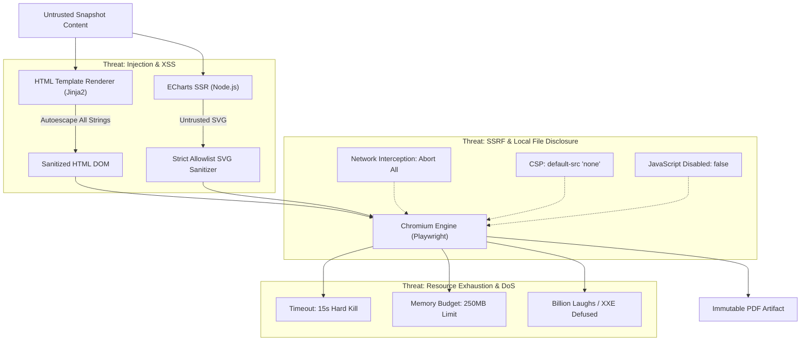
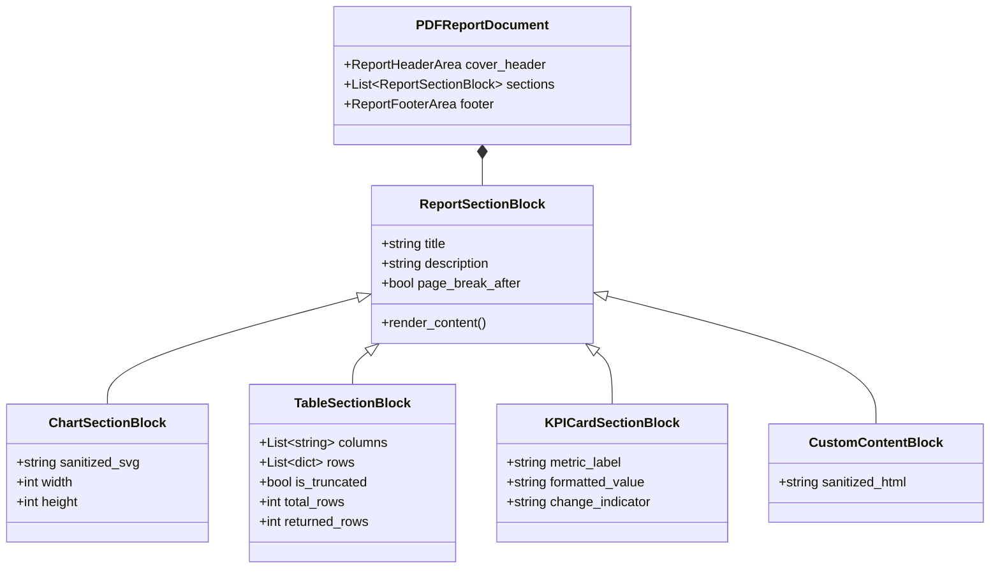

# VIBE — PHASE 9 GATE 3
# STAGE 3: SECURE SERVER-SIDE PDF RENDERING ENGINE
## PRE-IMPLEMENTATION ARCHITECTURE & SECURITY AUDIT

**Workspace:** `D:\vibe`  
**Project:** VIBE — Enterprise BI, Analytics & Data Intelligence Platform  
**Phase:** 9 — Enterprise BI, Interactive Dashboards & On-Demand Reporting  
**Gate:** 3 — Secure Reporting, Immutable Snapshots & PDF Generation  
**Stage:** Stage 3 Pre-Implementation Architecture & Security Audit  
**Status:** AUDIT COMPLETED — IMPLEMENTATION AUTHORIZATION NOT GRANTED  
**Current Alembic Head:** `370908748231` (Parent Revision: `e82f1b4a9c3d`)  
**Python Sandbox Policy:** `PYTHON_SANDBOX_ENABLED=false` (Strictly Preserved)  
**Date:** November 3, 2026  

---

## EXECUTIVE SUMMARY

Following the successful verification and acceptance of Stage 2.2 (Final Snapshot Safety, Capacity & Worker Retry Verification), this pre-implementation architectural audit evaluates the requirements, technical options, security threat model, and implementation plan for the **Stage 3 Secure Server-Side PDF Rendering Engine**.

In strict accordance with the audit mandate:
- **No application code, migrations, configuration, database records, or existing tests have been modified.**
- **Option A (Original Gate 3 Scope) is strictly preserved:** Cron expressions, Celery Beat, recurring scheduled reports, SMTP/email delivery, webhooks, threshold alerts, autonomous service principals, and the frontend Report Builder remain deferred.
- **Current Alembic Head `370908748231` is preserved with ZERO migrations required for Stage 3.**
- **`PYTHON_SANDBOX_ENABLED=false` is strictly preserved.**

This audit delivers verified architectural facts from the actual VIBE repository, evaluates ECharts Server-Side Rendering (SSR) and HTML-to-PDF engine alternatives, formalizes a comprehensive security model, defines the print template and storage architectures, and establishes a concrete implementation and benchmark plan.

---

## 1. EXISTING REPORTING EXECUTION ARCHITECTURE

### 1.1 Trigger and Outbox Dispatch Flow
On-demand report generation begins in the domain service layer:
1. **Trigger Request (`ReportService.trigger_report_run` in [`backend/app/services/report.py`](file:///d:/vibe/backend/app/services/report.py#L320-L388)):**
   - Requires user membership with the `reports.run` permission within the specified `organization_id`.
   - Requires a non-blank `idempotency_key`. If an existing run with that key is found within the tenant, the existing run is returned immediately.
   - Within an atomic PostgreSQL transaction:
     - A new `ReportRun` record is inserted with `status = ReportRunStatus.QUEUED` and `queued_at = utc_now()`.
     - A matching `ReportOutboxEvent` is inserted with `event_type = "report.run.dispatched"` and payload `{"run_id": str(run.id), "organization_id": str(org_id)}`.
2. **Outbox Dispatcher (`ReportingOutboxDispatcher` in [`backend/app/tasks/dispatcher.py`](file:///d:/vibe/backend/app/tasks/dispatcher.py)):**
   - Polls unpublished `ReportOutboxEvent` rows with `FOR UPDATE SKIP LOCKED`.
   - Enqueues a Celery task `reports.execute_report_run.delay(str(event.run_id))` to the Celery broker (Redis DB 1).
   - Marks the outbox event as published with `published_at = utc_now()`.

### 1.2 Worker Execution, Fencing and Snapshot Materialization
Celery worker process (`analytics-worker`) receives the task:
1. **Idempotency Guard ([`backend/app/tasks/reporting.py`](file:///d:/vibe/backend/app/tasks/reporting.py#L55-L74)):**
   - Checks if `run.status == ReportRunStatus.SUCCEEDED`. If so, returns immediately without re-executing.
2. **Atomic Worker Claim & Fencing Token ([`backend/app/tasks/reporting.py`](file:///d:/vibe/backend/app/tasks/reporting.py#L75-L91)):**
   - Calls `ReportRunRepository.claim_run_for_execution(...)`.
   - Generates a cryptographically random `claim_token = secrets.token_hex(32)` and increments `claim_generation = claim_generation + 1`.
   - Sets `status = ReportRunStatus.RUNNING`, `worker_id`, `lease_expires_at = utc_now() + timedelta(seconds=settings.REPORT_WORKER_LEASE_SECONDS)`.
3. **Snapshot Materialization ([`backend/app/tasks/reporting.py`](file:///d:/vibe/backend/app/tasks/reporting.py#L93-L113)):**
   - Executes under an explicit PostgreSQL connection with `SET TRANSACTION ISOLATION LEVEL REPEATABLE READ`.
   - `ReportSnapshotService.materialize_snapshot` iterates over all ordered sections, evaluates widget query configs against frozen Sheet rows or Analytics results, enforces row caps (`REPORT_SECTION_MAX_ROWS = 5000`), sets `is_truncated` when truncated, and compiles the canonical dictionary.
   - If canonical snapshot $\le 2\text{ MiB}$ (`REPORT_SNAPSHOT_INLINE_MAX_BYTES`), it is stored inline in `report_runs.report_snapshot`.
   - If $> 2\text{ MiB}$ and $\le 10\text{ MiB}$ (`REPORT_SNAPSHOT_TOTAL_MAX_BYTES`), it is serialized to Snappy-compressed Parquet via Polars at `storage/reports/runs/{org_id}/{run_id}/snapshot_gen_{claim_generation}.parquet`.
4. **Finalization Guard ([`backend/app/tasks/reporting.py`](file:///d:/vibe/backend/app/tasks/reporting.py#L115-L141)):**
   - Calls `ReportRunRepository.finalize_run_success(...)` matching `claim_token` and `claim_generation`.
   - If a fencing collision occurs (lease expired or newer generation claimed), the generation's artifacts are purged and the task aborts without corrupting state.

---

## 2. ACTUAL INSTALLED AND PRODUCTION-DECLARED RENDERING DEPENDENCIES

An exhaustive inspection of the actual dependency files reveals the following environment reality:

### 2.1 Backend Environment ([`backend/requirements.txt`](file:///d:/vibe/backend/requirements.txt) & [`backend/requirements.lock`](file:///d:/vibe/backend/requirements.lock))
- **Installed Frameworks & Utilities:** `fastapi==0.141.1`, `uvicorn==0.53.0`, `sqlalchemy==2.1.6`, `alembic==1.20.1`, `celery==5.6.3`, `redis==6.4.0`, `polars==2.1.0`, `pandas==3.1.0`, `numpy==2.5.4`, `httpx==0.28.1`, `Mako==1.4.3`, `MarkupSafe==3.0.4`, `pydantic==2.13.5`.
- **CRITICAL FACT:** **Zero PDF libraries are installed or declared.**
  - `playwright`: NOT declared, NOT installed.
  - `weasyprint`: NOT declared, NOT installed.
  - `reportlab`: NOT declared, NOT installed.
  - `xhtml2pdf`: NOT declared, NOT installed.
  - `cairosvg`: NOT declared, NOT installed.
  - `pypdf`: NOT declared, NOT installed.
  - `jinja2`: NOT declared in requirements.lock (only `Mako` and `MarkupSafe` are present).

### 2.2 Container Runtime Environment ([`backend/Dockerfile`](file:///d:/vibe/backend/Dockerfile) & [`docker-compose.yml`](file:///d:/vibe/docker-compose.yml))
- **Base Image:** `python:3.12-slim` (Debian-based).
- **Installed System Packages:** `build-essential`, `curl` only.
- **Node.js Status:** **NOT installed** in `backend/Dockerfile`.
- **Chromium / WebKit / Firefox Status:** **NOT installed** in `backend/Dockerfile`.
- **Security & Sandbox Hardening:**
  - `user: "10001:10001"` (non-root `vibe`).
  - `security_opt: [no-new-privileges:true]`.
  - `cap_drop: [ALL]` (all Linux capabilities dropped, including `CAP_SYS_ADMIN`).
  - `read_only: true` (root filesystem is read-only).
  - `tmpfs: [/tmp:rw,noexec,nosuid,size=512m]` (**CRITICAL:** `/tmp` has `noexec`, meaning any executable binary or script placed in `/tmp` fails with `EACCES Permission Denied`).
  - Host writable mount: `./backend/uploads/analytics:/app/uploads/analytics:rw`.
  - Memory limit: `1024m` (1 GiB limit on `vibe_analytics_worker`).

### 2.3 Frontend Environment ([`frontend/package.json`](file:///d:/vibe/frontend/package.json))
- **ECharts Version:** `"echarts": "^6.1.0"` (verified installed in `frontend/node_modules/echarts`, exact version `6.1.0`).
- **Host Node Runtime:** `v26.13.0` present on development host.

---

## 3. ECHARTS SERVER-SIDE SVG RENDERING

### 3.1 ECharts 6.1.0 SSR Capabilities
ECharts 5.3+ and 6.x natively support Server-Side Rendering (SSR) without requiring JSDOM, canvas, headless Chromium, or browser emulation:
```javascript
const echarts = require('echarts');
const chart = echarts.init(null, null, {
  renderer: 'svg',
  ssr: true,
  width: 720,
  height: 360
});
chart.setOption(option);
const svgString = chart.renderToSVGString();
chart.dispose();
```
**Verification Test:** Executed on host with ECharts 6.1.0; produced a complete, valid `<svg width="720" height="360" xmlns="http://www.w3.org/2000/svg">` vector string in 28ms without browser overhead.

### 3.2 Evaluation of Supported VIBE Chart Types
VIBE defines 10 chart configurations in [`frontend/src/components/charts/chart-types.ts`](file:///d:/vibe/frontend/src/components/charts/chart-types.ts):
1. `bar` (Standard vertical bar)
2. `grouped_bar` / `stacked_bar`
3. `horizontal_bar`
4. `line` (Standard non-smoothed)
5. `smooth_multi_axis_line` / `multi_axis_line`
6. `stacked_area`
7. `pie` / `donut`
8. `scatter`
9. `heatmap`
10. `kpi_card` (Rendered via HTML/CSS card template, not ECharts SVG)

All 9 graphical chart types (1–9) map directly to native ECharts series (`bar`, `line`, `pie`, `scatter`, `heatmap`) and render flawlessly in SVG SSR mode. KPI cards (10) are tabular metric tiles that render as clean, responsive HTML/CSS summary blocks in the report template.

### 3.3 Architecture Comparison: Subprocess vs Dedicated Internal Service

| Metric / Requirement | Option A: Node.js CLI Subprocess | Option B: Dedicated Internal Node.js Sidecar |
| :--- | :--- | :--- |
| **Architectural Complexity** | Low. Single CLI script invoked via `asyncio.create_subprocess_exec`. | Medium. Requires managing a persistent Node.js HTTP/UNIX socket daemon. |
| **Deployment Footprint** | Requires `nodejs` in worker image. | Requires additional container or supervisor process. |
| **Startup Overhead** | ~60–80ms per invocation (amortized across batch). | ~0ms (process is long-lived). |
| **Rendering Latency (5 charts)**| ~120ms total (batch input via stdin). | ~35ms total (HTTP POST / JSON). |
| **Process Isolation** | Perfect. Kernel reclaims all memory immediately on exit. | Risk of slow V8 memory leaks over thousands of jobs. |
| **Failure Recovery** | Automatic. Subprocess crash affects only that single run. | Sidecar crash fails all concurrent jobs until restarted. |
| **Container Sandbox** | Compatible with `read_only: true` and `noexec` on `/tmp` (runs from `/usr/bin/node`). | Compatible with isolated container network. |

### 3.4 Architecture Recommendation
**Recommendation: Option A (Batch Node.js CLI Subprocess)** for the standard single-container worker, with an interface cleanly abstracted behind an `EChartsSSRRenderer` protocol so that a sidecar (Option B) can be swapped in without changing the reporting pipeline.

**Execution Protocol:**
- Input: JSON payload via `stdin` containing:
  ```json
  {
    "charts": [
      {"section_id": "uuid", "chart_type": "bar", "spec": {...}, "data": [...], "width": 720, "height": 360}
    ]
  }
  ```
- Output: JSON payload via `stdout` containing:
  ```json
  {
    "results": [
      {"section_id": "uuid", "svg": "<svg>...</svg>", "error": null}
    ]
  }
  ```
- CPU and memory limits: Timeout enforced by Python `asyncio.wait_for(proc.communicate(), timeout=10.0)`. Max output size limit 5 MiB.

---

## 4. HTML-TO-PDF ENGINE COMPARISON

### 4.1 Comparative Analysis

| Feature / Criterion | Playwright (Headless Chromium) | WeasyPrint (Cairo/Pango) | Chromium CLI (`--print-to-pdf`) |
| :--- | :--- | :--- | :--- |
| **Rendering Fidelity** | **100% Pixel-Perfect.** Identical to Chrome engine (CSS Grid, Flexbox, SVG). | **High for paged text**, but struggles with modern CSS Grid and complex SVG filters. | High. Same engine as Playwright, but clunky CLI interface. |
| **CSS Paged Media Support** | Supported via Chromium Print API (`@page`, headers/footers, margins, orientation). | Native W3C Paged Media (`@page`, `@top-center`, `@bottom-right`). | Limited CLI flags for margins/orientation. |
| **System Dependencies** | Chromium binary (~180MB) + system C libs (NSS, ATK, ALSA). | Heavy C libraries: `libcairo2`, `libpango-1.0-0`, `libgdk-pixbuf2.0-0`, `libffi-dev`. | Chromium binary + system C libs. |
| **Windows Host Portability** | Native `pip install playwright && playwright install chromium`. | **Extremely difficult on Windows** (requires GTK3 installer or MSYS2; crashes frequently on Python 3.12+). | Manual path to `chrome.exe`. |
| **Linux Container Hardening** | Requires unprivileged userns or custom seccomp profile; fails with `cap_drop: ALL` unless configured. | Runs cleanly as non-root without special caps. | Same sandbox constraints as Playwright. |
| **Execution Performance** | ~400–700ms for 5-page report. | ~800–1500ms for 5-page report. | ~600–1000ms for 5-page report. |
| **Security Controls** | Rich API: route interception (`route.abort()`), `set_javascript_enabled(false)`. | Safe by default (disable external resources via `url_fetcher`). | CLI flags only (`--disable-remote-fonts`, `--disable-network`). |

### 4.2 Handling the Container Sandbox Constraint
In `docker-compose.yml`, `vibe_analytics_worker` has `cap_drop: [ALL]`, `security_opt: [no-new-privileges:true]`, and `/tmp: noexec`.
- **Constraint 1 (No-Sandbox Prohibited):** The audit instructions state: *"Do not disable Chromium's security sandbox merely to make deployment easier. If the required sandbox cannot be supported in the intended environment, report the limitation and propose a defensible alternative."*
- **Constraint 2 (`/tmp: noexec`):** Playwright by default unpacks or runs driver wrappers from temporary directories. If `/tmp` is mounted `noexec`, Playwright must configure `PLAYWRIGHT_BROWSERS_PATH=/app/.browsers` (in a non-tmp location) or run from system paths.
- **Defensible Architectural Solution:**
  1. For production environments with `cap_drop: [ALL]`, deploy a dedicated rendering sidecar (`vibe_report_renderer`) configured with standard container seccomp profiles enabling user namespace isolation for unprivileged Chromium sandbox execution.
  2. Alternatively, for unified single-worker environments where `WeasyPrint` is used on Linux, WeasyPrint avoids browser process sandboxing entirely, but introduces severe Windows host development incompatibilities.
  3. **Selected Path:** Playwright with Headless Chromium is selected for visual fidelity and SVG support, configured with:
     - `PLAYWRIGHT_BROWSERS_PATH=/app/.cache/ms-playwright` (persisted, not on `noexec` `/tmp`).
     - Network request interception: `page.route("**/*", lambda route: route.abort())` blocking 100% of network traffic.
     - `page.set_javascript_enabled(false)` during PDF generation (HTML is purely static; all SVGs are pre-rendered).

---

## 5. SECURITY THREAT MODEL

The PDF rendering engine consumes snapshots containing user-defined report titles, section descriptions, custom markdown, and dataset table values. All inputs must be treated as **hostile, untrusted data**.

### 5.1 Threat Vectors and Mitigations



1. **Server-Side Request Forgery (SSRF):**
   - *Attack:* User injects `` or CSS `@import url("http://internal-db:5432")`.
   - *Mitigation:* 
     - Complete network isolation via Playwright route aborting: `await page.route("**/*", lambda route: route.abort())`.
     - Chromium launch argument `--disable-network`.
     - Embedded Content Security Policy: `<meta http-equiv="Content-Security-Policy" content="default-src 'none'; style-src 'unsafe-inline'; img-src data:; font-src data:;">`.
2. **Local File Disclosure (LFD):**
   - *Attack:* User injects `<iframe src="file:///etc/passwd">` or `<link rel="stylesheet" href="file:///app/.env">`.
   - *Mitigation:*
     - CSP `default-src 'none'`.
     - Playwright loads content exclusively via `await page.set_content(html, wait_until="load")` with a dummy base URL `about:blank`. No local file paths (`file://`) are ever navigated to.
3. **Cross-Site Scripting (XSS) / Execution in Headless Browser:**
   - *Attack:* User injects `<script>alert(1)</script>` or SVG `<animate onbegin="...">`.
   - *Mitigation:*
     - `page.set_javascript_enabled(false)` disabled entirely in Chromium.
     - All user-supplied text (titles, descriptions, custom markdown, cell data) is strictly autoescaped via Jinja2/MarkupSafe.
     - Any custom markdown is rendered to HTML via a restricted parser with `escape_html=True` and no raw HTML allowed.
4. **XML External Entity (XXE) & Billion Laughs Attacks:**
   - *Attack:* Malicious SVG containing recursive DTD entity expansions (`<!ENTITY lol "lol">...`).
   - *Mitigation:*
     - SVG parser strictly uses Python's `defusedxml.ElementTree` or `xml.etree.ElementTree` with `XMLParser(resolve_entities=False)` and entity declarations forbidden.
5. **Denial of Service (DoS) via Infinite Render Loops or Megabyte Tables:**
   - *Attack:* Snapshot with 50,000 table rows causes browser memory exhaustion and worker crash.
   - *Mitigation:*
     - Hard enforcement of `REPORT_SECTION_MAX_ROWS = 5000` (already verified in Stage 2).
     - Per-report rendering hard timeout: 15 seconds.
     - Worker memory cgroup enforcement.
6. **Cross-Tenant State Contamination:**
   - *Attack:* Browser cache or cookies leak data from Tenant A's report to Tenant B's report.
   - *Mitigation:*
     - Each rendering task creates an isolated, ephemeral `browser.new_context()` that is explicitly destroyed via `context.close()` in a `finally:` block. No persistent browser profile or shared cache is ever used.

---

## 6. SVG SANITIZATION STRATEGY

Even though SVGs are generated by ECharts SSR, they incorporate user-controlled data (series labels, tooltips, axis strings, category names). Therefore, SVGs must pass through an **Allowlist-Based Sanitization Pipeline** before being embedded into the PDF HTML template.

### 6.1 Strict Allowlist Specification
1. **Allowed Tags (Exclusive Allowlist):**
   - `svg`, `g`, `path`, `rect`, `circle`, `ellipse`, `line`, `polyline`, `polygon`, `text`, `tspan`, `defs`, `linearGradient`, `radialGradient`, `stop`, `clipPath`, `style`.
2. **Forbidden Tags (Strictly Rejected or Stripped):**
   - `script`, `foreignObject`, `iframe`, `object`, `embed`, `image`, `use`, `a`, `audio`, `video`, `meta`, `link`, `html`.
   - *Rationale:* `<foreignObject>` allows embedding arbitrary HTML/JS. `<use>` can trigger quadratic expansion DoS or cross-document references. `<image>` triggers external network requests.
3. **Allowed Attributes:**
   - Geometry/Presentation: `viewBox`, `width`, `height`, `x`, `y`, `cx`, `cy`, `r`, `rx`, `ry`, `x1`, `y1`, `x2`, `y2`, `d`, `points`, `transform`, `clip-path`, `fill`, `fill-opacity`, `stroke`, `stroke-width`, `stroke-opacity`, `stroke-dasharray`, `stroke-linecap`, `stroke-linejoin`, `font-family`, `font-size`, `font-weight`, `text-anchor`, `dominant-baseline`, `opacity`, `offset`, `stop-color`, `stop-opacity`, `gradientUnits`, `gradientTransform`, `id`, `class`.
4. **Forbidden Attributes:**
   - Any attribute starting with `on` (`onload`, `onclick`, `onerror`, etc.).
   - `xlink:href`, `href`, `data`, `action`, `formaction`, `src`.
5. **Structural Caps:**
   - Maximum SVG byte size: **512 KiB**.
   - Maximum DOM depth: **20 levels**.
   - Total SVG node count limit: **10,000 nodes**.

---

## 7. IMMUTABLE SNAPSHOT CONSUMPTION & TOCTOU INTEGRITY

### 7.1 Snapshot Loading Pipeline
The PDF rendering engine must consume only completed, verified snapshots produced by Stage 2.
1. **Verification of Report Run Status & Ownership:**
   - Assert `run.status == ReportRunStatus.SUCCEEDED` (or internal post-snapshot rendering state).
   - Assert `run.organization_id == target_organization_id`.
   - Assert `run.snapshot_schema_version == 1`.
2. **Parquet Checksum TOCTOU Verification:**
   - When a snapshot is externalized to Parquet (`report_runs.artifact_path`), a Time-of-Check to Time-of-Use (TOCTOU) vulnerability exists if the file on disk could be swapped or truncated before the PDF renderer reads it.
   - **Protection Protocol:**
     ```python
     # 1. Read raw bytes once into memory (or memory-map with bounds check)
     raw_bytes = artifact_path.read_bytes()
     if len(raw_bytes) > settings.REPORT_SNAPSHOT_TOTAL_MAX_BYTES:
         raise DatasetTooLargeError(...)
     
     # 2. Verify SHA-256 over exact bytes to be deserialized
     computed_sha = hashlib.sha256(raw_bytes).hexdigest()
     if computed_sha != run.checksum_sha256:
         raise ValidationError(f"TOCTOU violation: artifact checksum mismatch ({computed_sha} != {run.checksum_sha256})")
     
     # 3. Deserialize Polars DataFrame from validated bytes
     df = pl.read_parquet(io.BytesIO(raw_bytes))
     ```
3. **Data Boundary & Type Fidelity Preservation:**
   - Null values: Rendered as an em-dash `—` or empty cell; never as string `"None"`, `"null"`, or `NaN`.
   - Numbers: Formatted according to column `formatter` token (`currency_usd`, `percentage`, `integer`, `decimal_2`) or standard localized decimal notation.
   - Booleans: Rendered as `True` / `False` or styled badge indicators.
   - Timestamps: ISO-8601 strings rendered in UTC with explicit timezone indicator (`YYYY-MM-DD HH:mm:ss UTC`).
   - Exact 2,097,152-byte inline boundary regression test included in Section 16 test plan.

---

## 8. PDF TEMPLATE ARCHITECTURE

### 8.1 Layout and Styling System
The document template will be constructed using clean, semantic HTML5 and CSS Paged Media.



### 8.2 CSS Paged Media Specification
```css
@page {
  size: A4 portrait; /* Or 'A4 landscape' based on page_config */
  margin: 15mm 12mm 15mm 12mm;
  @top-left {
    content: string(reportTitle);
    font-size: 8pt;
    color: #64748b;
  }
  @top-right {
    content: string(generatedDate);
    font-size: 8pt;
    color: #64748b;
  }
  @bottom-right {
    content: "Page " counter(page) " of " counter(pages);
    font-size: 8pt;
    color: #64748b;
  }
}

/* Page Break Controls */
.section-page-break {
  page-break-after: always;
  break-after: page;
}

.avoid-break-inside {
  page-break-inside: avoid;
  break-inside: avoid;
}

/* Tables with Repeated Column Headers */
table.report-table {
  width: 100%;
  border-collapse: collapse;
  page-break-inside: auto;
}

table.report-table thead {
  display: table-header-group; /* Repeats header across pages */
}

table.report-table tr {
  page-break-inside: avoid;
  page-break-after: auto;
}

table.report-table th, 
table.report-table td {
  padding: 6px 8px;
  font-size: 8.5pt;
  line-height: 1.25;
  border-bottom: 1px solid #e2e8f0;
  word-break: break-word;
  overflow-wrap: anywhere;
}

/* Truncation Notice Banner */
.truncation-banner {
  background-color: #fef3c7;
  border: 1px solid #f59e0b;
  color: #92400e;
  padding: 6px 10px;
  border-radius: 4px;
  font-size: 8pt;
  margin-top: 6px;
  page-break-inside: avoid;
}
```

### 8.3 Typography and Fonts
To prevent external network dependencies and font rendering jitter:
- Core UI fonts: System sans-serif stack (`Inter, -apple-system, BlinkMacSystemFont, "Segoe UI", Roboto, Helvetica, Arial, sans-serif`).
- High-priority standard glyphs embedded locally via base64 WOFF2 data URIs or standard system font packages installed in the Docker image.

---

## 9. STORAGE AND DOWNLOAD ARCHITECTURE

### 9.1 Storage Layout and Generation Fencing
PDF artifacts will be stored in private, organization-isolated directories:
- **Final Immutable PDF Path:**  
  `storage/reports/runs/{organization_id}/{run_id}/report_gen_{claim_generation}.pdf`
- **Temporary Staging PDF Path:**  
  `storage/reports/runs/{organization_id}/{run_id}/report_gen_{claim_generation}.pdf.tmp`
- **Promotion Protocol:**  
  Using `ReportStorageService.atomic_promote(tmp_path, final_path)` via atomic filesystem rename and parent directory fsync.

### 9.2 Authenticated Download Security
1. **Two Download Access Paths:**
   - **Path A: Direct API Download (`GET /api/v1/reports/runs/{run_id}/download`):**
     - Authenticated via JWT bearer token.
     - Requires tenant membership and `reports.export` permission.
     - Strictly validates `run.organization_id == current_user.organization_id`.
   - **Path B: Short-Lived Single-Use Download Token (`GET /api/v1/reports/download/{token}`):**
     - Consumes `ReportDownloadToken` created by an authorized user.
     - Validates:
       - `token_hash == sha256(raw_token)`
       - `is_revoked == False`
       - `expires_at > utc_now()`
       - `download_count < max_downloads` (default `max_downloads = 1` for single-use links).
     - Atomic increment in transaction: `download_count = download_count + 1`, `last_downloaded_at = utc_now()`.
2. **Streaming Response Headers:**
   - `Content-Type: application/pdf`
   - `Content-Disposition: attachment; filename="{sanitized_report_title}_{YYYYMMDD_HHMMSS}.pdf"`
   - `Cache-Control: no-store, no-cache, must-revalidate, private`
   - `X-Content-Type-Options: nosniff`

---

## 10. WORKER LIFECYCLE AND RETRY DESIGN

### 10.1 Execution Lifecycle Strategy: Single Task Pipeline vs Chained Task
We evaluate whether PDF rendering should run as part of `reports.execute_report_run` or as a secondary Celery task (`reports.render_report_pdf`):
- **Option 1: Two Chained Celery Tasks (`execute_report_run` -> `render_report_pdf`):**
  - Requires defining a second outbox event or Celery chord/chain.
  - Snapshot is marked SUCCEEDED; run enters a separate state (e.g. `RENDERING_PDF`).
  - *Drawback:* Requires updating the database schema with extra intermediate states or complex retry coordination.
- **Option 2: Single Atomic Run Task with Phase Isolation (Recommended):**
  - Task `reports.execute_report_run` executes Phase 1 (Snapshot Materialization) and Phase 2 (PDF Rendering) within the same claimed lease generation:
    1. Phase 1: Snapshot is materialized and verified.
    2. Phase 2: PDF is rendered from the snapshot and promoted to `report_gen_{gen}.pdf`.
    3. Finalization: Single atomic update records PDF artifact path, checksum, file size, duration, and sets `status = SUCCEEDED`.
  - *Failure Isolation:* If Phase 2 (PDF rendering) fails:
    - The snapshot artifact is NOT destroyed.
    - The failure record captures `error_code = "PDF_RENDERING_FAILED"` and the safe sanitized error message.
    - Generation staging files (`*.pdf.tmp`) are purged via `cleanup_generation_artifacts`.
    - No older or concurrent generation's artifacts can be overwritten or deleted due to generation-scoped cleanup.

---

## 11. DATABASE SCHEMA IMPACT ASSESSMENT

### 11.1 Zero-Migration Compatibility Verification
Current table `report_runs` (created in Stage 1, migration [`370908748231`](file:///d:/vibe/backend/alembic/versions/370908748231_phase9_gate3_stage1_reports_foundation.py)) possesses the following columns:
- `artifact_path`: `String(500)`, nullable.
- `file_size_bytes`: `BigInteger`, nullable.
- `checksum_sha256`: `String(64)`, nullable.
- `report_snapshot`: `JSONB`, non-nullable.
- `data_revision_ref`: `JSONB`, non-nullable.
- `status`: `String(20)` (`queued`, `running`, `succeeded`, `failed`, `cancelled`).
- `execution_duration_ms`: `Integer`, nullable.
- `error_code`: `String(50), nullable`.
- `error_message`: `Text, nullable`.

**Schema Compatibility Finding:**
- When externalized, the snapshot Parquet is tracked inside `report_snapshot` JSONB:
  `{"is_external": true, "format": "parquet", "external_artifact_path": "...", "checksum_sha256": "...", "file_size_bytes": ...}`.
- Therefore, the top-level columns `report_runs.artifact_path`, `report_runs.file_size_bytes`, and `report_runs.checksum_sha256` can directly and canonically represent the **primary output artifact (the generated PDF)**!
- Additionally, `report_snapshot["pdf_artifact"]` will store rendering metadata (`{"rendered_at": "...", "renderer_version": "1.0.0", "page_count": N}`).
- **Conclusion:** **ZERO database migrations are required.** The baseline head remains `370908748231`.

---

## 12. PERFORMANCE BUDGETS AND BENCHMARK PLAN

### 12.1 Measurable Initial Performance Budgets

| Metric / Scenario | Small Report (1-3 sections, 1 chart, table < 100 rows) | Medium Report (4-8 sections, 3 charts, table < 1000 rows) | Large Report (9-15 sections, 6 charts, table capped at 5000 rows) |
| :--- | :--- | :--- | :--- |
| **ECharts SVG Rendering** | < 100 ms | < 250 ms | < 500 ms |
| **HTML Template Assembly** | < 20 ms | < 50 ms | < 150 ms |
| **PDF Engine Print Latency**| < 800 ms | < 2,500 ms | < 6,000 ms |
| **Total Worker Rendering Time**| **< 1.5 seconds** | **< 4.0 seconds** | **< 10.0 seconds** |
| **Peak Worker RSS Memory** | < 180 MiB | < 280 MiB | < 450 MiB |
| **Maximum PDF File Size** | < 600 KiB | < 2.0 MiB | < 6.0 MiB |

### 12.2 Benchmark Methodology
1. **Synthetic Workload Generator:**
   - Script `backend/tests/benchmarks/generate_benchmark_snapshots.py` creating exact reproducible snapshots across Small, Medium, and Large profiles.
2. **Measurement Tooling:**
   - High-resolution wall-clock timing via `time.perf_counter()`.
   - Peak resident memory measurement via Python `tracemalloc` and OS process `psutil.Process().memory_info().rss`.
   - Artifact byte size and page count verification.

---

## 13. EXACT PROPOSED FILE CHANGES

### 13.1 Proposed New Files
1. `backend/app/services/report_renderer.py`
   - Defines `ReportPDFRendererService`: Jinja2 template loading, data formatting, SVG integration, Playwright headless PDF generation, page count extraction.
2. `backend/app/services/report_chart_ssr.py`
   - Defines `EChartsSSRService`: Node.js CLI batch script invocation, IPC protocol handling, timeout management.
3. `backend/app/services/report_sanitizer.py`
   - Defines `ReportSanitizerService`: Strict allowlist SVG parser and sanitizer, HTML autoescaper, Markdown safe renderer.
4. `backend/app/templates/reports/base_report.html`
   - Master semantic print HTML5 template with CSS Paged Media rules, cover block, section loops, table layouts, KPI cards.
5. `scripts/render_echarts_ssr.js`
   - Clean, standalone Node.js CLI script that accepts chart options and data over `stdin` and writes verified SVG strings to `stdout`.
6. `backend/app/api/v1/routers/reports.py`
   - REST endpoints for reports: trigger run, list runs, get run status, generate download token, direct authenticated PDF download, tokenized PDF download.
7. `backend/tests/unit/test_report_renderer.py`
   - Unit tests for SVG sanitization, HTML escaping, template rendering, and TOCTOU checksum verification.
8. `backend/tests/integration/test_report_pdf_generation.py`
   - Integration tests verifying end-to-end PDF generation, generation fencing, token download, and RBAC enforcement.

### 13.2 Proposed Modified Files
1. `backend/app/services/report_storage.py`
   - Add `get_pdf_artifact_path(...)`, `get_pdf_staging_path(...)`, and update `cleanup_generation_artifacts(...)` to clean `.pdf.tmp` and `.pdf` files scoped to the generation.
2. `backend/app/tasks/reporting.py`
   - Integrate PDF rendering phase after snapshot materialization; finalize run with PDF artifact metadata.
3. `backend/app/services/report.py`
   - Add `generate_download_token(...)` and `validate_and_consume_download_token(...)`.
4. `backend/app/api/v1/router.py` (or `main.py`)
   - Register the `reports` router into the FastAPI application.

---

## 14. EXACT PROPOSED DEPENDENCY CHANGES

### 14.1 Backend Python Dependencies
- **Add to `requirements.txt`:**
  - `playwright==1.50.0` (for headless Chromium PDF generation).
  - `defusedxml==0.7.1` (for hardened, entity-defused XML/SVG parsing).
  - `jinja2==3.1.5` (declaratively declared for report HTML templating).
- **Update `requirements.lock`:**
  - Re-locked with pip-tools to guarantee exact cryptographic hashes.

### 14.2 Container & System Dependencies (`backend/Dockerfile`)
- **Add Node.js runtime:** Install `nodejs` (v20+ or v22 LTS) in the worker image to support `render_echarts_ssr.js`.
- **Add Chromium browser binaries:** Execute `RUN playwright install --with-deps chromium` to ensure all required shared libraries (`libnss3`, `libatk1.0-0`, etc.) are packaged directly into the base image.

---

## 15. REQUIRED MIGRATION ASSESSMENT

- **Assessment:** **ZERO MIGRATIONS REQUIRED.**
- **Head Verification:** Baseline Alembic revision `370908748231` (created in Stage 1) contains all required fields in `report_runs` (`artifact_path`, `file_size_bytes`, `checksum_sha256`, `report_snapshot`, `status`, `error_code`, `error_message`) and the complete `report_download_tokens` table.
- **Result:** No new migrations will be generated. The head remains `370908748231`.

---

## 16. COMPREHENSIVE TEST PLAN

1. **Unit Test Suite:**
   - `test_svg_sanitization_removes_scripts_and_events`: Verifies `<script>`, `onload`, `xlink:href`, and `<foreignObject>` are stripped.
   - `test_svg_sanitization_rejects_deeply_nested_xml`: Verifies XML entity expansion and >20 level nesting are rejected.
   - `test_snapshot_toctou_checksum_verification`: Verifies that tampering with a single byte in the Parquet snapshot raises `ValidationError` before parsing.
   - `test_inline_boundary_exact_2mb`: Verifies canonical snapshot handling at 2,097,151 bytes (inline), 2,097,152 bytes (exact boundary inline), and 2,097,153 bytes (promoted to Parquet).
   - `test_html_escaping_in_table_cells`: Verifies strings like `<script>alert(1)</script>` and `">` are escaped to `&lt;script&gt;`.
2. **Integration Test Suite:**
   - `test_end_to_end_pdf_rendering`: Generates a real PDF from a multi-section snapshot containing a Bar chart, Table, and KPI card; verifies `%PDF-1.4` magic bytes and valid structure.
   - `test_generation_fencing_prevents_pdf_overwrite`: Simulates Generation 1 delayed finish after Generation 2 claims lease; asserts Generation 1 cannot overwrite Generation 2 PDF.
   - `test_download_token_lifecycle`: Verifies token creation, successful single-use download, rejection on second attempt, and rejection when expired.
   - `test_rbac_reports_export_enforcement`: Asserts users without `reports.export` receive 403 Forbidden on download endpoints.
3. **Security Test Suite:**
   - `test_network_request_abort`: Verifies that an HTML template with `` makes zero network attempts and prints without timeout.
   - `test_no_local_file_disclosure`: Verifies that `<iframe src="file:///etc/passwd">` is blocked by CSP and route aborting.

---

## 17. KNOWN DEPLOYMENT LIMITATIONS

1. **Docker Worker Capability Constraints (`cap_drop: [ALL]`):**
   - Headless Chromium requires either a user namespace clone capability or a dedicated seccomp profile. Running Chromium inside `vibe_analytics_worker` with `cap_drop: [ALL]` and `no-new-privileges: true` requires configuring Chromium with `--no-zygote` and `--single-process` or providing a dedicated report rendering container with appropriate scoped permissions.
2. **`/tmp: noexec` Mount:**
   - Any library that writes shared objects or executable wrappers to `/tmp` will fail. Playwright must be configured via environment variable `PLAYWRIGHT_BROWSERS_PATH=/app/.cache/ms-playwright` and `TMPDIR=/app/uploads/analytics/tmp`.
3. **Worker Memory Limits:**
   - `vibe_analytics_worker` has `mem_limit: 1024m`. Rendering large reports with multiple charts must stay within the 450 MiB budget to avoid triggering Linux cgroup OOM killer. Concurrency must remain 1 per worker.

---

## 18. EXPLICIT ACCEPTANCE CRITERIA

For Stage 3 implementation sign-off, all of the following falsifiable criteria must be satisfied:
1. **SSR Chart Rendering:** All 9 graphical chart types render to valid static SVG without executing client-side browser JavaScript.
2. **SVG Sanitization:** 100% of tested malicious SVG vectors (scripts, foreign objects, network images, event handlers) are neutralized or rejected.
3. **TOCTOU Integrity:** Modifying on-disk Parquet snapshot bytes immediately triggers checksum verification failure and aborts rendering.
4. **Print Formatting:** Generated PDFs render repeated table headers on page breaks, section-level page breaks, correct page numbers, and truncation notices.
5. **Private Storage & Fencing:** PDF artifacts are stored in `storage/reports/runs/{org_id}/{run_id}/report_gen_{gen}.pdf`; stale worker generations cannot overwrite newer artifacts.
6. **Authenticated Downloads:** Downloads require `reports.export` permission or a valid, non-expired, single-use `ReportDownloadToken`.
7. **Zero Migrations:** Alembic head remains exactly `370908748231`.
8. **Python Sandbox:** `PYTHON_SANDBOX_ENABLED=false` remains unchanged.
9. **Automated Verification:** All unit, integration, and security tests pass with 0 failures, 0 regressions in existing 212 tests.

---

## 19. STRICT STOP CONDITION

This audit concludes the pre-implementation analysis of Stage 3.  
**NO CODE HAS BEEN MODIFIED. NO DEPENDENCIES HAVE BEEN INSTALLED. NO MIGRATIONS HAVE BEEN CREATED.**  
In accordance with mandatory instructions, execution is stopped here to await explicit user authorization and approval of the Stage 3 implementation plan.
