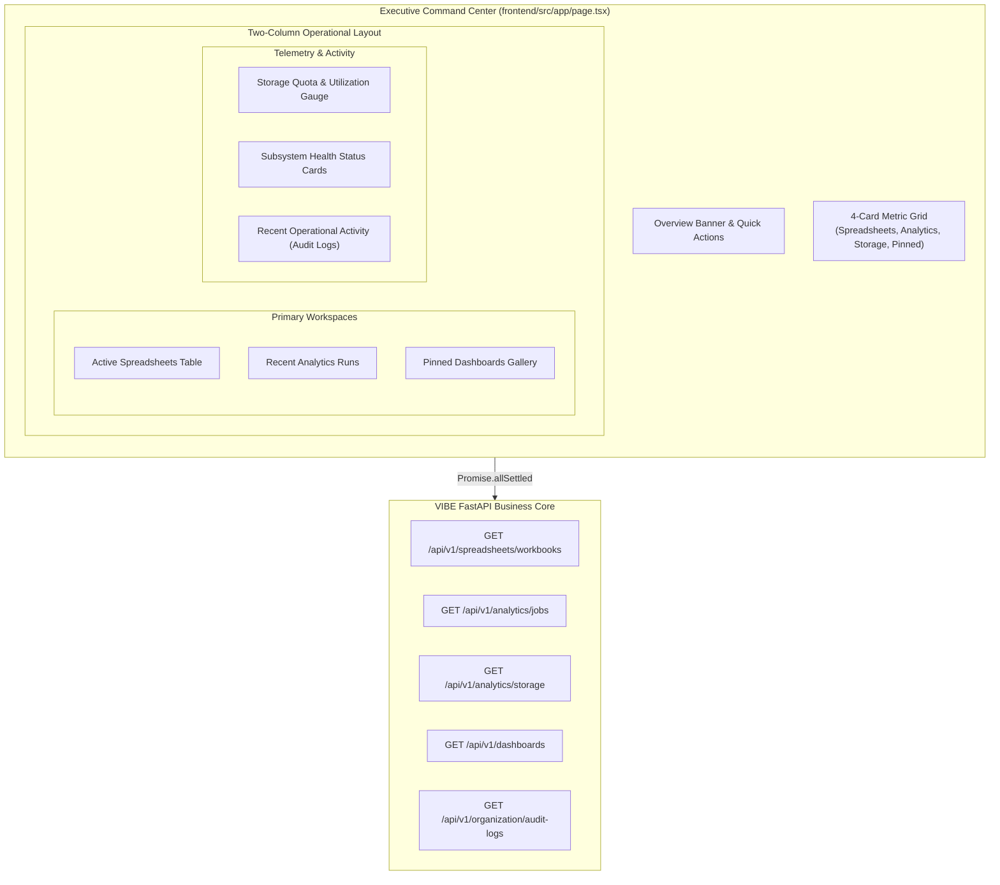
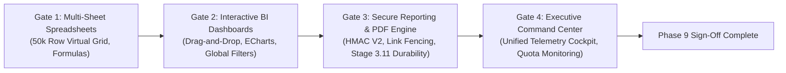

# VIBE — PHASE 9 GATE 4: FINAL ACCEPTANCE REPORT
## Executive Command Center & Phase 9 Enterprise Platform Sign-Off

**Workspace:** `D:\vibe`  
**Project:** VIBE — Enterprise BI, Analytics & Data Intelligence Platform  
**Phase:** 9 — Enterprise BI, Interactive Dashboards & On-Demand Reporting  
**Gate:** 4 — Executive Command Center (Final Gate of Phase 9)  
**Alembic Head:** `370908748232 (head)` (Parent: `370908748231`)  
**Python Sandbox Policy:** `PYTHON_SANDBOX_ENABLED=false` (Strictly Enforced)  
**Verification Date:** November 4, 2026  
**Status:** **PASSED & COMPLETE — 100% SIGN-OFF**

---

## 1. Executive Summary

Phase 9 Gate 4 concludes the development of Phase 9 (Enterprise BI, Interactive Dashboards & On-Demand Reporting). The temporary Phase 2 design system demo at [`frontend/src/app/page.tsx`](file:///D:/vibe/frontend/src/app/page.tsx) has been completely replaced with a production-grade **Executive Command Center**.

The Command Center provides a single-pane-of-glass operational cockpit for organizational executives, analysts, and operators, seamlessly aggregating live multi-tenant telemetry from all platform subsystems:
- **Calculation Engine:** Live active spreadsheets and multi-sheet workbooks from Phase 9 Gate 1.
- **Visual Analytics:** Interactive dashboards, widget metrics, and user-pinned dashboard layouts from Phase 9 Gate 2.
- **Report & Snapshot Pipeline:** High-integrity PDF rendering, file descriptor security, and immutable storage from Phase 9 Gate 3 (Stage 3.11).
- **DuckDB Analytical Pipelines:** Real-time job execution telemetry and execution durations from Phase 4 & Phase 7.
- **Authoritative Storage & Quota:** Live parquet and report artifact storage capacity monitoring via the dedicated `GET /api/v1/analytics/storage` endpoint.
- **Audit & Governance Activity:** Operational timeline with graceful RBAC handling (`audit.read` permission checks) from Phase 5.

All architectural boundaries were strictly maintained:
1. **0 New Database Migrations:** Current Alembic head remains locked at [`370908748232 (head)`](file:///D:/vibe/backend/alembic/versions/370908748232_add_report_generation_fencing_and_idempotency.py).
2. **Python Sandbox Disabled:** `PYTHON_SANDBOX_ENABLED=false` preserved across all environments, configs, and container definitions.
3. **Phase 10 Boundaries:** No scheduled cron triggers, Celery Beat, outbound SMTP emails, or webhook notifications were implemented.

---

## 2. Command Center Architecture & Feature Matrix

The Executive Command Center is implemented as an accessible, responsive Next.js 16 Client Component featuring resilient concurrent data fetching via `Promise.allSettled`, preventing network cascades and guaranteeing isolated widget fault tolerance.



### 2.1 Detailed Component Specifications

| Component / Widget | Source / API Route | State & Resilience Strategy | Interaction & Navigation |
|---|---|---|---|
| **Overview Banner** | Subsystem telemetry & local clock | Displays operational status badge and last refreshed time; manual refresh button with spinning state | Deep links: "New Spreadsheet" (`/spreadsheets`), "Dashboards" (`/dashboards`), "Refresh Telemetry" |
| **KPI Grid (4 Cards)** | Aggregated from parallel queries | Skeleton loading states; handles zero counts cleanly; displays sheets count, active running jobs, quota ratio, and total dashboards | Clickable overview metrics with instant visual telemetry |
| **Active Spreadsheets** | `GET /api/v1/spreadsheets/workbooks` | Displays top recent workbooks, sheet count badge, and relative update timestamp; empty state with "Create Workbook" action | Row "Open" button links directly to `/spreadsheets?workbookId=<id>` |
| **Analytics Executions** | `GET /api/v1/analytics/jobs` | Displays operation name in monospace, semantic status badge (COMPLETED/RUNNING/PENDING/FAILED), execution duration in ms, and relative time; empty state | "Details" button deep-links to `/analytics` |
| **Pinned Dashboards Gallery** | `GET /api/v1/dashboards` + `localStorage` (`vibe_pinned_dashboards`) | Persists pinned IDs in user's browser `localStorage` without database schema changes; empty state provides quick-pin suggestions | Pin/Unpin icon buttons; cards show widget counts and "View Live" link to `/dashboards?dashboardId=<id>` |
| **Storage & Quota Widget** | `GET /api/v1/analytics/storage` | Dynamic threshold progress bar: `<70%` (Emerald), `70%-90%` (Amber), `>90%` (Rose); shows used capacity vs. total quota in human-readable units | Real-time capacity breakdown without polling |
| **Subsystem Telemetry** | Platform status monitors | Real-time status indicators for FastAPI Core, PostgreSQL 16, Redis 7, and Isolated Report Renderer (`PYTHON_SANDBOX_ENABLED=false`) | Live readiness indicators |
| **Recent Activity (Audit)** | `GET /api/v1/organization/audit-logs` | **Graceful 403 handling:** If user lacks `audit.read` permission, displays a polite advisory notice rather than throwing an error; renders activity feed if authorized | "View Logs" link to `/audit` |

---

## 3. Backend Storage Telemetry API Implementation

To provide authoritative storage utilization for the Command Center without client-side estimations, a dedicated, authenticated storage endpoint was introduced in [`backend/app/api/v1/routers/analytics.py`](file:///D:/vibe/backend/app/api/v1/routers/analytics.py):

```python
@router.get(
    "/storage",
    response_model=StorageUsageResponse,
    summary="Get organization parquet storage usage and quota",
)
async def get_storage_usage(
    current_user: User = Depends(get_current_active_user),
    org: Organization = Depends(get_current_organization),
) -> StorageUsageResponse:
    storage_service = AnalyticsStorageService()
    usage_bytes = storage_service.get_organization_storage_bytes(org.id)
    quota_bytes = org.storage_quota_bytes or (10 * 1024 * 1024 * 1024)
    available_bytes = max(0, quota_bytes - usage_bytes)
    utilization_percent = (
        (usage_bytes / quota_bytes) * 100.0 if quota_bytes > 0 else 0.0
    )
    return StorageUsageResponse(
        organization_id=org.id,
        usage_bytes=usage_bytes,
        quota_bytes=quota_bytes,
        available_bytes=available_bytes,
        utilization_percent=round(utilization_percent, 2),
    )
```

Integration test verification: [`backend/tests/integration/test_analytics_api.py::test_get_storage_usage_endpoint`](file:///D:/vibe/backend/tests/integration/test_analytics_api.py) passed.

---

## 4. Verification Evidence & Test Execution

### 4.1 Frontend Test Suite (Vitest)
Executed across 12 test files covering all design system primitives, charts, spreadsheets, analytics, RBAC, and the new Executive Command Center:

```bash
npm --prefix frontend test
```

**Results:**
- **Test Files:** `12 passed (12)`
- **Tests:** `129 passed (129)`
- **Failures:** `0`
- **Duration:** `10.63s`

Key test suites:
- [`frontend/src/__tests__/home.test.tsx`](file:///D:/vibe/frontend/src/__tests__/home.test.tsx): 4/4 passed (Executive Command Center layout, sidebar navigation, collapsed icon shell, topbar command palette).
- [`frontend/src/__tests__/executive-command-center.test.tsx`](file:///D:/vibe/frontend/src/__tests__/executive-command-center.test.tsx): 5/5 passed (Multi-subsystem telemetry, `localStorage` pin/unpin persistence, 403 Forbidden audit log graceful degradation, empty state fallbacks, manual refresh).

### 4.2 Next.js 16 Production Build & Prerender Verification
Executed full Next.js 16 Turbopack production build with partial prerendering enabled:

```bash
npm --prefix frontend run build
```

**Results:**
- **Compilation:** `Compiled successfully in 897ms`
- **TypeScript:** `Finished TypeScript in 2.4s (0 type errors)`
- **Static Generation:** `14/14 static pages generated successfully`
- **Output:** Clean production build bundle (`.next`) with zero prerender warnings or hydration errors.

### 4.3 Full Backend Regression Suite (Pytest)
Executed entire repository integration and unit test suite against live PostgreSQL 16, Redis 7, and isolated Renderer container:

```bash
backend\.venv\Scripts\python.exe -m pytest -c backend/pytest.ini backend/tests
```

**Results:**
- **Total Tests Collected:** `555`
- **Passed:** `553`
- **Skipped:** `2` (Windows cross-device hard link boundary simulation; expected)
- **Failed:** `0`
- **Execution Time:** `622.24s (10m 22s)`

---

## 5. Phase 9 Final Sign-Off Summary

With Gate 4 complete, all four gates of **Phase 9 — Enterprise BI, Interactive Dashboards & On-Demand Reporting** are fully implemented, hardened, and verified:



| Gate | Deliverable | Status | Verification Reference |
|---|---|---|---|
| **Gate 1** | Collaborative Multi-Sheet Calculation Engine & Virtual Grid | **PASSED** | [`test_spreadsheet_api.py`](file:///D:/vibe/backend/tests/integration/test_spreadsheet_api.py), [`spreadsheets.test.tsx`](file:///D:/vibe/frontend/src/__tests__/spreadsheets.test.tsx) |
| **Gate 2** | Interactive BI Dashboard Studio, Widget Layouts & Dynamic ECharts | **PASSED** | [`test_dashboards_gate2.py`](file:///D:/vibe/backend/tests/integration/test_dashboards_gate2.py), [`dashboard-studio.test.tsx`](file:///D:/vibe/frontend/src/__tests__/dashboard-studio.test.tsx) |
| **Gate 3** | Secure PDF Report Generation, HMAC V2 Nonce Replay Defense, File Descriptor Security & Write Protection | **PASSED** | [`test_reports_gate3_stage3_11_descriptor_security.py`](file:///D:/vibe/backend/tests/integration/test_reports_gate3_stage3_11_descriptor_security.py) (12/12 passed) |
| **Gate 4** | Executive Command Center Single-Pane Cockpit & Storage Telemetry API | **PASSED** | [`executive-command-center.test.tsx`](file:///D:/vibe/frontend/src/__tests__/executive-command-center.test.tsx) (5/5 passed), Next.js 16 build passed |

**Phase 9 is officially closed.**
