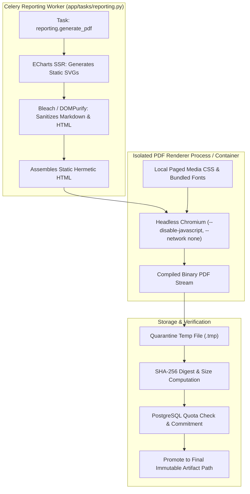

# VIBE — PHASE 9 PRODUCT & TECHNICAL PROPOSAL
## Enterprise Business Intelligence, Interactive Dashboards & On-Demand Reporting

**Document Version:** 2.0.0 (Hardened & Refined)  
**Phase:** 9  
**Target Migration:** Incremental forward migration from `e82f1b4a9c3d`  
**Status:** PROPOSED & READY FOR TECHNICAL REVIEW  

---

## 1. Executive Summary & Direction Alignment

Phase 9 delivers a production-grade **Business Intelligence (BI), Interactive Dashboard Studio & On-Demand Reporting Engine** for the VIBE platform.

It directly implements the mandate defined in [`docs/IMPLEMENTATION_PLAN.md`](file:///d:/vibe/docs/IMPLEMENTATION_PLAN.md#L106-L109), bridging the gap between VIBE's back-end compute horsepower (Polars 2.1, PostgreSQL Hybrid Storage) and executive decision-makers.

### 1.1 Strict Scope Boundaries: Phase 9 vs. Phase 10
To prevent scope drift and maintain implementation discipline, Phase 9 is strictly bounded to **on-demand user-driven workflows**:

- **Included in Phase 9:**
  1. Production Apache ECharts interactive visualization engine (10 core enterprise chart types).
  2. BI Dashboard Studio with drag-and-drop layout, global filtering, and boardroom presentation mode.
  3. Executive Operational Command Center on root `/`.
  4. On-demand Report Builder Studio on `/reports`.
  5. Isolated, headless server-side PDF compilation engine.
  6. Authorized artifact storage and signed download endpoints.
- **Explicitly Deferred to Phase 10 / Future:**
  1. Scheduled reports (cron / interval periodic triggers).
  2. Recurring automated delivery and Celery Beat daemon.
  3. Outbound email report distribution.
  4. Event-triggered threshold alert notifications.
  5. External database ingestion connectors (Snowflake, BigQuery).
  6. Real-time collaborative presence over WebSockets.

---

## 2. PDF Rendering Security Architecture

### 2.1 Threat Model & Attack Surface
Rendering user-authored reports to PDF introduces critical security vulnerabilities:
1. **Server-Side Request Forgery (SSRF):** Embedded images or stylesheets probing internal services (e.g. `http://169.254.169.254`, `http://postgres:5432`, `http://redis:6379`).
2. **Local File Inclusion (LFI):** Direct references to sensitive container files (`file:///etc/passwd`, application code, `.env`).
3. **Malicious Script Execution (XSS/RCE):** Malicious JavaScript executing within the browser rendering context.
4. **Denial of Service (DoS):** Infinite render loops, massive font loads, or excessive memory allocation triggering container OOM.

### 2.2 Server-Side SVG Rendering (Zero-Browser JS Guarantee)
A cornerstone of VIBE's hardened PDF architecture is **Apache ECharts Server-Side SVG Rendering (SSR)**:
- Instead of launching a browser to execute client-side JavaScript for charts, the Celery reporting worker uses ECharts SSR in a headless Node/Python subprocess to compile each widget configuration and Polars dataset into a **pure, static XML `<svg>` document**.
- The assembled HTML report template contains only pre-rendered static SVG strings, pre-formatted HTML data tables, and sanitized markdown.
- As a direct consequence, the PDF rendering engine executes with **JavaScript permanently disabled**:
  - Headless Chromium flag: `--disable-javascript`
  - All `<script>` tags, inline `onload/onerror` handlers, and external JS files are strictly inert.
- This architectural design **completely eliminates browser-based chart execution attacks**.

### 2.3 Renderer Process & Container Isolation


### 2.4 Defense-in-Depth Isolation Controls
1. **Total Network Denial (`--network none`):**
   - The rendering process runs in a sandbox with zero external network connectivity. Loopback only.
   - Sockets cannot connect to internal Docker networks (PostgreSQL, Redis) or cloud metadata endpoints (`169.254.169.254`).
2. **Credential Separation:**
   - The rendering process runs under dedicated unprivileged UID `10002:10002`.
   - It inherits **zero environment variables** containing database credentials, encryption master keys, or session secrets.
3. **Strict HTML/Markdown Sanitization:**
   - User-supplied Markdown is parsed and sanitized via `bleach` against a strict tag allowlist: `h1`, `h2`, `h3`, `h4`, `h5`, `h6`, `p`, `b`, `i`, `strong`, `em`, `ul`, `ol`, `li`, `table`, `thead`, `tbody`, `tr`, `th`, `td`, `pre`, `code`, `hr`, `br`, `span`, `div`.
   - Prohibited tags: `<script>`, `<iframe>`, `<object>`, `<embed>`, `<form>`, `<input>`, `<link>`, `<style>`, `<applet>`.
   - Remote resource prohibition: `src` attributes are restricted to base64 data URIs (`data:image/svg+xml;base64,...`) generated by trusted server-side SSR. All external `http://`, `https://`, and `file://` URLs are stripped.
4. **Hermetic Font & Asset Bundling:**
   - No remote web fonts. All typography uses locally bundled open-source fonts (Inter, Roboto Mono) referenced via local relative paths embedded directly in the print stylesheet.
5. **Execution & Resource Limits:**
   - Hard execution timeout: **30 seconds**.
   - Maximum output file size: **25 MB**.
   - Maximum memory ceiling: **512 MB**.
   - CPU quota: **1.0 core**.
   - PIDs ceiling: **16**.
6. **Temporary File Quarantine & Atomic Cleanup:**
   - PDF renders to an isolated temporary directory with restrictive permissions (`0700`).
   - All temp files are guaranteed unlinked in a `finally:` block, even on process abort or task timeout.

---

## 3. Artifact Storage Architecture

### 3.1 Multi-Worker Storage Abstraction
In multi-worker production deployments, saving artifacts to a local directory (`uploads/`) causes split-brain state where download requests route to workers lacking the file.

Phase 9 establishes the `ReportArtifactStorageService` implementing a unified `StorageBackendProtocol`:
```python
class StorageBackendProtocol(Protocol):
    async def put_artifact(self, storage_key: str, data: bytes) -> tuple[str, int, str]: ...
    async def get_artifact_stream(self, storage_key: str) -> AsyncIterator[bytes]: ...
    async def delete_artifact(self, storage_key: str) -> bool: ...
    async def generate_signed_url(self, storage_key: str, expires_in_seconds: int = 900) -> str: ...
```

- **Local Provider (Development):** Persists to `uploads/reports/artifacts/{org_id}/{report_id}/{run_id}.pdf`.
- **S3 / Object Store Provider (Production):** Uploads to private S3 bucket (`s3://vibe-reports/{org_id}/{report_id}/{run_id}.pdf`), emitting presigned GET URLs with a 15-minute expiration.

### 3.2 Tenant Isolation & Storage Hierarchy
- **Key Prefixing:** All storage keys are strictly prefixed with `{organization_id}/`.
- **Ownership Verification:** Every file read verifies that the path matches the caller's active `organization_id`. Cross-tenant key requests are rejected with HTTP 404 to prevent resource enumeration.
- **SHA-256 Cryptographic Integrity:** Before promoting a temporary file, the worker calculates `hashlib.sha256(data).hexdigest()`. This hash is persisted in `report_runs.artifact_sha256` and validated upon download.

### 3.3 Atomic Quota Accounting & Artifact Promotion
1. **Pre-Flight Quota Check:** Prior to launching PDF rendering, `ReportService` queries PostgreSQL `organizations.storage_used_bytes` against `settings.ANALYTICS_MAX_ORG_STORAGE_BYTES`. If remaining quota is $< 10\text{ MB}$, the run is rejected with HTTP 422 (`STORAGE_QUOTA_EXCEEDED`).
2. **Atomic Promotion:** The worker renders to `{run_id}.tmp`. Upon successful generation, the worker calculates the exact size and SHA-256 hash. In a single database transaction:
   - Increments `organizations.storage_used_bytes += actual_size`.
   - Moves `.tmp` to final storage path `{run_id}.pdf`.
   - Updates `report_runs` status to `completed`.
3. **Rollback on Failure:** If rendering fails, times out, or is cancelled, the `.tmp` file is immediately deleted, zero storage is committed to PostgreSQL, and the run transitions to `failed` or `cancelled`.

### 3.4 Authorized Download Endpoints
- **Endpoint:** `GET /api/v1/reports/{report_id}/runs/{run_id}/download`
- **Security Guardrails:**
  - Requires valid session cookie / authorization header.
  - Enforces `require_permission("reports.read")`.
  - Verifies `report_runs.organization_id == membership.organization_id`.
  - For local storage: Streams binary with headers `Content-Type: application/pdf`, `Content-Disposition: attachment; filename="report_name_date.pdf"`, and `X-Content-Type-Options: nosniff`.
  - For S3 storage: Issues HTTP 307 redirect to a 15-minute presigned GET URL with strict IP/caller HMAC binding.

---

## 4. Immutable Reporting & Reproducibility Architecture

### 4.1 Report Lifecycle State Machine
```
            +-----------+
            |   DRAFT   | (Editable in UI)
            +-----------+
                  |  Trigger "Generate PDF"
                  v
            +-----------+
            |  QUEUED   | (Immutable snapshot captured; outbox event written)
            +-----------+
                  |  Celery worker claims task
                  v
            +-----------+
            |  RUNNING  | (Polars aggregation + ECharts SSR + Headless PDF render)
            +-----------+
             /    |    \
   Cancel   /     |     \  Error / Timeout
           v      v      v
+-----------+ +-----------+ +-----------+
| CANCELLED | | COMPLETED | |  FAILED   |
+-----------+ +-----------+ +-----------+
```

### 4.2 Immutable Run Snapshots & Data Revision Pinning
When a report run transitions to `queued`:
1. **Layout & Content Snapshot:** `report_runs.report_snapshot` freezes the complete JSON state of report metadata, section order, markdown text, and widget parameters. Future edits to the report definition **never alter historical runs**.
2. **Filter & Date Range Snapshot:** `report_runs.filter_snapshot` freezes all global and widget-level filters applied during the run.
3. **Data Revision Reference:** `report_runs.data_revision_ref` records the sheet cell versions (`last_checkpoint_vibe_version`) or Parquet snapshot hashes at execution time. This guarantees that audit inquiries can establish precisely what data existed when the report was compiled.

### 4.3 Outbox Pattern Reuse & Crash Recovery
- **Zero Dropped Jobs:** Leverages the existing `OutboxDispatcher` daemon and PostgreSQL outbox pattern. The request transaction writes `INSERT INTO report_runs` and `INSERT INTO report_outbox_events` atomically.
- **Idempotency Guarantee:** Composite unique index `(organization_id, idempotency_key)` rejects duplicate trigger submissions within a 60-second window.
- **Worker Crash Recovery:** `report_runs.lease_expires_at` is set to 60 seconds upon claim. Workers renew the lease during multi-section rendering. If a worker process terminates abruptly, the `OutboxDispatcher` sweep identifies expired leases and re-enqueues or marks the run `failed` without deadlock.

---

## 5. Multi-Tenant Dashboard Security & Filter Architecture

### 5.1 Typed Parameterized Filter Schema
To prevent arbitrary SQL injection or Polars expression tampering, dashboard filters are strictly governed by a Pydantic v2 schema:

```python
class FilterOperator(str, Enum):
    EQ = "eq"
    NEQ = "neq"
    GT = "gt"
    GTE = "gte"
    LT = "lt"
    LTE = "lte"
    IN = "in"
    NOT_IN = "not_in"
    BETWEEN = "between"

class DashboardFilterInput(BaseModel):
    dimension: str = Field(..., pattern=r"^[a-zA-Z0-9_]{1,64}$")
    operator: FilterOperator
    value: Any
    timezone: str = Field(default="UTC", pattern=r"^[A-Za-z0-9_/\+\-]+$")
```

### 5.2 Server-Side Query Construction & Injection Prevention
- **Polars Expression Mapping:** Filters are mapped directly to compiled Polars AST methods:
  ```python
  if filter.operator == FilterOperator.EQ:
      df = df.filter(pl.col(filter.dimension) == filter.value)
  elif filter.operator == FilterOperator.IN:
      df = df.filter(pl.col(filter.dimension).is_in(filter.value))
  elif filter.operator == FilterOperator.BETWEEN:
      v_start, v_end = filter.value
      df = df.filter(pl.col(filter.dimension).is_between(v_start, v_end))
  ```
- **Zero Dynamic Code Execution:** No `eval()`, `exec()`, or raw string SQL queries are ever constructed.
- **Date & Timezone Normalization:** Date-based dimensions parse inputs as ISO 8601 UTC timestamps, preventing timezone shift errors across multi-region organizations.

### 5.3 Workspace Membership Enforcement
- Client-supplied `workspace_id` parameters are never blindly trusted.
- The service executes an authoritative join against `OrganizationMembership` verifying that the authenticated user possesses active membership in the target workspace.
- Any attempt to access dashboards or widgets belonging to another organization or unassigned workspace triggers `EntityNotFoundError` (returning HTTP 404 to eliminate enumeration).

---

## 6. Visualization Architecture & Realistic Performance Budgets

### 6.1 Supported Enterprise Chart Types (10 Core Types)
Phase 9 concentrates on the 10 most demanded enterprise business intelligence charts:
1. **Standard Bar Chart:** Vertical single-metric categorical comparison.
2. **Stacked & Grouped Bar Chart:** Multi-metric breakdown across dimensions.
3. **Horizontal Bar Chart:** High-cardinality ranking and leaderboard displays.
4. **Standard Line Chart:** Time-series trends and trajectories.
5. **Smooth Line & Multi-Axis Chart:** Correlated dual-metric time-series (e.g. Revenue vs Conversion Rate).
6. **Stacked Area Chart:** Cumulative volume progression over time.
7. **Pie & Donut Chart:** Proportional compositional share (bounded to $\le 7$ slices).
8. **Scatter Plot:** Two-variable distribution analysis.
9. **Heatmap Matrix:** Cross-dimensional intensity matrix (e.g. Day-of-Week vs Hour-of-Day).
10. **Multi-Metric KPI Card:** Primary value, delta percentage, and mini sparkline.

### 6.2 Safe Declarative Option Generation
- Chart option generators in `chart-options-builder.ts` are pure functional mappers.
- Custom formatter functions are **strictly declarative tokens**:
  - `"{value}%"` for percentages.
  - `"currency_usd"` for localized dollar formatting.
  - `"number_compact"` (e.g. `$1.2M`, `450K`).
- Zero arbitrary JavaScript code strings (`new Function(...)` or `eval()`) are accepted or executed on the client.

### 6.3 Client-Side Lazy Loading & Theme Bridge
- **Dynamic Import:** ECharts is lazy-loaded via `next/dynamic(() => import('@/components/charts/echarts-wrapper'), { ssr: false })`. The initial Next.js shell and spreadsheet grid remain lightweight ($0\text{ kB}$ ECharts on initial page load).
- **Theme Adaptation:** The chart wrapper bridges Tailwind CSS custom properties (`--foreground`, `--muted-foreground`, `--border`, `--surface`) into ECharts color themes. Switching between Light and Dark mode triggers a seamless `chartInstance.setOption(...)` re-theme without DOM re-mount.

### 6.4 Realistic Performance Budgets & Target Environment
To ensure measurable verification, Phase 9 establishes explicit performance budgets tested against realistic baseline constraints:

| Metric | Target Budget | Test Environment Baseline |
|---|---|---|
| **Initial Dashboard Load** | $\le 600\text{ ms}$ | 6 active widgets, local 100 Mbps simulated connection |
| **Widget Query Aggregation** | $\le 120\text{ ms}$ (p95) | 50,000 sheet rows aggregated in Polars |
| **Chart Client Render Latency** | $\le 150\text{ ms}$ | Canvas render, Chrome 130+, 4-core CPU |
| **Dashboard Scroll Frame Rate** | $\ge 58\text{ FPS}$ (0 dropped) | 60 Hz display, 1080p viewport, 1000px vertical scroll |
| **Client Memory Footprint** | $\le 85\text{ MB}$ total heap | 6 widgets active, zero leak across 10 dashboard tab switches |
| **PDF Generation Execution** | $\le 8.0\text{ s}$ total | 6 pages, 4 chart snapshots, 2 data tables |

---

## 7. Architectural Decisions Register

| Decision | Selected Strategy | Rejected Alternatives | Technical Justification |
|---|---|---|---|
| **Chart Engine** | **Apache ECharts** | Recharts, Chart.js, D3 | Out-of-the-box support for all 10 enterprise types; high-performance Canvas rendering; native server-side SVG rendering (SSR) capability. |
| **PDF Chart Strategy** | **Server-Side SVG Injection (SSR)** | Browser client screenshotting (`canvas.toDataURL()`) | Client screenshotting is unreliable, browser-dependent, and blocks user interaction. Server SSR produces deterministic vector graphics and allows disabling JavaScript in the PDF engine. |
| **PDF Engine** | **Headless Chromium (`--disable-javascript`)** | WeasyPrint, wkhtmltopdf | Headless Chromium provides 100% compliant CSS Grid, Flexbox, and SVG support. Disabling JavaScript mitigates browser-based RCE/SSRF attacks completely. |
| **Artifact Storage** | **Abstract `StorageBackendProtocol`** | Raw local `uploads/` path | Enables seamless deployment to S3/MinIO in clustered multi-worker environments while supporting local files in development. |
| **Reporting Scope** | **On-Demand Generation Only (Phase 9)** | Combining Scheduled Cron & Email in Phase 9 | Prevents scope creep. Establishing an isolated on-demand reporting engine provides a stable foundation before Phase 10 introduces Celery Beat scheduling. |
