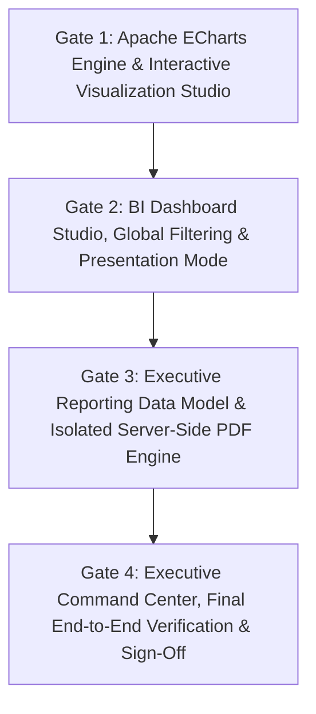

# VIBE — PHASE 9 IMPLEMENTATION ROADMAP
## Sequential Gate Breakdown, Engineering Tasks & Verification Milestones

**Document Version:** 2.0.0 (Hardened & Refined)  
**Phase:** 9  
**Target Migration:** Incremental forward migration from `e82f1b4a9c3d`  
**Execution Strategy:** Sequential gate execution with automated verification gates at each step  

---

## 1. Roadmap Overview & Gate Dependencies

Phase 9 is structured into four sequential, dependency-ordered engineering gates. No gate may commence until the preceding gate has passed all automated unit, integration, and security verification checks:

---

## 2. Gate 1: Apache ECharts Engine & Interactive Visualization Studio
**Status:** Completed & Verified (Gate 1 Implementation Accepted)

### 2.1 Objective
Replace the prototype inline SVG charts on `/dashboards` with a production-grade Apache ECharts visualization engine supporting 10 core enterprise chart types, dark/light theme switching, lazy-loaded client bundles, and high-performance Canvas rendering.

### 2.2 Existing Modules to Reuse
- `backend/app/services/dashboard.py`: Existing Polars sheet data extraction and aggregation queries.
- `backend/app/schemas/dashboard.py`: Existing `WidgetRead`, `WidgetCreateInput`, `WidgetDataQueryResponse`.
- `frontend/src/components/ui/`: Existing Radix design primitives (`Card`, `Badge`, `Button`, `Dialog`, `Select`).

### 2.3 New Modules to Create
- `frontend/src/components/charts/echarts-wrapper.tsx`: Next.js lazy-loaded, theme-aware React wrapper for Apache ECharts.
- `frontend/src/components/charts/chart-options-builder.ts`: Pure functional mapper translating Polars query responses into typed, declarative ECharts options.
- `frontend/src/components/charts/kpi-card.tsx`: Metric card with sparkline and percentage delta calculation.
- `frontend/src/components/charts/chart-skeleton.tsx`: Pulse loading placeholder for chart canvases.

### 2.4 Exact Implementation Tasks
1. Add `echarts` and `echarts-for-react` to `frontend/package.json` with tree-shaking configuration.
2. Build `echarts-wrapper.tsx` using `next/dynamic` (`ssr: false`) to ensure zero impact on initial page bundle.
3. Implement pure functional option generators in `chart-options-builder.ts` for all 10 chart types (Bar, Stacked Bar, Grouped Bar, Line, Smooth Line, Area, Pie/Donut, Scatter, Heatmap Matrix, KPI Card).
4. Implement declarative token formatters (`"{value}%"`, `"currency_usd"`, `"number_compact"`).
5. Bridge Tailwind CSS design variables (`--foreground`, `--muted-foreground`, `--border`, `--surface`) into ECharts theme configurations.
6. Replace manual SVG paths in `frontend/src/app/dashboards/page.tsx` with `<EChartsWrapper />`.

### 2.5 Security & Guardrails
- **Zero Arbitrary JavaScript:** Chart configurations must not accept or execute raw JavaScript code strings (`eval()`, `new Function()`, or custom inline JS formatters). All tooltips and labels use declarative tokens.
- **Client-Side Lazy Loading:** ECharts bundle must not load on unauthenticated routes or spreadsheet grid views.

### 2.6 Test Cases
- **Unit Tests (`frontend/src/__tests__/chart-options-builder.test.ts`):**
  - Verify declarative option generation for all 10 chart types with complete tabular data.
  - Test boundary conditions: empty data array, single row, missing categorical dimensions, null numeric values.
  - Verify theme bridge: light mode yields dark typography; dark mode yields light typography.
- **Performance Tests:**
  - Verify Canvas rendering latency $\le 150\text{ms}$ on a 5,000-point scatter plot.
  - Verify 60 FPS scrolling in Chrome DevTools on a dashboard mounting 6 active ECharts widgets.

### 2.7 Measurable Acceptance Criteria
1. All 10 chart types render cleanly without console warnings or layout shifts in both Light and Dark modes.
2. Hover tooltips, legend series toggling, and data zoom controls function smoothly.
3. Zero regressions across the 48 frontend Vitest tests and 431 backend tests.

### 2.8 Rollback Strategy
Revert `frontend/package.json` and `echarts-wrapper.tsx`. Re-enable baseline SVG render fallbacks. Zero backend or database changes occur in Gate 1.

---

## 3. Gate 2: BI Dashboard Studio, Global Filtering & Presentation Mode

### 3.1 Objective
Deliver an interactive dashboard canvas supporting responsive grid adjustments, cross-widget global filtering, and a distraction-free boardroom presentation mode with automated widget cycling.

### 3.2 Existing Modules to Reuse
- `backend/app/services/dashboard.py`: `query_widget_data`, `batch_update_layout`.
- `backend/app/models/dashboard.py`: `Dashboard`, `DashboardWidget`.
- `frontend/src/app/dashboards/page.tsx`: Existing dashboard CRUD dialogs.

### 3.3 New Modules to Create
- `frontend/src/components/dashboard/dashboard-filter-bar.tsx`: Global filter bar supporting Date Range, Workspace, and category filters.
- `frontend/src/components/dashboard/presentation-mode-modal.tsx`: Fullscreen 100vw/100vh modal with automated slideshow cycling.
- `frontend/src/components/dashboard/widget-config-drawer.tsx`: Slide-out drawer for configuring chart types, aggregations, and metrics.

### 3.4 Exact Implementation Tasks
1. Define typed `DashboardFilterInput` schema in `backend/app/schemas/dashboard.py` with strict regex and operator allowlist.
2. Extend `DashboardService.query_widget_data` to combine widget-level filters with dashboard-level global filters using compiled Polars expressions.
3. Enforce workspace membership authorization: client-supplied `workspace_id` must match authenticated `OrganizationMembership.workspace_id`.
4. Build `dashboard-filter-bar.tsx` on the frontend with debounced state synchronization.
5. Implement `presentation-mode-modal.tsx` supporting full-screen canvas expansion and configurable 30-second automated widget cycling.

### 3.5 Security Requirements
- **Server-Side Filter Validation:** Filter dimensions must match `^[a-zA-Z0-9_]{1,64}$`. Operators restricted to `eq`, `neq`, `gt`, `gte`, `lt`, `lte`, `in`, `between`.
- **Zero SQL / Polars Injection:** Queries must execute via compiled Polars methods (`pl.col(dim) == val`), strictly prohibiting string concatenation or `eval()`.
- **Tenant Isolation:** Filter queries against another organization's workspace return HTTP 404.

### 3.6 Test Cases
- **Integration Tests (`backend/tests/integration/test_dashboards_api.py`):**
  - `test_global_filter_propagation_across_widgets`: Verifies that global date filter filters both sheet-sourced and analytics-sourced widgets.
  - `test_invalid_filter_operator_rejected`: Probes filter endpoint with arbitrary operator (e.g. `__import__`, `DROP TABLE`); asserts HTTP 422.
  - `test_cross_workspace_filter_isolation`: User in Workspace A attempts to query Workspace B dashboard; asserts HTTP 404.
- **Frontend Component Tests (`frontend/src/__tests__/integrations-and-dashboards.test.tsx`):**
  - Test filter bar parameter changes, presentation mode fullscreen trigger, and drawer configuration updates.

### 3.7 Measurable Acceptance Criteria
1. Selecting a global date or categorical filter dynamically updates all widgets on the dashboard within $\le 200\text{ms}$.
2. Presentation mode expands seamlessly to fullscreen, hiding navigation elements and enabling auto-cycle.
3. Dashboard layout configuration persists cleanly to `dashboards.layout_config` in PostgreSQL.

### 3.8 Rollback Strategy
Revert frontend filter bar and backend filter parsing. The core `query_widget_data` logic reverts to its Gate 1 baseline without database migration impact.

---

## 4. Gate 3: Executive Reporting Data Model & Isolated Server-Side PDF Engine

### 4.1 Objective
Build the end-to-end Enterprise Reporting subsystem (`/reports`), including database models, RBAC permissions, multi-section report builder UI, isolated server-side PDF compilation with zero-browser JS execution (ECharts SSR), and authorized artifact download.

### 4.2 Database Migration & Schema Changes
- **Alembic Migration:** `create_phase9_reporting_subsystem.py` (Down revision: `e82f1b4a9c3d`)
  - **`reports` table:** `id` (UUID), `organization_id` (UUID FK), `workspace_id` (UUID FK), `created_by_user_id` (UUID FK), `title` (String), `description` (Text), `page_orientation` (String), `page_size` (String), `header_footer_config` (JSONB), `version` (Integer), `created_at`, `updated_at`.
  - **`report_sections` table:** `id` (UUID), `report_id` (UUID FK CASCADE), `organization_id` (UUID FK), `section_type` (String: markdown, widget, table, page_break), `content_config` (JSONB), `sort_order` (Integer), `created_at`, `updated_at`.
  - **`report_runs` table:** `id` (UUID), `report_id` (UUID FK CASCADE), `organization_id` (UUID FK), `requested_by_user_id` (UUID FK), `status` (String: queued, running, completed, failed, cancelled), `report_snapshot` (JSONB), `filter_snapshot` (JSONB), `data_revision_ref` (JSONB), `artifact_path` (String), `artifact_size_bytes` (Integer), `artifact_sha256` (String), `idempotency_key` (String), `lease_expires_at` (DateTime), `error_message` (Text), `execution_time_ms` (Integer), `created_at`, `completed_at`.
  - **`report_outbox_events` table:** Transactional outbox for guaranteed Celery task dispatch.
  - **Permissions:** Seed `reports.read`, `reports.create`, `reports.update`, `reports.delete`, `reports.export`.
  - **Role Backfill:** Assign permissions to `owner`, `admin`, `member`, `viewer` roles.

### 4.3 Existing Modules to Reuse
- `backend/app/db/transaction.py`: Transaction manager for atomic outbox commits.
- `backend/app/tasks/dispatcher.py`: Outbox dispatcher daemon polling outbox events.
- `backend/app/services/audit.py`: Audit service recording report lifecycle events.
- `backend/app/services/dashboard.py`: Reused for querying widget datasets.

### 4.4 New Modules to Create
- `backend/app/models/report.py`: ORM models for reports, sections, runs, outbox events.
- `backend/app/schemas/report.py`: Pydantic schemas for report CRUD, section types, run status.
- `backend/app/repositories/report.py`: Asynchronous repository layer with strict composite key tenant scoping.
- `backend/app/services/report.py`: Report lifecycle service and immutable snapshot capture.
- `backend/app/services/report_pdf.py`: Isolated PDF compilation service with ECharts SSR and headless Chromium.
- `backend/app/services/report_storage.py`: `ReportArtifactStorageService` implementing `StorageBackendProtocol`.
- `backend/app/tasks/reporting.py`: Celery task `reporting.generate_pdf` with lease renewal and cooperative cancellation.
- `backend/app/api/v1/routers/reports.py`: Full REST API suite registered under `/api/v1/reports`.
- `frontend/src/app/reports/page.tsx`: Report list, builder studio, and PDF export modal.
- `frontend/src/components/reports/section-markdown-editor.tsx`: Sanitized markdown text section editor.
- `frontend/src/components/reports/section-widget-picker.tsx`: Widget selector for report inclusion.
- `frontend/src/components/reports/section-sheet-table.tsx`: Spreadsheet table slice selector.

### 4.5 Exact Implementation Tasks
1. Generate and apply Alembic migration `create_phase9_reporting_subsystem.py`.
2. Implement `ReportService` managing report definitions and capturing immutable snapshots on run trigger.
3. Implement `ReportPdfService` executing ECharts SSR to static SVGs, sanitizing Markdown via `bleach`, and compiling PDF via headless Chromium (`--disable-javascript`, `--network none`).
4. Implement `ReportArtifactStorageService` providing atomic quarantine promotion (`.tmp` $\to$ `.pdf`) and SHA-256 verification.
5. Implement authorized download endpoint `GET /api/v1/reports/{id}/runs/{run_id}/download` with tenant fencing.
6. Build frontend `/reports` studio view and activate sidebar navigation link.

### 4.6 Security & SSRF Requirements
- **Total Network Denial:** PDF renderer executes with `--network none`. No outbound HTTP/DNS requests.
- **Zero Browser JavaScript:** Headless Chromium runs with `--disable-javascript`. All charts pre-rendered as static SVGs via server SSR.
- **Strict Markdown Sanitization:** HTML sanitization strips all ``; asserts script is inert or stripped.
  - `test_cross_tenant_report_download_denied`: User in Org A requests Org B's run artifact; asserts HTTP 404.

### 4.8 Measurable Acceptance Criteria
1. On-demand reports can be constructed with mixed text, ECharts snapshots, and tabular spreadsheet slices.
2. "Generate PDF" queues background job, transitions deterministically (`queued` $\to$ `running` $\to$ `completed`), and produces a high-fidelity PDF $\le 8.0\text{s}$.
3. Downloaded PDF renders cleanly with offline fonts, print page breaks, and verified SHA-256 hash.
4. Database migration upgrades and downgrades cleanly back to `e82f1b4a9c3d` on a test database.

### 4.9 Rollback Strategy
Execute `alembic downgrade e82f1b4a9c3d` to drop reporting tables. Unregister `reports_router` in `backend/app/main.py`. Reset sidebar link to `coming_soon`. Platform returns to Gate 2 baseline.

---

## 5. Gate 4: Executive Command Center, Final Regression & Sign-Off

### 5.1 Objective
Upgrade `/` into a unified Executive Command Center, execute full regression suites across backend and frontend, verify performance budgets, and finalize documentation.

### 5.2 Files & Modules
- **Modified Frontend Modules:**
  - `frontend/src/app/page.tsx`: Replace Phase 2 showcase with Executive Command Center.
  - `frontend/src/__tests__/home.test.tsx`: Update homepage tests to verify executive summary cards and quick navigation links.
- **Documentation Updates:**
  - `docs/CHANGELOG.md`: Record Phase 9 additions and verified gates.
  - `docs/API_DOCUMENTATION.md`: Document `/api/v1/reports/*` endpoints.
  - `docs/PROJECT_OVERVIEW.md`: Update feature completion matrix.

### 5.3 Implementation Tasks
1. Build Executive Command Center on `frontend/src/app/page.tsx`:
   - Metric cards: Total Active Spreadsheets, Total Analytics Runs, Storage Quota Utilization gauge.
   - Pinned / Starred Dashboards carousel.
   - Recent activity ledger.
2. Update `frontend/src/__tests__/home.test.tsx` to assert new dashboard elements.
3. Execute complete regression and quality test suite.

### 5.4 Full Regression Suite Verification
1. `backend\.venv\Scripts\python -m pytest backend/tests -m "not live" -q` (Target: $\ge 450$ passed, 0 failed).
2. `npm --prefix frontend test -- --run` (Target: $\ge 55$ passed, 0 failed).
3. `backend\.venv\Scripts\ruff check backend/app backend/tests` (0 errors).
4. `backend\.venv\Scripts\mypy backend/app` (0 errors across all source files).
5. `npm --prefix frontend run lint` (0 errors).
6. `npm --prefix frontend run build` (Clean Next.js Turbopack build).
7. Alembic head check: verified at new Phase 9 head.

---

## 6. Comprehensive Phase 9 Rollback & Disaster Recovery Strategy

If an unrecoverable defect occurs during Phase 9 execution:
1. **Database:** Execute `alembic downgrade e82f1b4a9c3d`. Drops all Phase 9 tables and permissions.
2. **Backend:** Unregister `reports_router` in `backend/app/main.py`.
3. **Frontend:** Revert `/reports` and `/dashboards` components; reset sidebar badges.
4. **Result:** Platform returns immediately to the stable, fully accepted Phase 8 baseline.
