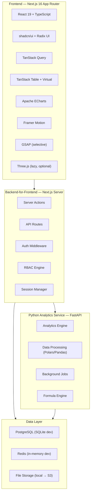
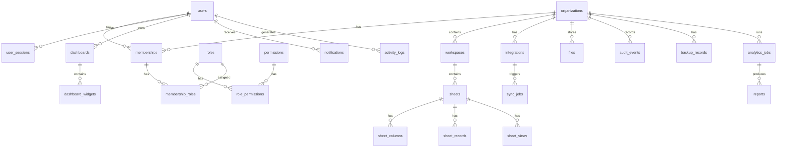
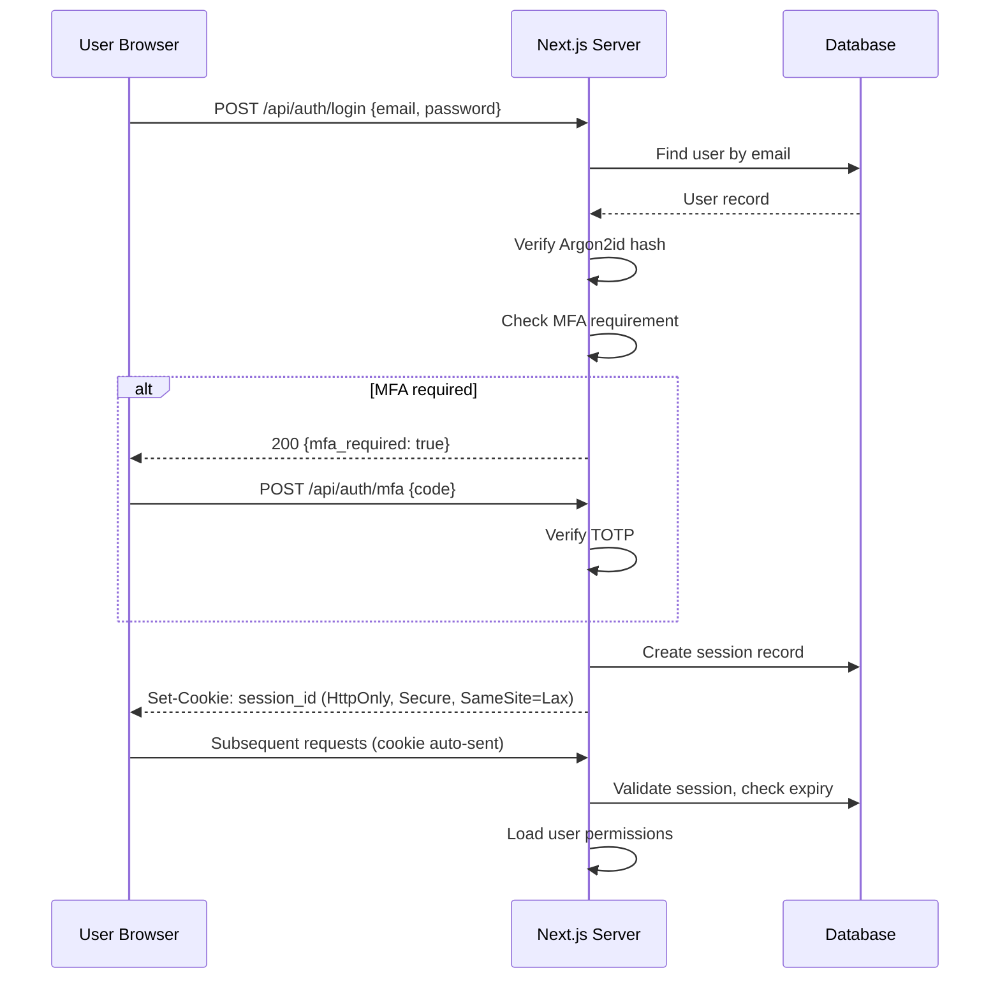
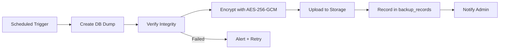

# Enterprise Admin & Data Intelligence Platform — Technical Assessment & Implementation Plan

> [!IMPORTANT]
> **This document requires your approval before any implementation begins.**
> Review each section carefully. I will not write any production code until you confirm.

---

## 1. Repository Assessment

| Item | Finding |
|---|---|
| **Repository location** | `d:\vibe` |
| **Current state** | **Empty directory** — no files, no git history, no hidden config |
| **Existing code** | None — greenfield project |
| **Git status** | Not initialized |
| **Reusable components** | None |
| **Known bugs** | N/A |

### Environment Inventory

| Tool | Version | Status |
|---|---|---|
| Node.js | v26.13.0 | ✅ Ready |
| npm | 11.20.0 | ✅ Ready |
| Python | 3.14.7 | ✅ Ready |
| pip | 26.2.1 | ✅ Ready |
| Git | Available | ✅ Ready |
| Docker | Not found | ⚠️ Not installed |
| PostgreSQL (psql) | Not found | ⚠️ Not installed locally |
| Redis (redis-cli) | Not found | ⚠️ Not installed locally |

### Pre-installed Python Packages (Global)

| Package | Version |
|---|---|
| FastAPI | 0.141.1 |
| Pydantic | 2.13.5 |
| uvicorn | 0.53.0 |
| httpx | 0.28.1 |
| numpy | 2.5.3 |
| pandas | 3.0.5 |
| scikit-learn | 1.9.1 |
| scipy | 1.18.1 |
| matplotlib | 3.11.2 |
| argon2-cffi | 25.1.0 |
| cryptography | 50.0.1 |
| Pillow | 12.3.0 |

**Not installed:** SQLAlchemy, Alembic, Celery, Redis, Polars

### System Resources

| Resource | Value |
|---|---|
| CPUs | 12 |
| RAM | ~16 GB |
| D: drive free | 243 GB |
| C: drive free | 132 GB |

---

## 2. Architecture Decision: Adapting to Environment Constraints

> [!WARNING]
> **Docker, PostgreSQL, and Redis are not installed locally.** This is the single most consequential constraint. I need your decision on how to handle it.

### Option A: SQLite-First Development (⭐ Recommended)

Use SQLite as the development database, with the schema designed for full PostgreSQL compatibility. PostgreSQL, Redis, and Celery are added when Docker becomes available or for production deployment.

**Advantages:**
- Zero infrastructure setup — start building immediately
- SQLAlchemy abstracts the SQL dialect; same models work on both
- Alembic migrations are database-agnostic
- You see a working application within hours, not days
- Can swap to PostgreSQL at any time with a single connection string change

**Trade-offs:**
- No JSONB (use JSON text with validation instead)
- No advisory locks (use file locks for dev)
- No Redis caching/queuing (use in-memory caching; add later)
- No Celery workers (use synchronous task execution with `asyncio` in dev)
- Background jobs run in-process during development

### Option B: Install Docker + PostgreSQL + Redis First

**Advantages:**
- Production-identical environment from day 1

**Disadvantages:**
- Requires Docker Desktop installation (may need admin rights, license)
- Significant setup time before any feature work
- Higher system resource usage on a 16GB machine

### Option C: Use Cloud-Hosted PostgreSQL/Redis

**Advantages:**
- Real databases, no Docker needed

**Disadvantages:**
- Requires cloud accounts, costs money, adds network dependency

**My Recommendation: Option A** — Get the full application running on SQLite, then upgrade to PostgreSQL/Redis when Docker is available. The architecture will be designed for PostgreSQL from the start — SQLite is just the development driver.

---

## 3. Recommended Architecture



### Architecture Decisions

| Decision | Choice | Rationale |
|---|---|---|
| **Architecture style** | Modular monolith (Next.js) + analytics sidecar (FastAPI) | Avoids microservice complexity; clear separation where needed |
| **Frontend framework** | Next.js 16 App Router | SSR, RSC, server actions, file-based routing |
| **Component library** | shadcn/ui + Radix primitives | Customizable, accessible, no vendor lock-in |
| **State management** | TanStack Query (server) + React context (client) | Eliminates Redux complexity; server state handled properly |
| **Spreadsheet engine** | TanStack Table + TanStack Virtual + custom formula parser | Production virtualization; no dependency on heavy grid libraries |
| **Charts** | Apache ECharts | Most complete, performant; supports all required chart types |
| **Database ORM** | SQLAlchemy 2.1 + Alembic | Industry standard; async support; database-agnostic |
| **Validation** | Zod (frontend) + Pydantic (backend) | Type-safe validation at every boundary |
| **Auth** | Custom server-side sessions (HttpOnly cookies, Argon2id) | Full control; no third-party auth dependency |
| **API communication** | Next.js API routes + Server Actions → FastAPI via internal HTTP | Simple, debuggable, no message bus needed initially |
| **Background processing** | FastAPI BackgroundTasks (dev) → Celery + Redis (production) | Start simple, scale later |
| **File storage** | Local filesystem (dev) → S3-compatible (production) | Abstracted via storage service layer |

---

## 4. Technology Stack — Pinned Versions

### Frontend (`package.json`)

| Package | Version | Purpose |
|---|---|---|
| next | ^16.4.3 | App framework |
| react / react-dom | ^19.3.1 | UI library |
| typescript | ^7.0.2 | Type safety |
| tailwindcss | ^4.3.3 | Styling |
| @tanstack/react-query | ^5.105.0 | Server state |
| @tanstack/react-table | ^9.3.1 | Data tables / spreadsheet |
| @tanstack/react-virtual | latest | Virtualized lists |
| zod | ^4.6.7 | Validation |
| echarts / echarts-for-react | ^6.1.0 | Charts |
| framer-motion | ^14.9.0 | Animations |
| gsap | ^3.15.0 | Premium animations |
| three / @react-three/fiber | ^0.187.0 / ^9.8.2 | 3D (lazy loaded) |
| react-hook-form | latest | Forms |
| @hookform/resolvers | latest | Zod integration |
| lucide-react | latest | Icons |
| sonner | latest | Toast notifications |
| cmdk | latest | Command palette |
| next-themes | latest | Theme switching |
| date-fns | latest | Date handling |
| vitest | ^5.0.5 | Unit testing |
| @testing-library/react | ^16.3.3 | Component testing |
| playwright | ^1.64.1 | E2E testing |

### Backend Python (`requirements.txt`)

| Package | Version | Purpose |
|---|---|---|
| fastapi | ~=0.141.1 | Analytics API |
| uvicorn | ~=0.53.0 | ASGI server |
| sqlalchemy | ~=2.1.6 | ORM |
| alembic | ~=1.20.1 | Migrations |
| pydantic | ~=2.13.5 | Validation |
| httpx | ~=0.28.1 | HTTP client |
| argon2-cffi | ~=25.1.0 | Password hashing |
| cryptography | ~=50.0.1 | Encryption |
| python-jose[cryptography] | latest | JWT/token handling |
| pandas | ~=3.0.5 | Data processing |
| polars | ~=2.1.0 | Fast data processing |
| numpy | ~=2.5.3 | Numerical computing |
| scipy | ~=1.18.1 | Statistical analysis |
| scikit-learn | ~=1.9.1 | ML (clustering, etc.) |
| matplotlib | ~=3.11.2 | Report generation |
| openpyxl | latest | Excel I/O |
| python-multipart | latest | File uploads |
| aiofiles | latest | Async file I/O |
| pytest | latest | Testing |
| pytest-asyncio | latest | Async testing |
| pytest-cov | latest | Coverage |

---

## 5. Database Architecture

### Entity-Relationship Overview



### Core Tables

#### Identity & Access

| Table | Key Columns | Notes |
|---|---|---|
| `users` | id, email, password_hash, display_name, avatar_url, status, email_verified, mfa_secret, created_at, updated_at | Argon2id hashed passwords |
| `organizations` | id, name, slug, settings, plan, created_at | Multi-tenant root |
| `memberships` | id, user_id, org_id, status, created_at | User ↔ Org link |
| `roles` | id, org_id, name, description, is_system, created_at | System + custom roles |
| `permissions` | id, resource, action, description | Granular permission definitions |
| `role_permissions` | role_id, permission_id | Many-to-many |
| `membership_roles` | membership_id, role_id | Users have roles per org |
| `user_sessions` | id, user_id, token_hash, ip, user_agent, expires_at, revoked_at | Server-side sessions |

#### Spreadsheet Engine

| Table | Key Columns | Notes |
|---|---|---|
| `workspaces` | id, org_id, name, description, icon, position | Container for sheets |
| `sheets` | id, workspace_id, name, description, row_count, created_by | Individual data tables |
| `sheet_columns` | id, sheet_id, name, data_type, config, position, width, formula | Column definitions with type/formula metadata |
| `sheet_records` | id, sheet_id, data (JSON), row_number, version, created_by, updated_at | **JSONB for flexible cell storage** |
| `sheet_views` | id, sheet_id, name, filters, sorts, groups, visible_columns, is_default | Saved views |
| `sheet_history` | id, sheet_id, record_id, column_id, old_value, new_value, changed_by, changed_at | Cell-level change tracking |

**Trade-off decision: JSONB for sheet_records**

| Approach | Pros | Cons |
|---|---|---|
| **JSONB `data` column** ⭐ | Flexible schema per sheet; fast reads; GIN indexing; simple CRUD | Harder cross-row queries; larger storage per row |
| Fully normalized (value-per-cell table) | Maximum query flexibility | Explosive row count; complex joins; slower writes |
| EAV pattern | Traditional flexibility | Performance nightmare at scale |

**Recommendation:** Use JSONB for cell data stored as `{"col_id": value, ...}`. This mirrors how Airtable and Notion store flexible records. Column definitions in `sheet_columns` provide the schema overlay. For PostgreSQL, GIN indexes enable efficient querying. For SQLite dev, use JSON text with application-level validation.

#### Analytics & Reporting

| Table | Key Columns | Notes |
|---|---|---|
| `data_sources` | id, org_id, name, type, config, status | Uploaded files, connected sheets |
| `analytics_jobs` | id, org_id, data_source_id, type, parameters, status, result, started_at, completed_at | Background analytics |
| `dashboards` | id, org_id, name, layout, is_default, created_by | Custom dashboards |
| `dashboard_widgets` | id, dashboard_id, type, config, position, size | Individual widgets |
| `reports` | id, org_id, name, type, config, generated_file_id, created_at | Generated reports |

#### Integration & Files

| Table | Key Columns | Notes |
|---|---|---|
| `integrations` | id, org_id, provider, status, config, last_sync_at | Google Sheets etc. |
| `oauth_credentials` | id, integration_id, access_token_enc, refresh_token_enc, expires_at | **Encrypted at rest** |
| `sync_jobs` | id, integration_id, direction, status, records_processed, error, started_at | Sync history |
| `files` | id, org_id, name, mime_type, size, storage_path, uploaded_by, created_at | File metadata |
| `file_versions` | id, file_id, version, storage_path, created_by, created_at | Version history |

#### Operational

| Table | Key Columns | Notes |
|---|---|---|
| `notifications` | id, user_id, org_id, type, title, body, read_at, created_at | In-app notifications |
| `activity_logs` | id, org_id, user_id, action, resource_type, resource_id, metadata, created_at | User activity |
| `audit_events` | id, org_id, actor_id, event_type, severity, details, ip, created_at | Security audit (append-only) |
| `backup_records` | id, org_id, type, status, file_path, size, checksum, encrypted, created_at | Backup tracking |
| `background_jobs` | id, type, payload, status, attempts, result, scheduled_at, started_at, completed_at | Job queue |

---

## 6. Security Architecture

### Threat Model (STRIDE Summary)

| Threat | Mitigation |
|---|---|
| **Spoofing** | Argon2id password hashing; server-side sessions; HttpOnly/Secure cookies; optional MFA |
| **Tampering** | CSRF tokens; input validation (Zod + Pydantic); parameterized queries (SQLAlchemy) |
| **Repudiation** | Immutable audit log; activity logging with IP/UA |
| **Information Disclosure** | Encrypted credentials at rest (AES-256-GCM); no secrets in frontend; CSP headers; error sanitization |
| **Denial of Service** | Rate limiting; request size limits; pagination; background processing for heavy ops |
| **Elevation of Privilege** | RBAC + ABAC server-side checks; tenant isolation; IDOR prevention |

### Authentication Flow



### Encryption Strategy

| Data | Method |
|---|---|
| Passwords | Argon2id (hash, not encrypt) |
| OAuth tokens | AES-256-GCM, key from environment variable |
| Session tokens | SHA-256 hash stored in DB; raw token in cookie |
| Backups | AES-256-GCM with separate backup key |
| Network | HTTPS/TLS (production) |

### Security Headers (Next.js middleware)

```
Content-Security-Policy: default-src 'self'; script-src 'self' 'unsafe-eval'; style-src 'self' 'unsafe-inline'; img-src 'self' data: blob:; connect-src 'self'
X-Content-Type-Options: nosniff
X-Frame-Options: DENY
X-XSS-Protection: 0
Referrer-Policy: strict-origin-when-cross-origin
Permissions-Policy: camera=(), microphone=(), geolocation=()
Strict-Transport-Security: max-age=31536000; includeSubDomains
```

---

## 7. Backup & Disaster Recovery Architecture

### Strategy

| Aspect | Development | Production |
|---|---|---|
| **Database backup** | SQLite file copy | pg_dump (logical) + WAL archiving (PITR) |
| **Schedule** | Manual + daily | Every 6 hours + continuous WAL |
| **Encryption** | AES-256-GCM | AES-256-GCM |
| **Storage** | Local `backups/` directory | S3-compatible remote storage |
| **Retention** | 7 days | 30 days daily + 12 months monthly |
| **RPO** | 24 hours | 1 hour (with WAL archiving) |
| **RTO** | 1 hour | 4 hours |
| **Verification** | Manual restore test | Automated weekly restore to test environment |

### Backup Flow



---

## 8. Complete Phased Implementation Plan

### Phase 0 — Research & Architecture ✅ (This Document)
- **Objective:** Assess environment, design architecture, get approval
- **Deliverable:** This document
- **Status:** Awaiting your approval

---

### Phase 1 — Project Foundation
**Objective:** Scaffold both projects, configure tooling, establish conventions

| Step | Task | Files Created/Modified |
|---|---|---|
| 1.1 | Initialize Git repo, `.gitignore`, README | `.gitignore`, `README.md` |
| 1.2 | Create Next.js project with TypeScript strict mode | `frontend/` directory |
| 1.3 | Install & configure Tailwind CSS 4 | `frontend/tailwind.config.ts`, globals |
| 1.4 | Initialize shadcn/ui, configure design tokens | `frontend/components/ui/`, `frontend/lib/utils.ts` |
| 1.5 | Create Python analytics project with venv | `backend/`, `backend/requirements.txt` |
| 1.6 | Configure SQLAlchemy + Alembic (SQLite dev) | `backend/app/db/`, `backend/alembic/` |
| 1.7 | Configure ESLint, Prettier, Vitest, Pytest | Config files |
| 1.8 | Create `.env.example` with documented variables | `.env.example` |
| 1.9 | Create project directory structure | Full tree |
| 1.10 | Write initial smoke tests | `frontend/__tests__/`, `backend/tests/` |

**Acceptance:** Both `npm run dev` and `uvicorn` start; tests pass; linting clean.

---

### Phase 2 — UI/UX Foundation
**Objective:** Build the application shell — layout, navigation, theming, core components

| Step | Task | Details |
|---|---|---|
| 2.1 | Design token system | CSS variables for colors, spacing, typography, radii, shadows |
| 2.2 | Theme provider (light/dark) | `next-themes` integration; system preference detection |
| 2.3 | App layout shell | Root layout with sidebar + topbar + main content area |
| 2.4 | Collapsible sidebar | Animated, responsive, icon-only collapsed mode |
| 2.5 | Top navigation bar | Breadcrumbs, search trigger, notifications, user menu |
| 2.6 | Command palette (Ctrl+K) | `cmdk` integration; search across pages/actions |
| 2.7 | Reusable components library | Modal, Drawer, ConfirmDialog, Toast (sonner), Skeleton, EmptyState, ErrorBoundary |
| 2.8 | Responsive design | Mobile sidebar overlay, adaptive layouts |
| 2.9 | Loading states | Page-level skeletons, component-level spinners |
| 2.10 | Keyboard shortcuts system | Global shortcut registry |
| 2.11 | Accessibility audit | ARIA labels, focus management, color contrast |

**Acceptance:** Pixel-perfect shell; dark/light toggle works; command palette opens; mobile layout functional; Lighthouse a11y 95+.

---

### Phase 3 — Backend & Database Foundation
**Objective:** Database schema, API layer, background job infrastructure

| Step | Task |
|---|---|
| 3.1 | Define SQLAlchemy models for all core tables |
| 3.2 | Generate Alembic initial migration |
| 3.3 | Create database seeder (demo data for development) |
| 3.4 | Build FastAPI analytics service skeleton |
| 3.5 | Create Next.js API route layer (auth, users, workspaces, sheets) |
| 3.6 | Implement request validation with Zod (frontend) and Pydantic (backend) |
| 3.7 | Build generic CRUD service layer |
| 3.8 | Implement pagination, sorting, filtering helpers |
| 3.9 | Create background job runner (in-process for dev) |
| 3.10 | Write database integration tests |

**Acceptance:** All models migrate; seed data loads; API routes respond; tests pass.

---

### Phase 4 — Authentication & Security
**Objective:** Complete auth system with server-side sessions and RBAC

| Step | Task |
|---|---|
| 4.1 | User registration with email validation |
| 4.2 | Login with Argon2id password verification |
| 4.3 | Server-side session management (HttpOnly cookies) |
| 4.4 | Auth middleware for Next.js (protect routes) |
| 4.5 | Password reset flow |
| 4.6 | RBAC engine — roles, permissions, checks |
| 4.7 | ABAC for record-level access (org isolation) |
| 4.8 | Rate limiting on auth endpoints |
| 4.9 | Security headers middleware |
| 4.10 | CSRF protection |
| 4.11 | Session management UI (view/revoke active sessions) |
| 4.12 | Audit logging for auth events |
| 4.13 | Auth security tests (injection, bypass, escalation) |

**Acceptance:** Login/logout works; protected routes enforce auth; RBAC blocks unauthorized actions; rate limiting triggers; security tests pass.

---

### Phase 5 — Administration Modules
**Objective:** Dashboard, user management, org management, notifications

| Step | Task |
|---|---|
| 5.1 | Dashboard overview page with KPI cards |
| 5.2 | Dashboard widget system (configurable layout) |
| 5.3 | User management — list, search, filter, paginate |
| 5.4 | User management — create, edit, activate/deactivate |
| 5.5 | User management — bulk operations, CSV export |
| 5.6 | Role management UI |
| 5.7 | Organization settings |
| 5.8 | Activity log viewer |
| 5.9 | Notification center (bell icon + panel) |
| 5.10 | File management module |

**Acceptance:** Admin can manage users end-to-end; dashboard shows live data; notifications appear; file upload/download works.

---

### Phase 6 — Spreadsheet Engine ⚡ (Critical Path)
**Objective:** Full-featured spreadsheet/data workspace

| Step | Task |
|---|---|
| 6.1 | Workspace CRUD (create, rename, reorder, delete) |
| 6.2 | Sheet CRUD within workspaces |
| 6.3 | Dynamic column system (add, rename, reorder, resize, delete columns) |
| 6.4 | Column types: text, number, date, boolean, select, currency |
| 6.5 | TanStack Table integration with virtual scrolling |
| 6.6 | Inline cell editing (click to edit, tab navigation) |
| 6.7 | Row operations (add, delete, duplicate, reorder) |
| 6.8 | Sorting and filtering UI |
| 6.9 | Search within sheet |
| 6.10 | Bulk selection and bulk edit |
| 6.11 | Copy/paste support |
| 6.12 | Keyboard navigation (arrows, Enter, Tab, Escape) |
| 6.13 | Auto-save with debounce + manual save |
| 6.14 | Undo/redo system |
| 6.15 | Formula engine (basic: SUM, AVG, COUNT, MIN, MAX, IF, CONCAT) |
| 6.16 | Conditional formatting |
| 6.17 | Data validation rules |
| 6.18 | Saved views (filters + sorts + column visibility) |
| 6.19 | CSV import/export |
| 6.20 | Excel import/export (via openpyxl) |
| 6.21 | JSON import/export |
| 6.22 | Version history viewer |
| 6.23 | Change tracking (cell-level diffs) |
| 6.24 | Duplicate detection |
| 6.25 | Server-side pagination for large datasets |

**Acceptance:** User can create workspace → create sheet → add columns → enter data → edit inline → filter/sort → use formulas → import CSV → export → view history. All with keyboard navigation and smooth performance on 10,000+ rows.

---

### Phase 7 — Google Sheets Integration
**Objective:** Secure OAuth integration with Google Sheets

| Step | Task |
|---|---|
| 7.1 | Google OAuth 2.0 flow (authorization code + PKCE) |
| 7.2 | Secure token storage (encrypted refresh tokens) |
| 7.3 | Spreadsheet browser and selector |
| 7.4 | Import Google Sheet → application sheet |
| 7.5 | Export application sheet → Google Sheet |
| 7.6 | Column/field mapping UI |
| 7.7 | Manual sync trigger |
| 7.8 | Scheduled sync (background job) |
| 7.9 | Conflict detection and resolution |
| 7.10 | Sync history and error reporting |
| 7.11 | Token refresh and revocation handling |
| 7.12 | Rate limit handling (429 + exponential backoff) |

**Acceptance:** OAuth flow completes; spreadsheet imports correctly; sync runs on schedule; conflicts are detected; token refresh works; revoked access is handled gracefully.

> [!NOTE]
> **Requires Google Cloud project credentials.** This phase will be built with the plumbing ready; actual OAuth flow testing requires you to provide a Google Cloud client ID and secret.

---

### Phase 8 — Python Analytics Service
**Objective:** Data processing, statistical analysis, background execution

| Step | Task |
|---|---|
| 8.1 | FastAPI analytics service with proper structure |
| 8.2 | Dataset upload and preview |
| 8.3 | Schema inspection and type detection |
| 8.4 | Data cleaning (missing values, duplicates, outliers) |
| 8.5 | Column transformations |
| 8.6 | Statistical summaries (descriptive stats, correlation, distribution) |
| 8.7 | Group-by aggregations |
| 8.8 | Time-series analysis and trend detection |
| 8.9 | Background job execution for heavy analytics |
| 8.10 | Result caching and retrieval |
| 8.11 | Data quality reports |

**Acceptance:** Upload CSV → preview → clean → analyze → get statistical summary → results stored. Background execution for datasets > 10MB.

---

### Phase 9 — Visualization & Reporting
**Objective:** Charts, custom dashboards, exportable reports

| Step | Task |
|---|---|
| 9.1 | ECharts integration with React wrapper |
| 9.2 | Chart builder UI (select data source, columns, chart type, aggregation) |
| 9.3 | All chart types: bar, line, area, pie/donut, scatter, histogram, heatmap, funnel |
| 9.4 | KPI widget cards |
| 9.5 | Custom dashboard builder (drag & drop layout) |
| 9.6 | Report builder (combine charts + tables + text) |
| 9.7 | Export to PDF |
| 9.8 | Export to CSV/Excel |
| 9.9 | Scheduled report generation |

**Acceptance:** User can build a dashboard with multiple charts from their data; export a professional PDF report.

---

### Phase 10 — Backup & Disaster Recovery
**Objective:** Automated encrypted backups with verified restoration

| Step | Task |
|---|---|
| 10.1 | Backup service (database dump + encryption) |
| 10.2 | Scheduled backup execution |
| 10.3 | Backup integrity verification (checksum) |
| 10.4 | Backup history and status dashboard |
| 10.5 | Manual backup trigger (admin UI) |
| 10.6 | Restore procedure implementation |
| 10.7 | Automated restore verification test |
| 10.8 | Backup retention policy enforcement |
| 10.9 | Failed backup alerting |

**Acceptance:** Backups run on schedule; are encrypted; integrity is verified; restore produces a working database; admin can see backup status.

---

### Phase 11 — Performance & Security Hardening
**Objective:** Optimize, audit, stress test

| Step | Task |
|---|---|
| 11.1 | Frontend bundle analysis and code splitting |
| 11.2 | Lighthouse audit and optimization |
| 11.3 | Database query optimization (EXPLAIN ANALYZE, indexes) |
| 11.4 | API response time profiling |
| 11.5 | Virtualization performance testing (10K+ rows) |
| 11.6 | Dependency vulnerability audit (npm audit, pip-audit) |
| 11.7 | Security penetration testing (manual + automated) |
| 11.8 | Accessibility audit (WCAG 2.1 AA) |
| 11.9 | Memory leak detection |
| 11.10 | Load testing with concurrent users |

**Acceptance:** Lighthouse 90+ perf, 95+ a11y; no critical vulnerabilities; spreadsheet smooth at 10K rows; API p95 < 200ms.

---

### Phase 12 — Production Readiness
**Objective:** Production configuration, CI/CD, documentation, final testing

| Step | Task |
|---|---|
| 12.1 | Production environment configuration |
| 12.2 | Docker Compose for production stack |
| 12.3 | CI/CD pipeline configuration |
| 12.4 | Complete API documentation |
| 12.5 | Deployment guide |
| 12.6 | Full end-to-end test suite (Playwright) |
| 12.7 | Final security assessment |
| 12.8 | System health monitoring dashboard |
| 12.9 | Final documentation review |
| 12.10 | Acceptance report |

**Acceptance:** All E2E tests pass; deployment works; documentation is complete and accurate; security report shows no critical issues.

---

## 9. Testing Strategy

| Layer | Tool | Scope |
|---|---|---|
| **Unit (Frontend)** | Vitest + RTL | Components, hooks, utilities, validation |
| **Unit (Backend)** | Pytest | Services, models, utilities, validation |
| **Integration** | Pytest + HTTPX | API endpoints, database operations, auth flows |
| **E2E** | Playwright | Full user workflows across both services |
| **Visual** | Playwright screenshots | Layout regression |
| **Performance** | Lighthouse CI | Core Web Vitals |
| **Security** | npm audit, pip-audit, manual review | Dependencies, common vulnerabilities |
| **Accessibility** | axe-core + Lighthouse | WCAG 2.1 AA compliance |

### Testing Gates (enforced at every step)

1. Type checking (`tsc --noEmit`)
2. Linting (`eslint`)
3. Unit tests (`vitest run`)
4. Backend tests (`pytest`)
5. No regressions in existing tests

---

## 10. Technical Risks & Mitigations

| Risk | Severity | Mitigation |
|---|---|---|
| **No Docker/PostgreSQL** | Medium | SQLite development driver; PostgreSQL-compatible schema design |
| **Python 3.14 compatibility** | Low | Most packages already support 3.14; tested versions available |
| **Spreadsheet performance at scale** | High | TanStack Virtual; server-side pagination; Web Workers for formulas |
| **Google OAuth requires credentials** | Medium | Build plumbing first; test with mock; real testing when credentials provided |
| **Formula engine complexity** | Medium | Start with basic formulas (SUM, AVG, etc.); expand iteratively |
| **JSONB on SQLite** | Low | Use JSON text + application validation in dev; JSONB in production PostgreSQL |
| **Bundle size with Three.js/GSAP** | Low | Dynamic imports; lazy loading; conditional rendering |
| **Single developer bandwidth** | High | Strict phase ordering; MVP features first; defer nice-to-haves |

---

## 11. Project Directory Structure (Proposed)

```
d:\vibe/
├── frontend/                    # Next.js application
│   ├── app/                     # App Router pages
│   │   ├── (auth)/              # Auth pages (login, register, reset)
│   │   ├── (dashboard)/         # Authenticated pages
│   │   │   ├── dashboard/
│   │   │   ├── users/
│   │   │   ├── roles/
│   │   │   ├── workspaces/
│   │   │   ├── analytics/
│   │   │   ├── reports/
│   │   │   ├── files/
│   │   │   ├── integrations/
│   │   │   ├── settings/
│   │   │   └── backups/
│   │   ├── api/                 # API routes
│   │   └── layout.tsx
│   ├── components/
│   │   ├── ui/                  # shadcn/ui components
│   │   ├── layout/              # Sidebar, Topbar, etc.
│   │   ├── dashboard/           # Dashboard widgets
│   │   ├── spreadsheet/         # Spreadsheet engine
│   │   ├── charts/              # Chart components
│   │   ├── forms/               # Form components
│   │   └── shared/              # Shared components
│   ├── lib/
│   │   ├── api/                 # API client functions
│   │   ├── auth/                # Auth utilities
│   │   ├── db/                  # Database access (SQLAlchemy via API)
│   │   ├── hooks/               # Custom hooks
│   │   ├── stores/              # Client state
│   │   ├── utils/               # Utilities
│   │   └── validations/         # Zod schemas
│   ├── styles/                  # Global styles, design tokens
│   ├── types/                   # TypeScript types
│   └── __tests__/               # Frontend tests
├── backend/                     # Python FastAPI service
│   ├── app/
│   │   ├── api/                 # API endpoints
│   │   ├── core/                # Config, security, dependencies
│   │   ├── db/                  # Database models, session, migrations
│   │   ├── models/              # SQLAlchemy models
│   │   ├── schemas/             # Pydantic schemas
│   │   ├── services/            # Business logic
│   │   ├── tasks/               # Background tasks
│   │   └── utils/               # Utilities
│   ├── alembic/                 # Database migrations
│   ├── tests/                   # Backend tests
│   └── requirements.txt
├── docs/                        # Project documentation
├── scripts/                     # Utility scripts
├── backups/                     # Local backup storage (dev)
├── uploads/                     # Local file storage (dev)
├── docker-compose.yml           # Production stack
├── .env.example                 # Environment template
├── .gitignore
└── README.md
```

---

## 12. Estimated Complexity & Timeline

| Phase | Complexity | Estimated Steps |
|---|---|---|
| Phase 0 — Research & Architecture | Medium | ✅ Complete |
| Phase 1 — Project Foundation | Medium | 10 steps |
| Phase 2 — UI/UX Foundation | High | 11 steps |
| Phase 3 — Backend & Database | High | 10 steps |
| Phase 4 — Authentication & Security | High | 13 steps |
| Phase 5 — Administration Modules | High | 10 steps |
| Phase 6 — Spreadsheet Engine | **Very High** | 25 steps |
| Phase 7 — Google Integration | High | 12 steps |
| Phase 8 — Python Analytics | High | 11 steps |
| Phase 9 — Visualization & Reporting | High | 9 steps |
| Phase 10 — Backup & DR | Medium | 9 steps |
| Phase 11 — Performance & Hardening | High | 10 steps |
| Phase 12 — Production Readiness | Medium | 10 steps |

> [!CAUTION]
> This is an extremely ambitious project. The spreadsheet engine alone (Phase 6) is comparable in complexity to a standalone product. I will build every phase to production quality, but expect this to be a multi-session effort. Each phase will be fully tested before proceeding.

---

## Questions Requiring Your Decision

1. **Database strategy**: Do you approve **Option A (SQLite-first development)**, or would you prefer to install Docker + PostgreSQL first?

2. **Google OAuth**: Do you have a Google Cloud project with OAuth credentials ready, or should I build the integration plumbing and test with mocks until credentials are available?

3. **Priority ordering**: The phases are listed in dependency order. Is there any particular module you'd like prioritized higher (e.g., should the spreadsheet engine move before administration)?

4. **3D/Three.js scope**: The prompt mentions Three.js for "optional analytics overview or onboarding scene." Should I:
   - (a) Skip Three.js entirely and focus on the core platform
   - (b) Add a tasteful 3D element to the login/onboarding page
   - (c) Build a 3D data visualization in the analytics section

5. **Deployment target**: Is this intended for local development only, or do you have a specific deployment target (Vercel, self-hosted VPS, cloud VM)?

---

**Please review this plan and let me know:**
- ✅ Approved — proceed with Phase 1
- 🔄 Changes needed — specify what to adjust
- ❓ Questions — I'll clarify any section
