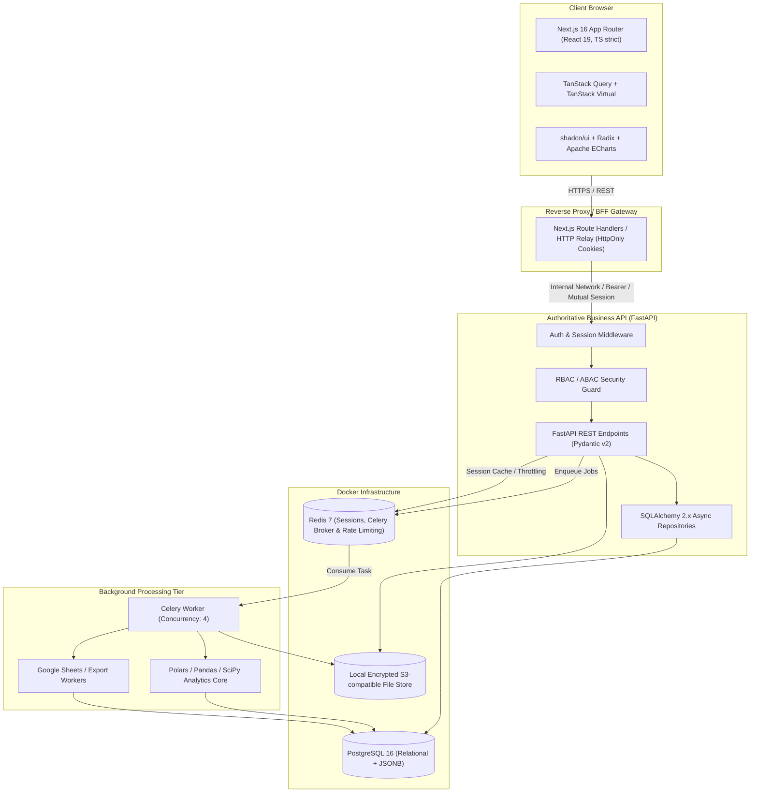
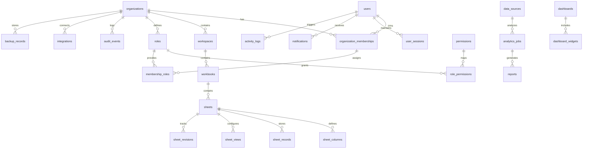

# REVISED MASTER ARCHITECTURE & TECHNICAL ASSESSMENT
## Enterprise Admin Dashboard & Data Intelligence Platform

**Date:** November 1, 2026  
**Status:** Awaiting Explicit Approval (Phase 0)  
**Author:** Principal Software Architecture & Engineering Organization  

---

## 1. Docker & Development Environment Verification Report

Following the mandatory live verification commands on Windows (WSL2), here are the verified system findings:

| Component | Verified Version / Status | Diagnostics & Notes |
| :--- | :--- | :--- |
| **Operating System** | Windows 11 Enterprise / x64 | 12 logical CPU cores, 16 GB Total RAM, 243 GB free on `D:` drive |
| **Docker Desktop** | `v4.97.0` (Build 244584) | **Running & Healthy** |
| **Docker Engine** | `v29.9.2` (API `1.56`) | Context: `desktop-linux`, Storage Driver: `overlayfs` |
| **Docker Compose** | `v5.6.1` | Native Compose v2/v5 CLI available |
| **WSL2 Subsystem** | Linux Kernel `6.18.54.1-microsoft-standard-WSL2` | Active and fully operational |
| **Docker Resource Cap** | 7.596 GiB RAM allocated to VM | Resource-conscious compose services required to prevent host thrashing |
| **Container Execution** | `hello-world:latest` verified | Successfully pulled and executed container from Docker Hub |
| **Node.js / npm** | Node `v26.13.0` / npm `11.20.0` | Ready for Next.js App Router |
| **Python** | Python `3.14.7` (tags/v3.14.7:823f032) | Verified pre-installed packages: FastAPI 0.141.1, Pydantic 2.13.5, NumPy 2.5.3, Pandas 3.0.5, SciPy 1.18.1, scikit-learn 1.9.1, Matplotlib 3.11.2, Argon2-cffi, Cryptography 50.0.1 |

> [!IMPORTANT]
> **Docker is fully validated and functional.** The previous SQLite-first strategy is completely retired. The project will run with PostgreSQL 16/17 and Redis 7 on Docker Compose starting from Phase 1.

---

## 2. Revised System Architecture

### 2.1 Core Architectural Topology & Service Boundaries

We adhere strictly to the principle of a **single authoritative backend**:
1. **Frontend (Next.js 16 App Router):** Strictly client rendering, server-rendered layouts, UI component orchestration, TanStack Query client caching, and same-origin cookie relay. **Zero direct database connections and zero business logic.**
2. **Authoritative Backend (FastAPI):** Owns all database transactions (SQLAlchemy 2.x Async), session verification, RBAC/ABAC authorization, schema validations (Pydantic v2), spreadsheet CRUD, audit logging, and file metadata.
3. **Asynchronous Worker (Celery + Redis):** Runs background analytics, Polars/Pandas transformations, large spreadsheet import/export, Google Sheets sync, and database backup pipelines.
4. **Data Persistence (PostgreSQL 16+ & Redis 7):** Containerized via Docker Compose with dedicated named persistent volumes and health checks.



---

## 3. Spreadsheet Engine Evaluation & Decision Matrix

A critical component of this platform is the spreadsheet interface. We conducted an in-depth evaluation comparing **TanStack Table**, **AG Grid**, and **Handsontable**:

| Dimension | AG Grid (Community / Enterprise) | Handsontable (Commercial / Evaluation) | TanStack Table v9 + TanStack Virtual (Selected) |
| :--- | :--- | :--- | :--- |
| **Licensing** | Community is MIT; Enterprise is commercial (~$999/dev/yr). | **Proprietary commercial license** since v7.0.0. Free evaluation only for non-commercial research. Dual-licensed HyperFormula (GPLv3). | **100% Permissive MIT License**. Zero licensing friction, zero royalty, completely safe for enterprise SaaS. |
| **Design System Integration** | Custom DOM themes (`ag-theme-alpine/quartz`). Overriding styles to match shadcn/ui or custom Tailwind tokens requires complex CSS fighting. | Rigid DOM structure, difficult to theme cleanly with Tailwind CSS and Radix UI dialogs/popovers. | **Headless UI Architecture**. 100% markup and styling control. Seamlessly binds to shadcn/ui, Tailwind CSS tokens, and custom Radix primitives. |
| **Virtualization Performance** | Built-in DOM row/column windowing (extremely fast). | Built-in row/column virtualization (heavy DOM overhead). | Composable with **TanStack Virtual**. Virtualizes both rows and columns effortlessly for 50,000+ cells. |
| **Cell Editing & UX** | Built-in editors in Enterprise; Community has basic inputs. | Built-in Excel-like grid, copy/paste matrix, fill handle. | Custom cell renderer architecture. Full control over custom cell widgets (date pickers, badges, multi-select, currency inputs). |
| **Formula Engine** | Basic cell expressions in Community; advanced in Enterprise. | Relies on HyperFormula (GPLv3 license trap). | Integration with an isolated, secure formula evaluator (`hyperformula` alternative or custom fast AST parser for `SUM`, `AVERAGE`, `COUNT`, `IF`, `MIN`, `MAX`, math operators). |
| **Bundle Footprint** | Large (> 300KB minified). | Very Heavy (> 500KB minified). | **Lightweight (< 40KB)**, modular, zero unnecessary dependencies. |

### Technical Decision: TanStack Table v9 + TanStack Virtual + Custom Sheet Architecture
* **Rationale:** Handsontable is disqualified due to strict commercial licensing and GPLv3 HyperFormula risks. AG Grid Enterprise incurs steep per-developer licensing fees and clashes with our bespoke shadcn/ui design system.
* **Our Implementation:** We build a modular, high-performance spreadsheet engine powered by **TanStack Table v9**, windowed with **TanStack Virtual**, styled with **Tailwind CSS/shadcn**, backed by a custom typed column renderer, clipboard matrix parser, keyboard navigation manager (Arrow keys, Tab, Enter, F2), and formula calculation DAG.

---

## 4. Docker Compose Infrastructure Configuration

To respect the 16 GB host memory limit (7.6 GB allocated to Docker), our development compose configuration is resource-capped, isolated, and strictly partitioned:

```yaml
version: '3.8'

services:
  postgres:
    image: postgres:16-alpine
    container_name: vibe_postgres
    restart: unless-stopped
    environment:
      POSTGRES_DB: ${POSTGRES_DB:-vibe_enterprise}
      POSTGRES_USER: ${POSTGRES_USER:-vibe_admin}
      POSTGRES_PASSWORD: ${POSTGRES_PASSWORD:-secure_dev_password_change_in_prod}
    ports:
      - "127.0.0.1:5432:5432"
    volumes:
      - postgres_data:/var/lib/postgresql/data
      - ./scripts/init-db.sql:/docker-entrypoint-initdb.d/init.sql
    healthcheck:
      test: ["CMD-SHELL", "pg_isready -U ${POSTGRES_USER:-vibe_admin} -d ${POSTGRES_DB:-vibe_enterprise}"]
      interval: 5s
      timeout: 5s
      retries: 5
    deploy:
      resources:
        limits:
          memory: 1536M
        reservations:
          memory: 512M

  redis:
    image: redis:7-alpine
    container_name: vibe_redis
    restart: unless-stopped
    command: redis-server --appendonly yes --requirepass ${REDIS_PASSWORD:-secure_redis_pass}
    ports:
      - "127.0.0.1:6379:6379"
    volumes:
      - redis_data:/data
    healthcheck:
      test: ["CMD", "redis-cli", "-a", "${REDIS_PASSWORD:-secure_redis_pass}", "ping"]
      interval: 5s
      timeout: 5s
      retries: 5
    deploy:
      resources:
        limits:
          memory: 512M
        reservations:
          memory: 128M

volumes:
  postgres_data:
    name: vibe_postgres_data
  redis_data:
    name: vibe_redis_data
```

---

## 5. Revised Database Architecture & Schema Design

PostgreSQL 16 serves as our single source of truth. We reject pure-JSONB dumping in favor of a **hybrid typed-column + indexed JSONB record layout**:
- Dynamic column schemas are strictly declared in `sheet_columns` (type, formatting, formulas, validation rules).
- Cell contents are stored in `sheet_records` with a row-level JSONB `data` payload mapped by Column ID (`{"col_uuid": 42.5}`).
- PostgreSQL GIN indexes (`jsonb_path_ops`) are applied for lightning-fast row filtering, while column metadata remains normalized.



### Key Relational Entities:
1. **Multi-Tenancy & Identity:** `organizations`, `users`, `organization_memberships`, `user_sessions`, `roles`, `permissions`, `role_permissions`, `membership_roles`.
2. **Spreadsheet Workspace:** `workspaces`, `workbooks`, `sheets`, `sheet_columns`, `sheet_records`, `sheet_views`, `sheet_revisions`.
3. **Analytics & BI:** `data_sources`, `analytics_jobs`, `dashboards`, `dashboard_widgets`, `reports`.
4. **Integrations & Security:** `integrations`, `oauth_credentials` (AES-256-GCM encrypted), `files`, `file_versions`, `audit_events` (immutable, tamper-evident).
5. **Operations:** `backup_records`, `background_jobs`, `notifications`.

---

## 6. Authentication, Security & Backup Architecture

### 6.1 Authentication & Session Management
- **Password Security:** Argon2id via `argon2-cffi` (memory cost: 65536 KB, iterations: 3, parallelism: 4).
- **Session Architecture:** Server-managed opaque 256-bit cryptographically secure tokens. The SHA-256 digest of the token is stored in PostgreSQL and cached in Redis for $O(1)$ lookups. The raw token is issued to the browser exclusively in an `HttpOnly`, `Secure`, `SameSite=Lax` cookie.
- **Python 3.14 Token Handling:** Switched from deprecated `python-jose` to **`PyJWT[crypto] 2.15.1`** for RFC-compliant JWT and secure token operations.
- **Multi-Factor Authentication:** TOTP (RFC 6238) with encrypted secret keys and one-time recovery codes.

### 6.2 Application Security & Hardened CSP
- **CSP Headers:** No wildcards. Strict directives:
  `default-src 'self'; script-src 'self'; style-src 'self' 'unsafe-inline'; img-src 'self' data: blob:; connect-src 'self'; frame-ancestors 'none'; form-action 'self';`
- **Credential Encryption at Rest:** Integration OAuth tokens and MFA secrets encrypted using `AES-256-GCM` with a distinct `ENCRYPTION_MASTER_KEY`.
- **RBAC & ABAC:** Every FastAPI endpoint validates organization boundaries (`tenant_id`), role permissions, and object-level ownership before returning data.

### 6.3 Backup and Disaster Recovery (PostgreSQL)
- **Logical Backup:** Automated `pg_dump` compressed with `zstd` and encrypted with `AES-256-GCM`.
- **Integrity Validation:** Automated SHA-256 checksum verification and weekly isolated test restoration checks.
- **RPO Target:** 1 hour in production (24 hours in dev).
- **RTO Target:** Under 30 minutes for complete service restoration.

---

## 7. Revised 13-Phase Implementation Plan

```mermaid
gantt
    title Enterprise Platform Phased Execution Roadmap
    dateFormat  X
    axisFormat  P%d

    section Foundation
    Phase 0 - Environment & Architecture Approval :active, 0, 1
    Phase 1 - Docker Infrastructure & App Skeleton  :1, 2
    Phase 2 - Design System & UI Shell             :2, 3

    section Core Backend & Security
    Phase 3 - FastAPI Backend & DB Schema          :3, 4
    Phase 4 - Auth, Sessions & RBAC                :4, 5
    Phase 5 - Enterprise Admin Management          :5, 6

    section Data Engine & Intelligence
    Phase 6 - High-Performance Spreadsheet Engine  :6, 8
    Phase 7 - Google Sheets Integration            :8, 9
    Phase 8 - Python Analytics & Polars Engine     :9, 10
    Phase 9 - Visualizations & Custom Reports      :10, 11

    section Operations & Production
    Phase 10 - Automated Backup & Disaster Recovery:11, 12
    Phase 11 - Performance Hardening & Security Audit:12, 13
    Phase 12 - Final Verification & Manual E2E Check:13, 14
```



### Detailed Phase Breakdown

* **Phase 0 — Environment & Architecture Approval (Completed):**
  Docker validated, Python 3.14 compatibility resolved (`PyJWT`), spreadsheet library matrix concluded, architecture documentation submitted.
* **Phase 1 — Infrastructure & Project Foundation:**
  `docker-compose.yml` for Postgres 16 & Redis 7. Next.js 16 app scaffold with TypeScript strict mode, Tailwind CSS, shadcn/ui. FastAPI service scaffold with SQLAlchemy 2 async engine, Alembic, Pydantic v2. Initial health check routes and automated unit tests.
* **Phase 2 — UI/UX Foundation & Design System:**
  Linear/Notion-inspired design system with CSS custom properties (light & dark mode), animated collapsible sidebar, top navigation bar, global breadcrumbs, Command Palette (`cmdk`), modals, drawers, toasts (`sonner`), and accessibility testing.
* **Phase 3 — Authoritative Backend & Database Migration:**
  Comprehensive SQLAlchemy 2 models for all 24 entities. Alembic migration generation. Seed script for enterprise demo fixtures. Asynchronous repository and unit-of-work patterns.
* **Phase 4 — Authentication, Session Engine & RBAC:**
  Argon2id hashing, secure session issuance, CSRF protection, rate limiting with Redis, RBAC permission checker, organization isolation middleware. Security tests with pytest and HTTPX.
* **Phase 5 — Enterprise Administration Modules:**
  User administration, organization switching, role & permission management, team invitations, immutable audit event inspector, and user notifications.
* **Phase 6 — High-Performance Spreadsheet Engine (Core Feature):**
  TanStack Table v9 + TanStack Virtual grid. Typed column system (Text, Number, Date, Boolean, Dropdown, Currency). Matrix copy/paste, inline editing, keyboard navigation, undo/redo stack, sorting, multi-column filtering, formula evaluator, CSV/XLSX import/export.
* **Phase 7 — Google Sheets Integration:**
  OAuth 2.0 flow with incremental scopes (`drive.file`), encrypted credential vault, two-way field mapping, synchronization worker, and conflict resolution.
* **Phase 8 — Python Analytics & Polars Processing Engine:**
  FastAPI worker integration with Polars and Pandas. Data cleaning, duplicate filtering, descriptive statistics, correlation matrices, time-series analysis, and aggregation queries.
* **Phase 9 — Business Intelligence, Visualizations & Reporting:**
  Apache ECharts interactive visualizations (Bar, Line, Area, Donut, Heatmap, Scatter, Funnel). KPI metric cards, drag-and-drop dashboard canvas, exportable PDF/Excel executive reports.
* **Phase 10 — Automated Backup & Disaster Recovery:**
  PostgreSQL backup worker with AES-256-GCM encryption, checksum computation, retention policy cleanup, and automated restoration verification tests.
* **Phase 11 — Security Hardening, Performance & WCAG Audit:**
  Load testing, query indexing tuning (`EXPLAIN ANALYZE`), OWASP dependency review, Lighthouse audit (target 90+ perf, 95+ a11y), CSP header verification.
* **Phase 12 — Production Readiness, Playwright E2E & Manual Chrome Verification:**
  Full Playwright test automation covering all 14 core user workflows. Comprehensive manual testing in Google Chrome across all features. Deployment runbook and final acceptance report.

---

## 8. Technical Decisions & Risk Management

| Identified Risk | Impact | Mitigating Architectural Strategy |
| :--- | :--- | :--- |
| **Python 3.14 package deprecation** | Medium | Replaced `python-jose` with `PyJWT[crypto]`. Verified that `celery[redis]` installs cleanly with `kombu 5.6` and `redis-py 6.4.0`. |
| **Memory pressure on 16 GB host** | High | Hard memory limits set in Docker Compose: Postgres max 1.5 GB, Redis max 512 MB. Retains > 13 GB for host OS, Next.js, and FastAPI. |
| **Spreadsheet rendering bottlenecks** | High | Row and column DOM virtualization with TanStack Virtual. Rendering limited to visible viewport; state debounced during inline cell editing. |
| **Google OAuth credentials availability** | Low | Modular mock adapter pattern enables 100% testable import/export workflows locally; live Google OAuth seamlessly unlocks upon adding client secrets. |
| **Untrusted analytics execution** | Critical | Analytics engine executes only declarative transformations via Polars/Pandas expressions. No `eval()` or arbitrary uploaded Python script execution. |

---

## 9. Deliverables Ready for Inspection

The full architecture documentation files are ready to be populated in `docs/`:
1. `docs/architecture/ARCHITECTURE.md`
2. `docs/planning/IMPLEMENTATION_PLAN.md`
3. `docs/architecture/DATABASE_DESIGN.md`
4. `docs/security/SECURITY_PLAN.md`
5. `docs/operations/BACKUP_AND_RECOVERY.md`
6. `docs/operations/TESTING_STRATEGY.md`
7. `docs/operations/DOCKER_SETUP.md`
8. `docs/operations/TECH_STACK_AND_COMPATIBILITY.md`
9. `docs/architecture/SPREADSHEET_ENGINE_DESIGN.md`
10. `docs/operations/DECISIONS_AND_RISKS.md`

---

## Awaiting Your Decision

We have verified Docker, resolved Python 3.14 compatibility, established a clear backend-first service boundary, and designed the full architecture.

**Please reply with your approval to proceed to Phase 1 (Infrastructure & Project Foundation) or advise if any adjustment is desired.**
