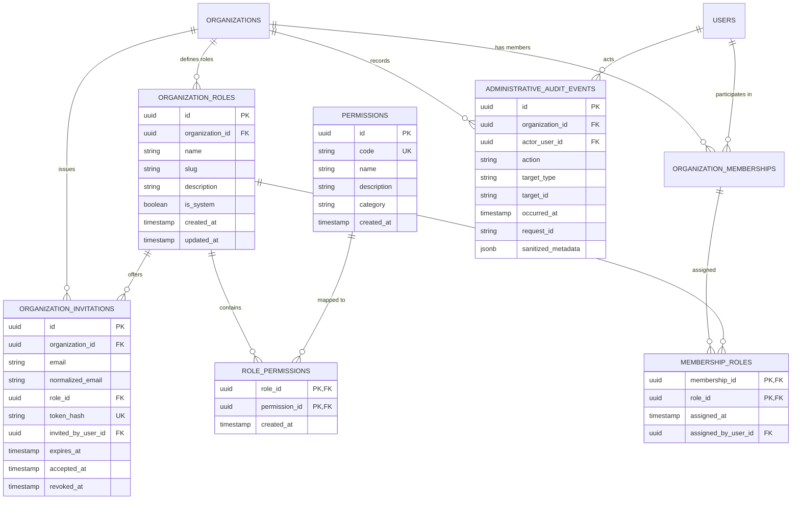

# Role-Based Access Control (RBAC) & Organization Administration

## 1. Architecture Overview

The VIBE platform enforces an organization-scoped, multi-tenant Role-Based Access Control (RBAC) architecture. Permissions evaluate **authoritatively against PostgreSQL** via optimized relational joins, ensuring that permission modifications, role revocations, and membership updates take effect immediately across all active user sessions without stale caching anomalies or race conditions.



---

## 2. System Permissions Catalogue & Role Matrix

The platform establishes 16 standardized permissions across 6 functional categories. Permissions are fixed system constants seeded via database migrations.

### System Permissions

| Permission Code | Category | Name | Description |
| :--- | :--- | :--- | :--- |
| `organization.read` | Organization | View Organization | View organization profile, settings, and metadata |
| `organization.settings.update` | Organization | Update Organization Settings | Modify organization name, configuration, and brand |
| `members.read` | Members | View Members | View members, pending invitations, and assigned roles |
| `members.invite` | Members | Invite Members | Issue invitations to onboard new members |
| `members.roles.assign` | Members | Assign Member Roles | Assign and modify roles for organization members |
| `members.remove` | Members | Remove Members | Remove members from the organization |
| `roles.read` | Roles | View Roles | View organization roles and associated permissions |
| `roles.create` | Roles | Create Roles | Create custom organization roles |
| `roles.update` | Roles | Update Roles | Modify custom organization roles and their permissions |
| `roles.delete` | Roles | Delete Roles | Delete unassigned custom roles |
| `workspaces.read` | Workspaces | View Workspaces | View workspaces in the organization |
| `workspaces.create` | Workspaces | Create Workspaces | Create new workspaces in the organization |
| `workspaces.update` | Workspaces | Update Workspaces | Modify workspace settings and metadata |
| `workspaces.delete` | Workspaces | Delete Workspaces | Delete workspaces from the organization |
| `audit.read` | Audit | View Audit Logs | View append-only administrative audit events |
| `ownership.transfer` | Ownership | Transfer Ownership | Primary ownership transfer to another active member |
| `spreadsheets.read` | Spreadsheets | View Spreadsheets | View workbooks, sheets, columns, and cell values |
| `spreadsheets.create` | Spreadsheets | Create Spreadsheets | Create workbooks and add new sheets |
| `spreadsheets.update` | Spreadsheets | Update Spreadsheets | Edit cell values, formulas, and sheet structures |
| `spreadsheets.delete` | Spreadsheets | Delete Spreadsheets | Delete sheets and workbooks |
| `analytics.read` | Analytics | View Analytics | Inspect analytical operation catalogue and job results |
| `analytics.create` | Analytics | Create Analytics Jobs | Schedule analytical processing jobs against datasets |
| `analytics.cancel` | Analytics | Cancel Analytics Jobs | Request cooperative cancellation of pending/running jobs |
| `analytics.export` | Analytics | Export & Publish Analytics | Export Parquet artifacts and publish results to sheets |

### Default System Role Matrix

When an organization is provisioned, 4 immutable system roles (`is_system = true`) are seeded:

| Permission Code | Owner (`owner`) | Admin (`admin`) | Member (`member`) | Viewer (`viewer`) |
| :--- | :---: | :---: | :---: | :---: |
| `organization.read` | **Yes** | **Yes** | **Yes** | **Yes** |
| `organization.settings.update` | **Yes** | **Yes** | No | No |
| `members.read` | **Yes** | **Yes** | **Yes** | **Yes** |
| `members.invite` | **Yes** | **Yes** | No | No |
| `members.roles.assign` | **Yes** | **Yes** | No | No |
| `members.remove` | **Yes** | **Yes** | No | No |
| `roles.read` | **Yes** | **Yes** | **Yes** | **Yes** |
| `roles.create` | **Yes** | **Yes** | No | No |
| `roles.update` | **Yes** | **Yes** | No | No |
| `roles.delete` | **Yes** | **Yes** | No | No |
| `workspaces.read` | **Yes** | **Yes** | **Yes** | **Yes** |
| `workspaces.create` | **Yes** | **Yes** | **Yes** | No |
| `workspaces.update` | **Yes** | **Yes** | **Yes** | No |
| `workspaces.delete` | **Yes** | **Yes** | No | No |
| `audit.read` | **Yes** | **Yes** | No | No |
| `ownership.transfer` | **Yes** | No | No | No |
| `spreadsheets.read` | **Yes** | **Yes** | **Yes** | **Yes** |
| `spreadsheets.create` | **Yes** | **Yes** | **Yes** | No |
| `spreadsheets.update` | **Yes** | **Yes** | **Yes** | No |
| `spreadsheets.delete` | **Yes** | **Yes** | No | No |
| `analytics.read` | **Yes** | **Yes** | **Yes** | **Yes** |
| `analytics.create` | **Yes** | **Yes** | **Yes** | No |
| `analytics.cancel` | **Yes** | **Yes** | **Yes** | No |
| `analytics.export` | **Yes** | **Yes** | **Yes** | No |

---

## 3. Authoritative Permission Evaluation

Permission resolution avoids N+1 database queries through a single, indexed SQL join across 5 tables:

```sql
SELECT DISTINCT permissions.code
FROM permissions
JOIN role_permissions ON role_permissions.permission_id = permissions.id
JOIN organization_roles ON organization_roles.id = role_permissions.role_id
JOIN membership_roles ON membership_roles.role_id = organization_roles.id
WHERE membership_roles.membership_id = :membership_id;
```

Effective permissions are verified authoritatively per request by dependency factories:
- `require_permission(permission_code)`
- `require_any_permission(*permission_codes)`
- `require_all_permissions(*permission_codes)`

---

## 4. Anti-Privilege Escalation & Delegation Controls

The authorization service enforces strict boundaries against vertical and horizontal privilege escalation:

1. **Delegation Authority Constraint:** An administrator cannot create or edit a custom role with permissions they do not possess.
2. **Assignment Authority Constraint:** An administrator cannot assign a role granting permissions that exceed their own effective permissions. Specifically, an Admin cannot assign the `owner` role.
3. **Self-Escalation Prohibition:** A user cannot update their own membership roles to grant themselves extra permissions.
4. **System Role Immutability:** System roles (`owner`, `admin`, `member`, `viewer`) cannot be renamed, deleted, or stripped of permissions.
5. **Reassignment Dependency:** A custom role cannot be deleted if any organization member is currently assigned to it.

---

## 5. Last-Owner Protection & Concurrency Guarantees

Organizations must retain at least one active Owner at all times. The platform guarantees this through PostgreSQL row-level locks:

```python
owners = await session.execute(
    select(OrganizationMembership)
    .join(MembershipRole, MembershipRole.membership_id == OrganizationMembership.id)
    .join(OrganizationRole, OrganizationRole.id == MembershipRole.role_id)
    .where(
        OrganizationMembership.organization_id == organization_id,
        OrganizationRole.slug == "owner",
        OrganizationRole.is_system.is_(True),
    )
    .with_for_update()
)
```

- When demoting or removing an Owner, `get_owner_memberships(organization_id, for_update=True)` locks all owner records.
- If two owners attempt concurrent demotions or removals, PostgreSQL serializes the transactions; the second transaction evaluates the updated count (`len(owners) <= 1`) and aborts with a 400 Bad Request error.

---

## 6. Organization Ownership Transfer Protocol

Primary organization ownership transfer is an explicit, irreversible atomic operation:

1. **Permission Check:** Initiator must possess `ownership.transfer`.
2. **Confirmation Safeguard:** Payload must include the confirmation phrase `"TRANSFER"` in exact match.
3. **Target Validation:** Target must be an active member of the same organization; self-transfer is rejected.
4. **Atomic Swap:** In a single database transaction with row locks:
   - Previous Owner is assigned the system `admin` role.
   - Target Member is assigned the system `owner` role.
   - An immutable audit event (`organization.ownership_transferred`) is recorded.

---

## 7. Organization Invitation Lifecycle

Invitations support secure, email-driven member onboarding without revealing sensitive organization data:

- **Token Generation:** 32-byte cryptographically secure random token generated via `secrets.token_urlsafe(32)`.
- **Database Storage:** Only the SHA-256 hash (`token_hash`) is stored; the plaintext token is transmitted exclusively in the invitation link.
- **Expiration & Revocation:** Configured lifetime (7 days); expired or revoked invitations are immediately rejected.
- **Atomic Single-Use Consumption:**
  ```sql
  UPDATE organization_invitations
  SET accepted_at = :now
  WHERE id = :invitation_id AND accepted_at IS NULL AND revoked_at IS NULL AND expires_at > :now
  RETURNING id;
  ```
  Prevents duplicate memberships and race conditions on simultaneous acceptances.
- **Cross-Identity Defense:** Acceptance verifies that the authenticated user's normalized email matches the invited email.

---

## 8. Append-Only Administrative Audit Ledger

All state-changing administrative operations write to `administrative_audit_events`.
- **Audit Actions:** `role.created`, `role.updated`, `role.deleted`, `member.roles_updated`, `member.removed`, `invitation.created`, `invitation.revoked`, `invitation.accepted`, `organization.ownership_transferred`.
- **Sanitized Metadata:** Recursively strips sensitive fields (`password`, `token`, `secret`, `hash`) before persistence.
- **Tenant Isolation:** Enforced via `organization_id` indexing; an organization cannot view audit events of other tenants.

---

## 9. Spreadsheet Subsystem Permissions (Phase 6)

Spreadsheet operations are governed by 4 granular permission codes seeded into the permissions catalog:

| Permission Code | Description | Owner | Admin | Member | Viewer |
|---|---|:---:|:---:|:---:|:---:|
| `spreadsheets.read` | View workbooks, sheets, ranges, and cell values | ✅ | ✅ | ✅ | ✅ |
| `spreadsheets.create` | Create new workbooks and sheets | ✅ | ✅ | ✅ | ❌ |
| `spreadsheets.update` | Mutate cell values, formulas, and execute undo/redo | ✅ | ✅ | ✅ | ❌ |
| `spreadsheets.delete` | Delete workbooks and sheets | ✅ | ✅ | ❌ | ❌ |


